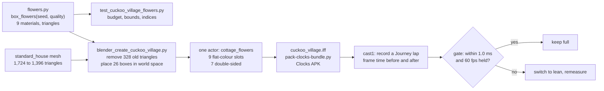
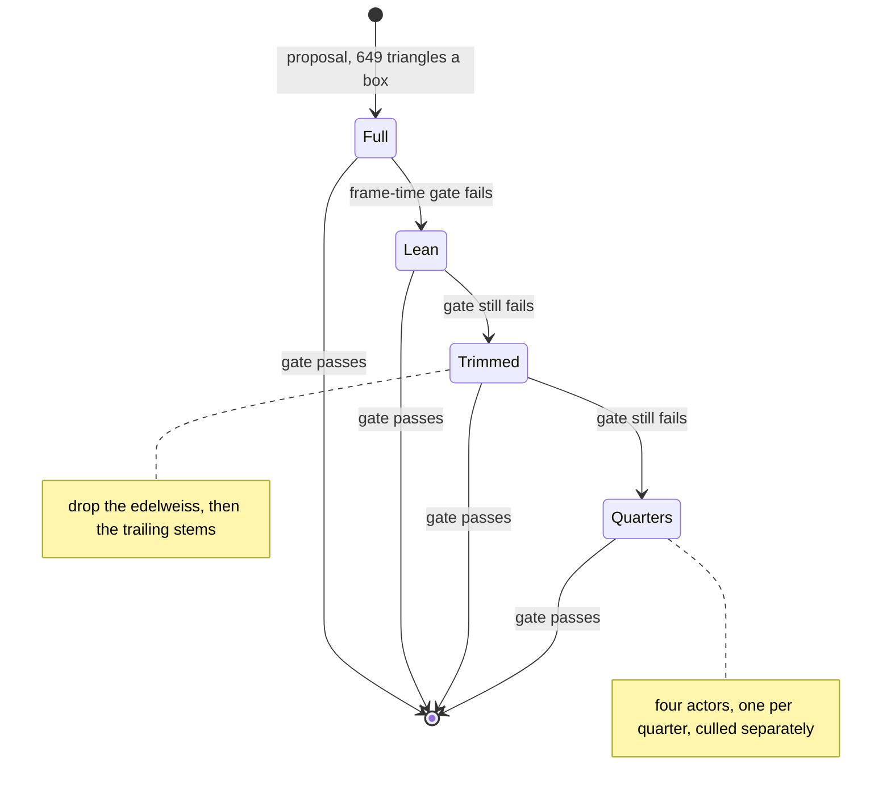
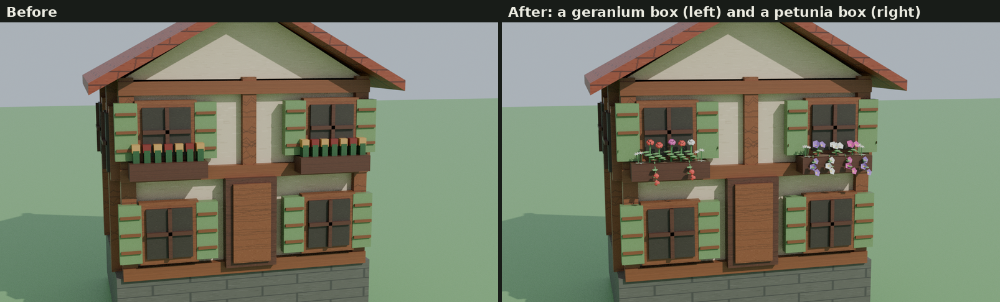

# Cuckoo Village window boxes: trailing petunias and edelweiss

**Status:** proposal for review, 2026‑11‑22. Nothing is in the level yet: the geometry and the renders below are a prototype, and the level build is untouched.

## Context

The cottage window boxes in the Cuckoo Village are two rows of blocks: each box carries seven green posts topped with seven coloured cubes (14 cubes, about 164 triangles), textured from the shared atlas. Close up they read as bricks, not flowers (compare the first picture below). There are 26 boxes: two on the front of each of the 13 cottages.

Will asked for them to be modelled with more polygons, in flat coloured materials instead of textured ones, with a plan showing before and after renderings, budgets, materials and render time. The flower was chosen in discussion (Will, 2026‑11‑22: "i don't like geraniums", then "Petunias and Edelweiss"). The ones I considered and set aside: geraniums (rejected), pansies, marigolds and lavender.

Measured today with [`flowers_prototype.py`](../../wflevels/cuckoo_village_assets/flowers_prototype.py): the cottage mesh `standard_house` is 1,724 triangles, of which 328 are the plants of its two window boxes. The whole village layout is 67,364 triangles, and the Christmas candles add about 3,600, so the level is about 71,000 today.

## Approach

**Geometry.** [`flowers.py`](../../wflevels/cuckoo_village_assets/flowers.py) builds one box of flowers as plain triangles per material, in code, so it is unit-tested without Blender ([`test_cuckoo_village_flowers.py`](../../tests/test_cuckoo_village_flowers.py), 8 tests passing). Each box holds:

- a **soil bed**, a four-triangle mound just above the box top;
- **3 mounded petunias** along the middle, each with three round leaves and three blooms;
- **4 trailing petunia stems** that arch over the front rim and hang down the front of the box, each with two leaves and three blooms. These give the street camera a hanging mass of colour;
- **2 edelweiss tufts** nearer the ends, each with narrow silver leaves and two stems ending in a star.

A **petunia bloom** is a funnel: ten petal triangles round a recessed rim of five lobes, plus five triangles of yellow throat (15 triangles). An **edelweiss head** is a flat star of seven pointed felty bracts (14 triangles) round a five-triangle yellow heart (19 triangles). Colours rotate per box from magenta, violet and white, so no two neighbouring boxes match. Everything is seeded by the box number, so a rebuild gives the same flowers.

**Build.** In `blender_create_cuckoo_village.py`, after the candles:

1. Remove the old plant faces from the one shared `standard_house` mesh (the 13 cottages share it, so this is one edit), and assert that exactly 328 triangles went, so a change to the cottage art cannot silently leave a stump.
2. For each of the 26 boxes, take its world position, heading and scale from the cottage actor, and place the box's flowers with `placed()`.
3. Join all 26 into **one static actor, `cottage_flowers`**, with nine flat-coloured material slots. The materials have a Base Color and no texture, which the exporter already writes as a flat colour; the seven thin petal and leaf materials carry `wf_double_sided`, which the engine honours by skipping back-face culling for them.

**Why one actor.** One baked actor costs 9 draw calls for all 26 boxes. One actor per cottage would cost 13 × 9 = 117. Triangles are cheap on this GPU and draw calls are not, so I chose the single actor, which gives up per-cottage culling. If the measurement below says that was the wrong call, the fallback is four actors by quarter of the village (36 draw calls).

**Fallback set.** `QUALITY["lean"]` is the same flowers with fewer parts (332 triangles a box instead of 649: 2 mounds of 3 blooms, 2 vines of 2 blooms, 2 tufts of 1 head). It is a switch in code, not a setting. It is used only if the frame-time gate fails (see Budgets).

No setting: the flowers are always there. Seasonal planting is listed under Out of scope.

### Build flow

### Quality modes

## Budgets

Counted from the code, not estimated (a test enforces the full set at 700 triangles a box and 18,200 in all).

| | Today | Full (proposal) | Lean (fallback) |
|---|---|---|---|
| Triangles in one box | about 164 (14 cubes) | 649 | 332 |
| Triangles in all 26 boxes | 4,264 | 16,874 | 8,632 |
| Cottage mesh (shared by 13) | 1,724 | 1,396 | 1,396 |
| Whole level, about | 70,964 | 83,574 (+17.8 %) | 75,332 (+6.2 %) |
| Draw calls added | 0 (shares the house's) | 9 | 9 |
| Actors added | 0 | 1 | 1 |
| Level file, estimated | 4.98 MB | about 5.45 MB (+0.46 MB) | about 5.2 MB (+0.23 MB) |

The file estimate uses the cost the candles measured: 27.9 bytes a triangle (4,882,432 to 4,982,784 bytes for about 3,600 triangles and 13 actors). It is an estimate until the level is built. The Clocks bundle (8.56 MB) grows by the same amount.

**The frame-time gate.** None of the numbers above is a frame time. The acceptance is a measurement on cast1: record one Journey camera lap with the pre-change build and one with the flowers, and compare the median frame time and the achieved frame rate. The flowers pass if the median is within 1.0 ms of the pre-change build and 60 fps is held. Otherwise step down the ladder in the state diagram above. I have not measured on a device yet.

## Materials

All nine are flat colours (Base Color only, no texture). "Per piece" is the triangles in one petal set, leaf or stem, averaged where pieces vary; "Pieces per box" is how many of those a box holds, averaged over the 26 boxes where the colours rotate; "Total" is the whole village (26 boxes, full set).

| Material | Colour | Used for | Double-sided | Per piece | Pieces per box | Total |
|---|---|---|---|---|---|---|
| `petunia_magenta` | #CC1775 | Petunia petals | yes | 10 per bloom | 7.0 blooms | 1,830 |
| `petunia_violet` | #6E30B2 | Petunia petals | yes | 10 per bloom | 7.0 blooms | 1,830 |
| `petunia_white` | #F5F2EB | Petunia petals | yes | 10 per bloom | 6.9 blooms | 1,800 |
| `flower_centre` | #F7CC29 | Petunia throats and the edelweiss heart | yes | 5 per bloom or head | 25 (21 throats, 4 hearts) | 3,250 |
| `edelweiss_felt` | #DBDBC9 | Edelweiss bracts | yes | 14 per head | 4 heads | 1,456 |
| `leaf_green` | #2B6E24 | Petunia leaves | yes | 6 per leaf | 17 leaves | 2,652 |
| `leaf_silver` | #809978 | Edelweiss leaves | yes | 4 per leaf | 6 leaves | 624 |
| `stem_green` | #174517 | Stems | no | 11.6 on average (8 for a mound or edelweiss stem, 18 for a trailing stem) | 11 stems | 3,328 |
| `soil` | #331F12 | The soil bed in each box | no | 4 per bed | 1 bed | 104 |

### What one flower costs

A flower is its petals plus its yellow centre; the plant it sits on adds leaves and a stem.

| Piece | Triangles | Made of |
|---|---|---|
| One petunia bloom | 15 | 10 petal + 5 throat |
| One edelweiss head | 19 | 14 bract + 5 heart |
| A mounded petunia plant | 71 | stem 8, three leaves 18, three blooms 45 |
| A trailing petunia stem | 75 | stem 18, two leaves 12, three blooms 45 |
| An edelweiss tuft | 66 | three silver leaves 12, two stems 16, two heads 38 |
| One whole box | 649 | 3 mounds 213, 4 trailing stems 300, 2 tufts 132, soil bed 4 |

The lean set uses the same pieces: 2 mounds of 3 blooms, 2 trailing stems of 2 blooms and 2 tufts of 1 head.

## Renders, before and after

Cycles on the CPU, 48 samples, denoised, 1280 × 720, in the Blender container, from [`flowers_prototype.py`](../../wflevels/cuckoo_village_assets/flowers_prototype.py). The "before" is the committed `village_assets.blend` cottage; the "after" removes the old plant faces and adds the new flowers, with the same camera and lights.

**Close-up** (1.5 m from the box): the first picture is the decision this plan asks you to make.

**The whole cottage front.**

**Street distance**, in native pixels (about what the TV shows from the tower camera). The flowers read as colour, not as petals, which is the reason for the hanging stems: the colour mass is what survives the distance.

**The lean fallback next to the full set.**

There is no live mockup page here: the surface is a rendered 3D scene, so the four stills are the mockups.

### Render time

| View | Before | After (full) | After (lean) |
|---|---|---|---|
| Close-up | 67.1 s | 56.8 s | 61.2 s |
| Cottage | 55.1 s | 51.6 s | not rendered |
| Street | 37.1 s | 39.3 s | 36.1 s |
| Total | 159.3 s | 147.7 s | not comparable |

Cycles time is set by the samples, the resolution and the lighting, not by 1,298 more triangles on a scene of 1,700, so the differences are run-to-run noise (the first close-up "before" took 58.3 s with an earlier camera). **This is not the on-device cost.** The on-device cost is the frame-time gate above.

## Out of scope

- **Seasonal planting.** Pansies in spring, petunias in summer, asters or heather in autumn, fir sprigs with red berries in December, chosen by the date as the candles are. It needs extra meshes and cells and a place in the settings; this plan only makes the summer boxes good.
- **The Bavaria-mode chalet's boxes.** The chalet shares this geometry (the cuckoo-village plan lists flower boxes among its extra meshes). Rebuilding them is a follow-up once the village boxes are accepted.
- **Wind or sway on the trailing stems.** The engine poses actors, not vertices, so a sway needs one actor per stem group and a director word; it is not in this change.
- **Flowers on the Tide Harbour and Aquarium levels.** Not part of this request.

## Verification

1. **The geometry tests pass.** `scripts/in-linux-container.sh python3 -m pytest tests/test_cuckoo_village_flowers.py -q` reports 8 passed. (Green today.)
2. **The prototype reproduces the renders and counts.** `WF_CONTAINER_IMAGE=blender scripts/in-linux-container.sh blender --background --python wflevels/cuckoo_village_assets/flowers_prototype.py -- /src/build-docker/flowers/render-full full` prints `MESH house tris before 1724 removed 328 after 1396` and `MESH flowers tris 1298` (two boxes).
3. **The level builds with the flowers.** `bash wflevels/cuckoo_village/build.sh` in the Blender container reports 87 actors (86 today plus `cottage_flowers`) and the removed-triangle assertion holds (328).
4. **The exported materials are flat colours.** The level's material list for `cottage_flowers` has nine slots, none naming a texture, and seven with flag 8 set.
5. **The size is within the estimate.** `cuckoo_village-standalone.iff` is at most 0.6 MB larger than the 4,982,784 bytes it is today.
6. **The bundle and launcher tests still pass.** `tests/test_clocks_bundle.py`, `test_launcher_parity.py`, `test_audit_level_settings.py`, `test_cuckoo_village_forth.py`, `test_cuckoo_village_candles.py`.
7. **The flowers show on cast1.** Build the Clocks APK, install it, and run a `record` job over a Journey lap; a captured frame near a cottage shows petunias and edelweiss, and the candles and window lights still work.
8. **The frame-time gate.** Median frame time of one Journey lap with the flowers is within 1.0 ms of the pre-change build and 60 fps is held; the two measurements and the gate result are pasted here.

<!--
When the work lands, this section becomes the permanent record: keep each step as written and paste the raw output under it, then PASS or FAIL.
-->
