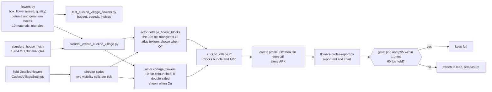
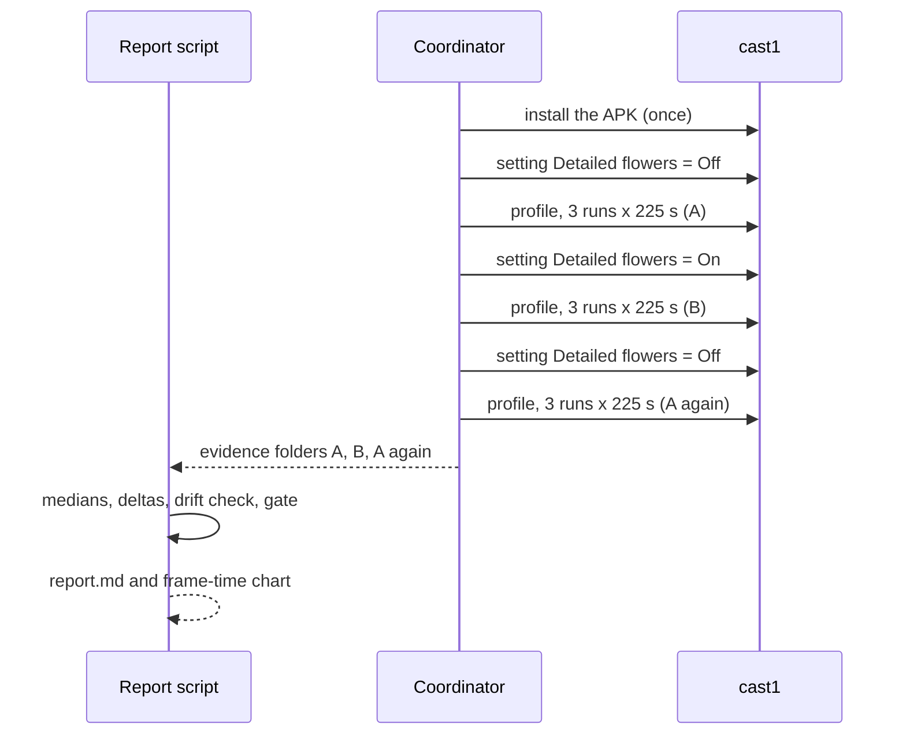
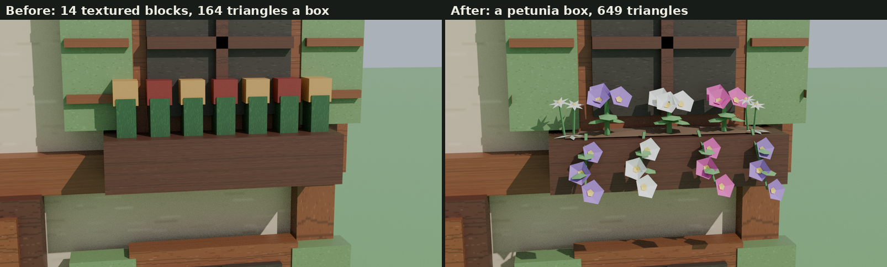
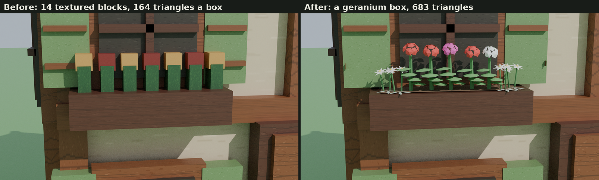
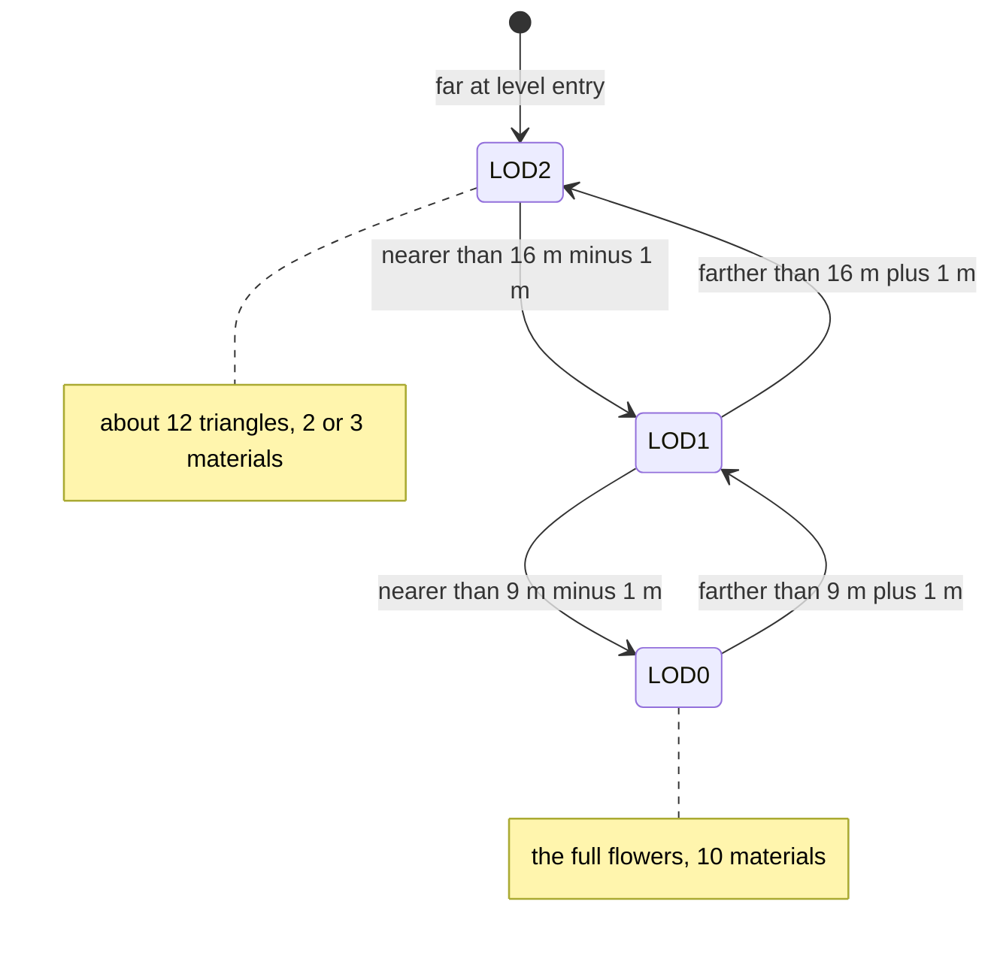

# Cuckoo Village window boxes: trailing petunias and edelweiss

**Status:** proposal for review, 2026‑11‑22. Nothing is in the level yet: the geometry and the renders below are a prototype, and the level build is untouched. Revised 2026‑11‑22: the flowers sit behind a settings toggle, so one APK can be profiled both ways, and a script writes the before-and-after report.

## Context

The cottage window boxes in the Cuckoo Village are two rows of blocks: each box carries seven green posts topped with seven coloured cubes (14 cubes, about 164 triangles), textured from the shared atlas. Close up they read as bricks, not flowers (compare the first picture below). There are 26 boxes: two on the front of each of the 13 cottages.

Will asked for them to be modelled with more polygons, in flat coloured materials instead of textured ones, with a plan showing before and after renderings, budgets, materials and render time. The flowers were chosen in discussion (Will, 2026‑11‑22: "i don't like geraniums", then "Petunias and Edelweiss", then "make 1/3 of the flowerboxes germaniums and edelweiss, so need a new model for germanium after all"). So two kinds of box alternate, two in three petunia and one in three geranium, and every box has edelweiss. Then, on the geranium boxes (Will, 2026‑11‑22): "i don't like the ivy geraniums; get rid of them" and "add more edelweiss in the geranium boxes instead". The ones I considered and set aside: pansies, marigolds and lavender.

Measured today with [`flowers_prototype.py`](../../wflevels/cuckoo_village_assets/flowers_prototype.py): the cottage mesh `standard_house` is 1,724 triangles, of which 328 are the plants of its two window boxes. The whole village layout is 67,364 triangles, and the Christmas candles add about 3,600, so the level is about 71,000 today.

## Approach

**Geometry.** [`flowers.py`](../../wflevels/cuckoo_village_assets/flowers.py) builds one box of flowers as plain triangles per material, in code, so it is unit-tested without Blender ([`test_cuckoo_village_flowers.py`](../../tests/test_cuckoo_village_flowers.py), 12 tests passing). **One box in three is a geranium box** (boxes 0, 3, 6 and so on: 9 of the 26), the other 17 are petunia boxes, and every box has a soil bed and edelweiss. A box holds:

- a **soil bed**, a four-triangle mound just above the box top;
- **edelweiss tufts**: 2 on a petunia box, 4 on a geranium box, each with narrow silver leaves and two stems ending in a star;
- on a **petunia box**, 3 mounded petunias along the middle (three round leaves and three blooms each) and 4 trailing petunia stems that arch over the front rim and hang down the front (two leaves and three blooms each). The hanging stems give the street camera a mass of colour that survives the distance;
- on a **geranium box**, 5 upright (zonal) geraniums along the middle and nothing hanging: a thick stem with four big round leaves spiralling up it, topped by a dense round **umbel**, seven small florets packed on a dome, so from a distance the head is one ball of colour, as a real zonal geranium's is. The four edelweiss tufts are spread across the whole width, one in each gap between the plants and a little forward of them, in place of the hanging stems (Will, 2026‑11‑22: "maybe edelweiss more distributed across the box?").

A **petunia bloom** is a funnel: ten petal triangles round a recessed rim of five lobes, plus five triangles of yellow throat (15 triangles). A **geranium floret** is five petals as a cupped pentagon (5 triangles); a head packs 7 of them on a dome (35 triangles). An **edelweiss head** is a flat star of seven pointed felty bracts (14 triangles) round a five-triangle yellow heart (19 triangles). Petunias rotate through magenta, violet and white; geraniums are mostly red, with pink and white ones among them. Everything is seeded by the box number, so a rebuild gives the same flowers.

**The setting.** A new field, **Detailed flowers** (Off / On, default On), is appended to `CuckooVillageSettings`, a live field like the other six: it shows in the hold-A form on the TV and in the phone's Dream form. On shows the petunias and edelweiss. Off shows today's blocks. It exists so that one APK can be measured both ways: the same build, the same device, the same camera lap, with only this field changed. Whether it stays as a permanent option or is retired once the flowers are accepted is a decision for Will (see Out of scope).

**Build.** In `blender_create_cuckoo_village.py`, after the candles:

1. Take the old plant faces out of the one shared `standard_house` mesh (the 13 cottages share it, so this is one edit), asserting that exactly 328 triangles went, and bake them into a second static actor, **`cottage_flower_blocks`**, one mesh for all 26 boxes, with the village atlas material they have today. With the setting Off the village looks exactly as it does now.
2. For each of the 26 boxes, take its world position, heading and scale from the cottage actor, and place the box's new flowers with `placed()`.
3. Join all 26 into **one static actor, `cottage_flowers`**, with ten flat-coloured material slots. The materials have a Base Color and no texture, which the exporter already writes as a flat colour; the eight thin petal and leaf materials carry `wf_double_sided`, which the engine honours by skipping back-face culling for them.
4. The director script (`forth.py`) reads the field with `property@`, like the six existing ones, and drives two visibility cells every tick: `cottage_flowers` shows when the field is 1 and `cottage_flower_blocks` when it is 0. A hidden actor draws no triangles.

**Why one actor of flowers.** One baked actor costs 10 draw calls for all 26 boxes. One actor per cottage would cost 13 × 10 = 130. Triangles are cheap on this GPU and draw calls are not, so I chose the single actor, which gives up per-cottage culling. If the profiling says that was the wrong call, the fallback is four actors by quarter of the village (40 draw calls).

**Fallback set.** `QUALITY["lean"]` is the same flowers with fewer parts (332 triangles on a petunia box instead of 649, 355 on a geranium box instead of 683: for example 2 mounds of 3 blooms, 2 vines of 2 blooms and 2 tufts of 1 head on a petunia box, and 3 plants of 5 florets and 4 tufts of 1 head on a geranium box, so a geranium box keeps all four of its edelweiss). It is a switch in code, not a setting. It is used only if the profiling gate fails (see Profiling).

Other files that change with the new field: `cuckoovillagesettings.oas` (+ the regenerated `.oad` and `.ht`), `timeline.py` (`SETTINGS_DEFAULTS` and the two cell numbers, 227 and 228, after the flame cells), the phone's capabilities asset (`scripts/gen-settings-capabilities.py` regenerates it from the `.oad`), and `test_cuckoo_village_settings.py` and `test_cuckoo_village_settings_effect.py` (seven fields instead of six).

### Build flow

### Quality modes

## Budgets

Counted from the code, not estimated (a test enforces the full set at 700 triangles a box and 18,200 in all).

| | Today | Full (proposal) | Lean (fallback) |
|---|---|---|---|
| Triangles in one box | about 164 (14 cubes) | 649 (petunia), 683 (geranium) | 332 (petunia), 355 (geranium) |
| Triangles in all 26 boxes (17 petunia, 9 geranium) | 4,264 | 17,180 | 8,839 |
| Cottage mesh (shared by 13) | 1,724 | 1,396 | 1,396 |
| Whole level, setting On, about | 70,964 | 83,880 (+18.2 %) | 75,539 (+6.4 %) |
| Whole level, setting Off | 70,964 | 70,964 (same blocks, as a separate actor) | 70,964 |
| Draw calls added, On | 0 (shares the house's) | 10 | 10 |
| Actors added | 0 | 2 (flowers and blocks) | 2 |
| Level file, estimated, with the setting | 4.98 MB | about 5.58 MB (+0.60 MB) | about 5.34 MB (+0.36 MB) |
| Level file, estimated, after the setting is retired | 4.98 MB | about 5.45 MB (+0.47 MB) | about 5.22 MB (+0.24 MB) |

The file estimate uses the cost the candles measured: 27.9 bytes a triangle (4,882,432 to 4,982,784 bytes for about 3,600 triangles and 13 actors). The setting keeps both versions in the file, which adds the 4,264 triangles of blocks (about 0.12 MB). It is an estimate until the level is built. The Clocks bundle (8.56 MB) grows by the same amount.

None of these numbers is a frame time; the profiling below is.

## Profiling before and after

The setting makes this a like-for-like measurement: **one APK, one device, only the field changes.**

**Method.** On cast1 (`chromecast-test-01`, the Chromecast HD that is the performance target), with the coordinator's `profile` workflow:

1. Install the one APK, and select the village.
2. Set **Detailed flowers** Off with the `screensaver-setting-set` workflow, and run `profile` with `warmup` 15 s, `runs` 3 and `duration` 225 s. The Journey camera's lap is 225 s, so every run covers one whole lap and the flowers are on screen at their nearest and furthest in each.
3. Set the field On and run the same `profile`.
4. Set it Off again and run the same `profile` a third time, so any drift (heat, background load) shows up as the difference between the two Off sets instead of being credited to the flowers.
5. Run `scripts/flowers-profile-report.py` on the three evidence folders.

Each run records, per the profile job: achieved frames per second, the median, 90th, 95th and 99th percentile frame time, the worst frame, the percentage of missed refreshes, the memory (`meminfo`), the thermal status, and the per-frame present times. About 36 minutes of cast1 in all (3 × 3 runs × 4 minutes).

**The gate.** The flowers pass if all of these hold: the median p50 and the median p95 frame time with the field On are each within **1.0 ms** of the median of the two Off sets; the frames per second with it On stay within 0.5 of the Off sets and at least 59 (the refresh is 59.94 Hz); the missed-refresh percentage rises by no more than 2 points; and the two Off sets agree with each other to within 0.5 ms, otherwise the run is thrown away as drifted. If it fails, step down the ladder in the quality diagram and measure again.

### The report

`scripts/flowers-profile-report.py` (to be written with the build, modelled on `summarise-plant-resolution-comparison.py`) reads the three evidence folders and writes `docs/diagnostics/cuckoo-village-flowers-<date>/report.md`, with a chart, so the difference after implementation is generated, not typed. It contains:

| Section | What it shows |
|---|---|
| Build facts | Triangles, actors and material slots in each state (read from the built level); the level file size now against the size at the commit before the change (`git show`); the APK checksum. |
| Frame times | A table of fps, p50, p95, p99, worst and missed refreshes: each run, the median of each set, and the On minus Off difference with the percentage. |
| Drift | The two Off sets side by side, and the thermal status of each run. |
| Memory | Total PSS (from `meminfo`) in each state. |
| Chart | A histogram of per-frame present times for Off and On over the same axis. |
| Pictures | A device capture in each state from the same camera moment, so the difference is visible next to the numbers. |
| Verdict | PASS or FAIL against the gate, with each condition and its measured value on its own line. |

The report is written once, after the build, from real evidence. It does not exist yet.

## Materials

All ten are flat colours (Base Color only, no texture). "Per piece" is the triangles in one petal set, leaf or stem, averaged where pieces vary; "Pieces per box" is how many of those a box holds, averaged over the 26 boxes (17 petunia, 9 geranium); "Total" is the whole village (26 boxes, full set).

| Material | Colour | Used for | Double-sided | Per piece | Pieces per box | Total |
|---|---|---|---|---|---|---|
| `bloom_red` | #C7120F | Geranium petals | yes | 5 per floret | 7.3 florets | 945 |
| `bloom_magenta` | #CC1775 | Petunia petals, and the pink geraniums | yes | 10 per petunia bloom, 5 per geranium floret | 3.9 blooms, 2.4 florets | 1,335 |
| `bloom_violet` | #6E30B2 | Petunia petals | yes | 10 per bloom | 5.0 blooms | 1,290 |
| `bloom_white` | #F5F2EB | Petunia petals, and the white geraniums | yes | 10 per petunia bloom, 5 per geranium floret | 4.8 blooms, 2.4 florets | 1,575 |
| `flower_centre` | #F7CC29 | Petunia throats and edelweiss hearts | yes | 5 per throat or heart | 19.1 | 2,485 |
| `edelweiss_felt` | #DBDBC9 | Edelweiss bracts | yes | 14 per head | 5.4 heads | 1,960 |
| `leaf_green` | #2B6E24 | Petunia and geranium leaves | yes | 6.8 on average (6 petunia, 8 geranium) | 18.0 leaves | 3,174 |
| `leaf_silver` | #809978 | Edelweiss leaves | yes | 4 per leaf | 8.1 leaves | 840 |
| `stem_green` | #174517 | Stems | no | 11.4 on average (8 for a mound or edelweiss stem, 16 for a geranium, 18 for a trailing petunia stem) | 11.7 stems | 3,472 |
| `soil` | #331F12 | The soil bed in each box | no | 4 per bed | 1 bed | 104 |

### What one flower costs

A flower is its petals plus its yellow centre; the plant it sits on adds leaves and a stem.

| Piece | Triangles | Made of |
|---|---|---|
| One petunia bloom | 15 | 10 petal + 5 throat |
| One geranium floret | 5 | a cupped pentagon |
| One geranium umbel (a round head) | 35 | 7 florets |
| One edelweiss head | 19 | 14 bract + 5 heart |
| A mounded petunia plant | 71 | stem 8, three leaves 18, three blooms 45 |
| An upright geranium plant | 83 | stem 16, four leaves 32, one umbel 35 |
| A trailing petunia stem | 75 | stem 18, two leaves 12, three blooms 45 |
| An edelweiss tuft | 66 | three silver leaves 12, two stems 16, two heads 38 |
| One petunia box | 649 | 3 mounds 213, 4 trailing stems 300, 2 tufts 132, soil bed 4 |
| One geranium box | 683 | 5 upright plants 415, 4 tufts 264, soil bed 4 |

The lean set uses the same pieces in smaller numbers.

## Renders, before and after

Cycles on the CPU, 48 samples, denoised, 1280 × 720, in the Blender container, from [`flowers_prototype.py`](../../wflevels/cuckoo_village_assets/flowers_prototype.py). The "before" is the committed `village_assets.blend` cottage; the "after" removes the old plant faces and adds the new flowers, with the same camera and lights. Box 0 (the left box) is a geranium box and box 1 (the right box) a petunia box.

**Close-up of a petunia box** (1.5 m away): this and the next picture are the decision this plan asks you to make.

**Close-up of a geranium box.**

**The whole cottage front**, a geranium box on the left and a petunia box on the right.

**Street distance**, in native pixels (about what the TV shows from the tower camera). The flowers read as colour, not as petals, which is the reason for the hanging stems: the colour mass is what survives the distance. The two box kinds are distinguishable by colour: mostly red on a geranium box, violet, magenta and white on a petunia box.

**The lean fallback next to the full set**, both box kinds.

There is no live mockup page here: the surface is a rendered 3D scene, so the five stills are the mockups.

### Render time

The render times come from one sequential run (before, then after, then lean) while other jobs were loading the machine (load average 18 to 31 on 8 cores, falling during the run), so **wall-clock seconds are not comparable between rows**: the first close-up "before" took 162 s and the same view "after" took 84 s with the same scene complexity. The **CPU seconds** (summed over every render thread) are the fair comparison, because another job on the machine barely changes them.

| View | Before: wall / CPU | After, full: wall / CPU | After, lean: wall / CPU |
|---|---|---|---|
| Close-up, petunia box | 162.2 s / 392 s | 83.5 s / 373 s | 79.3 s / 369 s |
| Close-up, geranium box | 151.8 s / 402 s | 110.1 s / 403 s | 94.9 s / 387 s |
| Cottage | 62.9 s / 293 s | 89.2 s / 305 s | not rendered |
| Street | 43.3 s / 222 s | 77.0 s / 234 s | not rendered |
| Total (the four views) | 420.2 s / 1,309 s | 359.8 s / 1,315 s | not comparable |

On CPU seconds the "after" is 0.5 % **more** than the "before" (1,315 s against 1,309 s), for about 1,000 more triangles in a 1,724-triangle scene (2,742 with the flowers). That is no measurable cost in Cycles, and the experiment is too coarse to see a small one, since the load on the machine also moves CPU seconds a little. **This is not the on-device cost.** The on-device cost is the profiling above.

## Follow-up: level-of-detail model replacement, with a lot of profiling

**Status: a follow-up, not part of this change.** It starts only after the plan above is built and profiled, and **its first phase decides whether it is built at all**: if the profiling shows the full flowers cost almost nothing, the follow-up closes with its numbers and no code.

### Why it might pay

The flowers are modelled for a close look, and today's Journey camera rarely gives one (Will expects closer camera work in the future, which is the other half of the case: a distance-driven swap is what lets the detail stay affordable when the camera does come in). Measured from `timeline.camera()` over one 225 s lap, with all 13 cottages sampled every second (the distance is from the camera to a point 2 m up a cottage, where its boxes are):

| | Journey camera | Still camera |
|---|---|---|
| Camera to a cottage, nearest | 7.1 m | 16.8 m |
| Nearest cottage, median over the lap | 12.2 m | 22.2 m |
| Camera to a cottage, farthest | 35.3 m | 24.8 m |
| Share of cottage-seconds under 8 m | 5 % | 0 % |
| Share between 8 and 14 m | 25 % | not measured, none under 16.8 m |
| Share over 14 m | 70 % | 100 % |

On the screen: with the shot's default 50° of horizontal field of view on a 1920-pixel-wide frame (the level's own value is read in step F1 below), the frame holds about 290 pixels per metre at 7.1 m, 169 at 12.2 m, 147 at 14 m and 59 at 35 m. A geranium umbel (0.10 m across) is therefore about 29 pixels wide at the closest approach and 15 at 14 m, and one floret (0.034 m) is about 10 pixels and 5. **So today the petals the plan pays for are resolved on a few boxes for a few seconds, while the full set is drawn for all 26 boxes at every moment.** That is the case for swapping the model with distance, and it gets stronger, not weaker, if a later camera moves closer: the near boxes then need the detail and the far ones still do not. The case against is that the full set may cost nothing measurable, in which case the extra machinery is a loss for now. The profiling therefore also measures the cost with the camera pulled in (a closer test lap, described in the profiling below), so the decision does not rest only on today's camera path.

### What exists, and the mechanism

The engine has no level-of-detail support of its own (a search of `wfsource`, `engine` and the docs finds none). The mechanism is the one the setting and the candles already use: **the director sets visibility cells every tick, and a hidden actor draws no triangles.** The Journey camera is a function of the clock, and the director already sets the camera actor's position every tick, so it can take each cottage's squared distance from the camera (13 subtractions and multiplications, no square root) and pick that cottage's detail level.

### The design, if it is built

| Level | What it is | Triangles a box |
|---|---|---|
| LOD0 | the full flowers of this plan | 649 (petunia), 683 (geranium) |
| LOD1 | the lean set | 332, 355 |
| LOD2 | colour only: a few flat quads and a dome in the box's main colours, with no stems or leaves | about 12 (to be modelled) |

Switch distances are set from the pixel sizes above (a first guess: LOD0 inside 9 m, LOD1 to 16 m, LOD2 beyond) and **tuned by the profiling**, with a **hysteresis of 1 m** so that a cottage at the boundary does not flip every frame, and the cottages switch independently.

**The cost that can sink it is draw calls, not triangles.** One actor per cottage and level means 13 × 3 = 39 flower actors. Hidden ones are free, but each visible one is a draw call per material, and the full and lean flowers have ten materials. Four ways to arrange it are measured against each other:

| Variant | Actors | Visible draw calls, worst case | Notes |
|---|---|---|---|
| A. Static full, one actor (this plan) | 1 | 10 | the baseline for everything below |
| B. LOD per cottage | 39 | 13 × 10 = 130 | the finest control, the most draw calls |
| C. LOD per quarter of the village | 12 | 4 × 10 = 40 | four groups switch together by the nearest cottage in the group |
| D. LOD per cottage with one material | 39 | 13 × 1 = 13 | every flower in one palette material with vertex colours (`wf_texture_palette` and `wf_baked_vertex_color`, which the exporter already supports); it is a textured material, not the flat colours you asked for, so it is an experiment to measure and your decision to keep |

### The profiling

"A lot", because the answer depends on the distance and on how many draw calls the GPU tolerates, and a single before-and-after number would hide both. It all runs from **one APK**: the plan's two-way `Detailed flowers` field becomes a four-way **`Flower detail`** field (Blocks, Lean, Full, Auto), so no profile needs its own build.

**Phase 0: is it needed at all, today and with a closer camera?** The plan's own A/B/A profile gives the cost of the full flowers as `On` minus `Off`. **If that cost is under 0.5 ms at p95 and the gate has at least 1 ms of headroom, defer the follow-up**: the plan above stays as built, and the numbers wait for the first closer camera. Phase 1 below adds a closer lap to the measurement so the deferral is not made blind.

**Phase 1: the cost against distance.** The profile job records every frame's present time. The lap is a function of the clock, so each frame's lap phase gives its distance to the nearest cottage with no special camera and no test-only setting. Over 5 laps per variant, bucket the frames by the nearest cottage's distance (2 m wide buckets from 6 m to 36 m) and plot the median and the 95th percentile of the frame time per bucket for Blocks, Lean and Full. The gaps between the curves are the cost of the detail at each distance. It also shows whether the cost is spread over the lap or comes in bursts, which is when a switch helps.

**A closer lap.** A test-build-only camera path (never a customer setting, like the test clock) that brings the camera to 3 m from each cottage in turn, along the same lane the Journey follows, so the frame time can also be measured at the distances a future camera might use. It is profiled for Blocks, Lean and Full, 3 laps each, in the same interleaved order.

**Phase 2: static variants.** Blocks, Lean and Full, 5 laps each, interleaved (A B C A B C and so on) so heat and background load spread across all three, with the Blocks run repeated every ninth lap as a drift check.

**Phase 3: dynamic variants.** Auto, built as B, C and D, each with two sets of switch distances, so 6 variants, 5 laps each.

**Totals.** 3 static and 6 dynamic variants at 5 laps is 45 laps, and the closer lap adds 3 variants at 3 laps, so 54 laps of 225 s plus a 15 s warm-up each, about 3.6 hours of cast1, run in the order above with the drift checks. It is the coordinator's `profile` workflow throughout, `screensaver-setting-set` between runs, and the same Journey lap.

**What each run records** (the profile job's evidence, per frame and per run):

| Measure | Source |
|---|---|
| fps, median, p90, p95, p99 and worst frame time, missed refreshes | the profile job's `summary.json` and present times |
| Frame time against distance to the nearest cottage | the present times mapped through `timeline.camera()` (Phase 1) |
| Draw calls and triangles per frame | the engine's frame statistics if the log carries them; otherwise a counter is added to the debug server first (step F2) |
| Memory | `meminfo`, total PSS |
| Heat | the thermal status of each run |
| Director cost | frame time of Blocks against a variant whose director does the distance work but draws nothing (the cost of the 13 distance tests alone) |
| Switches per lap | counted in the director's log, to check the hysteresis holds |
| Visible pop | see below |

**Visible pop.** A swap must not be noticed. At each cottage's switch distance, render the frame just before and just after the switch from the same camera pose (the desktop engine with the test clock, deterministic), and measure how many pixels change in the window round the box. The threshold is **a proposal to be tuned on a reviewed set of pairs, and yours to approve**: at most 0.6 % of the pixels in a 160 × 120 window change by more than 24 of 255.

**The report.** `scripts/flowers-profile-report.py` grows these sections: the cost-against-distance chart (one line per variant), a variants table with each variant's difference from the static Full, the draw-call and triangle counts, the pop table, the switch counts, and the verdict below.

### The decision rule

Adopt a LOD variant only if all of these hold, otherwise keep the static flowers (Full, or Lean if the plan's gate had failed):

1. its p95 frame time is at least **0.5 ms** below the static Full's in the busiest 10 % of the lap;
2. its p50 is not above the static Full's by more than 0.2 ms anywhere in the lap (the director's distance tests and the extra draw calls cost something);
3. no pop pair exceeds the threshold, and no cottage switches more than 4 times a lap;
4. the level file grows by no more than 0.4 MB over this plan's (LOD1 is the lean mesh, 8,839 triangles, about 0.25 MB, and LOD2 is small), and the plan's own gate still passes.

### Verification of the follow-up

F1. **The field of view and the pixel sizes.** Read the level's camera shot FOV and recompute the pixels-per-metre table above; correct the table if it is not 50°.
F2. **The counters.** Confirm the engine's log or debug server reports draw calls and triangles per frame; add them if not, with a test.
F3. **Phase 0.** The A/B/A numbers from the plan, and the decision to continue or stop, written down here.
F4. **Phase 1.** The cost-against-distance chart for Blocks, Lean and Full from 5 laps each.
F5. **Phase 2 and 3, and the closer lap.** The 54 laps, the three job lists, the drift checks, and the variants table.
F6. **The pop pairs.** The before and after frames at every switch distance and the measured change.
F7. **The verdict.** The report's decision against the four rules, and either the chosen variant landed with its tests or the follow-up closed as not worth building.

## Out of scope

- **Level-of-detail replacement.** The follow-up section above: a distance-driven swap of the flower models, with Phase 0 deciding whether it is built.
- **Retiring the setting.** Once the flowers are accepted, either keep **Detailed flowers** as a permanent user option (blocks on a slow device), or remove the field and the `cottage_flower_blocks` actor (about 0.12 MB and one more actor). It is Will's call; until then both are in the level. This becomes a TODO item when the plan lands.
- **Seasonal planting.** Pansies in spring, petunias in summer, asters or heather in autumn, fir sprigs with red berries in December, chosen by the date as the candles are. It needs extra meshes and cells and a place in the settings; this plan only makes the summer boxes good.
- **The Bavaria-mode chalet's boxes.** The chalet shares this geometry (the cuckoo-village plan lists flower boxes among its extra meshes). Rebuilding them is a follow-up once the village boxes are accepted.
- **Wind or sway on the trailing stems.** The engine poses actors, not vertices, so a sway needs one actor per stem group and a director word; it is not in this change.
- **A still-camera profile.** The Journey lap covers near and far views. A profile with Camera motion Still at the closest view would give a worst case; add it only if the lap result is close to the gate.
- **Flowers on the Tide Harbour and Aquarium levels.** Not part of this request.

## Verification

1. **The geometry tests pass.** `scripts/in-linux-container.sh python3 -m pytest tests/test_cuckoo_village_flowers.py -q` reports 12 passed. (Green today.)
2. **The prototype reproduces the renders and counts.** `WF_CONTAINER_IMAGE=blender scripts/in-linux-container.sh blender --background --python wflevels/cuckoo_village_assets/flowers_prototype.py -- /src/build-docker/flowers/render-full full` prints `MESH house tris before 1724 removed 328 after 1396` and `MESH flowers tris 1332` (two boxes: a geranium box of 683 and a petunia box of 649).
3. **The setting exists and is live.** `test_cuckoo_village_settings.py` and `test_cuckoo_village_settings_effect.py` pass with seven fields, and `Detailed flowers` is Off / On, default On, live. The regenerated `.oad` equals what `oas2oad` makes, and the phone's capabilities asset lists the field.
4. **The director follows the field.** `tests/verify_cuckoo_village_forth.py` in the real zForth VM: with the field On the flowers cell is 1 and the blocks cell 0, with it Off the reverse, with it unset (default) On, at noon, dusk, night and dawn on dates in and out of the candle season.
5. **The level builds with both versions.** `bash wflevels/cuckoo_village/build.sh` in the Blender container reports 88 actors (86 today plus `cottage_flowers` and `cottage_flower_blocks`) and the removed-triangle assertion holds (328).
6. **The exported materials are as designed.** `cottage_flowers` has ten slots, none naming a texture, eight with flag 8 set; `cottage_flower_blocks` has the one atlas material.
7. **The size is within the estimate.** `cuckoo_village-standalone.iff` is at most 0.75 MB larger than the 4,982,784 bytes it is today.
8. **The bundle and launcher tests still pass.** `tests/test_clocks_bundle.py`, `test_launcher_parity.py`, `test_audit_level_settings.py`, `test_cuckoo_village_forth.py`, `test_cuckoo_village_candles.py`.
9. **Both states show on cast1.** Build the Clocks APK, install it, and capture a frame near a cottage with the field Off (the blocks, as today) and On (petunias and edelweiss); the candles and window lights still work in both.
10. **The profile, Off then On then Off.** The three `profile` runs described under Profiling, each 3 runs × 225 s on `chromecast-test-01` with the one APK; the three job numbers are recorded here.
11. **The report is generated.** `python3 scripts/flowers-profile-report.py <the three evidence folders>` writes `docs/diagnostics/cuckoo-village-flowers-<date>/report.md` with every section in the table above filled from the evidence, and exits 0 only when the gate passes.
12. **The gate.** The report's verdict is PASS (or, on FAIL, the next step down the quality ladder is built and steps 10 and 11 are repeated).

<!--
When the work lands, this section becomes the permanent record: keep each step as written and paste the raw output under it, then PASS or FAIL.
-->
