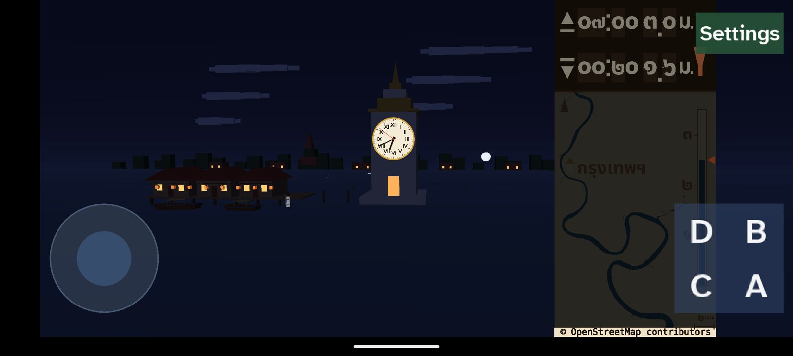
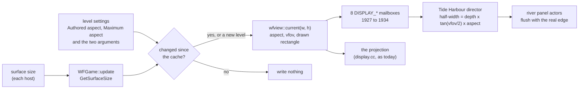
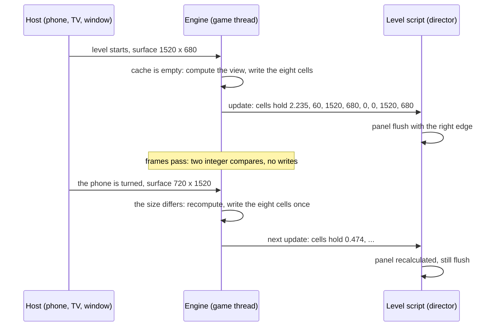
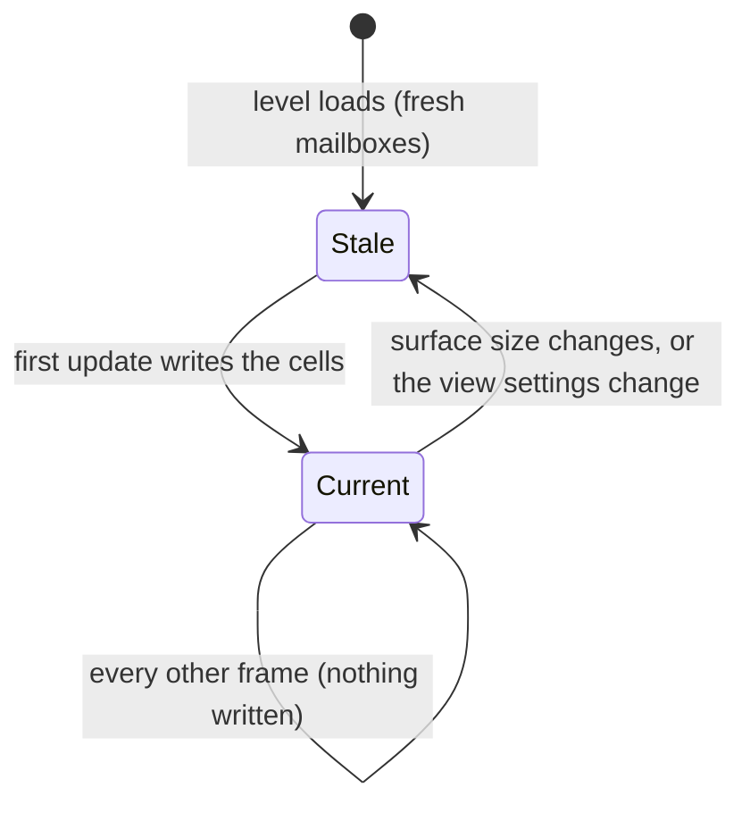
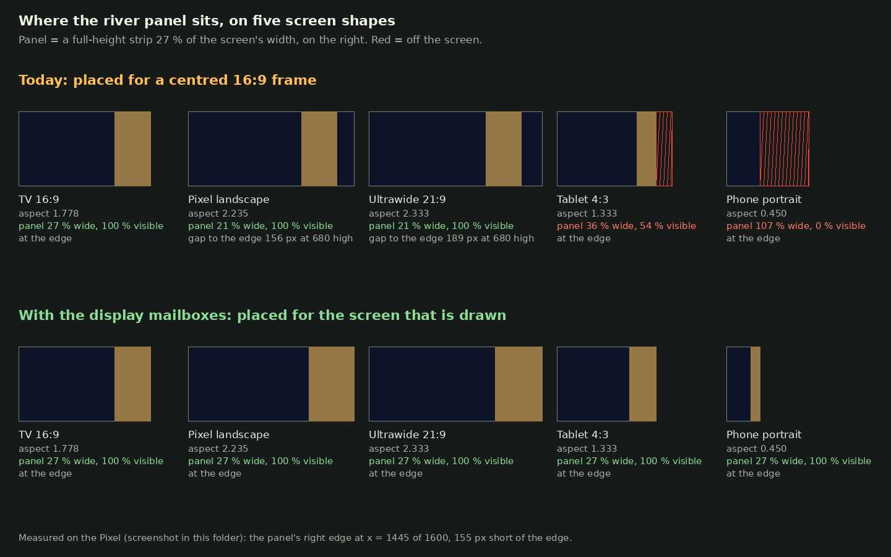

# Display system mailboxes: the screen's shape, for level scripts

**Status:** proposal for review, 2026‑11‑22. Nothing is implemented. Will's direction (2026‑11‑22): "you can't hardcode the position, it has to be calculated at runtime", "just exposing settings via system mailboxes", written "only initially and if display size changes".

## Context

On Will's Pixel the Tide Harbour river panel does not reach the edge of the screen. The screenshot below is the real phone in landscape: the drawing area is 1520 × 680 pixels (aspect 2.235), the panel's right edge is at x ≈ 1445 and the display's is at 1600, so about 155 px of harbour shows to the right of the map.

The cause is a constant. The panel is placed by the Tide Harbour director (`wflevels/tide_harbour/forth.py`, the panel word at line 314) as `PANEL_FRAC * TAN_V * ASPECT * depth`, and `ASPECT` is `16.0 / 9.0` in `wflevels/tide_harbour/panel.py` ("the screen the panel is drawn for: a 16:9 television"). So the panel's width and its edge are those of a 16:9 frame centred on the screen. The arithmetic reproduces the photograph: on a 1520 × 680 area the centre is at x = 840, a 16:9 frame is 1209 wide, so its right edge is at 840 + 604 = 1444, against the measured 1445.

That is right on a television and wrong everywhere else (the mockup below): on a wider screen the panel stops short of the edge, on a 4:3 tablet it is cut off (54 % visible), and on a portrait phone it is entirely off the screen.

The engine already knows the answer. `wfsource/source/gfx/authored_view.hp` computes, for the surface size and the level's two view settings, the projection's aspect, its vertical field of view and the rectangle actually drawn, and every display (`gfx/gl/display.cc`, iOS, macOS) asks it. A level script cannot read any of it. Scripts can read the wall clock (`WALL_DAY`, `WALL_HOUR` and the others, `INDEXOF_WALL_*` in zForth), because the engine publishes it in **system mailboxes**; the display needs the same treatment.

## Approach

**Eight read-only system mailboxes**, appended after `WALL_UTC_OFFSET` (1926) in `wfsource/source/mailbox/mailbox.inc`, with `GLOBAL_SYSTEM_MAX` moving from 1927 to 1935. Every level script, in every level, gets the matching `INDEXOF_DISPLAY_*` word the way it gets `INDEXOF_WALL_DAY`.

| Mailbox | Number | Value |
|---|---|---|
| `DISPLAY_ASPECT` | 1927 | the projection's aspect, the drawn rectangle's width over its height (1.778 on a television, 2.235 on this Pixel in landscape, the capped value on a pillarboxed screen) |
| `DISPLAY_VFOV` | 1928 | the projection's vertical field of view in degrees (60, or larger on a screen narrower than the level's authored aspect) |
| `DISPLAY_WIDTH`, `DISPLAY_HEIGHT` | 1929, 1930 | the surface in pixels |
| `DISPLAY_VIEW_X`, `DISPLAY_VIEW_Y`, `DISPLAY_VIEW_WIDTH`, `DISPLAY_VIEW_HEIGHT` | 1931 to 1934 | the rectangle actually drawn, in surface pixels; the whole surface unless a maximum aspect pillarboxes it |

**When they are written: at the start of a level, and when something that decides the view changes. Not every frame.** The inputs are the surface size and the level's authored and maximum aspect (and the `--authored-aspect` and `--maximum-aspect` overrides). A small cache of those four numbers, held beside the wall-clock sample in `Level`, is compared each frame, which costs two integer comparisons and two float comparisons, and the eight cells are written only when it differs or a new level has started (a new level has fresh mailboxes, so its first update always writes). The size comes from the call `WFGame::update` already makes each frame (`_display->GetSurfaceSize`, `wfsource/source/game/game.cc`, near line 673); the view comes from `wfview::current(width, height)`, the same function the projection uses, so the script and the picture can never disagree.

**Tide Harbour then calculates the panel from them.** The director replaces the constant with the mailboxes: the half-width at the panel's depth `d` is `d × tan(DISPLAY_VFOV / 2) × DISPLAY_ASPECT`, and the panel is the same `PANEL_FRAC` (27 %) of it, flush against the real edge. `panel.py` and the Python reference model gain `aspect` and `vfov` parameters that default to 16:9 and 60°, so every existing number and test is reproduced exactly on a television. Because the director reads the cells every frame and a read is free, a window that is resized or a phone that is turned moves the panel within one frame.

### How it fits together

## Mockups

The surface is a rendered scene, so the mockups are layouts. The first picture is the decision this plan makes: the same full-height panel, 27 % of the screen's width, on five screen shapes, today and with the mailboxes.

[Open the live mockup](2026-11-22-display-mailboxes/layouts.html): a slider for the screen's shape, both placements side by side. It is generated by [`scripts/mockup-display-layouts.py`](../../scripts/mockup-display-layouts.py) with the director's own geometry, so it can be regenerated and checked.

| Screen | Aspect | Today: panel visible | With the mailboxes |
|---|---|---|---|
| Television 16:9 | 1.778 | 100 %, at the edge | the same: nothing changes |
| Pixel in landscape | 2.235 | 100 %, 156 px short of the edge (measured 155) | at the edge |
| Ultrawide 21:9 | 2.333 | 100 %, 189 px short (at 680 high) | at the edge |
| Tablet 4:3 | 1.333 | **54 %**, the rest off the screen | at the edge |
| Phone portrait | 0.450 | **0 %**, entirely off the screen | at the edge, 27 % of the width |

## Budgets

| | Cost |
|---|---|
| Mailbox memory | 8 cells (one float each) in every level's global mailbox array; `GLOBAL_SYSTEM_MAX` 1927 to 1935 |
| Per frame, nothing changed | two integer and two float comparisons, no writes |
| Per change | 8 writes and one `wfview::current` call (already computed by the display each frame today) |
| Director, Tide Harbour | about 5 more Forth operations a frame (one `tan`, two multiplies, the reads) |
| Level files | none change except `tide_harbour.iff` (a few more bytes of script) |
| Triangles, draw calls, materials | none |

## Out of scope

- **Safe-area and cutout insets.** The Pixel screenshot has a black strip about 80 px wide at the left. Whether it is the display cutout or the activity's window is not established here, and the mailboxes describe the surface the engine draws, not what the phone covers. Insets would be more mailboxes in a later piece.
- **The on-screen controller and the Settings button overlay the panel** on the phone (the joystick and D, B, C, A buttons, and the Settings button over the clock readings, in the screenshot). That is the touch layer's layout, owned by the Aquarium owner's touch controller work, and it can use these same mailboxes later.
- **A portrait layout for the panel.** With the mailboxes the panel is still 27 % of the width, which is a thin strip on a portrait phone. Whether portrait should lay out differently (a bar at the bottom, say) is a design decision, not a placement bug.
- **A change counter** (`DISPLAY_SERIAL`). A script that wants to know the display changed compares the aspect with its last value; a counter can be added if one needs it.
- **Other levels.** Nothing else uses the mailboxes yet; they exist for any level that lays something out against the screen.

## Verification

1. **The values are the view's.** A new CTest `display_mailboxes` (beside `authored_view` and `wall_clock_test`): for a set of surface sizes and the level and argument settings, the eight values equal `wfview::view` and the drawn rectangle; unchanged inputs write nothing (a counter on the writes stays at 1); a changed size writes once.
2. **The mailbox table.** `tests/test_mailbox_global_bounds.py` follows `GLOBAL_SYSTEM_MAX` to 1935, and each new name has an `INDEXOF_` word the zForth bridge resolves.
3. **The director, in the real VM.** The real-zForth check of the Tide Harbour director with the display cells set to each of the five shapes: the panel's edge equals the right edge of the visible frame within 1 mm at the panel's depth, and at 16:9 and 60° the poses are bit-for-bit the poses of today's model.
4. **The desktop engine at five window sizes.** `scripts/check-tide-harbour.py --capture` at 1920 × 1080, 1520 × 680, 1920 × 823, 1440 × 1080 and 600 × 1330: in each capture the panel's right edge is within 2 px of the display's right edge, and its width is 27 % of the width within 2 px.
5. **The television is unchanged.** The 1920 × 1080 capture matches today's capture (the committed reference) within the capture's own tolerance.
6. **The resize.** On the desktop engine, resize the window while Tide Harbour runs: the log shows the eight cells written once for the change and not on the frames between, and the panel follows within a frame.
7. **The Pixel.** The same screenshot as the one in Context, after the change: the panel's right edge at the right edge of the drawing area.
8. **The wall-clock mailboxes are untouched.** `tests/wall_clock_test.cpp` and the Tide Harbour and Minute Machine suites pass unchanged.

## Who

The mailboxes are engine files (`mailbox.inc`, `level.cc`, `game.cc`), shared with every level; the panel change is in the Tide Harbour level, which the Tide Harbour session owns. The plan is written to be done by one session in one commit series (the engine commit with its CTest first, then the Tide commit), so it is for Will to say whether that is the Tide session or another.
