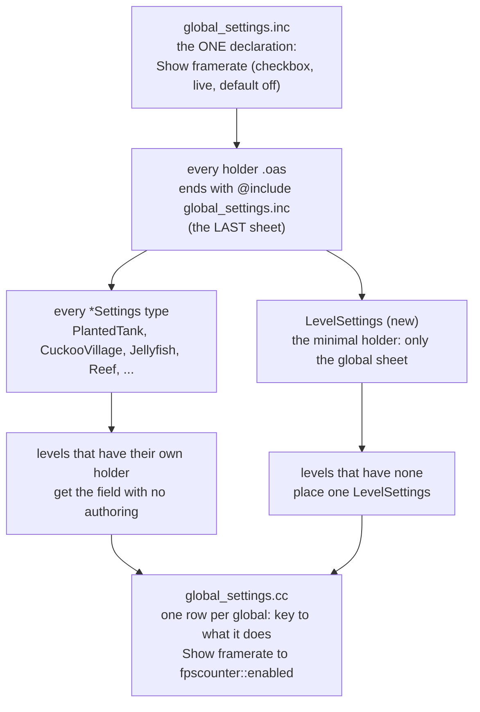
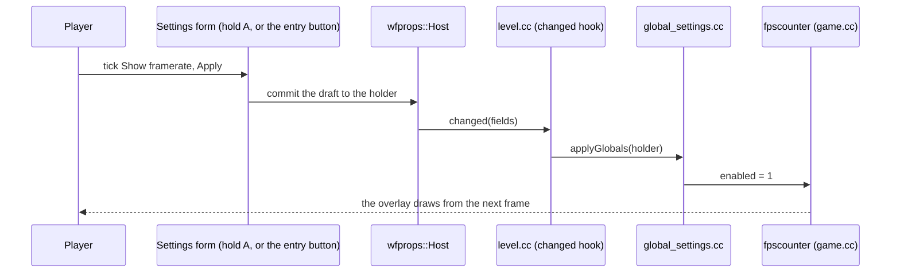
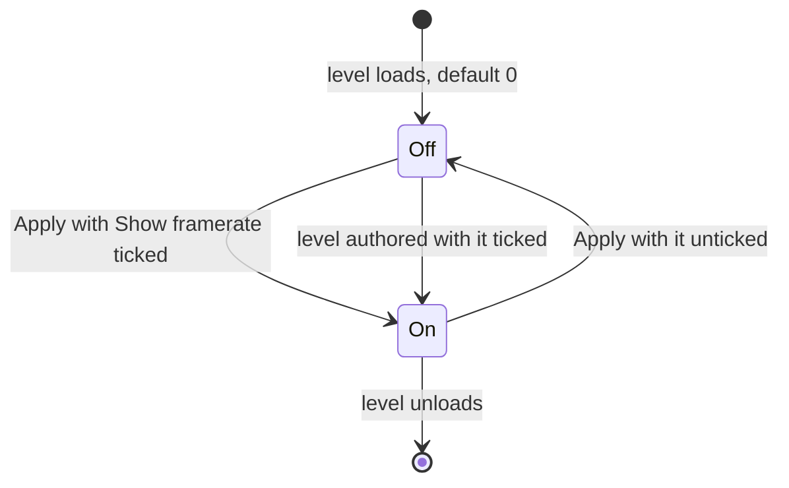

# Global level settings: Show framerate in every level

**Status: Phases 1 to 3 done; Phase 1 MERGED into `2026-new-level` on 2026‑11‑22 (c0e00e8e; Will: "merge"), the default holder and the level rebuilds follow on the same branch. Phase 4 (docs and starting templates) is done; Phase 5 (the device check) remains. The engine compiles with the code, `task test-global-settings` (14 checks) and 19 guard tests pass, and the baseline level is rebuilt and carries the field (the audit's first level). The settings suites pass except two planted-tank tests that wait for `aquarium_plants` to be rebuilt. Decided by Will 2026‑11‑22 ("Show framerate: hook that up and make sure all wf levels include this level setting, at a minimum (update docs, update starting templates)"; "i recommend having a global declaration (right now consisting only of Show FPS) so you only have to change in 1 place in future").  Phases 2 to 5 are next.** Rank: Phase 1 T4 (engine and the shared declaration), Phases 2 and 3 T3 against this plan, Phase 4 T2.

## Context

The engine already has the framerate overlay (`fpscounter::enabled`, drawn in `game.cc`) and one switch for it: the **Show FPS** row of the baseline level's *Runtime Options* sheet (`runtime_show_fps` in `wfsource/source/game/runtime_options.cc`). That row lives in the `RuntimeDiagnostics` actor that only the baseline level places, so no shipped level lets a player turn the overlay on. Will wants it in every level, declared once.

What a level exposes today is a **settings holder**: an actor of a `*Settings` type whose `.oas` includes `settings.inc` and whose `SHOW_AS_LIVE` fields the form lists ([level-building.md, Settings actors](../level-building.md); [howto, section 5](../howto/combine-levels-chooser-and-screensaver-launch.md); [scripts/audit-level-settings.py](../../scripts/audit-level-settings.py)). The engine reads such a field **by key** after Apply: `level.cc` does it for `LevelRenderSettings` and the key `Stained glass light` (`applyStainedGlassLight`, called when the holder changes and once at load). `settings.inc` already says where a field every holder shares goes: after `actor.inc`, in its own sheet.

The audit covers only the two packs' manifests (3 clocks, 11 tanks). The repository has 4 manifests (aquarium 11, clocks 3, main CD 8, SMB 4 levels) and about 160 level sources: 25 Blender builders, 63 `.lev` text levels, 128 `.iff.txt` files (standalone variants included).

## Design

1. **One declaration.** `wfsource/source/oas/global_settings.inc` holds the global sheet. Today it is one field: **Show framerate**, `TYPEENTRYBOOLEAN`, checkbox, `SHOW_AS_LIVE`, default 0. Every settings holder ends with `@include global_settings.inc` just before `TYPEFOOTER`, so every `*Settings` type carries it. **Revised during Phase 1:** the first draft had `settings.inc` include it at the top, which put the new field first and shifted the id of every other field (Sea Stars' phone asset ids moved by one). Last keeps every existing id, so a level built earlier, its director and its phone asset keep working. The cost is one include line per holder, which `tests/test_global_level_settings.py` enforces. A second global later is one more line here and one more row in the engine table.
2. **One engine table.** `wfsource/source/game/global_settings.cc` maps a global's key to what it does (`"Show framerate"` sets `fpscounter::enabled`). `level.cc` calls it where it calls `applyStainedGlassLight` today, for **any** holder (the change hook currently tests `schema == "LevelRenderSettings"`), and once at load for every holder. Two holders that disagree: any ticked holder turns it on at load, and the holder just edited wins afterwards.
3. **A minimal holder for levels that have none.** A new type `LevelSettings` (`levelsettings.oas`: `@include settings.inc`, nothing else), registered in the eight `objects.*` files like any type. A level without its own holder places one. (`LevelSettings.java` in the screensaver is an unrelated Java class; the OAS type name is its own namespace.)
4. **Existing levels.** The sheet is last, so no field a level already uses moves. A level built earlier works unchanged and lacks the field until it is rebuilt. Two things read a built level **against the current `.oad`** and so need the rebuild before they pass: `scripts/plant_settings_actor.py` (it refuses a planted level whose embedded descriptor differs, "Level uses a different planted descriptor", which is why two planted-tank tests are red) and the phone capability assets (`scripts/gen-settings-capabilities.py`, regenerated with the level; the Sea Stars asset is already regenerated and its old ids are kept, with `Show framerate` added as 140).
5. **Baseline's old row stays.** The *Runtime Options* `runtime_show_fps` row is an engine-wide diagnostic switch for the same overlay and keeps working; the global setting is the per-level one a player sees. Both set `fpscounter::enabled`; the last write wins, which is what a player expects.
6. **Coverage is audited, not trusted.** `scripts/audit-level-settings.py` gains a roster `all` (every manifest, plus the baseline and the dev levels that have a `build.sh`) and a check `global`: the level's built catalog lists **Show framerate**. `--strict` fails while any level lacks it, so a new level cannot ship without it.

How a toggle reaches the screen:

States of the setting in a level:

## Mockups

The form row is the same on the TV and in the phone's touch form (the engine's own, restored in [the touch plan](2026-11-22-aquarium-clocks-touch-controls.md)). States shown: unticked default, ticked after Apply, a level that keeps its own sheets.

## Phases

| Phase | What | Tier | Done when |
|---|---|---|---|
| 1 | **Built on the branch.** `global_settings.inc` and the include in each holder; `levelsettings.oas`, its registry lines (last), actor class and `.oad`; `global_settings.cc` and the two `level.cc` calls; every holder's `.oad` and `.ht` regenerated; the Sea Stars phone asset; `tests/test_global_level_settings.py` (16) and four stale expectations updated. `task test-global-settings` for the engine table (load against Apply, two holders, other keys). The baseline's Field types owner ends with the global sheet and the level and main `cd.iff` are rebuilt; its Runtime owner already has the same switch as its Show FPS row. **Done.** | T4 | done: guard tests, host test, settings suites, baseline rebuilt and listed by the audit |
| 2 | **Audit done:** `audit-level-settings.py --roster levels` lists every built level (56) and `--strict` fails while one lacks the field. **Not done:** the helper that places a `LevelSettings` holder, one function for the Blender builders and one snippet for `.lev` and `.iff.txt` | T3 | the audit runs on every level (done) and the helper exists |
| 3 | **Done for every level a player can reach**, by a different route than first planned: levcomp adds a default `LevelSettings` holder to any level that has none (`wftools/levcomp-rs/src/default_holder.rs`, 5 tests; `--no-default-settings` turns it off), so a rebuild is the whole change. 22 of 23 reachable levels carry the field or are exempt (`snowgoons` and `marble-madness-3d-astra`: hand-authored IFF with no `.lev`); `minute_machine` is the Clocks session's. The 22 levels no player can reach are a TODO to keep and upgrade or delete. | T3 | `audit-level-settings.py --roster levels --strict` exits 0 once `minute_machine` is rebuilt |
| 4 | **Done.** `wflevels/baseline/README.md` (the starting level: where Show framerate lives and what a new level gets for free), `docs/level-building.md` Settings actors (the global sheet, the default holder, `--no-default-settings`, how to add a global), `settings.inc`'s comment, and the HOWTO's section 5 and check table. The starting template needs no edit of its own: levcomp adds the holder to a new level, and the baseline's Field types owner carries the sheet. | T2 | each file says the global sheet is automatic and where to add the next global |
| 5 | Device check: Show framerate on a clock on cast1 and an Aquarium tank on the Pixel, and the Dream stays overlay-free | T5 | the verification below |

Phases 1 and 4 ship together for the baseline, so the starting template is right from the first commit. Rebuilding every committed `.iff` is the long part of Phase 3; levels are built in the containers (`scripts/in-linux-container.sh`, `WF_CONTAINER_IMAGE=blender` for the Blender builders).

## Verification

1. A host test (`task` target to be named in Phase 1) proves `global_settings.cc` maps `Show framerate` to the overlay for any holder, and that two holders resolve as in Design 2.
2. `tests/test_global_level_settings.py` proves `settings.inc` includes `global_settings.inc`, every `*Settings` type's generated `.oad` lists the field, and `LevelSettings` is in all eight registries.
3. `python3 scripts/audit-level-settings.py --roster all --strict` exits 0.
4. The baseline level, rebuilt, lists **Show framerate** in the form of each owner, and ticking it draws the overlay (desktop, `xvfb-run`, a screenshot).
5. cast1: a clock and a tank, hold A, tick it, Apply: the overlay draws. The Pixel: the same through the entry button.
6. The Dream still draws no overlay by default.

Each step's raw output goes below it with PASS or FAIL when it is run.

## Open

| # | Question | Recommendation |
|---|---|---|
| Q1 | Should the choice persist between launches (per app, not per level)? | Not in the first change: the level's authored default applies at every launch. The Dream's settings provider (`TankSettingsProvider`) is the place to persist it later, so a player's choice survives. Say if you want it now. |
| Q2 | Default off in every level? | Yes. The overlay costs a few draw calls and clutters a screensaver. |
| Q3 | Does "all wf levels" include the style, spike and regression levels (`style_*`, `*_spike`, `teleport_regression`) or only levels a player can reach? | Every level with a `build.sh`, so none is the exception a template copies; the audit's `all` roster lists them separately so you can see the count. |
