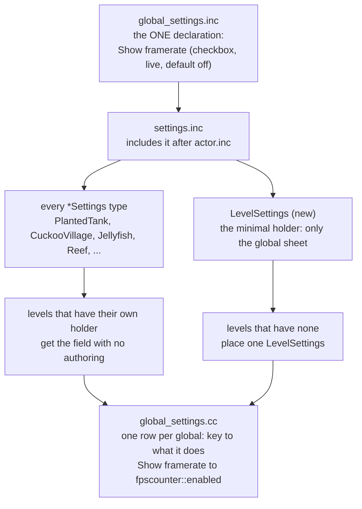
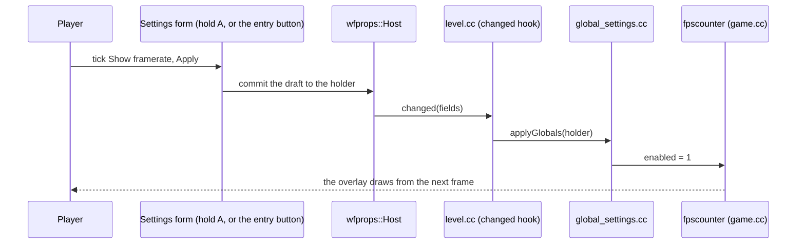
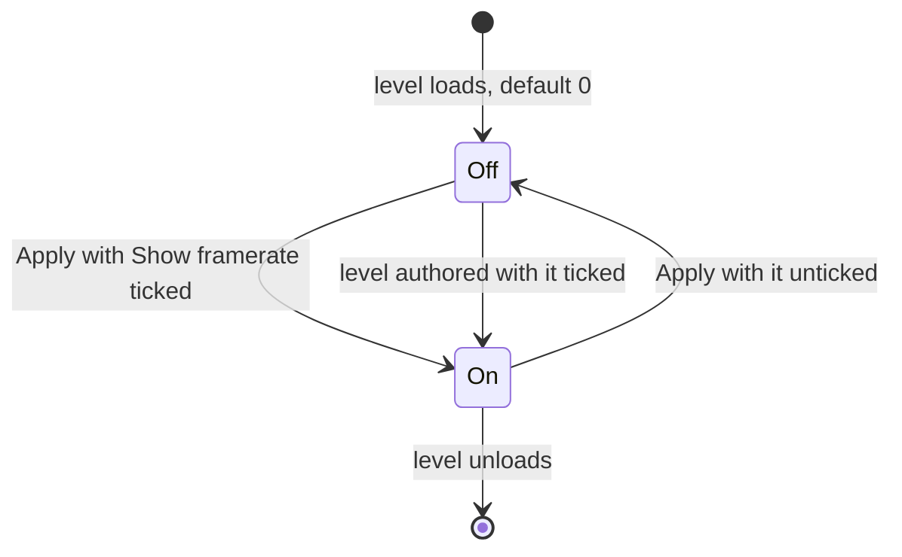
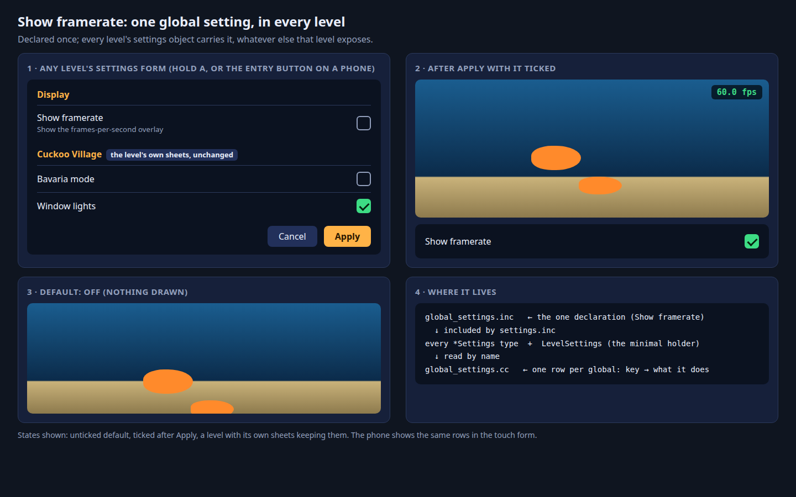

# Global level settings: Show framerate in every level

**Status: decided by Will 2026‑11‑22 ("Show framerate: hook that up and make sure all wf levels include this level setting, at a minimum (update docs, update starting templates)"; "i recommend having a global declaration (right now consisting only of Show FPS) so you only have to change in 1 place in future"). Not started; Phase 1 is next.** Rank: Phase 1 T4 (engine and the shared declaration), Phases 2 and 3 T3 against this plan, Phase 4 T2.

## Context

The engine already has the framerate overlay (`fpscounter::enabled`, drawn in `game.cc`) and one switch for it: the **Show FPS** row of the baseline level's *Runtime Options* sheet (`runtime_show_fps` in `wfsource/source/game/runtime_options.cc`). That row lives in the `RuntimeDiagnostics` actor that only the baseline level places, so no shipped level lets a player turn the overlay on. Will wants it in every level, declared once.

What a level exposes today is a **settings holder**: an actor of a `*Settings` type whose `.oas` includes `settings.inc` and whose `SHOW_AS_LIVE` fields the form lists ([level-building.md, Settings actors](../level-building.md); [howto, section 5](../howto/combine-levels-chooser-and-screensaver-launch.md); [scripts/audit-level-settings.py](../../scripts/audit-level-settings.py)). The engine reads such a field **by key** after Apply: `level.cc` does it for `LevelRenderSettings` and the key `Stained glass light` (`applyStainedGlassLight`, called when the holder changes and once at load). `settings.inc` already says where a field every holder shares goes: after `actor.inc`, in its own sheet.

The audit covers only the two packs' manifests (3 clocks, 11 tanks). The repository has 4 manifests (aquarium 11, clocks 3, main CD 8, SMB 4 levels) and about 160 level sources: 25 Blender builders, 63 `.lev` text levels, 128 `.iff.txt` files (standalone variants included).

## Design

1. **One declaration.** `wfsource/source/oas/global_settings.inc` holds the global sheet. Today it is one field: **Show framerate**, `TYPEENTRYBOOLEAN`, checkbox, `SHOW_AS_LIVE`, default 0. `settings.inc` includes it, so **every** current and future `*Settings` type carries it. A second global later is one more line here and one more row in the engine table.
2. **One engine table.** `wfsource/source/game/global_settings.cc` maps a global's key to what it does (`"Show framerate"` sets `fpscounter::enabled`). `level.cc` calls it where it calls `applyStainedGlassLight` today, for **any** holder (the change hook currently tests `schema == "LevelRenderSettings"`), and once at load for every holder. Two holders that disagree: any ticked holder turns it on at load, and the holder just edited wins afterwards.
3. **A minimal holder for levels that have none.** A new type `LevelSettings` (`levelsettings.oas`: `@include settings.inc`, nothing else), registered in the eight `objects.*` files like any type. A level without its own holder places one. (`LevelSettings.java` in the screensaver is an unrelated Java class; the OAS type name is its own namespace.)
4. **Existing levels' field order.** Adding a shared sheet changes the struct of every settings type, so each level that has a holder must be rebuilt. Directors find fields by **key** through the `catalog` tool at build time (`blender_create_cuckoo_village.py:245`), not by a fixed index, so a rebuild picks up the new offsets. Tests that fake indices (`129 + i` in `forth.py`) are unaffected. The generated phone capability assets (`scripts/gen-settings-capabilities.py`) are regenerated.
5. **Baseline's old row stays.** The *Runtime Options* `runtime_show_fps` row is an engine-wide diagnostic switch for the same overlay and keeps working; the global setting is the per-level one a player sees. Both set `fpscounter::enabled`; the last write wins, which is what a player expects.
6. **Coverage is audited, not trusted.** `scripts/audit-level-settings.py` gains a roster `all` (every manifest, plus the baseline and the dev levels that have a `build.sh`) and a check `global`: the level's built catalog lists **Show framerate**. `--strict` fails while any level lacks it, so a new level cannot ship without it.

How a toggle reaches the screen:

States of the setting in a level:

## Mockups

The form row is the same on the TV and in the phone's touch form (the engine's own, restored in [the touch plan](2026-11-22-aquarium-clocks-touch-controls.md)). States shown: unticked default, ticked after Apply, a level that keeps its own sheets.

## Phases

| Phase | What | Tier | Done when |
|---|---|---|---|
| 1 | `global_settings.inc`, include it from `settings.inc`; `levelsettings.oas` and its registry lines; `global_settings.cc` and the two `level.cc` calls; host tests (the table maps the key, any holder, two holders) | T4 | `task` host tests pass; a rebuilt baseline level lists the field on both of its owners |
| 2 | The helper that places a `LevelSettings` holder: one function for the Blender builders, one snippet for `.lev` and `.iff.txt`; the audit's `all` roster and `global` check | T3 | the audit runs on every level and reports each one's state |
| 3 | Roll out in batches by kind: levels with a holder (rebuild only), Blender builders, `.lev` text, `.iff.txt`; regenerate the phone assets and the committed `.iff` bundles | T3 per batch | `audit-level-settings.py --roster all --strict` exits 0 |
| 4 | Docs and starting templates: `wflevels/baseline` (README and its level), `wflevels/basic/basic.lev`, `docs/level-building.md` Settings actors, the howto section 5 and its model table, `settings.inc`'s own comment, the Blender add-on's new-level path if it has one | T2 | each file says the global sheet is automatic and where to add the next global |
| 5 | Device check: Show framerate on a clock on cast1 and an Aquarium tank on the Pixel, and the Dream stays overlay-free | T5 | the verification below |

Phases 1 and 4 ship together for the baseline, so the starting template is right from the first commit. Rebuilding every committed `.iff` is the long part of Phase 3; levels are built in the containers (`scripts/in-linux-container.sh`, `WF_CONTAINER_IMAGE=blender` for the Blender builders).

## Verification

1. A host test (`task` target to be named in Phase 1) proves `global_settings.cc` maps `Show framerate` to the overlay for any holder, and that two holders resolve as in Design 2.
2. `tests/test_global_level_settings.py` proves `settings.inc` includes `global_settings.inc`, every `*Settings` type's generated `.oad` lists the field, and `LevelSettings` is in all eight registries.
3. `python3 scripts/audit-level-settings.py --roster all --strict` exits 0.
4. The baseline level, rebuilt, lists **Show framerate** in the form of each owner, and ticking it draws the overlay (desktop, `xvfb-run`, a screenshot).
5. cast1: a clock and a tank, hold A, tick it, Apply: the overlay draws. The Pixel: the same through the entry button.
6. The Dream still draws no overlay by default.

Each step's raw output goes below it with PASS or FAIL when it is run.

## Open

| # | Question | Recommendation |
|---|---|---|
| Q1 | Should the choice persist between launches (per app, not per level)? | Not in the first change: the level's authored default applies at every launch. The Dream's settings provider (`TankSettingsProvider`) is the place to persist it later, so a player's choice survives. Say if you want it now. |
| Q2 | Default off in every level? | Yes. The overlay costs a few draw calls and clutters a screensaver. |
| Q3 | Does "all wf levels" include the style, spike and regression levels (`style_*`, `*_spike`, `teleport_regression`) or only levels a player can reach? | Every level with a `build.sh`, so none is the exception a template copies; the audit's `all` roster lists them separately so you can see the count. |
