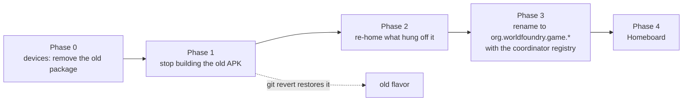

# One Aquarium APK: retire the standalone playable app

**Status: decided by Will 2026‑11‑22. Phases 1 and 2 are done; the rename (Phase 3) waits for the coordinator's administrator upgrade.** Will: "i only want 1 apk with combined app and screensaver (with the good icon)", then: the combined app "should not be called screensaver", and every app standardises on `org.worldfoundry.game.{{name}}` ("also for 3d clocks and others in the future"). The combined Aquarium app, today `org.worldfoundry.screensaver`, becomes **`org.worldfoundry.game.aquarium`**; the 3D Clocks, today `org.worldfoundry.clocks`, become `org.worldfoundry.game.clocks`. This plan retires the second Aquarium package, `org.worldfoundry.wf_game.aquarium`, renames the combined app, and lists what goes with each. It closes the `[T4]` question in [the One Aquarium app plan](2026-11-21-one-aquarium-app.md) (decision 2 there kept the old package "for now").

## Where it stands

| | Combined Aquarium app (keep, renamed) | Standalone playable app (retire) |
|---|---|---|
| Package | today `org.worldfoundry.screensaver`, becomes `org.worldfoundry.game.aquarium` | `org.worldfoundry.wf_game.aquarium` |
| Built by | `android/screensaver`, flavor `aquarium` (its `applicationId`; the Java code package stays `org.worldfoundry.screensaver`) | `android/app`, product flavor `aquarium` (and its `diagnostic` build type) |
| Icon and banner | the approved clownfish, tiger barb and betta art (`585d590f`) | the old clownfish tank banner |
| Normal launch | the tank menu; a tank from it is the playable one (steered on cast1, 2026‑11‑22, `J‑08baa5d0ca23`) | the same menu |
| As a screensaver | `AquariumDreamService`, preview, `LEVEL` and `DREAM` extras, settings provider | none |
| Phone as a controller | no | yes (`controller.html`, `layout.json`) |
| Installed on | cast1, the Pixel | cast1, the Pixel |

## What retiring removes

These are the real costs, found by inventory on 2026‑11‑22, not guesses:

1. **The phone-pad controller for the Aquarium** (the phone as a gamepad over the LAN). The combined app has none; the TV remote's d-pad steers the fish. The condo flavor keeps its own phone pad.
2. **The `diagnostic` build of the Aquarium** (`assembleAquariumDiagnostic`) and, with it, the coordinator's `aquarium` registry entry (`native`, eight scenes) that `record`, `profile` and `check` use for runtime-diagnostics, settings and plant checks.
3. **Ten scripts and harnesses that start the old package by name:** `scripts/check-arowana-device.py`, `check-growing-plants-device.py`, `check-growing-plants-lifetime.py`, `check-lionfish-feeding-device.py`, `check-menu-back-device.py`, `check-species-device.py`, `profile-growing-plants-device.py`, `profile-growing-plants-trace.py`, plus `scripts/android-device-run.sh`, `wflevels/aquarium_tanks/check_chromecast_menu.py`.
4. **`android/app/src/aquarium/assets/wf_args.txt`**, which the desktop `task run-aquarium-menu` and a comment in `CMakeLists.txt` read: it moves, it is not deleted.
5. **Tests that guard the flavor:** `tests/test_aquarium_android.py` (14 tests; the TODO records that its Taskfile asset checks already fail on origin), `tests/phonepad_harness.py`'s aquarium layout, and checks in `test_game_apps_android.py`, `test_launcher_parity.py`, `test_dream_host_vram.py` and others that name the package.

Left alone: the historical device logs and plan evidence that name the package (about 2 000 files), which are a record, and the Homeboard and coordinator repositories until their own steps below.

## Phases

0. **Devices (the old package).** Remove `org.worldfoundry.wf_game.aquarium` from cast1 and the Pixel. The coordinator has no uninstall workflow (checked: `capability-describe uninstall` finds nothing), so this is a manual step on each device (Pixel: long-press the icon, Uninstall; Chromecast: Settings, Apps). Nothing else on the devices changes.
1. ~~**Stop building it.** Remove the `aquarium` flavor from `android/app/build.gradle.kts`, `android/app/src/aquarium/`, the `build-apk` and `build-apk-diagnostic` and `install-apk` defaults that name it, and the `chromecast-aquarium` alias; rewrite `tests/test_aquarium_android.py` to the snowgoons and condo flavors that remain.~~ **Done 2026‑11‑22.** Also removed: `build-cd-iff-aquarium-menu` as a dependency of `build-apk` and `build-apk-debug` (it only fed the old flavor), and `build-apk-diagnostic`.
2. ~~**Re-home what hung off it.** Move `wf_args.txt` next to the menu bundle for `run-aquarium-menu` and CMake; decide for each device script in item 3: port to the combined app (`AquariumActivity`, `LEVEL`), or archive it under `docs/reference/device-harnesses/` where eleven already have a `.txt` copy.~~ **Done 2026‑11‑22:** `wf_args.txt` is `wflevels/aquarium-wf_args.txt` (13 consumers repointed); the phone-pad layout is `wfsource/source/hal/phonepad/aquarium-layout.json`; the four growing-plants scripts were identical to their archived copies and are removed; `check-arowana-device.py`, `check-lionfish-feeding-device.py`, `check-species-device.py`, `build-aquarium-variant.py`, `profile-lionfish-realism.py`, `check_chromecast_menu.py` and `check-menu-back-device.py` are archived as `.txt`. **One deviation from Q2's "port `check-menu-back-device.py`":** it was written for the NativeActivity flavors with the Aquarium's selector order and Betta checks inside it, so it is archived, and the combined app's Back handling is checked by a coordinator `check` job with an `input_script` ([HOWTO section 6](../howto/combine-levels-chooser-and-screensaver-launch.md)). `scripts/gen-aquarium-android-art.py` stays: `gen-condo-android-art.py` imports it.
3. **Rename (D5), in one step with the registry.** In `android/screensaver/build.gradle.kts` set `applicationId` to `org.worldfoundry.game.aquarium` (flavor `aquarium`) and `org.worldfoundry.game.clocks` (flavor `clocks`); the manifests' provider authorities and the `am start` component names (a leading `.` resolves against the `applicationId`, so use full class names) follow. The coordinator registry's `screensaver` and `clocks-screensaver` entries (package, activity, `dream_component`, `preview_activity`, `settings_authority`) change at the same moment, which is an administrator upgrade of the installed service; an APK built before that cannot be registered. Then on each device: install the new APKs, select the new Dream component, remove `org.worldfoundry.screensaver` and `org.worldfoundry.clocks`.
4. **Coordinator and Homeboard.** Remove or re-point the registry's `aquarium` entry (a protected registry edit, with Will's approval at that step); update Homeboard's directory and investigation notes.

## Decisions

| # | Decision | Why |
|---|---|---|
| D1 | The end state is one Aquarium package. | Will, 2026‑11‑22. |
| D2 | The old flavor is removed in Phase 1, not kept as a hidden dev build. | A second APK that nobody installs still gets built, tested and named in scripts. `git revert` restores it. |
| D3 | The phone-pad controller and the diagnostic build are given up. | The combined app has neither; the d-pad steers. If either is wanted back it becomes a feature of the combined app, not a second package. |
| D4 | Phase 0 is manual. | There is no uninstall in the coordinator; adding one is a protected capability and not worth building for this. |
| D5 | **Package names are `org.worldfoundry.game.{{name}}`**, for the combined Aquarium app and the 3D Clocks now, and for every new app. The Java code package (`namespace`) is not renamed; only the Gradle `applicationId` is. Existing `org.worldfoundry.wf_game.*` apps (condo, smb, qbert, baseline, parmenides, the original) and Seahorse Grid are not renamed by this plan. | Will, 2026‑11‑22. A new `applicationId` is a new app to Android: installs sit beside the old ones, saved settings start fresh (`tank` returns to `random`), and the selected Dream component changes. The code package stays so that no class, test or `LEVEL` extra key has to move. |

## Open

| # | Question | Recommendation |
|---|---|---|
| ~~Q1~~ | ~~Give up the Aquarium phone-pad controller and the diagnostic build (D3)?~~ **Accepted by Will, 2026‑11‑22.** | Yes. The remote steers the fish, and the diagnostics can be rebuilt on the combined app if a validator needs them. |
| Q3 | Rename Seahorse Grid and the `wf_game.*` apps to the new pattern too? **Will, 2026‑11‑22: wait; only Aquarium and Clocks now.** | Not in this plan. Rename them when each is next rebuilt, so no device is reinstalled twice. |
| ~~Q2~~ | ~~For each of the ten scripts in item 3: port or archive?~~ **Accepted by Will, 2026‑11‑22 (with the one deviation recorded in Phase 2).** | Archive the one-off investigations (arowana, growing plants, species, lionfish feeding); port `check-menu-back-device.py`, which now belongs to the combined app's menu. |

## Verification

1. `task chromecast:devices` then an `inspect` job on cast1 and the Pixel: `packages.txt` has `org.worldfoundry.game.aquarium` and `org.worldfoundry.game.clocks`, and none of `org.worldfoundry.wf_game.aquarium`, `org.worldfoundry.screensaver`, `org.worldfoundry.clocks`.
2. `git grep -l "wf_game\.aquarium" -- . ':!docs/diagnostics' ':!docs/transcripts' ':!docs/plans'` lists only files this plan names as kept.
3. `scripts/in-linux-container.sh python3 -m pytest tests -q -k "aquarium or launcher or android"` passes.
4. `cd android && ./gradlew :app:tasks --offline` lists no `Aquarium` variant, and `./gradlew :screensaver:assembleAquariumRelease --offline` still builds.
5. `task run-aquarium-menu` still starts the menu on the desktop.
6. On cast1 and the Pixel: one Aquarium tile, with the approved icon, that opens the menu; the Dream still starts from the lock screen while charging.
7. The coordinator registry has no entry whose `package` is `org.worldfoundry.screensaver` or `org.worldfoundry.clocks`, and `screensaver-show` with a level still plays that tank.
