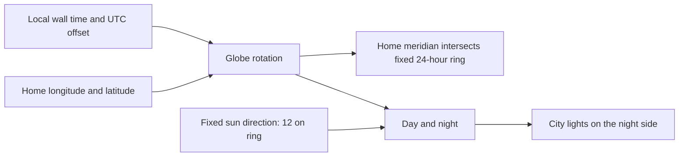

# Globe in a 24-hour Sun Ring

Status: standalone implemented and PC-verified; device testing and pack integration are deferred until the current batch is ready.

## Experience and visual target

A recognizable Earth floats in a fixed equatorial 24-hour ring, with a home pin and meridian, a sunward 12, a clear night side and warm city lights. The globe rotates once per day. The home meridian meets the ring at the device's current local civil time. Camera and framing should make the ring and home pin legible at TV distance; a small numerical time may supplement the ring. The [high-fidelity concept mockup](2026-11-23-globe-sun-ring/concept-mockup.png) is a visual target, not a mechanically accurate diagram: do not copy its linearized labels or treat it as a screenshot.

Earth texture: [NASA/Goddard Space Flight Center Scientific Visualization Studio, Blue Marble](https://svs.gsfc.nasa.gov/2915/), courtesy of Reto Stockli (NASA/GSFC) and NASA's Earth Observatory.

The standalone requires `--vram-slot-width=1024 --vram-slot-height=512`; the PC capture helper supplies these flags. The Clocks pack's existing texture slot is 2048×1024, subject to verification when the batch is packaged.



```text
                      north pole
                         |
               globe  ___|___      sun -> noon (12)
                     /   |   \
     00 / 24  ------|----+----|------ 12
                     \  home /      fixed ring
                      -------
```

## Time and geography

A fixed sun-facing dial depicts solar time. Civil time is defined by time-zone and daylight-saving rules rather than longitude, and the sun's apparent noon also varies with date. Therefore a single undistorted ring cannot exactly show both the home pin's civil time and actual solar illumination for arbitrary locations; it cannot show every city's civil time either. Use a clearly documented civil-time calibration for the home pin, and describe other longitudes as approximate solar times rather than claiming exact city times. The wall-clock mailbox supplies the device UTC offset but no GPS location. Choose a representative home city from the device UTC offset using the table below. Offset alone cannot distinguish time zones that share it or determine the user's actual city; daylight-saving changes can also select a different representative. A more accurate astronomical model must use date, season, longitude and UTC without silently presenting an approximation as exact.


## Representative home by UTC offset

The table covers the offsets in the installed IANA database in 2026, including seasonal offsets; uncommon unlisted offsets select the nearest listed offset. The point is a representative, not a GPS fix.

| UTC offset | Representative | Latitude | Longitude |
|---|---|---:|---:|
| UTC-12:00 | Baker Island (uninhabited) | 0.19° | -176.48° |
| UTC-11:00 | Pago Pago | -14.28° | -170.70° |
| UTC-10:00 | Honolulu | 21.31° | -157.86° |
| UTC-09:30 | Taiohae | -8.91° | -140.10° |
| UTC-09:00 | Anchorage | 61.22° | -149.90° |
| UTC-08:00 | Los Angeles | 34.05° | -118.24° |
| UTC-07:00 | Denver | 39.74° | -104.99° |
| UTC-06:00 | Chicago | 41.88° | -87.63° |
| UTC-05:00 | New York | 40.71° | -74.01° |
| UTC-04:00 | Santo Domingo | 18.49° | -69.93° |
| UTC-03:30 | St John's | 47.56° | -52.71° |
| UTC-03:00 | Buenos Aires | -34.60° | -58.38° |
| UTC-02:30 | St John's (daylight) | 47.56° | -52.71° |
| UTC-02:00 | Fernando de Noronha | -3.85° | -32.42° |
| UTC-01:00 | Praia | 14.92° | -23.51° |
| UTC+00:00 | London | 51.51° | -0.13° |
| UTC+01:00 | Paris | 48.86° | 2.35° |
| UTC+02:00 | Cairo | 30.04° | 31.24° |
| UTC+03:00 | Istanbul | 41.01° | 28.98° |
| UTC+03:30 | Tehran | 35.69° | 51.39° |
| UTC+04:00 | Dubai | 25.20° | 55.27° |
| UTC+04:30 | Kabul | 34.56° | 69.21° |
| UTC+05:00 | Karachi | 24.86° | 67.01° |
| UTC+05:30 | Delhi | 28.61° | 77.21° |
| UTC+05:45 | Kathmandu | 27.72° | 85.32° |
| UTC+06:00 | Dhaka | 23.81° | 90.41° |
| UTC+06:30 | Yangon | 16.87° | 96.20° |
| UTC+07:00 | Bangkok | 13.76° | 100.50° |
| UTC+08:00 | Singapore | 1.35° | 103.82° |
| UTC+08:45 | Eucla | -31.68° | 128.88° |
| UTC+09:00 | Tokyo | 35.68° | 139.69° |
| UTC+09:30 | Darwin | -12.46° | 130.84° |
| UTC+10:00 | Brisbane | -27.47° | 153.03° |
| UTC+10:30 | Lord Howe Island (daylight) | -31.55° | 159.08° |
| UTC+11:00 | Sydney (daylight) | -33.87° | 151.21° |
| UTC+12:00 | Auckland | -36.85° | 174.76° |
| UTC+12:45 | Chatham Islands | -43.95° | -176.56° |
| UTC+13:00 | Auckland (daylight) | -36.85° | 174.76° |
| UTC+13:45 | Chatham Islands (daylight) | -43.95° | -176.56° |
| UTC+14:00 | Kiritimati | 1.87° | -157.43° |

## Implementation and verification

- Use real 3D globe and ring geometry and real local wall time, not a fixed illustration. Keep settings in a normal pre-approved level settings holder and leave other engine code alone.
- Test home/ring alignment across midnight, noon and fractional UTC offsets, continuous rotation and the day/night transition. Inspect PC captures at multiple times and verify the settings interaction and current local clock. Preserve existing uncommitted changes in main.
- During the present batch, do not change the pack manifest, rebuild bundles or APKs, test Chromecast or deploy. When Will closes the batch, follow the device, packaging and deployment procedure in the combined-pack HOWTO.

## PC results

The [Bangkok noon](2026-11-23-globe-sun-ring/pc-noon.png), [Bangkok midnight](2026-11-23-globe-sun-ring/pc-midnight.png), and [Kathmandu noon](2026-11-23-globe-sun-ring/pc-nepal-noon.png) captures were made in the real desktop engine. At UTC+07:00, its Earth rotation mailbox read 0.720825 turns at noon and 0.220825 at midnight; the Bangkok city-light mailbox changed from 0 to on, and setting City lights to Off returned it to 0. At UTC+05:45 the home longitude mailbox read 0.237 turns (Kathmandu), and accelerated wall time advanced the actual Earth rotation. At a frozen noon the camera shot's X position was 0.18 with drift on and 0 with drift off. Holding A opened the [settings UI](2026-11-23-globe-sun-ring/pc-settings.png). The mockup is an art target; the PC captures show the current implementation.

The offset-derived home is only an estimate, and its longitude calibrates the dial to local civil time; the resulting terminator and city time readings are approximate, not an astronomical simulation or a time-zone database. The current visual uses directional lighting and selected city-light clusters, rather than a comprehensive map of night lights.
