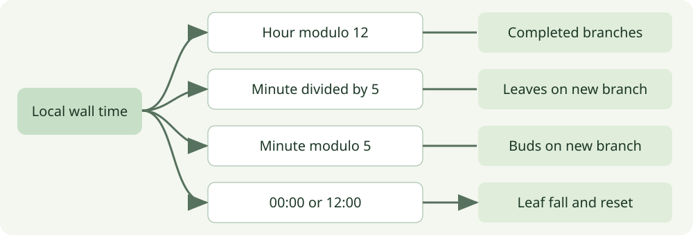

# Hour Tree

Status: standalone built and PC-verified; open for Will's review. Chromecast testing and bundling wait for the current batch.

## Experience

A solitary tree grows in a tranquil clearing. Count completed branches for hours since midnight or noon, then count the leaves on the newest growing branch in groups of five minutes and its small buds for the remaining minutes. Completed branches have sparse decorative foliage; the newest branch spaces its counting leaves and buds so they can be distinguished. At 10:08, ten branches are complete and the eleventh is growing one leaf and three buds. At noon and midnight the leaves fall and the tree begins a new cycle. Keep the geometry open enough to count; this is a slow, ambient clock. A gently travelling camera reveals depth, with a setting to hold the camera still.

The high-fidelity concept mockup sets the atmosphere, not the exact number of branches or leaves. Counts and behavior follow the diagrams below.


The [Blender study](2026-11-23-hour-tree/blender-study.png) explores textured wood and a landscape; it remains a work in progress and is not the current engine appearance. Its editable scene is `wflevels/hour_tree/hour_tree_art.blend`. The PC engine uses its trunk and branches, with a separate leaf texture, gently swaying foliage and a moving camera. At `:59`, the counting leaves still need a readability check from the moving camera.

```text
                 10:08
                 newest branch (11)
                      /── leaf          = 5 minutes
                     /─── bud bud bud   = 3 minutes
                    /
       completed   /  10 completed branches = 10 hours
       branches   /
                tree

    11:59                 12:00 / 00:00
    11 complete           leaves drift down
    12th growing          cycle starts again
    11 leaves + 4 buds
```

```text
Local wall time
   ├── hour modulo 12 ───────> completed branches
   ├── minute divided by 5 ──> leaves on newest branch
   ├── minute modulo 5 ──────> buds on newest branch
   └── 00:00 or 12:00 ───────> leaf fall and new cycle
```



## Implementation and verification

Use the existing level scripting and normal pre-approved settings registration, including Show framerate. On PC verify 00:00, 10:08, 11:59, 12:00 and the rollover animation, including counts, and inspect an actual desktop render. Then open the standalone level visibly for Will's feedback. Do not add to the shared bundle, test Chromecast or deploy until the batch is ready. Seasonal appearance is optional and must not make the clock depend on an unavailable date source.

PC results: the standalone and its settings holder build successfully; the 10:08 model test passes. A PC run confirmed camera and leaf motion; an override held the camera still. Will found the leaves hard to count and could not see their texture. The revised [10:59 capture](2026-11-23-hour-tree/pc-1059.png) shows visible veins, eleven spaced leaves and four buds. The [noon +1s](2026-11-23-hour-tree/pc-noon-01.png) and [noon +3s](2026-11-23-hour-tree/pc-noon-03.png) captures show the falling foliage at two positions; [midnight +3s](2026-11-23-hour-tree/pc-midnight-03.png) shows the same reset state. A live rollover initially crashed because the hidden falling-leaf actor kept moving outside the room. The level script now parks it outside the fall; live noon and midnight checks both observed the leaf actor descend and return to zero without crashing. The old flat prototype and Blender study should not be treated as the finished visual target.
