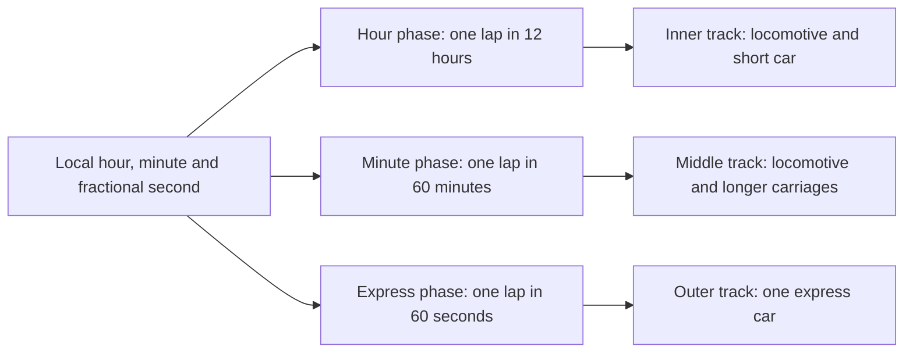

# Train Loops

Status: standalone implemented and PC-verified; live window opened for review. Device testing and bundling wait for the current batch.

## Experience

Three concentric model railways sit on a small landscaped tabletop, with twelve station markers arranged like clock numerals. From midnight to noon the stations show 00–11 and the house lights are off. At 12:00, all the numbers change together to 12–23 and the house lights turn on; at midnight they change back. The inner loop carries a short hour train, the middle loop a longer minute train, and the outer loop a single streamlined express for seconds. The leading end of each train is the clock hand. All three lead vehicles pass the top station together at 12:00:00 and the express completes one lap a minute. Trains run smoothly, not in minute or second jumps. The camera travels across and beyond the clock.

```text
                        12  station
                   .-----------------.      outer: single express
                .-'  .-------------.  '-.   middle: long minute train
             9 /    /  .---------.  \    \ 3
               |   |   |  short   |  |   |  inner: hour train
                \   \  '---------'  /   /
                 '-. '-------------' .-'
                     '------6------'
```



All twelve labels and the house lights switch together:

```text
00:00–11:59   00 01 02 03 04 05 06 07 08 09 10 11    lights off
12:00–23:59   12 13 14 15 16 17 18 19 20 21 22 23    lights on
```

The [high-fidelity mockup](2026-11-23-train-loops/concept-mockup.png) is an art and composition target, not an engine screenshot or a precise diagram.

## Time and implementation

At local time `h:m:s`, the lead phases in revolutions clockwise from 12 are `((h % 12) + m/60 + s/3600)/12`, `(m + s/60)/60`, and `s/60`. Each carriage follows its locomotive at a fixed angular distance, with its own tangent orientation; loops have distinct radii so nothing collides. A table-driven geometry model and tests check midnight/noon alignment, quarters, 10:08:22, wraparound and carriage spacing. Clock settings use the approved normal holder and registry additions, with camera drift and global frame-rate control. Existing unrelated changes in main are preserved.

The camera follows a closed smooth spline: it starts outside in a wide view, travels low across the tracks and past the far side, then sweeps out beyond the layout before returning. Its look-at point moves along a separate spline so the journey shows the tabletop in depth rather than merely making the dial appear to spin. Camera drift Off holds the original wide view. A visible desktop run must use the host's local time zone, including its daylight-saving rules. Do not let a UTC-configured container silently replace the computer's local time.

## Verification

Build the standalone and the matching PC engine, then inspect actual captures at 12:00, 10:08:22, and across a simulated minute rollover. Check train geometry, counts, tangent orientation, continuous motion and the settings UI on PC. At the end, run the real standalone level in a visible desktop window for Will to review. Do not add this clock to the pack, rebuild its bundles or APKs, test a Chromecast, or deploy until Will closes the current batch.

PC results: the real engine's actor positions and tangent rotations matched the model for every locomotive and carriage at [12:00](2026-11-23-train-loops/pc-noon.png) and [10:08:22](2026-11-23-train-loops/pc-ten-eight.png). During a live 11:59:56-to-12:00 transition the express crossed the twelve position continuously. Holding A opened the [settings screen](2026-11-23-train-loops/pc-settings.png); the shared Display section contains Show framerate. The spline camera and target matched their model at several points across the circuit, and drift Off held the wide view. PC captures of [midnight](2026-11-23-train-loops/pc-am.png) and [noon](2026-11-23-train-loops/pc-pm.png) show the two number sets and the corresponding house lights. The first visible launch mistakenly used the container's UTC time zone; subsequent launches mount the host's local-time file. The mockup depicts the target style; the PC captures show the actual geometry.
