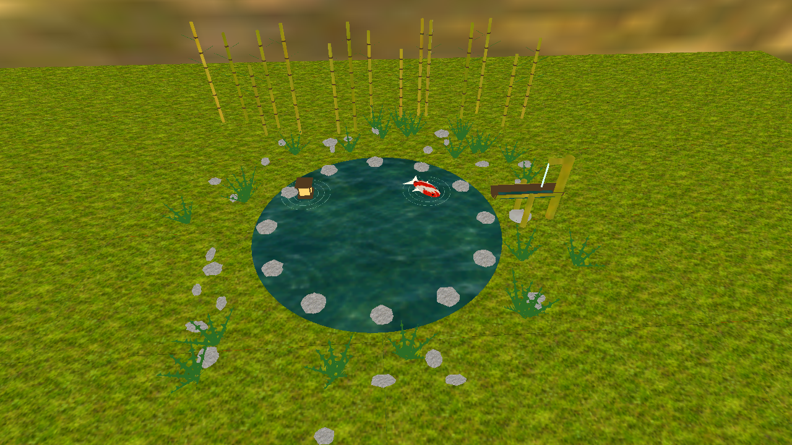
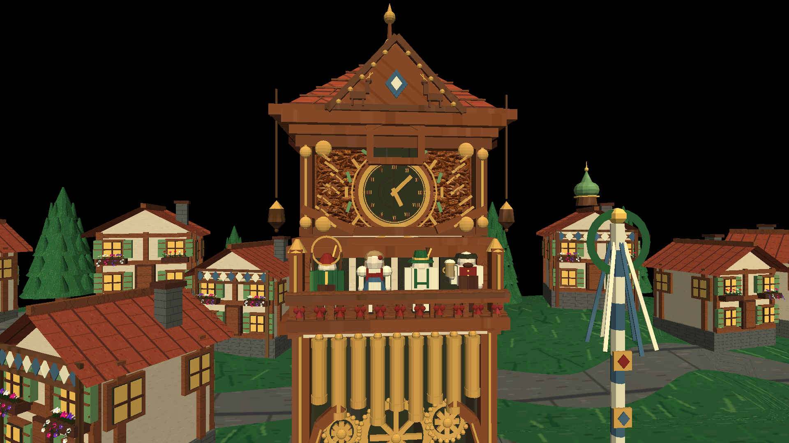
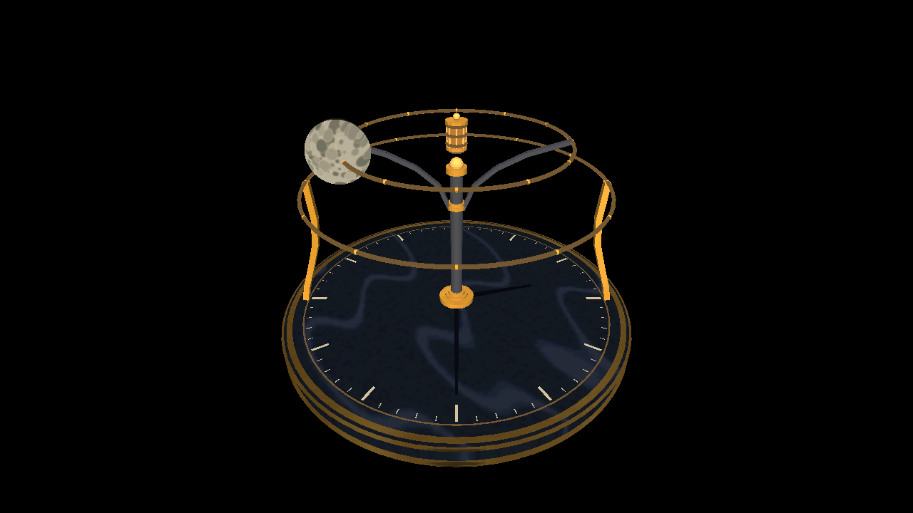
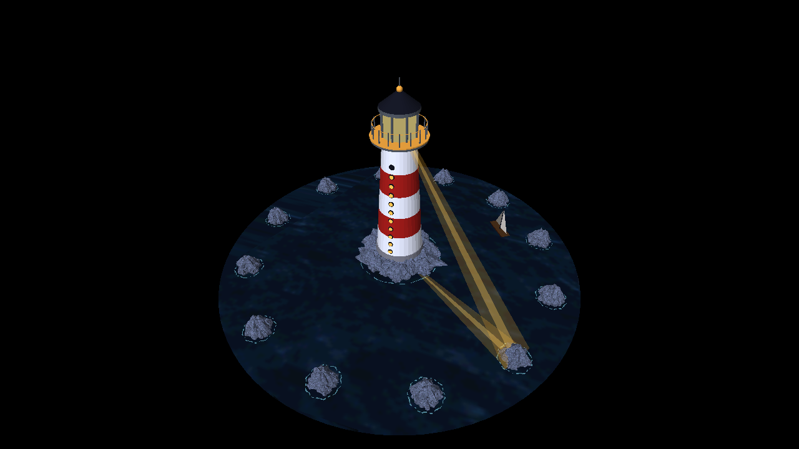
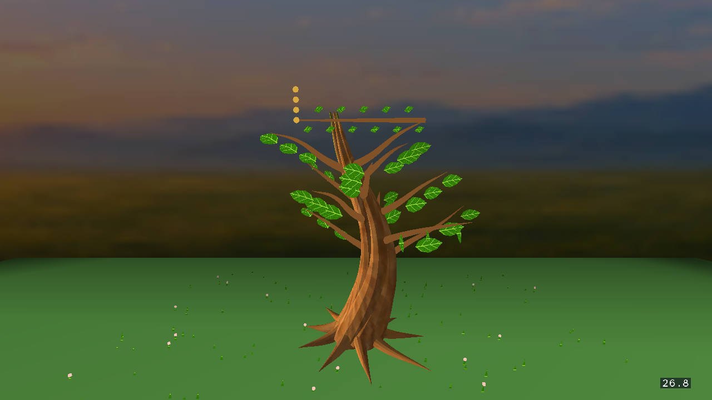
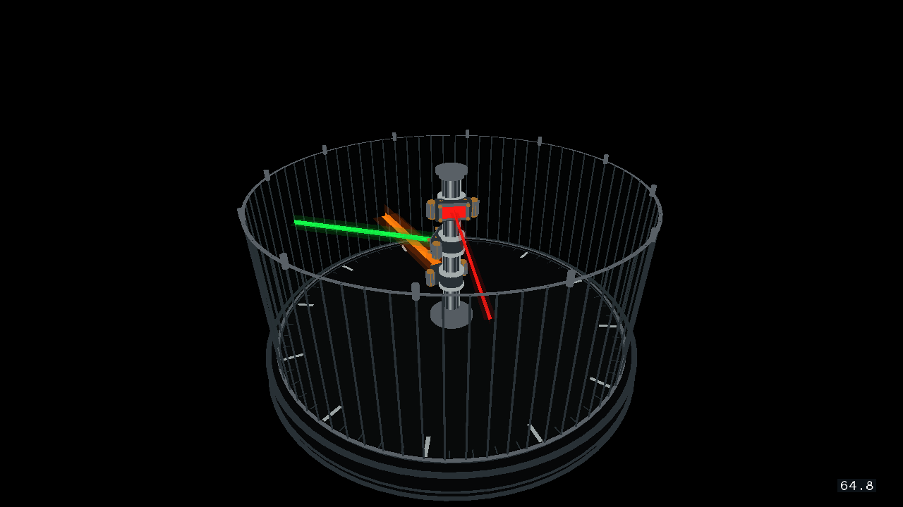

# Update the 3D Clocks bundle with finished levels

**Status: plan, 2026-11-24.** Add all newly finished clock levels to the combined app and screensaver in one batch. This document plans the work; it does not itself authorize engine changes. Follow the [3D Clocks batch workflow](../howto/combine-levels-chooser-and-screensaver-launch.md#3d-clocks-batch-workflow), including standalone device checks before adding levels to the pack.

## Scope and inventory

The original bundle contained Minute Machine, Tide Harbour, Cuckoo Village and Anamorphic Shards; the current [manifest](../../wflevels/clocks-menu.manifest) lists the expanded roster. Preserve their IDs; this update deliberately reorders their positions. Will subsequently requested a fix to Anamorphic Shards, so rebuild its existing entry with that fix, verify the packaged bytes contain the updated level, and complete the fix's outstanding PC and Chromecast checks. Do not add a second entry.

The following **12 new standalone levels** are the proposed batch, including Corolla Gauge at Will’s request. IDs are their level-source directory names; confirm each built standalone's exact name before adding its manifest line. The table records the evidence and gaps in the plans as of 24 November, not completed Chromecast acceptance. All 12 need the device and combined-package checks below.

| Proposed chooser name | Level ID | PC evidence and specific work before acceptance |
|---|---|---|
| [Bamboo Tipper and Pond](2026-11-24-bamboo-tipper-pond.md) | `bamboo_tipper_pond` | Positions and noon rollover checked; check tip and water reset, pond options, settings and camera on TV. PC feedback is open. |
| [The Corolla Gauge](2026-11-24-corolla-gauge.md) | `corolla_gauge` | Will approved batch inclusion; its separate agent owns refinement and level verification. Include the handed-off standalone and palette without duplicating that work. |
| [Dutch Cuckoo Village](2026-11-24-dutch-cuckoo-village.md) | `dutch_cuckoo_village` | Standalone PC captures and camera clearance sampling exist. Test the journey and still views, crossings and hourly choreography, settings, and dusk performance; the audible call is deferred in its plan. |
| [Globe in a 24-hour Sun Ring](2026-11-23-globe-sun-ring.md) | `globe_sun_ring` | Noon, midnight, Kathmandu's fractional offset and settings checked on PC. Verify local-time alignment, city lights and camera on TV. |
| [Hour Tree](2026-11-23-hour-tree.md) | `hour_tree` | Revised leaves and live noon/midnight reset checked on PC after a crash fix. Check leaf and bud readability, rollover stability and the revised artwork on TV; visual review is open. |
| [Lava-lamp Digits](2026-11-24-lava-lamp-digits.md) | `lava_lamp_digits` | PC time and melt/formation checks exist; visual refinement and feedback remain. Recheck 23:59→00:00 after the final art changes and assess digit readability and transitions on TV. |
| [Lighthouse](2026-11-24-lighthouse.md) | `lighthouse` | Boat, beam, windows and rollover checked on PC. Include the implemented [water-motion follow-up](2026-11-24-lighthouse-water-motion.md); profile water, surf and wake and verify texture-slot fit on TV. Visual feedback is open. |
| [Metronome Forest](2026-11-24-metronome-forest.md) | `metronome_forest` | PC checks cover counts and minute-boundary convergence. Verify count readability, all 60 moving metronomes, frame pacing and still camera on TV; visual feedback is open. |
| [Mirror and Haze](2026-11-24-mirror-haze.md) | `mirror_haze` | PC clock motion and an 80-frame beam-visibility sweep passed. Verify all three beams remain readable on TV and apply haze and camera changes through the settings UI. |
| [Moon Lantern](2026-11-24-moon-lantern.md) | `moon_lantern` | Lunar reference dates and shadow angles checked on PC. In-engine rollover, still-camera and framerate-toggle checks remain; record the visual differences and review status before acceptance. |
| [Train Loops](2026-11-23-train-loops.md) | `train_loops` | PC positions, settings and live noon rollover checked. Verify train counts, continuous motion, day/night appearance and camera on TV. |
| [Triple-axis Tourbillon](2026-11-24-triple-axis-tourbillon.md) | `triple_axis_tourbillon` | Hands, cages, bead and live six-minute alignment checked on PC. Verify clock readability, motion and still camera on TV; visual review is open. |

Use this proposed order for the **entire collection**, alternating accessible clock faces, lively scenes, quiet landscapes and more abstract ways to read time. The 16 entries include the four existing clocks and the 12 new candidates:

| Position | Clock | Place in the collection |
|---|---|---|
| 1 | Minute Machine | A familiar mechanical introduction with a clear clock face. |
| 2 | Tide Harbour | Opens out to a Bangkok riverside scene. |
| 3 | Train Loops | Returns to a familiar dial through moving trains. |
| 4 | Bamboo Tipper and Pond | A quieter natural interlude. |
| 5 | Triple-axis Tourbillon | An intricate close-up mechanical contrast. |
| 6 | Cuckoo Village | A lively architectural scene and hourly performance. |
| 7 | Moon Lantern | A calm astronomical dial after the village. |
| 8 | Metronome Forest | A rhythmic counted display with many moving parts. |
| 9 | Lighthouse | A night seascape with a boat and sweeping beam. |
| 10 | Anamorphic Shards | An abstract change of pace after the landscape. |
| 11 | Hour Tree | An organic counted clock. |
| 12 | The Corolla Gauge | A flower and 24-hour specimen label follow the tree. |
| 13 | Dutch Cuckoo Village | A second village separated from the first, with its own journey and character. |
| 14 | Mirror and Haze | A minimal composition of colored beams. |
| 15 | Globe in a 24-hour Sun Ring | A world-scale view of day and night. |
| 16 | Lava-lamp Digits | A direct digital display to finish the sequence. |

This deliberately replaces the prior append-only order for this update. Keep IDs stable, rebuild the menu and bundle in exactly the same order as the manifest, and verify saved selections across upgrade: catalog IDs map to bundle positions at runtime, but inspect every persistence and launch path for any stored or hard-coded indices before relying on that behavior. Test each previously saved clock through upgrade, and reconcile manifest documentation and tests that require append-only order. If a level fails or remains unfinished, record the reason and keep the relative order of those released. The inventory sweep below must catch any other level finished before the roster freeze.

**Corolla Gauge:** Will requested its inclusion despite unfinished flower and pot artwork. Its standalone and palette were packed; its level plan records a passed live hour rollover. Its separate agent owns its remaining refinement and level verification; integrate its handed-off standalone and palette without duplicating that work. [Versailles Topiary](2026-11-24-versailles-topiary-clock.md) remains a proposal.

**Local pack update, 24 November:** the 16-entry `wflevels/clocks-cd.iff` was repacked after the hour-display and night-cue changes, including the handed-off Corolla standalone. SHA-256: `7d45e157f3cff6d08bb5dc7524bab311986ec516d6b63a36483cedfc92322036`. The manifest/bundle tests passed. This is a local pack, not a new installed APK; per-clock device acceptance remains open, and an active Corolla refinement may produce a newer standalone that needs a later repack.

Before freezing the roster, inspect all clock plans and level sources, including work in progress, for additional finished levels. Record each candidate's level ID, source and artifact revision, PC and visual-review status, outstanding checks, and disposition. Include every level that is finished at the roster freeze; record unfinished levels and their specific remaining work rather than quietly omitting them or treating a plan as proof of completion. In particular, Moon Lantern records outstanding rollover and settings checks; Lava Lamp Digits records remaining visual refinement. Preserve any pending feedback and do not assume a visible PC window implies approval.

## 24-hour readings and nighttime appearance

Will's requirement, 2026‑11‑24: **sweep every clock level. If it shows hour numbers, the hour display must use 24-hour time. If it does not show hour numbers, give it a nighttime mode, usually with some lights on.** Apply this to existing bundle entries, new candidates and clocks still being authored, including Corolla Gauge; the sweep must also look for clock levels outside this inventory. A 12-hour numbered dial needs a 24-hour numeric presentation, such as labels that correctly change with the local half-day or a clearly readable 00–23 display. Will specifically excluded the Tide Harbour tower from changes; its side panel is addressed separately below. A nonnumeric hour display needs a visibly distinct night appearance driven by local time; choose lights, windows or other scene-appropriate details that can be seen from the actual camera. Nighttime means night, not merely the whole PM half of the day. Use each scene's established day/night timing where available and document the chosen local schedule otherwise. Keep the time readable, including in moving and still camera views.

The source sweep and the associated level changes are complete. A checkmark means that the clock was reviewed for this requirement and the required source change was made or its existing behavior identified. It does not mean that the separately listed Chromecast, transition or readability checks have passed. Check how existing settings affect the nighttime indicator and document an explicit user-controlled option that turns it off; the default appearance must show the night cue. Use existing level, actor, material and script features; propose and obtain explicit permission for any engine change.

| Done | Clock | Result | Before and after |
|---|---|---|---|
| ☑ | Minute Machine | Its number drums already show local hours 00–23. | — |
| ☑ | Tide Harbour | The tide panel now uses Arabic digits while retaining the Thai labels and the existing tower dial. [Appendix](2026-11-21-tide-harbour-clock.md#appendix-arabic-digits-on-the-side-panel-20261124) | 
 
 |
| ☑ | Train Loops | Station labels already switch between 00–11 and 12–23 at noon and midnight. | — |
| ☑ | Bamboo Tipper and Pond | The floating hour lantern gains a warm glow at night. [Appendix](2026-11-24-bamboo-tipper-pond.md#appendix-nighttime-lantern-20261124) | 
 
 |
| ☑ | Triple-axis Tourbillon | Two pedestal lamps illuminate at night, complementing its unnumbered hour dial. [Appendix](2026-11-24-triple-axis-tourbillon.md#appendix-nighttime-lamps-20261124) | 
 
 |
| ☑ | Cuckoo Village | Classic and Bavaria dials now switch their labels between 00–11 and 12–23. [Appendix](2026-11-21-cuckoo-village.md#appendix-24-hour-dial-labels-20261124) | 
 
 |
| ☑ | Moon Lantern | A warm glow appears in the orbiting lantern at night, distinguishing night on its unnumbered dial. [Appendix](2026-11-24-moon-lantern.md#appendix-nighttime-lantern-20261124) | 
 
 |
| ☑ | Metronome Forest | Two lamps on the stand illuminate at night; the hours remain a count of brass columns. [Appendix](2026-11-24-metronome-forest.md#appendix-nighttime-indicator-20261124) | 
 
 |
| ☑ | Lighthouse | A blue rim illuminates the sea at night, separate from the windows that count the hour. [Appendix](2026-11-24-lighthouse.md#appendix-nighttime-indicator-20261124) | 
 
 |
| ☑ | Anamorphic Shards | Its projected hour digits already use 24-hour time with a leading zero. | — |
| ☑ | Hour Tree | A moon-and-stars backdrop appears at night while the branches continue to count hours. [Appendix](2026-11-23-hour-tree.md#appendix-nighttime-appearance-20261124) | 
 
 |
| ☑ | Dutch Cuckoo Village | Its dial has unnumbered marks, and the village already lights its windows from dusk to dawn when enabled. | — |
| ☑ | Mirror and Haze | A pale ring illuminates at night, distinct from the three colored time beams. [Appendix](2026-11-24-mirror-haze.md#appendix-nighttime-indicator-20261124) | 
 
 |
| ☑ | Globe in a 24-hour Sun Ring | Its numbered ring already represents all 24 hours and includes city lights. | — |
| ☑ | Lava-lamp Digits | Its four wax digits already display local time in 24-hour format. | — |
| ☑ | Corolla Gauge | Its pot label uses 00–23; the separate level agent owns its refinement and verification. | — |

The thumbnails show the original scene and the changed scene; some were captured at different times and camera angles. Cuckoo Village’s after image is a distant view and does not establish dial readability. Full-size images and matched day/night views are in the linked level appendices. Dashes indicate no scene change was made in this sweep. Remaining checks include transition boundaries, time jumps, readability along the camera path, and Chromecast testing and profiling; the linked appendices record the specifics for each changed clock. Record the source revision and results for each check. Exercise at least 00:00, 11:59, 12:00, 13:00 and 23:59, plus both sides of its night/day transitions, direct entry and resume/time jumps. Check actual rendered output and relevant settings, then include the same requirement in each clock's Chromecast testing and profiling. Do not mark the sweep complete on model tests alone.

## Work

1. **Establish the baseline.** Inspect current source, generated artifacts, object registry, bundle and APK rather than relying on dated plan statuses. Record existing menu order and saved Dream selection behavior. Account for concurrent uncommitted work before rebuilding generated files.
2. **Sweep hour displays and close standalone acceptance.** Apply the 24-hour or nighttime requirement above to every clock, including existing entries and unfinished work. For every finished candidate, verify the actual PC build, its time display and transitions, camera modes and settings, and record visual-review status and remaining differences. Complete each level's own outstanding acceptance checks before including it. Record the exact revision and standalone hash for device testing.
3. **Test and profile every clock on Chromecast.** This applies to all 16 proposed entries, including the four already in the bundle and the updated Anamorphic Shards. Freeze a device build for each new candidate or a suitable temporary test build, verify it contains the intended standalone bytes, and use owned coordinator sessions. For each clock check readability, animation and time transitions, settings including hold-A, frame time and memory; save screenshots, logs and a profile identifying the build and device. Measure both available Chromecasts where possible, document unavailable devices and outstanding checks, and complete those checks when the devices return. Include the Lighthouse water motion in its measurements. A PC review or visual approval does not replace this testing and profiling.
4. **Integrate the roster.** Reorder the manifest and bundle to the proposed collection order above, preserving stable IDs; audit all consumers for positional assumptions and test upgrade from each previously saved clock selection. Ensure each has a settings object and the expected catalog and Dream label. Rebuild levels affected by object-registry changes against the same current registry. Corolla Gauge requires its generated palette table in the packaged level; verify the combined app and Dream contain and use it. Check all texture pages fit the Clocks host's configured VRAM slot.
5. **Build and verify.** Run `task clocks-regenerate`, the relevant clock, catalog, settings and bundle tests, `task clocks-check`, and `task build-clocks-apk`. The freshness check rebuilds a Git ref, so run it against a ref containing the intended changes or explicitly record that limitation. Inspect the final bundle roster and confirm its level bytes match the tested outputs. Freeze the release APK and record its hash and build revision.
6. **Verify the combined release.** Install and exercise the frozen APK through the coordinator on available intended devices. Launch and profile every clock from the actual combined release; associate each result with its level ID and the frozen APK hash. Check chooser navigation, hold-A settings and persistence, Dream selection and resume, and named `org.worldfoundry.screensaver.LEVEL` launches without changing the saved selection. Check invalid IDs and random selection, and exercise phone touch controls where an authorized phone workflow is available. Capture evidence and record any untested device or path.
7. **Close out and clean up.** Update the Android README, individual level plans and batch evidence with the actual roster, build commands, hashes, tests, device results and remaining limitations. Reconcile stale plan statements and avoid declaring device acceptance for checks that did not run. Inventory batch-created temporary files, test APKs, generated artifacts, branches and worktrees. Preserve unique changes and useful evidence; check ignored files and active use before removing disposable files or temporary worktrees. After integration, return to the integration branch and remove merged temporary worktrees and their merged local branches when accounted for. Leave unrelated or unfinished work alone, and record anything that prevents cleanup with its reason and next step.

## Completion

The update is complete when all levels found finished at the freeze are included exactly once, the catalog and bundle match the agreed new order and saved choices survive upgrade, generated artifacts and the release APK match the tested sources, and every included level has passed Chromecast testing and profiling with results recorded. Record unavailable devices as outstanding; do not claim their checks passed. If an individual candidate fails or needs further work, record the blocker and keep it out of the release until it passes; do not present the batch as fully complete while a finished level remains unaccounted for. Any newly required engine modification needs a concrete proposal and Will's explicit permission before editing engine code.
