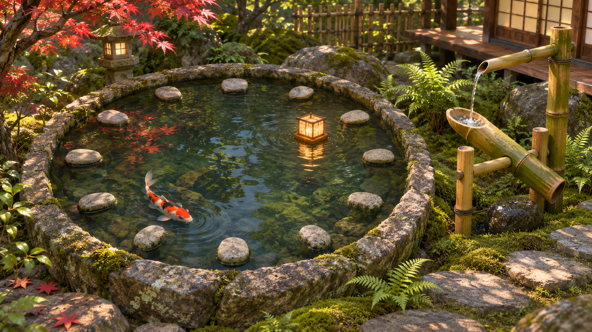
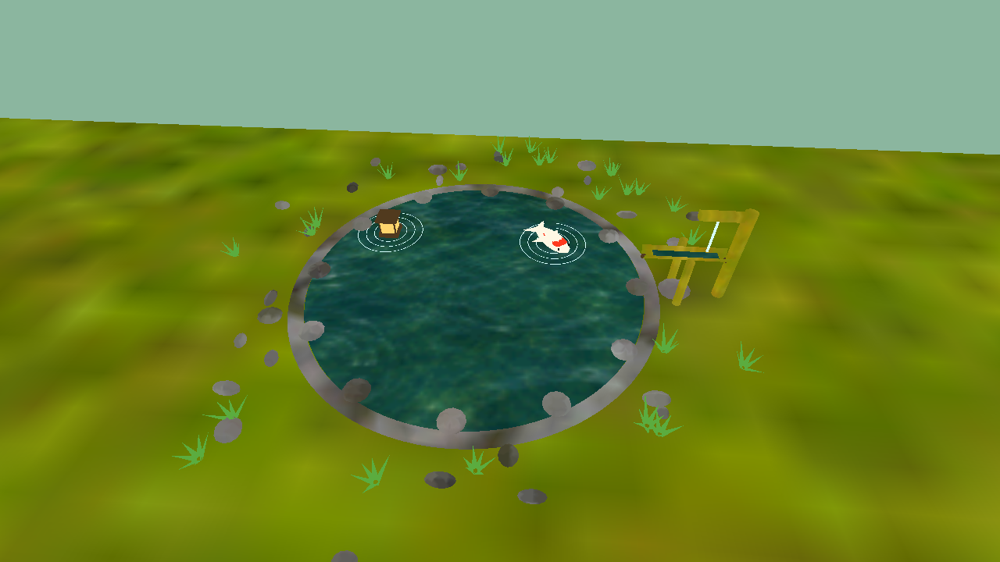

# Bamboo Tipper and Pond

Status: standalone implemented and PC-verified; open for Will's feedback. Chromecast, bundle and deployment wait for the current batch.

## Experience and appearance

A small shishi-odoshi stands beside a circular garden pond, with moss, rocks and foliage. Twelve distinct stones around the water form the dial. A floating lantern moves clockwise once every twelve hours, a koi swims clockwise once an hour, and water builds in the bamboo cup over each minute. As the minute changes, the tube tips, empties and returns to its resting position against its stone. The knock is **silent**. A smooth closed camera path travels from a wide pond view toward the bamboo mechanism and back; the camera-drift setting holds the original wide view still.



The illustration is an appearance target, not a capture of the level. The actual dial has exactly twelve stones, and the lantern and koi must be visually distinct and easy to follow.

## Level settings

The Pond section exposes **Water motion** (on by default), **Ripples** around the koi and lantern (on by default), and **Koi size** (Small, Normal or Large; Normal by default). The shared Clock section offers camera drift or a still camera, and Display includes Show framerate. These change the presentation without changing how the clock reads. The bamboo knock remains silent.

## Reading the time

```text
                         12
                    11        1
                10    lantern    2
               9    round pond    3       water spout
                8      koi       4             |
                    7   6   5               bamboo → stone

Lantern = hour       Koi = minute       Tube filling = seconds
```

```text
Local hour, minute, second
   ├── (hour mod 12 + minute/60 + second/3600) / 12 → lantern orbit
   ├── (minute + second/60) / 60 ───────────────────→ koi orbit
   └── second / 60 ─────────────────────────────────→ water fill
                                                        ↓ at minute change
                                               tip → empty → return (silent)
```

## Build and verification

Create an editable Blender scene and standalone level using existing engine features, and add the normal pre-approved settings holder with camera drift and Show framerate. Keep the clock time and animation smooth. Use the actual host local time for the visible PC run.

On PC verify the lantern and koi positions at 12:00 and 10:08:22, 59:xx-to-00:xx rollover, the tip and empty/reset motion, a quiet soundtrack, moving and still camera views and settings. Inspect rendered frames against the mockup, then run the real standalone visibly for Will's feedback. Record any visual compromises honestly. Do not add the clock to bundles or deploy until Will says the batch is ready.

PC results: the engine's lantern and koi positions matched the model at 10:08:22 and 12:00:01. A live 11:59:55 rollover showed the water reset and the tube tip and return; the still-camera override held the camera in place. The koi uses the Aquarium's fish-deformation primitive. The pond has moving surface texture and ripples; the Aquarium's underwater camera caustics are not applied to the outdoor garden. No knock is played. PC property overrides confirmed small and large koi, still water and hidden ripples; the [settings screen](2026-11-24-bamboo-tipper-pond/pc-settings.png) shows the Clock, Pond and Display sections. The spline camera and target matched the model at wide, across-pond and close-tipper positions. The current [wide view](2026-11-24-bamboo-tipper-pond/pc-wide.png) and an earlier [close view](2026-11-24-bamboo-tipper-pond/pc-tipper-close.png) show the actual stylized engine rendering; the concept illustration is not a screenshot.


