# The Corolla Gauge

Status: Will approved the standalone for inclusion in the 3D Clocks batch on 2026-11-24. The bundle owner will integrate and deploy it with the other clocks.

## Experience and visual target

A large cutaway tulip stands on a grower's bench in a numbered specimen pot. Its red-rose fixed petals frame the style, anthers and the dark star at the base. A contrasting pale petal pivots outward from the flower's base. A brass protractor follows its tip, marked in one-degree minute increments, with larger and numbered five- or ten-minute marks. The setting should look like a detailed botanical instrument, not a flat icon or a generic flower in a room.

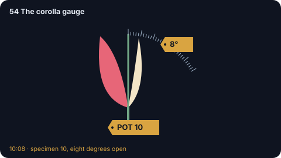

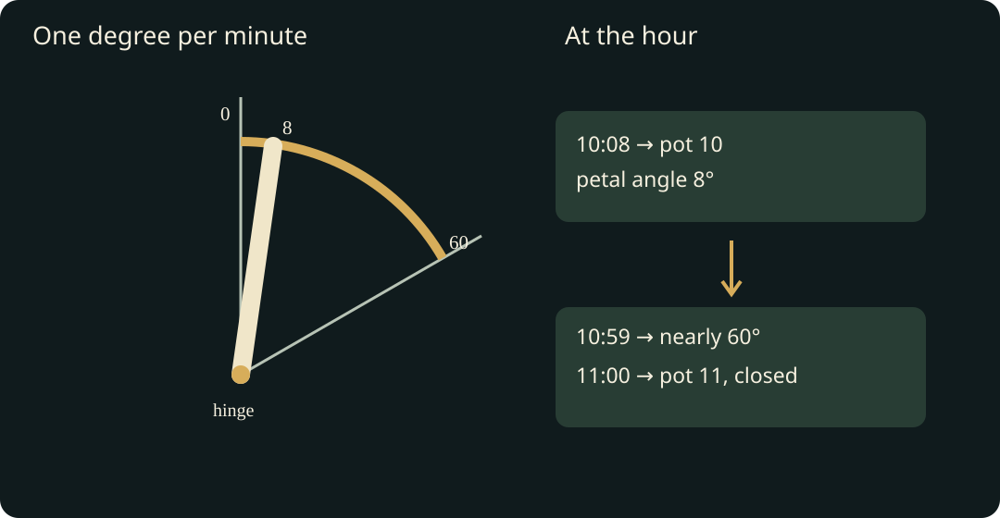

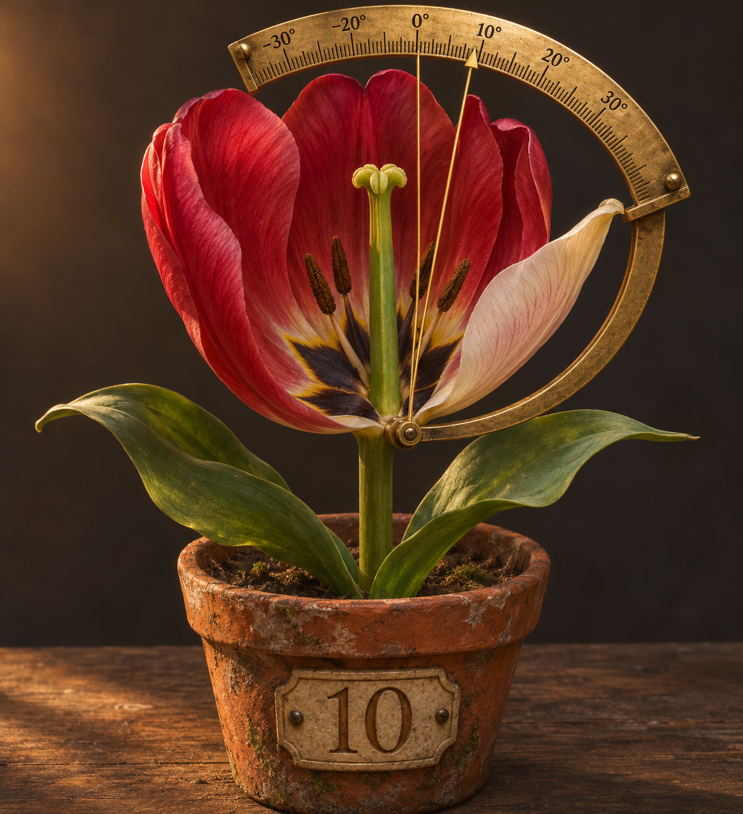

The generated concept is a material and modeling reference only: its petal angle and signed protractor labels do not agree with 10:08. The diagram and the reading rules below specify the actual mechanism.

## How it reads

The pot's specimen label shows the local hour in 24-hour form, `00`–`23`. The petal rotates one degree per minute from closed upright at `HH:00` to almost 60 degrees at `HH:59:59`. The seconds contribute a fraction of a degree, so it moves steadily. Its **tip** follows the brass arc and points at the corresponding minute marks: at 10:08 it is at eight degrees, at 10:59 nearly sixty degrees. At the hour the specimen number changes and the petal returns to closed. The change is a deliberate discontinuity representing the next pot arriving; any arrival transition must not display an incorrect hour or minute.

## Build and verify

Author a genuinely curved and textured flower with visible veins, a distinct hinged pale petal, central style and dark star, a legible labeled pot and a brass protractor with ticks. Construct the moving petal about its real hinge, rather than moving the entire flower. Use the existing level scripting and regular settings object, including Show framerate and slow/still camera. Keep the camera high enough and the protractor legible throughout its motion; keep the scenery subordinate to the clock. Check mesh triangle sizes and atlas/UV appearance in the PC engine. No engine changes are authorized by this plan.

Test the actual PC level at midnight, 10:08, 10:59 and 11:00; measure the petal angle, verify the pot label changes correctly, check the minute ticks and the visible gap to the style, and exercise the camera and settings. Compare screenshots against the original illustration and visual target, document differences and refine the asset where practical. As the last implementation step, run the standalone on the PC for Will's feedback.

## PC implementation and review

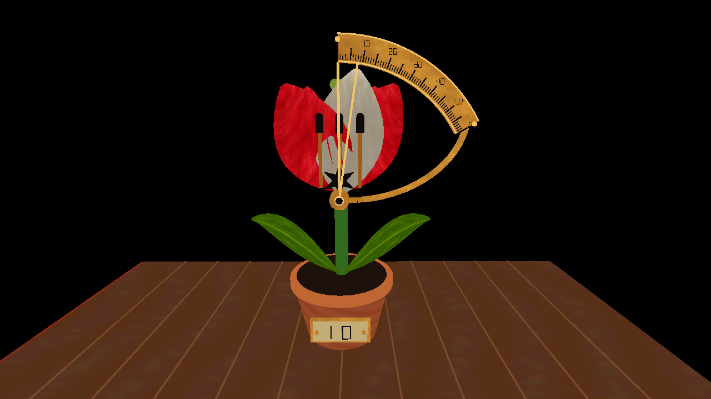

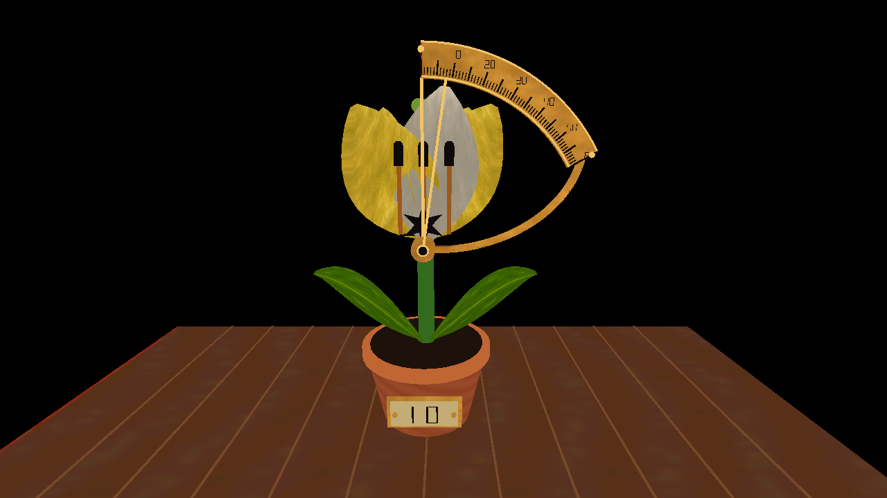

The standalone includes a hinged petal and matching moving pointer, a 0–60-degree scale, a curved support and pivot, a textured brass plate, a 24-hour specimen label and an incoming motion for the new pot. The brass, petal and leaf textures were generated using the concept art as a reference; the scale and its markings are authored geometry. The PC engine measured the petal at approximately 8° at 10:08, 59° at 10:59 and closed at 11:00 and 00:00; the pointer was verified against the petal in the final 10:08 capture. The 10 and 11 pot labels were visually checked. The final mesh-size check passed.

The tulip setting offers Scarlet, Rose, Apricot, Golden, Violet and Ivory. It uses the Discus indexed-palette mechanism: two encoded index images share the generated petal pattern, with the upper index range reserved for the pale measuring petal, and six immutable lookup tables recolor the other petals without changing geometry or pixel indices. The green leaf texture does not change. The PC renderer was captured with Scarlet and Golden, and the index/table invariant has an automated test. As with Discus, the selection lasts only for the loaded level. When bundling this batch, attach the generated palette table to both app and screensaver level containers, as the Discus workflow does; the standalone build attaches it already.

The real render remains more stylized than the generated concept: the petals, leaves, pot and lighting have less surface detail and depth. The hour change presents a short slide-in of the new specimen rather than a fully modeled pot-exchange mechanism. The palette was tested through launch overrides; runtime testing through the settings UI and a continuous rollover capture remain outstanding. Chromecast measurement and bundle work are deferred with the batch.

### Petal texture refinement

A generated petal surface adds fine longitudinal veins and a warm base, guided by the concept. Each curved petal has its own base-to-tip UV mapping, including the hinged measuring petal; the palette tables are still generated from a single shared index pattern. A second, more subtly weathered terracotta texture wraps the pot body and rim. The pot texture is 1024² and the petals are 512²; the level uses a 2048 × 1024 room atlas and the PC capture configures a matching VRAM slot. The rebuilt PC level was captured at 10:08 and the petal and pointer measured approximately 8°. The larger atlas must be accommodated and verified when this level is bundled for devices.

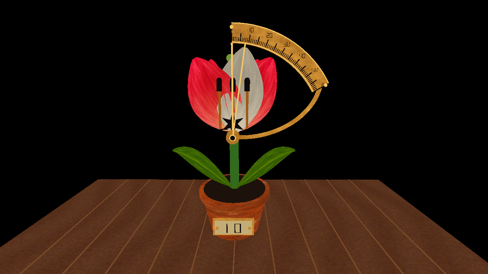

The stamens now grow from the flower's base on tapered, curved filaments, with rounded anthers at staggered heights. Each petal uses a 40 × 32 surface grid. The PC capture at 10:45 shows the flower with the measuring petal open; the petal and pointer measured approximately 45°.

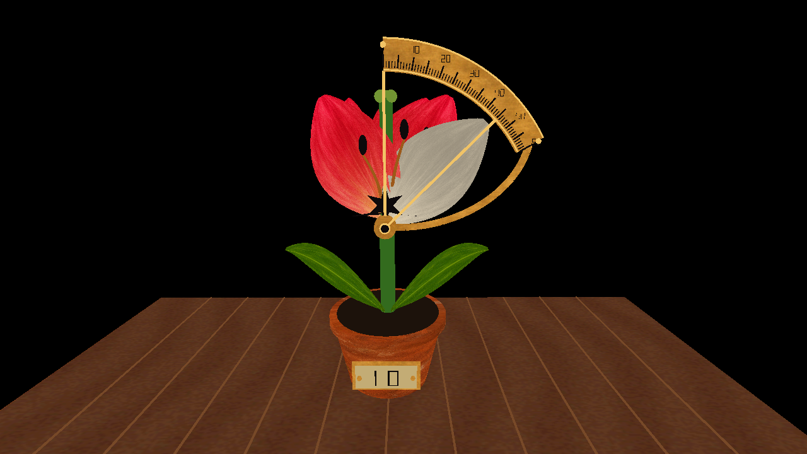

The flower was refined with pollen-textured anthers on curved filaments attached at the base, curled petal edges and wavy leaves. The separate basal star geometry was removed; dark markings are now part of the petal textures. Following PC feedback, the flower now has three stamens, the petal margins flare more visibly, and the camera travels farther sideways and gently changes height. The 10:45 PC capture verifies the petal angle; the complete camera path still needs visual review.

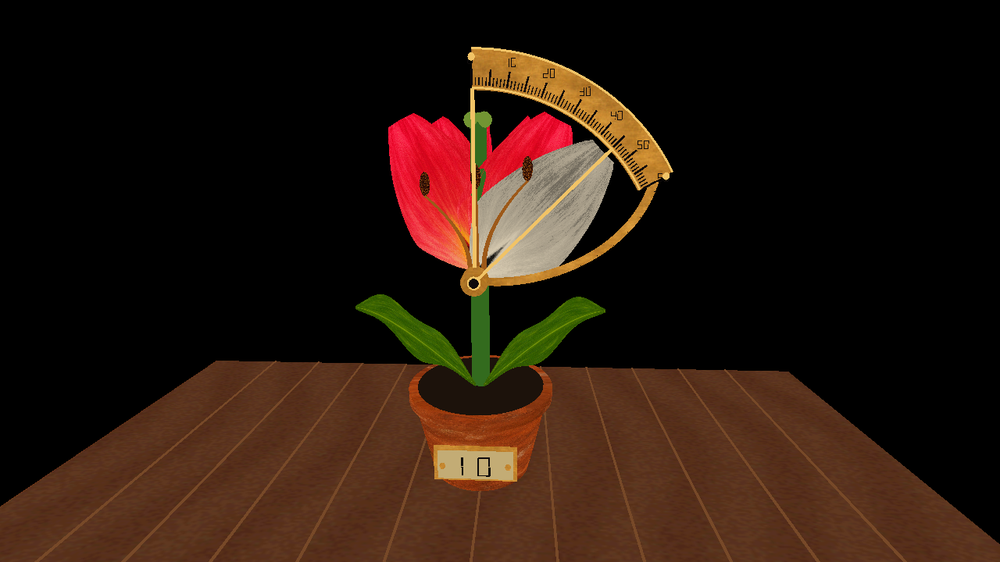

The petal margins now have separate tapered folded surfaces, and the dark basal markings extend visibly up the petal textures. The pistil has its own green texture and is positioned to remain visible in the cutaway. The updated PC capture at 10:45 passed the petal-angle check.

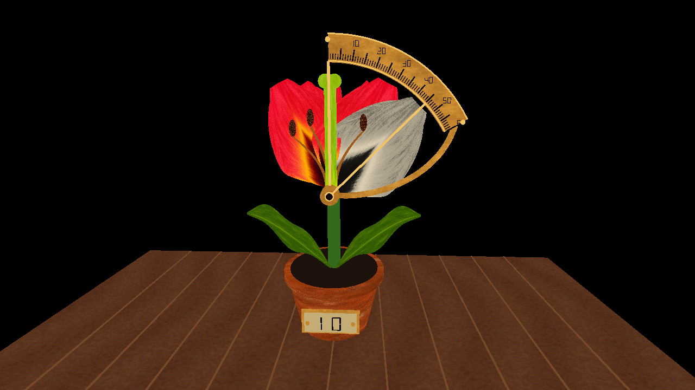

The three stamens are separate actors with independent slow movements, verified in the PC engine over a six-second capture. Wider shaded folds now turn back over the petal surfaces. The 10:45 capture still shows a small red-petal intersection with the pale petal at this camera angle; refine the overlap during visual review.

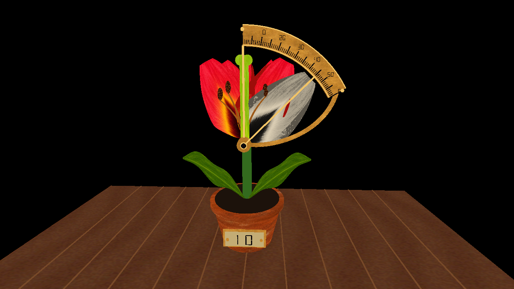

The pistil now uses a higher-contrast veined green texture. The rear petals were moved back to remove the red intersection with the measuring petal in the 10:45 PC capture. The edge curling still needs visual refinement; the existing shaded folds do not yet read clearly enough from the normal camera.

## Bundle handoff, 24 November

Will approved inclusion in the current batch. The final standalone SHA-256 is `ce93912dfd37f86a73f5a5232bf1b927629c89a96f3d8337611fbcba8511f1c0`. Its 2048 × 1024 room atlas needs a matching VRAM slot, already configured in the Clocks assets. Its indexed-palette table is attached to the standalone by `build.sh`; retain it when packing the chooser and Dream and verify all six palettes through the settings UI. The level registers `CorollaGaugeSettings` in the shared actor registry; recook other levels against the same registry when building the combined pack.

The PC engine passed a live 10:59→11:00 rollover: the petal returned from nearly 60° to 0°, and the captures show the pot label change from 10 to 11. The independent stamen movement and the 10:45 petal angle also passed. The texture palette invariant test passes. On this handoff both Chromecasts were unavailable; cast2 re-add job J‑ef9f6bda12d6 failed with `device-not-found-on-network`.

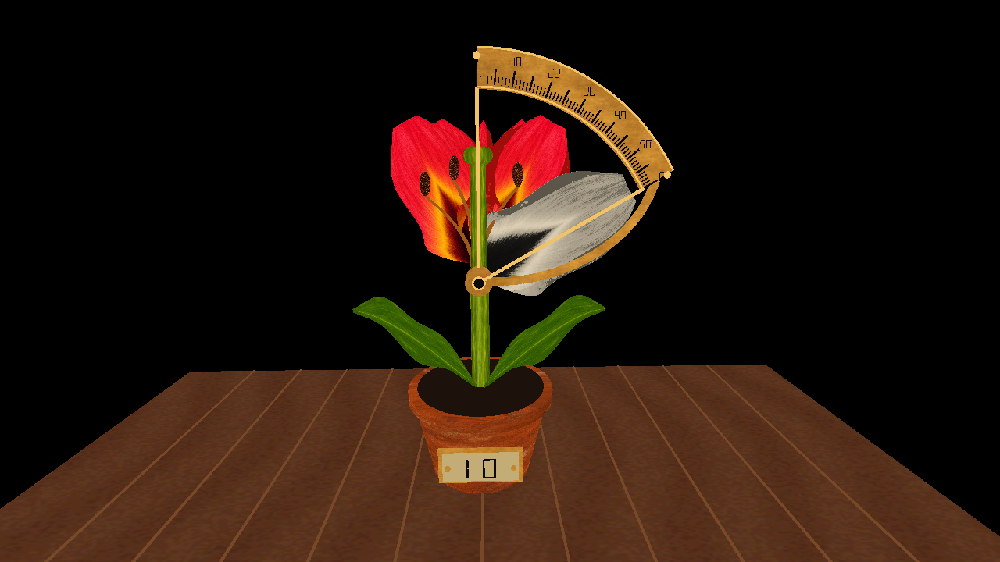

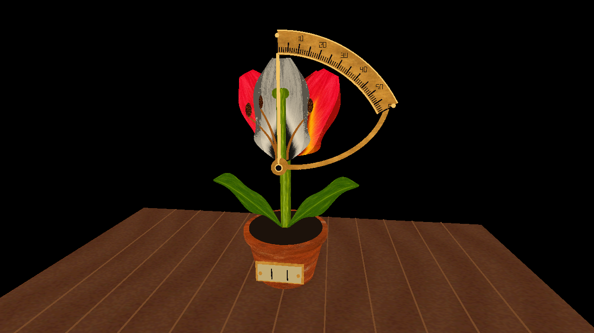

## Additional PC verification, 24 November

The moving camera was sampled every ten seconds for 150 seconds, covering both its 90-second horizontal and 140-second vertical cycles. All samples retained the gauge and pot in frame; the still setting held the camera at its authored position for 20 seconds. The silhouette and shading of the folded petal edges remain an artistic limitation at the normal viewing distance.

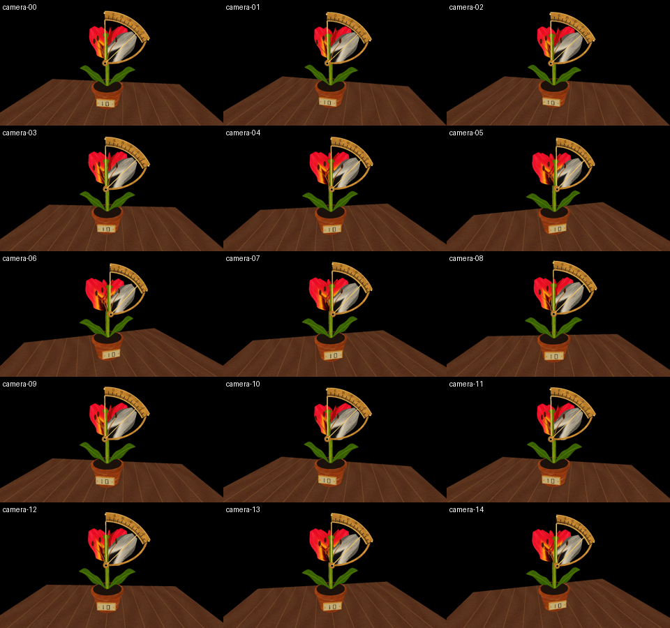

PC captures verified the pot labels at 00:30, 12:30, 13:30 and 23:30; the earlier live rollover captures show 10 changing to 11.

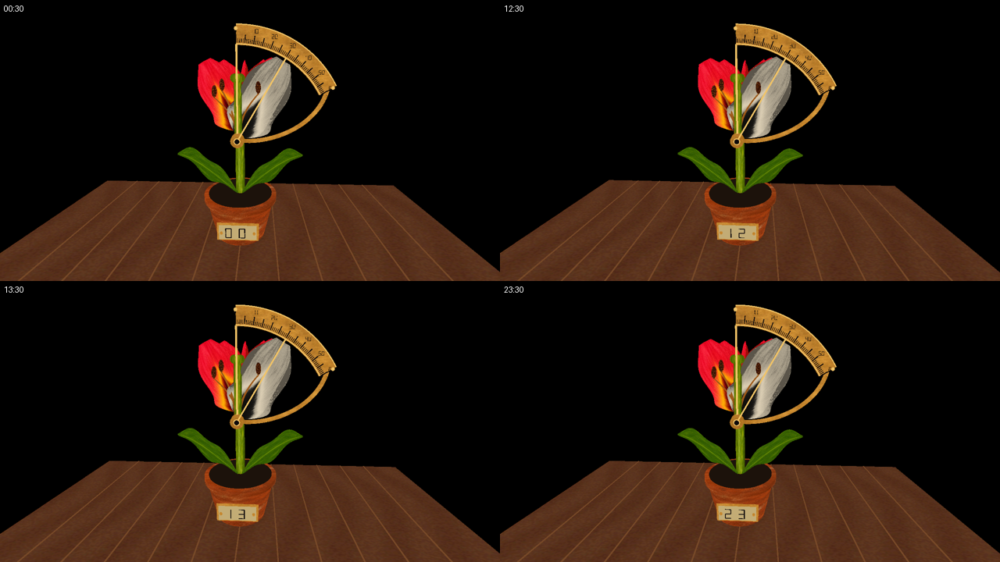

The TV controller form initially trapped focus on the Camera radio row, preventing entry to Tulip. With the authorized shared settings-navigation fix, Left at the first radio option returns to the section rail. Using a temporary two-entry **PC test bundle**, controller input opened settings, navigated to Tulip, selected and applied each of the six palettes, and returned to the running scene. The palette changes were confirmed in the engine log and captures. This was not a combined release or screensaver test.

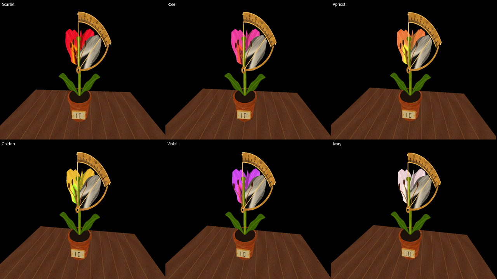

Chromecast profiling and on-device controls, labels and rollover remain unverified because both devices were unreachable. Combined release and screensaver verification are assigned to the other agent.
