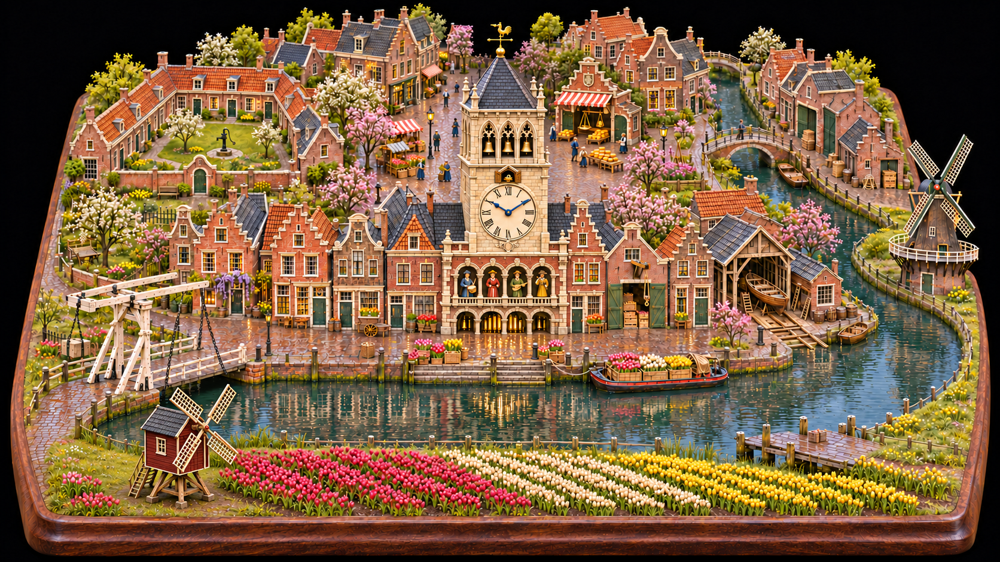
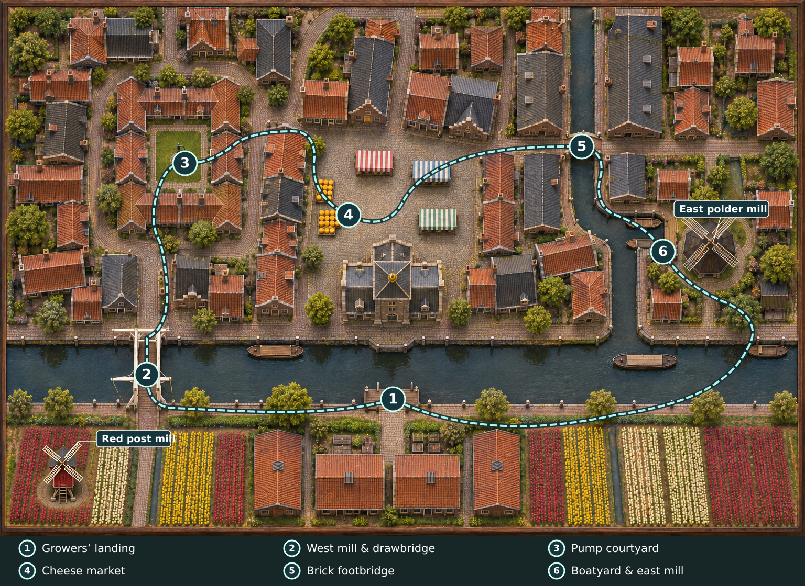
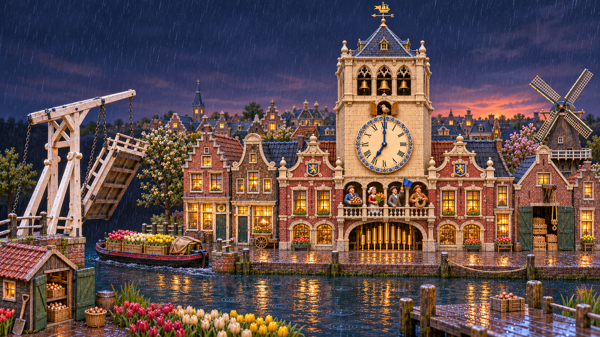
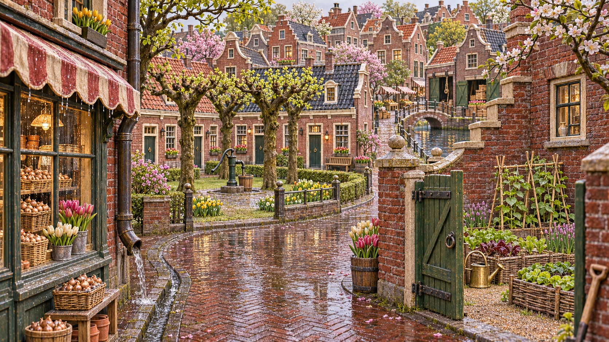
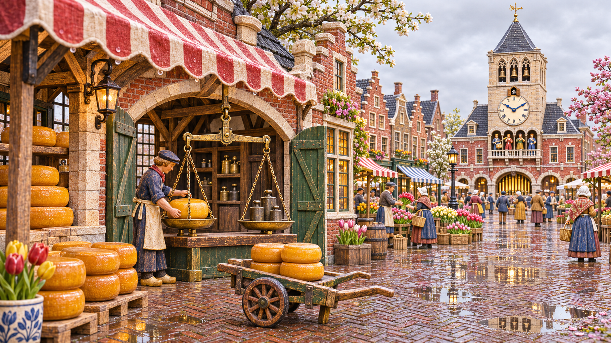

# Dutch Cuckoo Village — Tulpenkade

**Proposed · 24 November 2026**

*The market hall stands between two public spaces. Its clock faces the boats. Behind it,
a striped awning shelters the cheese scales on the square. The camera can disappear
into the town here and find its way back by a different canal.*

At eight minutes past ten, a little bulb boat lies tied up beside a Dutch market hall.
The dial on its pale stone tower reads 10:08. Across the canal a grower has set out
three buckets of cut tulips, sorted by colour. At eleven the white bridge lifts, the boat
comes through with the next delivery, and a painted wooden cuckoo leans out above the
dial to count the hour. From the front of the model you can watch the boat and count the
bird without taking your eyes off the village.

*Tulpenkade* (“Tulip Quay”) is a fictional bulb-growing village inspired by the Dutch
Bollenstreek. Give it its own **Dutch Cuckoo Village** entry in the WF Clocks chooser
and Dream selector, with the proposed level ID `dutch_cuckoo_village`. The canal needs
two banks, a navigable bridge and a low camera approach. Those features justify a
separately authored level. Share the clockwork with [Cuckoo Village](2026-11-21-cuckoo-village.md).

## The model

Set the whole village on a shallow, dark-edged wooden base against the clock collection’s
plain dark background. A dogleg canal cuts the base in two. On the town bank, narrow
brick houses share party walls, but the eaves rise and fall from one house to the next.
Mix a stepped gable, a bell gable and a plain warehouse with a loading door. Give each
front a practical reason to face the water, such as a landing stair, a hoist or a mooring
post. On the growers’ bank, leave enough flat ground to see long parallel tulip rows,
a drainage ditch and the low roofs of bulb sheds. At the west end of the beds, put a
small oxblood-red post mill on timber trestles with a rear ladder and four cream sails.
At the east boatyard bend, keep the taller dark polder mill with its white gallery.
From the performance landing, the two sail circles sit on opposite sides of the clock;
leave clear water between the little mill and the lifting bridge.

### What is in the town-wide picture?

Read this inventory against the daylight view at the top of the plan, with the red mill
at lower left. A row lists one identifiable building, a run of adjoining houses, or a
family of repeated objects. Roofs overlap at the back, so the visible fronts are a
better guide for modelling than a speculative count of hidden houses. The animation
column describes the proposed scene.

| Where to look | Building, structure or object | Details visible in the picture | Planned movement |
|---|---|---|---|
| Lower left, west bulb plot | Red post mill | Square red timber body, grey pitched roof, timber trestle on footings, ladder, four cream lattice sails | Sails turn |
| Far right, east bend | Dark polder mill | Tall tapering timber body, white gallery and rail, cap, four lattice sails, low masonry base and green door | Sails turn |
| Centre quay | Market hall and square civic tower | Low brick hall, limestone-faced shaft, slate pyramid, corner pinnacles and gilded weather vane | Tower and vane fixed |
| Tower face | Clock, cuckoo hatch and bird | Cream dial, blue hands, hour marks and a little hatch between dial and bells | Hands sweep. Hatch and bird perform on the hour |
| Tower openings | Belfry, balcony and chime arcade | Bells behind traceried openings, four figure bays on a pale stone rail, brass pipes behind the lower arches | Figures move. Bells and pipes stay still |
| Balcony, left to right | Four painted clock figures | Grower with bulb tray, seller with bouquet, bridge keeper with flag, skipper with coil of line. Props read most clearly in the crossing close-up | Quarter solos and hourly parade |
| West quay, from the bridge to the hall | Gabled house fronts | A narrow curved gable, stepped red-brick fronts, a grey-brown bell gable and a slim pointed red-tile roof beside the hall | Window light at dusk |
| East quay, from the hall to the boatyard | Quayside houses and loading house | Narrow brick house, broad open green loading doors with crates and a projecting hoist, then another narrow stepped front by the shed | Window light at dusk. Hoist fixed |
| East quay corner | Boathouse and slipway | Open timber-truss shed, tiled lean-to, side workshop, rails sloping into the canal, ladders and a wooden hull on supports | Fixed |
| Northwest | Almshouses and courtyard | Joined low brick wings, orange roof tiles, dormers and green doors around a lawn. Brick enclosure with arched gate, path, benches and iron hand pump | Fixed buildings and pump. Window light at dusk |
| West side, in front of the court | Enclosed garden | Brick and timber boundaries, picket gate, bench, paths, low planting and flowering trees | Fixed |
| Rear streets around the square | Shop houses and rear rooflines | Adjoining brick shops and homes, green shopfronts, awnings, chimneys, dormers, stepped and curved gables | Window light at dusk |
| Market square | Cheese weigh house | Crested brick front, open weighing bay, green doors and red-and-white awning | Weighing mechanism cycles |
| In and outside the weigh house | Cheese wheels and weighing kit | Golden wheels on timber boards, low display tables, two hanging pans and a beam. The close view resolves the handbarrow, iron weights and cheesemonger’s hands | One wheel, the beam, pans and cheesemonger move. Stacks and barrow stay put |
| Across the square | Flower stalls and market furniture | Striped canopies on poles, counters, baskets, boxes and buckets of cut flowers | Fixed |
| Along the back canal | Warehouse row | Tall brick storehouses with large green loading doors, a smaller gabled store, hoisting tackle, stored crates, casks and a little timber stand | Fixed |
| Across the main canal, west | White lifting bridge | Timber uprights, overhead lifting beams, counterweight, hanging chains, deck leaf and its rails, fixed approaches | Opens on the hour for the bulb boat. The deck stays down during all three quarter solos |
| Across the back canal | Brick footbridge and distant crossing | One arched masonry footbridge with a rail, and a smaller crossing visible between roofs near the rear edge | Fixed |
| Both waterways | Canal banks and waterside fittings | Main canal, narrower back canal, quay walls, landing steps, timber piles, mooring posts, rails, ropes and small fenced paths | Water and reflections move. Shore fittings stay fixed |
| Near bank, lower right | Growers’ landing | Timber platform on piles, mooring posts and a crate on the deck | Fixed |
| On the main canal | Tulip barge and load | Low painted hull, open crates of red, white and yellow tulips, covered load towards one end | Crosses on the hour. Cargo rides with the hull |
| At the boatyard and back-canal wall | Two small open boats | One tied by the slip and another moored below the footbridge | Remain moored |
| Lower edge and waterside gardens | Tulip beds, verge and trees | Rows of carmine, ivory and yellow blooms, leaves, bare soil, grasses, low hedges, green trees and pink or white blossom | Planting stays still in the first build |
| Square, bridge and lanes | Townspeople | Small figures at the cheese scales, flower stall, bridge rail and shopfronts | Cheesemonger works the scales. Other townspeople hold their poses |
| Along the fronts and wharf | Street and trading objects | Lantern posts, wall lamps, flower boxes, pots, wooden cart with spoked wheel, barrels, baskets, stacked packing cases and market buckets | Props fixed. Window glow reflects on the wet paving |
| Across the model | Streets, building details and base | Cobbled lanes and square, wet paving, roof tiles, gutters, downpipes, glazed windows, masonry sills and dark-edged wooden plinth | Rainwater, reflections and lighting change |

### Town and aerial map

*North is up. Follow the numbered marks in order. The line gives the proposed camera
track in plan. The landing at 1 is also the quarter-hour performance viewpoint.* [Full aerial without route markings](2026-11-24-dutch-cuckoo-village/aerial-town-two-mills.png)

Allow roughly thirty buildings and give the inland streets about two thirds of the base.
The lanes turn around occupied blocks. Model a roof ridge, rear wall and yard wherever
the travelling camera can see over a frontage.

- **Pump courtyard.** Behind the west quay, a narrow brick lane opens into a three-sided
  court of low almshouses. Rain spills from a downspout by the corner shop. The pump,
  kitchen gardens and lime trees give the camera something to discover at window height.
- **Market square.** Enter beside the weigh house. Amber-rinded cheese wheels lie flat
  in short stacks on boards under its awning. A porter has just wheeled a fresh load
  across the cobbles. One wheel sits in the suspended pan, with iron weights opposite.
  Let the beam rock and settle as the camera passes. Leave a cart-width lane along the
  stalls, wide enough for the viewer to see the wheels edge-on and then from above.
- **Back canal.** Follow the line of the shop roofs to a brick footbridge. From the
  crown of the arch, the camera can look down past warehouse hoists to the water. This
  bridge stays fixed. The white bridge on the main canal performs on the hour.
- **Boatyard and mill bend.** A hull rests on a sloping slipway, with exposed ribs visible
  through the shed door. Take the channel around the yard to the mill, where the buildings
  fall away and the stripes of the tulip beds come back into view.

### The Delft clock tower

Use the civic belfry of Delft’s Stadhuis on the Markt as the architectural reference.
Its substantial stone-clad square tower has three traceried recesses on each face of
the bell stage. Those proportions give Tulpenkade a landmark that reads from the market
square and the back canal as well as from the quay. [Dutch national monument register](https://monumentenregister.cultureelerfgoed.nl/monumenten/11901)

For this miniature, set a pale limestone-faced shaft into a lower red-brick hall. Cut
three pointed bell openings into each side. Finish it with a short slate pyramid and a
small gilded weather vane. Keep the quay-facing cream dial and deep blue hands below the
bell stage, the cuckoo hatch directly above twelve, four figure bays below the dial,
and the exposed brass chimes behind the loading arcade at quay level. Use deep blue
hands and strong quarter marks. The flower seller’s buckets repeat the ivory, carmine
and yellow of the fields, large enough to read as three bunches from the opposite bank.
At the landing, a close view should show the folded leaves and cup-shaped blooms that
distinguish a tulip. Keep the distant rows broad and planted into the soil so individual
stems never turn into a shimmer. The art direction is a spring day that can be seen
year-round. Dusk warms the house windows and leaves the clock face readable.

## A quarter-hour on the quay

*Seven o’clock from the growers’ landing. The bridge leaf clears the barge on the left.
On the right, the cuckoo, the dial and the bridge keeper’s blue flag all read against
the brickwork. Rain rings catch the window light below the quay.*

The four toys have jobs in the same delivery. Each has a prop that reads in silhouette
and moves with it on the existing bow pivot. They stay in view in their bays between
turns. The quarter solos last eight seconds.

| Device local time | Balcony | Canal |
|---|---|---|
| `:15` | The grower steps out, tips a shallow tray of bulbs towards the quay and returns. | The boat is moored. |
| `:30` | The flower seller bows with a tall fan of cut tulips in one arm. | The deck is down and the towpath is open. |
| `:45` | The bridge keeper leans out with a square signal flag. | The boat stays moored and the bridge stays down until the hour. |
| `:00` | The skipper steps out first with a coiled line. All four figures make the two-lap balcony parade and return to their bays. Above them the cuckoo bobs the local hour, with twelve bobs at noon and midnight. | The bridge lifts for one loaded bulb boat, then closes behind it. |

**The crossing takes 24 seconds.** From seconds 0–4, the bridge leaf rises and its
counterweight descends while the boat waits clear. From 4–16, the boat crosses with the
leaf fully raised. Its stern clears the bridge before the leaf lowers over seconds 16–21.
The boat eases into its berth by second 24. The mills keep turning throughout. The bird’s first
bob starts at second 1, with 1.4 seconds between calls. Even a twelve-count finishes
within the camera hold. The visible bob carries the count when muted.

Put berth A west of the white bridge and berth B at the market quay to its east. On
even-numbered hours the boat crosses from A to B. On odd hours it returns from B to A.
Use a double-ended market boat and keep its crates aboard.
At 10:08 it is at B, ready for the eleven o’clock crossing. The same boat can stay in
view between hours. Its position, the bridge angle, the parade and the camera all follow
from one local wall-clock sample, including entry halfway through a crossing. For
audible calls, use the shared sound path once verified. Play only future call boundaries
after entry, resume or a clock correction.

### What moves, and when?

All times below are **device local time**. The mill speeds, shower pattern and scale
cycle are proposed starting values for the first motion test. They apply in both
camera modes, so a viewer who chooses Still can watch the town at work.

| When | What the viewer sees |
|---|---|
| Continuously | Both hands sweep. The little west post mill makes one revolution in 48 seconds. The larger east mill takes 72 seconds. Both turn gently in the same prevailing wind, with an offset so their four sails pass upright at different moments. Only the sail assemblies rotate. |
| Throughout the day | Slow ripples travel along the canals. Broken reflections of the quay, mills and window lights follow the water. Between crossings the bulb boat rests at its berth. |
| Each minute, seconds 20–32 | The cheesemonger tips one wheel onto the pan over seconds 20–23. The beam dips and the opposite pan rises. Both settle by second 27. The merchant slides that wheel back onto the board by second 32 and the empty balance returns to level. |
| First 90 seconds of every ten minutes | A light shower crosses the rooftops. Rings spread on the canal and isolated drops join in the courtyard gutter. Ease the rain in and out over ten seconds. Runoff thins for another 30 seconds; the cobbles keep their wet sheen between showers. |
| At :15, :30 and :45, seconds 0–8 | The grower bows with the bulb tray at :15, the seller with tulips at :30, and the keeper with the flag at :45. Each returns to their own bay. |
| On the hour, seconds 0–24 | The skipper leads all four toys out for two laps. The hatch opens and the cuckoo counts the hour, once at one o’clock through twelve times at twelve. The first bob starts at second 1, with 1.4 seconds between bobs. At twelve the last bob starts at second 16.4. The bird retracts, the hatch closes and the four figures settle by second 24. |
| During that same hourly performance | In seconds 0–4 the bridge lifts and its counterweight descends. From 4–16 the loaded barge passes under the raised span, leaving a short wake. From 16–21 the bridge lowers behind its stern. The boat reaches the opposite berth by second 24. |
| 17:30–18:30 and 05:30–06:30 | Windows fade up through dusk and down through dawn, staggered by house. Turning Window lights off keeps them dark. |
| Between quarter performances | Journey makes four laps through town during each quarter interval and eases into the landing before the next show. Still holds the wide shot throughout. |

Sample mill angles directly from seconds since local midnight. Give the cheese cycle
and rain their own minute and ten-minute phases. Starting the Dream at 10:00:10 should
show a partly completed boat crossing, both mills turning and rain already falling.
The camera’s location never starts or resets an animation.

## Camera and controls

**Journey** makes a closed circuit starting and ending at the growers’ landing. Keep the
horizon level. Use the tower roof as an occasional landmark over the eaves. Let it pass
out of sight in the court so its reappearance means the camera is coming home.

| Mark | Approximate share of a lap | What the moving camera sees |
|---|---|---|
| 1 · Growers’ landing | Start | Face the clock across the main canal, with the white drawbridge to the left. Follow the furrows west towards the small red post mill. |
| 2 · White drawbridge | 0–20% | Look across the red mill’s open trestle and cream sails, then rise past the bridge counterweight at eaves height. Cross into town beside the bridge and turn up the shop lane. |
| 3 · Pump courtyard | 20–38% | Ease down to upper-window height. Pass the running gutter and pump. Follow the east lane towards the striped market awning. |
| 4 · Cheese market | 38–58% | Skim the open edge of the square. Pass the barrow and weighing pan close enough to see the rind. Look up past the stalls to the stone belfry. |
| 5 · Brick footbridge | 58–73% | Round the corner above the arch. The view opens down the back canal towards the warehouse doors. |
| 6 · Boatyard and east mill | 73–100% | Look through the boat shed, rise outside the dark polder mill’s sail sweep, then turn over the fields and ease back to 1. |

*From the lane, the viewer sees water running from a downspout before the courtyard
comes into view. The shot leaves by the passage on the far side.*

*The cheese stop. Stage the wheel on the pan against the dark weigh-house doorway so
its round edge stays readable when the camera passes the awning.*

Fit four complete laps between successive quarter performances, roughly 3 minutes
40 seconds per lap. Derive progress from seconds since the last quarter. Hold at 1
through the first eight seconds of an ordinary quarter or the first 24 of the hour.
Divide the remaining interval into four laps and ease the departure and final approach.
The camera is already looking across the canal when the next bird or figure emerges.
Check continuous position and heading at the lap seam and direct entry mid-lap.

In the performance shot, frame water in the lower third, the balcony above it and the
cuckoo against clear space. At full bridge lift the dial, the four figures and the
hatch must all stay in view. Aim for a dial diameter of at least 10% of picture height.

**Still** uses one wider view from the growers’ bank. Let the boat, bridge and figures
perform within that frame. Use the normal clockwise dial and continuously sampled
hands in both views. At 10:08:00 the minute hand is 48° clockwise from twelve and the
hour hand is 304°. Use device local time even when the viewer lives outside the Netherlands.

Use one level settings object with the standard one-second hold on remote OK. Give it
**Camera motion** (Journey or Still, default Journey), **Window lights** (default On)
and the shared global settings. Add **Sound** with the working call path and verify mute,
volume and audio focus in the Dream. Retain the existing village lighting schedule for
the windows. Store choices under the Dutch level ID so choosing a camera here preserves
the viewer’s preference for the other village.

## Build sequence

1. **Block out the sightlines.** Author the two banks, clock front, bridge swept volume,
   berths and growers’ landing at model scale. Block in all four inland districts and
   run the full camera circuit in grey boxes before detailing individual buildings. Place the existing hand, bird and four figure
   pivots in the clock front. Review a wide frame and a performance frame with the bridge
   fully up and the boat underneath. Move the bridge or the quay before detailing them
   if the bird or the boat disappears behind the span.
2. **Wire the clock before dressing the town.** Reuse the dial angles, solo timing,
   parade progress and bird count from the [reference timeline](../../wflevels/cuckoo_village/timeline.py)
   and [zForth director](../../wflevels/cuckoo_village/forth.py). The reference currently
   embeds the hillside tower’s world coordinates, balcony oval and figure names.
   Supply the Dutch tower anchors, actor mapping and camera path at level build time.
   Keep a single implementation of the clock maths. Add level poses for the bridge leaf,
   its linkage and the two-berth trip, using eased travel and seconds into the hour.
   Compare both villages against their reference poses if shared code moves.
3. **Rig the moving models.** Put each mill’s four sails on one axle. Rig the white
   bridge from the deck hinge through the chains to the overhead beam and counterweight.
   Check the linkage at half lift as well as at each end of travel. At the weigh house,
   keep the wheel in contact with the merchant’s hands or a supporting surface as it
   passes from board to pan and back. Use the same local-time sample for these actions,
   the shower, gutter runoff and boat wake.
4. **Dress the close and far views.** Build the hall, figures, lifting bridge and boat
   first. Then build the courtyard houses, market stalls and weigh house, canal warehouses
   and slipway. Reuse complete house shells with varied ends, roofs and yards. Add tulip
   clumps, quayside buckets and field strips. Batch distant rows by bed and reuse atlas regions. Start with a dark
   water surface and a few broken strokes of reflected window colour. Judge the effect
   from the landing at dusk. Use the [flower profiling plan](2026-11-22-cuckoo-village-flowers-lod.md)
   for measurement ideas if the beds are expensive. Record provenance for the artwork.
5. **Integrate into WF Clocks.** Build a standalone level and append its entry to the
   [clock manifest](../../wflevels/clocks-menu.manifest). Use the [pack and settings
   HOWTO](../howto/combine-levels-chooser-and-screensaver-launch.md) for the level
   settings holder, capabilities and chooser/Dream checks. Confirm the package selects
   and restores each village independently. Any required engine work beyond the
   documented standing permission for routine settings holders needs a concrete
   proposal and Will’s explicit approval before editing engine code.

## Acceptance

- **Can you read it from the sofa?** Capture 10:08 in daylight and repeat the front view
  at dusk on a TV. Check the dial against device time and measure its diameter in the
  capture. From the wide view the two banks, bridge and bulb beds should be recognizable.
  From the landing the viewer should be able to distinguish all four props and count the bird.
- **Is there a town to travel through?** Review a continuous lap and a still from each
  numbered stop. Check clearances at the lane corner, market awning, footbridge parapet
  and both mills’ full sail sweeps. Check the square from both entrances for exposed building backs or
  repeated façades. Capture a full weighing cycle and the shower from the actual market camera. Profile
  the high mill view too, where the greatest number of roofs is visible at once.
- **Does the machinery fit?** Record one complete crossing in each direction. Check the
  keeper’s flag at `10:45` with the deck seated and the barge at the east quay. At
  `11:00` follow that barge west through the raised bridge from the landing camera.
  The brick footbridge on the back canal stays open to pedestrians throughout. Check the
  bow, stern and tallest tulip crate against the moving leaf. Check the counterweight
  against the houses and the signal flag against its neighbour. Capture each quarter solo,
  a one-call hour and a twelve-call hour. By second 24 the bridge must be seated, all
  figures home and the boat at the destination berth.
- **Can it start anywhere?** Exercise entry at `09:59:59`, `10:00:10`, `10:00:24`,
  `10:30:04` and `23:59:59`. Jump forwards and backwards across an hour and resume
  during the parade. Compare the resulting poses with direct entry at the same local
  time. Check silence for missed calls and the next on-time call with sound enabled.
- **Does it work as a screensaver?** Freeze the APK and test the installed chooser and
  Dream through the shared Chromecast coordinator on cast1 and cast2. Record a full
  Journey loop, the Still performance, window lights and settings persistence through
  wake and relaunch. Profile the dusk crossing with the tulip beds in view against the
  existing village on the same device and build. Keep frame-time and memory measurements
  with the captures so the field density can be chosen from the actual TV result.
