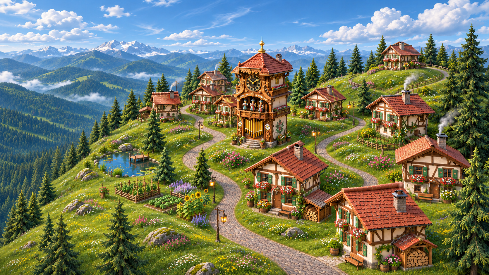
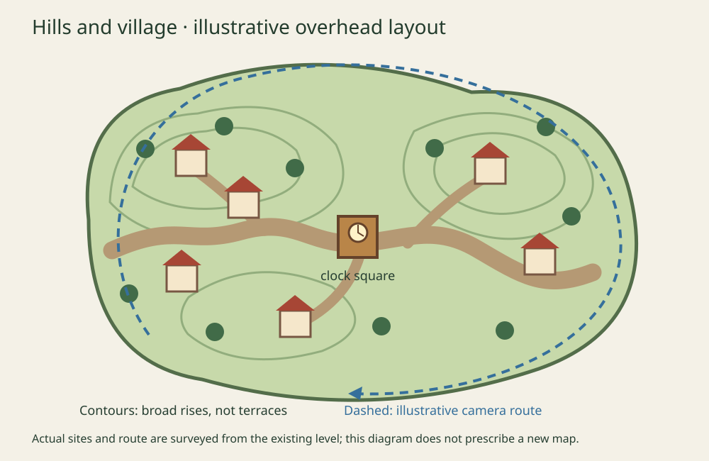
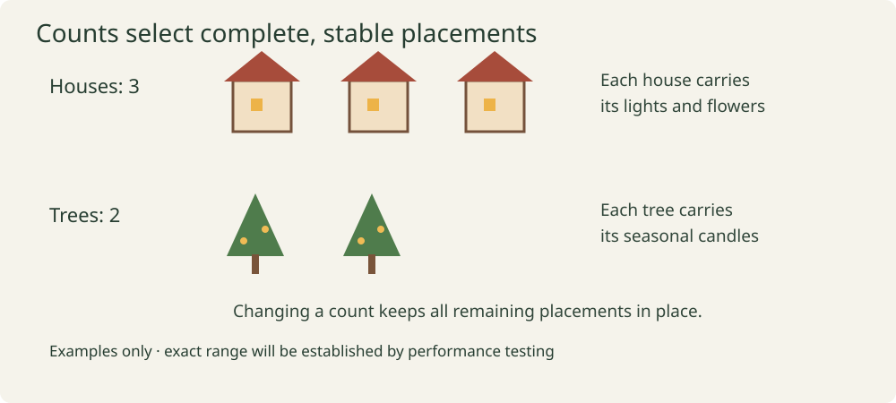
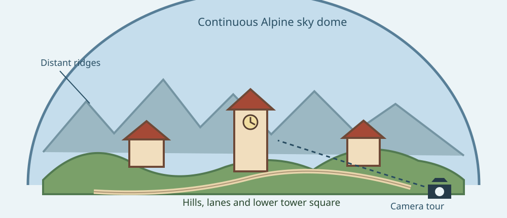
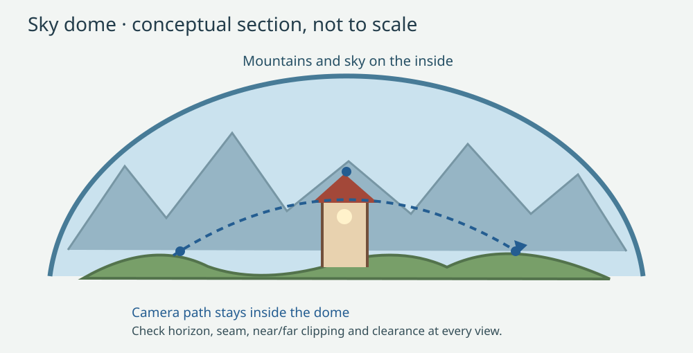

# German Cuckoo Village: Alpine hills and sky

**Status: implementation in review · 24 November 2026.** The hillside, Alpine day/night dome and live house/tree settings have been implemented in worktree `.worktrees/german-alpine-hills`, branch `feat/german-alpine-hills`, intended for integration into `2026-new-level`. Will explicitly approved the two additional settings fields. The worktree includes a snapshot of concurrent, uncommitted 24-hour dial work from the integration checkout; reconcile that work with its owner before merging.

The standalone was rebuilt and rendered on PC, including the maximum of 24 houses and 24 trees and a zero-population Christmas night. A zForth test changes populations live and verifies house, tree, light, flower and candle visibility in both modes; the full date, candle and pose VM regression passed too. The settings schema and its generated metadata pass their tests. The full camera route, settings UI and Chromecast performance have not yet been accepted. The level uses a 2048×2048 room texture page and a 48 MB standalone room allocation: the batch owner must verify the combined host allocation and memory budget on device before integration. The day/night dome switches at 06:00 and 18:00 rather than blending through dusk. The generated standalone SHA-256 is `14e6100f8968ed226088c82d84bd23f0f9ca5a657be80a6bccfd6f645e3d60f4`.

## The scene

The little timber-and-plaster village sits on a visibly undulating Alpine hillside. Its lanes climb gently between houses set at different heights, among grassy banks, trees and gardens. Beyond the village, a continuous sky dome shows an uninhabited Alpine panorama: dark conifer foothills give way to blue-gray ridges and a few distant snow-capped peaks beneath an open sky. The clock tower and its moving figures remain the focus. The mountains frame it rather than competing with its dial.

*Concept art: a visual target, not an engine capture or an exact map. Keep the existing village's actual tower, clock mechanism, buildings and composition rather than replacing them with the illustration.*

The earlier village plan explicitly specified an empty background; this request supersedes that visual requirement. Keep the existing handcrafted model-village character and wooden base unless the new terrain needs the rim adjusted to avoid exposed gaps. The new horizon should surround the whole camera route, including views beyond the back and sides of the village, rather than appearing as one flat panel behind the tower.

## Shape and placement

- **Hills:** make the slopes obvious in the moving view with several broad, irregular rises and a lower square near the tower. Favor an inhabited Alpine valley over a steep peak. Give cottages level foundations cut into the terrain and blend them into natural grassy banks. Use a short retaining wall, stones or steps only where a particular foundation or path needs them; extensive stone terraces and continuous walls are not a goal. Avoid a uniform mound or rows of identical terraces.
- **Lanes and water:** drape winding paths continuously over the new height field, preserving their connections to doors, bridge and square. Make their gradients visually plausible, with smooth transitions and no floating ribbons, terrain poking through, sudden cliffs or impassable-looking junctions. Re-seat the bridge, stream, plots, flowers, trees and candle actors on the revised ground; retain their existing behavior and local offsets. Will noticed a tree off the edge: find it in the current village and move it onto solid terrain, then check every tree's trunk and roots against the ground and model boundary from the full camera route. Keep each relocated tree's candles and seasonal decorations aligned.
- **Tower and clock:** retain the glockenspiel front, dial, hands, cuckoo, balcony and their relative pivots. Prefer keeping the tower datum fixed while sculpting around it. If its elevation must change, update and verify every dependent timeline position and performance camera together. Keep the quarter-hour front view clear and its dial readable.
- **Backdrop:** use a textured inward-facing sky dome, with a continuous panoramic mountain horizon and sky reaching above it. The skybox contains no other villages, towns, houses, churches or other buildings: only mountains, natural foothills, forests, sky and clouds. Avoid obvious mirrored peaks, seams, polar pinching, low-resolution bands, and black gaps. The dome must surround every camera position and lie safely within the actual far clip; its surface must not intersect village geometry. Establish scale, curvature and horizon height by sampling the entire route, not by judging one still. Use backface winding/material settings supported by the existing asset pipeline and verify in the game renderer.
- **Light and time:** preserve the existing day/dusk timing, warm windows, candles, seasonal events and both art modes. Make the sky and mountains coherent with the current day and dusk appearances; if the existing level tools cannot support a satisfactory transition, document the limitation and propose an asset-level solution before considering engine work. Keep a visible difference at night and enough contrast to read the hands and figures.

## House and tree settings

Add **Houses** and **Trees** to the village's own settings, adjustable while the level is running and available wherever this level's settings are exposed. Each setting is an exact visible count: Houses counts cottages and excludes the clock tower; Trees counts individual village trees. Start at the existing population of 13 cottages and 12 trees. As a proposed authoring range, provide 0–24 of each, with additional well-spaced sites above today's counts; measure the maximum on device before fixing the shipped range. Zero leaves the tower and its performance intact. If the full range cannot meet the measured budget, document the tested limit and expose that limit honestly rather than silently showing fewer objects.

Use a stable, deliberately composed placement order, distributed across the hills, so changing a count adds or removes the next complete house or tree without reshuffling the rest. Keep sites clear of lanes, the clock and camera sightlines and place every trunk on terrain inside the model boundary. Each house's lights, flower boxes and Bavaria-specific decoration must follow that house; each tree's candle sticks, flames and seasonal decorations must follow that tree, including at night and during the Christmas period. The current flower and candle-stick geometry includes batches spanning multiple houses or trees, so plan the required asset regrouping or per-count variants; hiding an individual building or tree must not leave orphaned decorations. Preserve the existing settings and mode behavior. Use existing level scripting and settings mechanisms; any engine-code change requires a separate proposal and explicit permission.

## Starting point and constraints

The level is generated by [`blender_create_cuckoo_village.py`](../../wflevels/cuckoo_village/blender_create_cuckoo_village.py), which imports the layout construction in [`cuckoo_village_layout/generate.py`](../../wflevels/cuckoo_village_layout/generate.py). That layout already uses a modest `height(x, y)` field for terrain, roads, house positions and other placements. Its tower height is asserted against [`timeline.py`](../../wflevels/cuckoo_village/timeline.py); the camera and performance poses also use that timeline. Adjust these as a coordinated scene, not as independently moved meshes. Bavaria-specific objects and the seasonal/candle/flower additions must follow the same terrain and preserve their switches.

The main checkout contains concurrent clock-batch work. Inspect current uncommitted village and bundle changes before editing, preserve them, and coordinate with the batch owner. Follow the [level-building guide](../level-building.md), [actor reference](../2026-05-03-oas-actor-types.md), [baseline guide](../../wflevels/baseline/README.md) and [troubleshooting FAQ](../level-design-troubleshooting.md). Use existing level assets, materials, camera and scripting; engine changes require a separate concrete proposal and Will's explicit permission. Check texture-page dimensions against the Clocks host's actual VRAM slot and measure the cost of the dome and terrain on devices rather than guessing a budget.

## Build and verify

1. **Survey the live baseline.** Record source and standalone revisions, layout heights and all camera positions, including the still view and quarter/hour holds. Capture the current daytime and dusk scene. Identify objects attached to terrain, the tower datum and Bavaria/seasonal overlays before moving anything.
2. **Block out the hills.** Revise the height field and placements; render an overhead contour/placement map and representative wide, low and tower-facing views. Identify and correct the tree reported off the edge, then inspect every tree's contact with the terrain and boundary, as well as foundations, lane gradients, bridge/stream joins and gardens, from the full camera route. Compare the result to the target before adding detail.
3. **Make the Alpine dome.** Prepare a seamless panorama and an inward-facing dome using the established texture workflow. Test a directional landmark or checker first in the cooked PC engine, then check all azimuths, horizon continuity, UV orientation, seams, pole and clipping. Add the finished mountains and sky with sufficient texture detail for a television; check atlas size and memory.
4. **Reconcile animation and settings.** Rebuild the standalone. Verify Classic and Bavaria, moving and still camera, quarter-hour and hourly transitions, clock hands, figures, bird, dusk lights, candles and relevant seasonal appearances. Exercise both new counts at zero, one, the defaults and the maximum, and change them up and down through the settings UI while the level is running. Count visible houses and trees, confirm stable placement and check attached lights, flowers and candle sticks/flames in daytime, dusk and Christmas in both modes. Sample 10:08, a quarter boundary, hour rollover, day and dusk, and time jumps. Compare against the previous behavior so the landscape does not hide or disturb the mechanism.
5. **Review on PC.** Capture the whole camera tour, including the front hold and both ends of each transition; check terrain and backdrop at several heights and directions. Compare actual frames with the concept, explicitly record differences and refine. Open the running standalone for Will's review.
6. **Device and integration.** After the approved standalone is ready for the clock batch, freeze a device build and use the shared coordinator to capture and profile on the available Chromecasts, including day/dusk, mode settings, full camera tour and an hourly performance. Measure frame time and memory against the existing village; record unavailable devices and outstanding tests. Integrate into the combined app and screensaver only through the batch owner's workflow, with the matching registry and texture slot; verify actual packaged bytes and installed behavior.

**Acceptance:** a distinctly hilly German village with grounded houses and trees and connected lanes; exact, usable house and tree count settings without orphaned decorations; an uninterrupted Alpine sky dome throughout the camera tour; a readable, unobstructed clock and performances; preserved Classic/Bavaria, seasonal and dusk behavior; and measured PC and device evidence. Any unverified device or behavior remains explicitly open.
