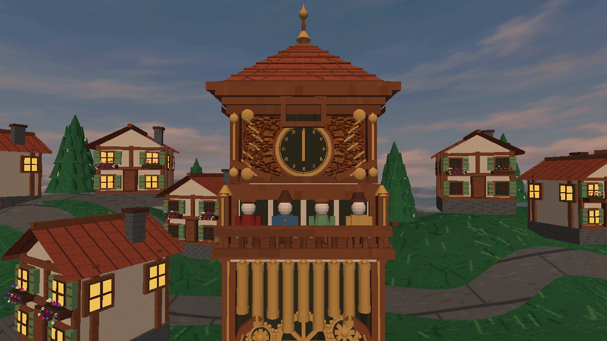
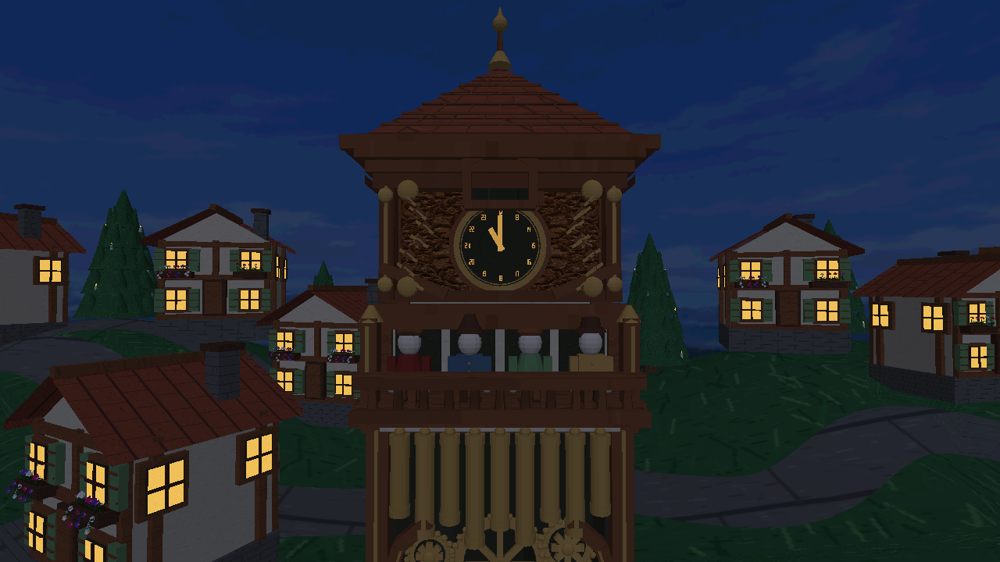
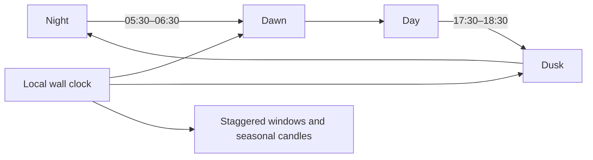

# German Cuckoo Village: coordinated day and night

**Status: implementation in review · 24 November 2026.** Extend the [Alpine hills refinement](2026-11-24-german-cuckoo-village-alpine-hills.md) so the sky and the village change together throughout the day. The current refinement is in `.worktrees/german-alpine-hills`, branch `feat/german-alpine-hills`, intended for `2026-new-level`; reconcile its concurrent 24-hour dial snapshot before integration.

**Implementation in review:** Will subsequently authorized scripted light color and directional orientation, and the proposed material-opacity support. The worktree implements RGB light mailboxes, uses existing actor rotation mailboxes for directional lights, and adds material opacity for aligned day/night/twilight sky layers. The director calculates lighting from local time; windows and candle flames use self-lit materials. The PC build and focused VM tests pass, and desktop captures cover dusk and night. Full camera-route, time-jump rendering, other backend and Chromecast verification remain open. The three sky images fit the existing 1024-square permanent page after reducing the sky images' vertical resolution; review their quality on a television. The engine changes and level have not yet been integrated into the shared checkout.

*Actual desktop-engine capture at 18:00. The later clock-marking adjustment is not present in this image.*

*Actual desktop-engine capture at 23:00, after brightening the clock markings. These stills demonstrate the sampled appearances; they do not verify the full transition, camera route or device performance.*

## Experience

The mountain horizon stays fixed as cool dawn gives way to daylight, then warms at dusk and settles into a dark blue night. The terrain, trees, cottages and tower follow the same progression: brighter by day, warmer at dusk and dimmer and cooler at night. Keep the dial, hands and moving figures readable at every time. Warm window and Christmas-candle light should remain visible against the darker village. The backdrop contains mountains, forests, sky and clouds only, with no other villages or buildings.

Use the device's local wall clock. The present level staggers windows across **05:30–06:30** at dawn and **17:30–18:30** at dusk; use those intervals as the initial transition windows and preserve the individual window and candle schedules and settings. Treat them as authored clock times, not calculated Alpine sunrise and sunset. Pick transition curves and colors by visual review. Do not introduce flashes, horizon movement, a dark veil over illuminated windows, or illegible clock faces.

The diagram expresses the daily cycle; the rendered appearance changes during each interval. Every state is calculated from the current local time, not accumulated since launch. Starting halfway through a transition, jumping the clock forward or backward, crossing midnight and resuming after sleep must produce the appropriate scene immediately. Preserve Classic and Bavaria modes, house/tree counts and existing controls.

## Approach and constraints

1. **Align the sky.** Produce coordinated day, dawn, dusk and night appearances from one panorama, preserving mountain outlines, horizon and dome mapping so peaks do not shift or double. Keep the backdrop seamless around the whole route. First test whether existing material blending and authored fixed-opacity layers can give a visually satisfactory transition; fixed layers may have perceptible steps and must be measured in the actual renderer. Account for transparent sorting, dome overlap and texture-page cost. If that approach is unsuitable, document the result and alternatives.
2. **Change the village with the sky.** Investigate how to darken and cool the actual foreground scene using existing authoring and rendering features while leaving windows, candles and the clock readable. The [level-building guide](../level-building.md) says light color is currently read when a Light is built, and describes fixed-opacity veils as an existing workaround; verify applicability to this level, including whether a veil would incorrectly cover its luminous details or sky. Compare the available asset-level approaches in motion, not just stills. Do not claim continuous runtime light control until verified.
3. **Coordinate the transitions.** Implement a shared time-of-day state or equivalent deterministic calculation in the level director. Align sky and foreground with the current dawn/dusk ranges and keep the existing staggered window logic, `Window lights`, Christmas season and `Candles all year` behavior. Avoid changing clock or performance behavior. A transition must not alter population-dependent visibility or leave glowing details behind when a house or tree is hidden.
4. **Respect engine boundaries.** Asset, level-script and tooling work may proceed within this plan. If satisfactory continuous blending or foreground lighting requires new engine behavior, first prepare a concrete proposal with affected files, expected visual result, alternatives and test strategy. Obtain Will's explicit permission before modifying engine code. Do not treat this plan as that permission.

The current Alpine standalone uses a 2048×2048 room texture page and a 48 MB room allocation. Record the texture, geometry, overdraw and memory impact of any added sky layers or scene variants. Avoid silently exceeding the host's slot or assuming the 24-house/24-tree maximum is affordable on a Chromecast.

## Verification

- Rebuild the standalone and use the actual PC renderer. Capture the complete moving camera route in both styles at night, dawn, day and dusk; inspect sky seams, mountain alignment, terrain, tower readability and the transition itself.
- Exercise 05:29, 05:30, intermediate dawn samples, 06:30, 17:29, 17:30, intermediate dusk samples and 18:30, plus midnight. Start directly within each transition and jump the clock forwards and backwards. Confirm state is determined by the new time without a flash or delayed catch-up.
- Check windows on and off; Christmas and non-Christmas dates; candles all year on and off; both village styles; population 0, default and 24; and camera still and moving. Check that windows and flames follow their buildings and trees at all relevant times.
- Measure the standalone's texture allocation, room memory and rendering cost. Record whether fixed-step blending is visible and whether transparent layers obscure the clock or illuminated details. Run appropriate level-script and settings regressions and preserve screenshot and time-jump evidence.
- Open the actual standalone for Will's review. Follow the [clock batch workflow](../howto/combine-levels-chooser-and-screensaver-launch.md): defer Chromecast builds, device profiling and combined app/screensaver integration until the batch is ready. Then use the shared coordinator, verify the frozen artifact and measure both the populated village and transitions on available devices. Record unavailable devices and outstanding checks.

**Acceptance:** the sky and foreground form a coherent, attractive day-to-night cycle with aligned mountains and readable clock; changes follow local time immediately, including after jumps; lights and settings retain their behavior; and visual quality, memory and performance have been verified on the intended targets. Record any stepwise blending or other limitation explicitly.
