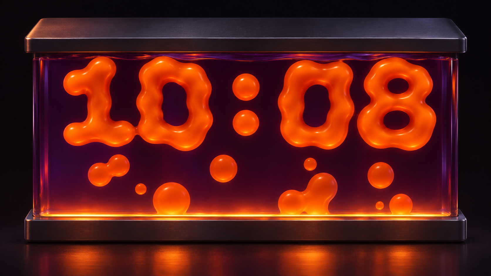
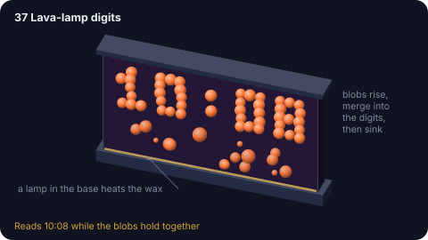
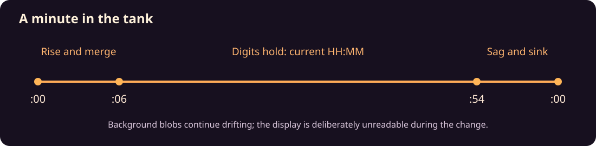
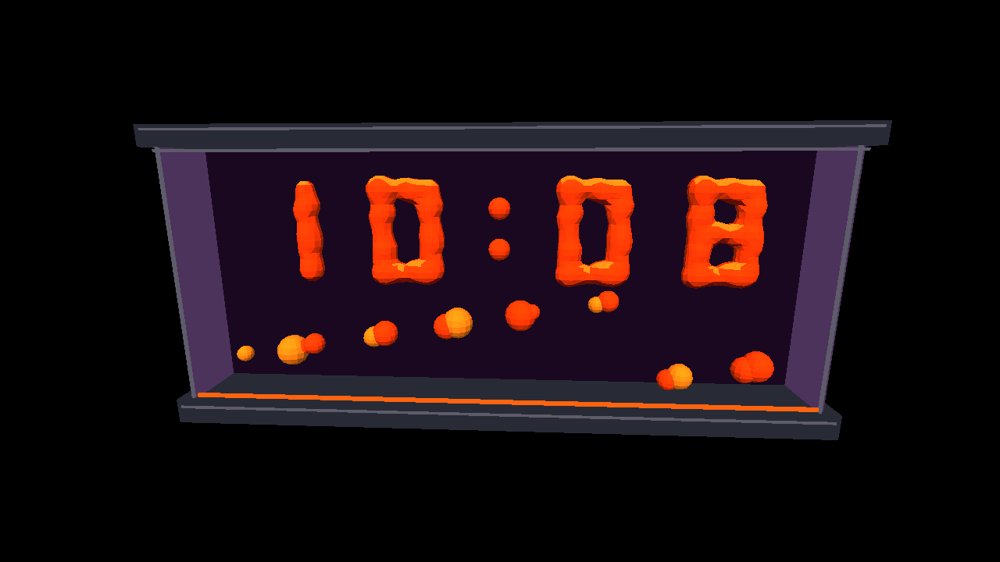

# Lava-lamp digits

**Superseded 2026‑11‑26 by [Lava lamp: a real lamp, with the time in its base](2026-11-26-lava-lamp.md).** Will (2026‑11‑26): "let's change the design (for now) from using the lava to make the digits of the time to 'simply' modelling and emulating a regular lava lamp." This record stays as the history of the first attempt.

Status: standalone built and checked on PC; visual refinement and feedback remain. Device testing, bundling and deployment wait for the current batch.

## Visual target

One wide, shallow glass tank with a dark metal cap and heated base, dark purple liquid, orange wax digits near the top, and loose blobs rising through the lower half. The display is the wax itself, not text on a screen. Keep the original illustration's single tank and simple setting; the generated image below is a high-fidelity target, not footage of the level.

## Reading and motion

Show local wall time as four 24-hour digits with a colon. The current minute holds legibly for most of the minute. At the end the wax sags, separates and sinks; after the boundary the new minute's blobs rise and merge. The time may be unreadable during this change, but must not display the previous minute after the boundary. Continuously rising loose blobs give the tank life between changes. Motion should be unhurried and visibly organic rather than a text fade or abrupt digit swap.

Use a gentle camera drift that keeps the whole display readable, with a still-camera setting. Include Show framerate and the normal level settings object. The scene is silent.

## Implementation and verification

Build an editable Blender scene and a standalone clock using existing level and scripting features. Construct smooth, merged wax geometry, a dimensional tank, and animated floating wax. Use the existing mesh deformation controls for continuous wax wobble and soft distortion, and use independently moving wax pieces during disintegration and formation; inspect the join between those phases. Use the visual target to assess material, depth and composition. Implement and inspect the actual melt and formation, including 09:59→10:00 and 23:59→00:00, in a running PC build. Verify readability and the moving and still camera. Compare a real PC capture with the target and record any remaining visual differences here. Finally open the actual standalone level at local time in a visible PC window for Will's feedback. Do not add the level to the pack or deploy during this batch.

### PC results and remaining visual work

**PASS — PC checks, 2026-11-24.** The standalone builds and reads 10:08 and 00:00; 23:59 was also checked before the final visual refinement. Fixed-time engine captures show the 09:59 melt and 10:00 formation; a live 09:59→10:00 run observed the moving wax strokes, loose blob and camera. Camera and blob positions matched the time model, and the still-camera override passed. Two model tests pass. Scaling the entire scene 48× preserves the wax geometry: the smallest Blender triangle measures 0.0000977 square units, above the conservative 0.00008 threshold. The current level uses existing mesh deformation and authored movement; the proposed Jolt-based simulation is a separate TODO.

The engine capture has a dimensional tank, recognizable wax digits, moving blobs and a heated base. It remains more faceted and angular than the smooth, glossy mockup; glass reflections, material richness and the organic merging transition need further refinement. The mockup's reflections and soft lighting are an art target, not a claim about the current render.
