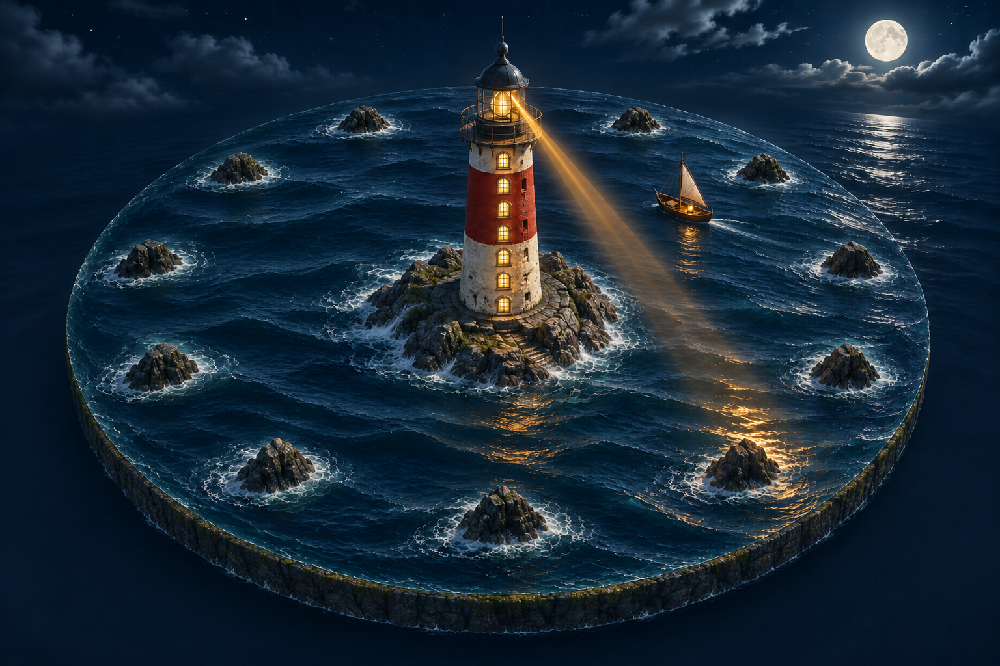
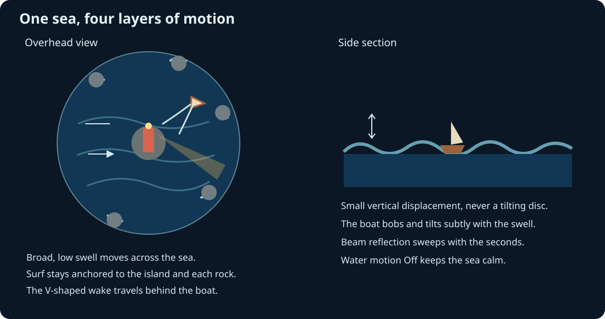
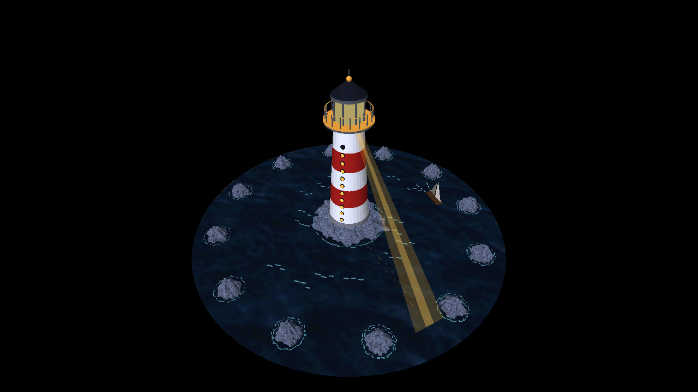

# Lighthouse: moving water, surf and wake

Status: implemented and verified on PC; ready for visual feedback. This is the water-effects follow-up to the [Lighthouse clock plan](2026-11-24-lighthouse.md). Chromecast testing, bundling and deployment remain deferred until the current clock batch is ready.

## Goal and visual target

Make the sea visibly move like a calm, moonlit ocean: broad gentle swell, smaller irregular ripples, broken surf around the twelve rock piles and central island, and a modest wake behind the circling boat. The moving beam should continue to cast a broken golden reflection on the water. The clock remains easy to read: the boat and beam positions still mark minutes and seconds, and the tower windows still count the hour.

This image is a generated art target, not a capture or a promise of simulated fluid physics. Keep the current modeled lighthouse, detailed rock piles, boat, ring and camera composition; focus this work on the sea and its interaction with those objects.

## What exists and what needs to change

The starting `Sea` was an opaque textured disc whose entire actor rocked back and forth around its center. The foam was broken geometry but fixed in place. The boat orbited on a mathematically exact circle without a wake; the beam had a flat sea-level highlight. Those cues did not create traveling waves, animated surf or a boat wake. The texture is adapted from Bamboo Tipper. The existing 512×512 rock texture is packed with it into a 640×512 room page, so texture-slot size must be considered when changing the atlas.

## Design

| Effect | Intended behavior | Implementation to prove on PC |
|---|---|---|
| Broad swell | Low, slow, overlapping waves travel across the ring in more than one direction; the sea edge stays bounded and there is no visible minute reset. | Prototype a tessellated textured sea mesh using existing generic mesh deformation (`DFRM`) and authored controls. First prove it can produce smooth, looping vertical surface displacement without unacceptable seams, normals or cost; do not assume a rooted-curve deformer is automatically a general height-field solver. |
| Fine glints | Thin, irregular blue-white highlights travel with the swell and remain subordinate to the boat, rocks and time reading. | Layer a small number of animated, broken crest meshes or suitably authored existing deformation; avoid large translucent sheets and visible strip boundaries. Keep the base water opaque. |
| Surf | Foam breaks, shifts and recedes around each stationary rock pile and the central island without rotating the rocks or looking like solid concentric circles. | Build short broken foam strokes anchored to the existing rock centers; animate a few independently phased groups with existing actor transforms. Keep them above the sea without z-fighting or poking through the rock. |
| Boat and wake | The boat maintains its precise minute-bearing orbit while gently bobbing and rolling; a small broken V-shaped wake trails its direction of travel. | Use the existing wall-clock orbit for X/Y and heading. Add a separate bounded bob/roll driven by water animation, and a wake actor following the same position and tangent. Verify the wake faces aft at all four quadrants and the hour rollover. |
| Beam reflection | The golden reflection follows the seconds beam across the moving water and breaks into short highlights. | Retain the beam's clock-driven direction and use a modest set of offset segments above the surface; check at edge-on camera angles and when the beam meets the boat. |

Prototype the deformable sea first. If the existing deformer cannot produce a convincing bounded surface, try a small number of overlapping, independently moving textured wave meshes and crest highlights, using the existing actor and deformation interfaces. The Tide Harbour experiment observed visible bands from rigid water bars, so inspect for seams and do not present a banded result as smooth water. If neither approach is convincing or practical without an engine modification, document the evidence and a concrete engine proposal; obtain explicit permission before changing engine code. None is authorized by this plan alone.

Use a bounded animation phase advanced from simulation time, independent of the wall-clock second, so the water does not jump at :00. Keep amplitudes small compared with the boat and rocks; tune from actual PC playback rather than from the still mockup. The effect is an authored, looping visual approximation, not a fluid simulation. Ensure the water's geometry and any ripples stay inside the circular boundary and preserve the existing beam direction and twelve distinct rock positions.

## Settings

Keep the existing **Water motion** setting, on by default. Off freezes the sea in a calm pose, removes moving wake and glints, and leaves the fixed foam, clock readings and orbiting boat intact. The boat's bob and roll stop when water motion is off. The existing **Camera drift** and **Show framerate** remain independent. Use the normal pre-approved level settings path if an additional setting is actually needed; avoid adding controls that do not improve the user experience.

## Implementation and PC checks

1. Capture the current level at matching wide and closer camera views as a baseline. Build the surface-motion prototype and inspect it in the actual PC engine, including the disk edge, lighting, triangle sizes and atlas/VRAM settings. Keep or reject it based on visible results, not a Blender preview alone.
2. Add the chosen swell, glints, rock surf, boat bob/wake and broken beam reflection. Start with restrained geometry and motion; increase detail where the PC comparison shows obvious gaps. Check the whole 60-second camera loop and the level's actual local-time behavior.
3. Exercise **Water motion** both on and off, plus camera still/moving and Show framerate. At representative times on both sides of :00, verify the boat and beam remain at their existing calculated positions, the wake trails the boat, the water stays continuous, and hour windows still reset at noon and midnight. Include a real-time run across the minute, not only frozen screenshots.
4. Record representative PC captures and a short motion recording, compare them to the water mockup, and document visual differences, triangle and texture-page sizes, and PC performance. Fix artifacts such as texture seams, z-fighting, obvious popping, floating foam, clipping or a wake pointing forward. Any device-cost claim remains unverified until the batch's Chromecast measurement.
5. Update this plan and the parent Lighthouse plan with the result. Finally open the actual standalone at host local time in a visible PC window for Will's feedback. Do not add the level to the shared pack, build bundles or deploy during the current batch.

## Implemented result and PC evidence

**PASS — 2026-11-24.** The opaque sea is now a tessellated surface. A prototype showed that the existing fish mesh deformer can move its local Y axis vertically when the mesh is authored in a rotated local frame; this produces a smooth, modest directional swell without an engine change. The deformer is anchored at one side and is not a general two-dimensional fluid solver. Broken animated crest highlights, locally oscillating surf, a bobbing/rolling boat, an aft V-shaped wake and smaller golden beam-reflection glints complete the effect. The wave phase uses bounded simulation time and does not reset at the clock's minute boundary.

[Open the short PC recording with a fixed camera and clock](2026-11-24-lighthouse-water-motion/pc-water-motion.gif). It is an animated GIF; some Markdown previewers display only its first frame.

With camera and clock fixed, a 20-frame 1024×576 PC comparison saw 30,031 changed pixels with water on; with it off, the corresponding frames were identical and the watched boat, surf and glint positions stayed fixed. The minute orbit and wake position/heading matched their model at all four quarters of the dial. A real-time noon rollover kept the beam, boat and moving water continuous; the existing midnight, hour-window and camera checks remain applicable. The final mesh audit found no triangles below 0.00008 square units; its minimum was 0.000216. The larger 640×512 room page uses the PC VRAM overrides in the capture harness.

One short desktop `--frame-profile` window reported 36,032 submitted triangles per frame and 25.16 ms p95 total CPU with water on; the separate off window reported 35,062 triangles and 23.78 ms p95. These are single PC samples with startup outliers, not a controlled benchmark or a Chromecast estimate. Measure the combined clock on Chromecast when the batch is released. The result remains stylized compared with the photorealistic mockup; the highlights are authored geometry rather than simulated foam or physically calculated reflections.
