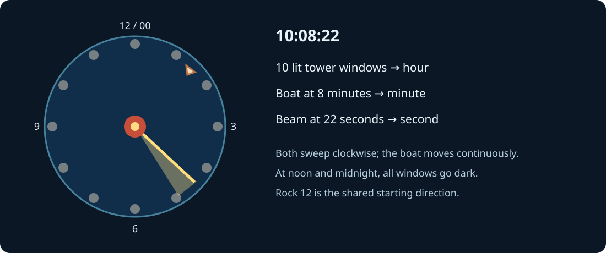
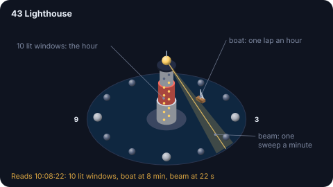
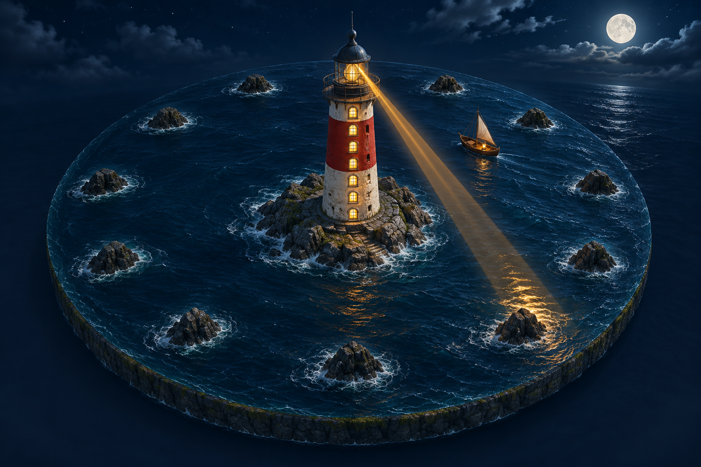
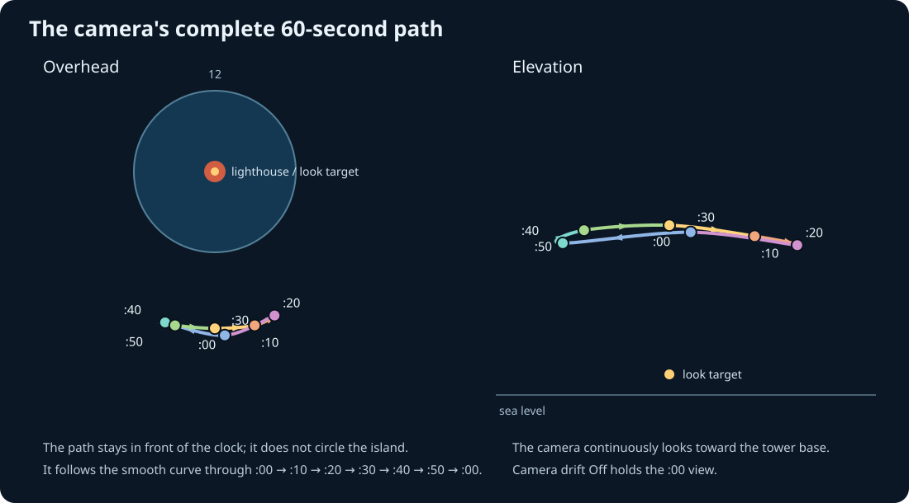
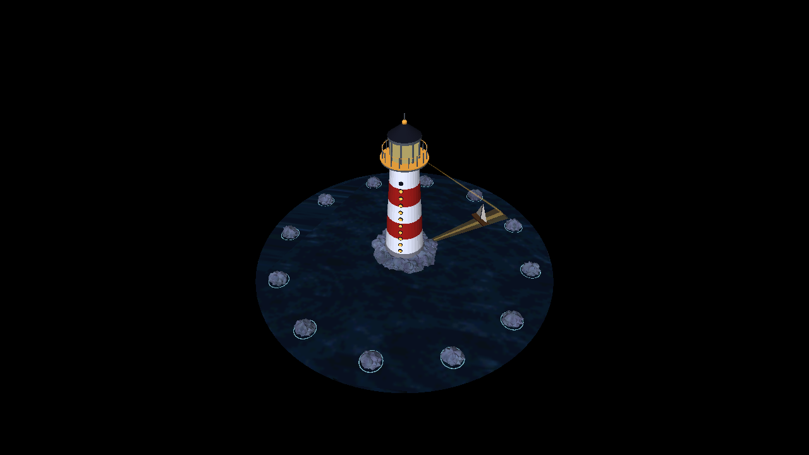
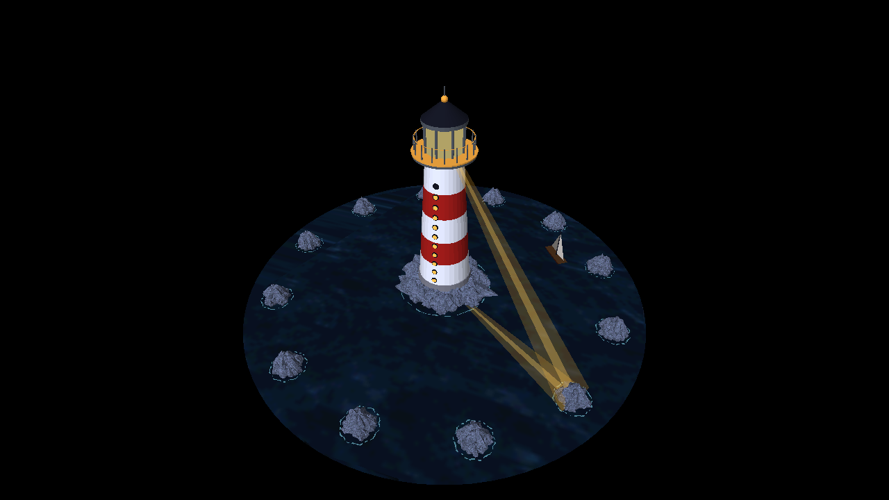

# Lighthouse clock

Status: standalone built and verified on PC; ready for visual feedback. Chromecast, bundling and deployment wait for the current batch.

## Experience and reading

A detailed red-and-white striped lighthouse stands on a central rocky island in a circular patch of moonlit sea. Exactly twelve clearly separate rocks make the dial. A small boat circles the lighthouse once per hour; the lantern's single visible beam sweeps clockwise once per minute. The tower has eleven countable windows; `hour modulo 12` of them glow, so all are dark at 12:00 and 00:00. The scene is silent. A slow, gentle camera path reveals the tower and water while retaining readable views of the whole ring, with a still-camera option and Show framerate.

The generated mockup is a visual target, not an engine capture or an exact time reading. Reuse the Bamboo Tipper's aquarium-derived water texture and moving surface technique where it suits the moonlit sea; do not require an engine change. Model the tower, lantern, beam, rocky island, twelve dial rocks and boat with depth and details visible in the PC capture.

## Time and continuity

At the top of the dial is twelve. In an overhead view all angles advance clockwise. The boat's phase is `(minute + second/60)/60`, the beam's is `second/60`, and the count of lit windows is `hour % 12`. The boat and beam meet when their phases coincide; their motion is continuous across minute and hour changes. This depicts local wall time, without AM/PM differentiation.

## Camera path

The camera stays on the front side of the ring; it does **not** orbit all the way around the lighthouse. It moves from the centered wide view at :00 to the right and slightly lower by :20, crosses back toward center by :30, sweeps left by :40–:50, then returns to the starting view at :00. The path is a continuous closed Catmull–Rom spline, keyed to local wall-clock seconds, and the camera always looks toward the same point near the tower's base. The :00 and :60 position and direction meet smoothly. **Camera drift: Off** fixes the camera at the :00 view.

## Implementation and verification

Create an editable Blender scene and standalone level, register the ordinary settings object, and implement animated water, boat, beam and windows using existing features. Test at 10:08:22, 11:59→12:00 and 23:59→00:00, and verify beam and boat phase, their meeting, window count, moving and still camera, and Show framerate on PC. Compare an actual PC capture with the target and fix obvious visual gaps. Record captures and any remaining differences. As the final step, open the real standalone at host local time in a visible PC window for Will's feedback. Do not touch the pack manifest or deploy during this batch.

### PC results

**PASS — 2026-11-24.** The time-model tests cover the two angular rates, the beam–boat meeting and both day boundaries. The PC engine's boat, beam and camera mailboxes matched the model at 10:08:22, the 10:08:08.1356 meeting, noon, midnight and 23:59:59. A live noon rollover showed the beam and boat moving across the boundary. Captures show ten lit windows at 10 and all dark at noon and midnight. Moving and still camera, disabled water motion and enabled Show framerate were checked on PC. The water reuses the Bamboo Tipper texture, tinted for night. A mesh audit after scaling the scene 2× found a minimum triangle area of 0.000216, above the 0.00008 conservative threshold.

Following feedback, each dial mark is now a cluster of individually textured, irregular rocks, with a more detailed central island and broken surf. The rock source is cooked at 512×512 rather than 128×128; the resulting room atlas is 640×512. PC launches must use the larger VRAM slot in `capture_pc.py`; the existing Clocks app's 2048×1024 slot is large enough, subject to the batch's device verification. The camera was brought closer while retaining the dial in view, and the diagram above reflects the updated path.

The tower, gallery, lantern, rocks, foam, boat, beam and animated textured sea are modeled in the level. The PC render is more stylized than the mockup: the water, rocks and tower lack the mockup's fine photographic detail, and its distant sky and reflections are not modeled. The beam has a faint sea-level reflection so its direction remains visible when the vertical beam is edge-on.

Water motion, animated surf and the boat wake are implemented and PC-verified in the separate [follow-up plan](2026-11-24-lighthouse-water-motion.md).

## Appendix: nighttime indicator, 2026‑11‑24

The hour is counted in tower windows rather than shown with numerals. A pale blue illuminated rim around the sea now appears from 18:00 through 05:59 local time, separate from the windows that carry the hour. The rim uses prelit geometry switched by the level director; it does not add a dynamic light or alter the beam, boat or hour-window count.

**Before:** the earlier PC engine capture at a different time and camera position, before the night rim was added.

**After:** PC engine captures at 10:08:22 and 22:08:22 show the rim off and on at matching clock and camera phases.

The standalone rebuilt, and both PC captures passed the existing boat, beam, wake and camera position checks. Switching boundaries, time jumps, the complete camera path, TV readability and Chromecast profiling remain to be checked. This change is not yet in the installed APK.
