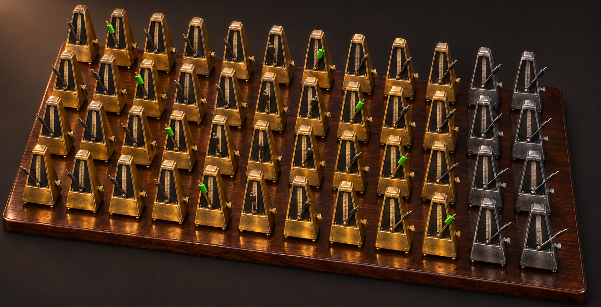
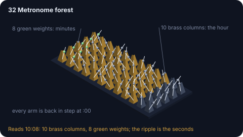

# Metronome Forest

Status: standalone implemented and checked on PC; open for visual feedback. Chromecast, bundling and deployment wait for the current batch.

## Experience and reading

Sixty vintage metronomes stand in twelve distinct columns of five on one flat rectangular platform, viewed from an elevated diagonal angle as in the original project illustration. The first hour-count columns are brass; the remaining columns are gray. Twelve brass columns represent 12, so noon and midnight are not confused with a missing display. The first `minute` weights are green, counted in groups of five down each column from left to right; the remaining weights are neutral. At 10:08 there are ten brass columns, and the first column has five green weights while the next has three. A slow camera journey reveals the forest while recurring wide views keep the count legible. Camera drift can be switched off. The motion is silent.





The high-fidelity illustration is a lighting and material reference, not a capture or an exact minute reading. Its dark, open-looking cases do not match the original illustration: the level uses solid, three-dimensional tapered pyramid bodies, simple pale arms and round weights. The level must render exactly 12 columns and five rows and use the counting rules above. The earlier stepped-platform concept was superseded after checking the original illustration.

```text
10:08  B = brass column, . = gray column, G = green weight, - = neutral

       B B B B B B B B B B . .       count 10 brass columns
       G G - - - - - - - - - -
       G G - - - - - - - - - -
       G G - - - - - - - - - -       count 5 + 3 green weights
       G - - - - - - - - - - -
       G - - - - - - - - - - -
```

## Motion

The metronomes are indexed 0–59 in column-major order. Number `i` makes `60+i` complete oscillations in exactly 60 seconds. Their angles follow `A·sin(2π·(60+i)·second/60)`: all pass through the same centered position in the same direction at the minute boundary, drift into a wave, and return into step without a positional or velocity jump. Local hour and minute determine colors; seconds do not change the clock reading. This is a visual pendulum-wave simulation, not a synchronized audio performance.

```text
local time ── hour (1–12) ──> brass / gray columns
           ├─ minute (0–59) ─> green / neutral weights
           └─ second ────────> 60 silent oscillators → aligned at :00
```

## Build and PC verification

**PASS — PC verification, 2026-11-24.**

The editable Blender scene and standalone level include the normal settings object, camera drift and Show framerate. On PC, inspected the 10:08 display and noon and midnight captures; the latter show twelve brass columns and no green weights. Real-engine checks sampled representative pendulum angles and the camera path at 10:08:22, verified the still-camera option, and checked positions immediately before and at the minute boundary. A live run across noon observed pendulums moving and converging; the model tests also check all 60 oscillators for positional and velocity continuity and the camera spline for a smooth loop. The standalone was opened at local time for Will's review. No Chromecast, bundle or deployment until the batch is closed.

## Appendix: nighttime indicator, 2026‑11‑24

The hour is indicated by a count of brass columns, not hour numerals. To distinguish night, two warm lamps on the front edge of the stand now illuminate from 18:00 through 05:59 local time. Their visibility follows the wall-clock hour on each update, so a start or time change recomputes the state. They are authored emissive-looking geometry, not runtime light sources, and do not change the pendulum or counting behavior.

**Before:** an earlier PC engine capture at 12:00, before the lamps were added. The camera is in a different position from the two after captures.


**After:** PC engine captures at 10:08:22 and 22:08:22. The camera and clock counts match between these two views; the lamps are off by day and on at night.


The standalone rebuilt successfully. Both PC captures passed the existing representative pendulum and camera checks; `tests/test_metronome_forest.py` passed (3 tests). The transition boundaries, time jumps, still-camera view, full camera path, and Chromecast readability and profiling remain to be verified. This change is not yet in the installed bundle.
