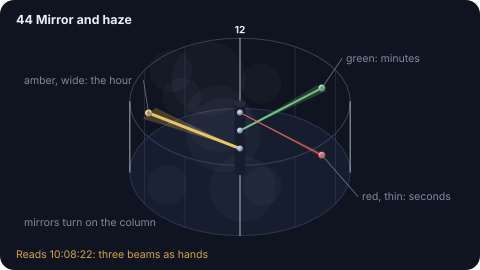
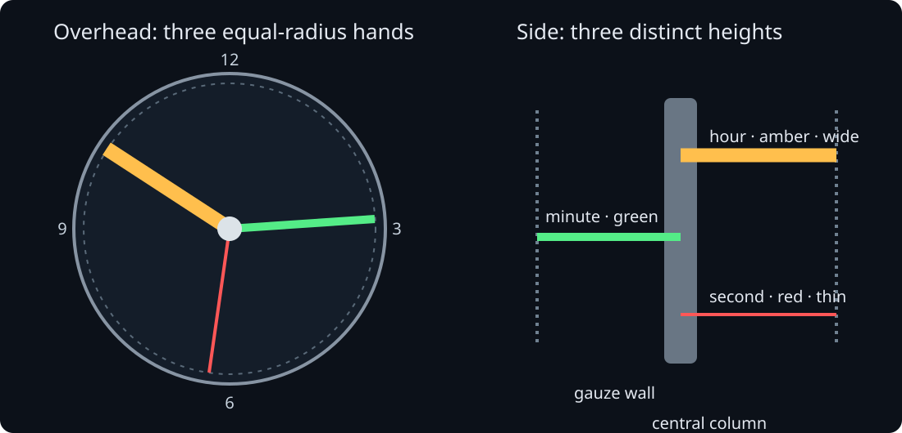
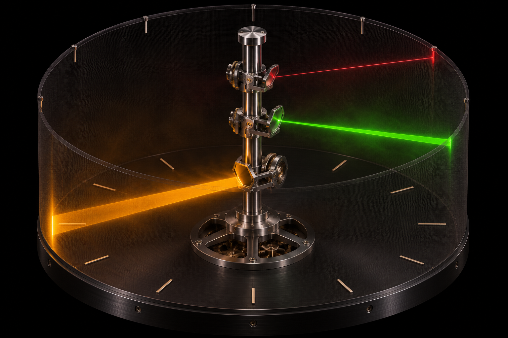
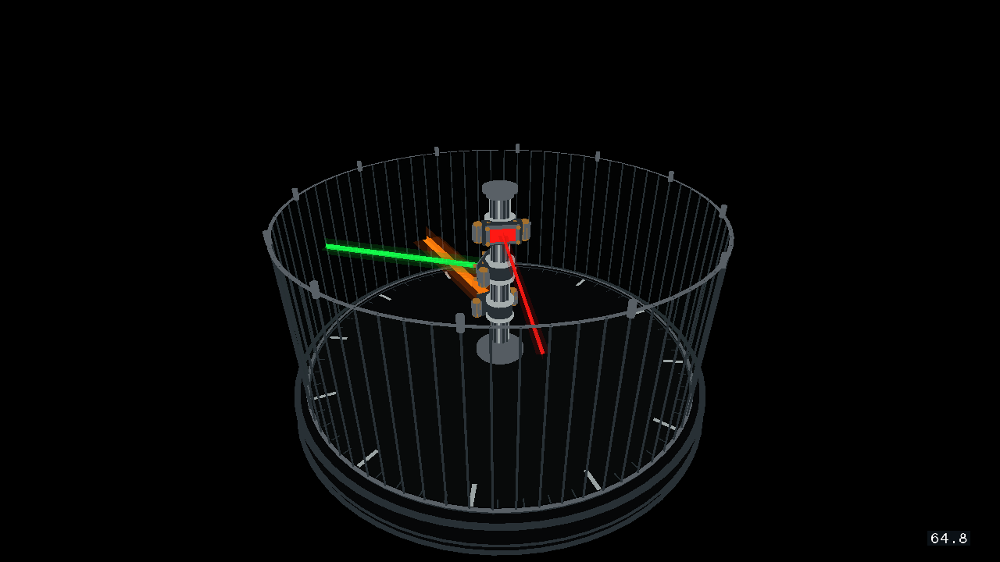
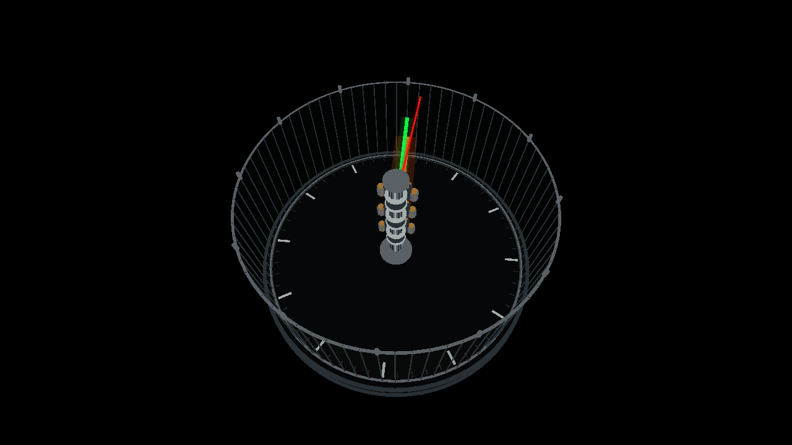

# Mirror and Haze

Status: standalone implemented and verified on PC. Chromecast measurement, bundle integration and deployment remain deferred until the batch is declared ready.

## Experience and visual target

A dark, circular instrument has a central column of three rotating mirror assemblies and a surrounding cylindrical gauze drum. Three differently colored beams run from the column to the drum at separate heights. The wide amber hour beam, medium green minute beam and thin red seconds beam are all the same length. The rest of the screen stays predominantly black. The column, mountings and gauze should be deliberately detailed, with no unrelated room or scenery.

## Clock behavior

Looking down, twelve is farthest from the camera and hands advance clockwise. Beam endpoints use the same radius. Hour phase is `(hour % 12 + minute/60 + second/3600)/12`; minute phase is `(minute + second/60)/60`; second phase is seconds/60. Use fractional elapsed time between wall-clock ticks to keep the second beam smooth while resynchronizing to wall time. The three mirror faces rotate along with their beams. Equal angular phases place beams over one another in plan view while their separate heights preserve the visual distinction. Midnight and noon must both read twelve; hour/minute rollover and local time-zone behavior follow the wall clock.

## Rendering and settings

Build the authored geometry in Blender: a dark layered plinth, fine twelve-position perimeter markers, a gauze drum with subdued vertical mesh structure, and a central column with mirror housings, pivots and fasteners. Prototype translucent prelit beam geometry and haze with the existing `wf_opacity` material support. Ensure the ordering and crossing behavior work in the PC renderer; use a restrained layered approximation if true volumetric haze is unavailable, and record the visual limitation. Test the triangle sizes against engine limits and scale authored geometry if necessary. Keep the translucent coverage and layer count controlled for later device profiling.

Add a normal level settings object for Show framerate, still/moving camera, and practical beam/haze visibility controls supported by existing level facilities. Camera motion should be smooth and show the vertical separation without making the dial appear to spin. No engine modification is authorized by this plan.

## Verification and review

Build the standalone, run it on PC, and check fixed times around 00:00, 12:00 and minute/hour boundaries; confirm all three beam directions, lengths, colors and heights, mirror alignment and a crossing. Check continuous seconds, camera motion, settings and mesh size. Compare real engine captures to the original and the concept target, improve deficiencies, and document any remaining differences. Finally leave the real standalone running for Will's feedback. Device tests, shared bundles and deployment happen when Will declares the batch ready.

## PC progress and remaining checks

The standalone has three individually rotated mirror assemblies and colored beams, a gauze drum, camera drift, a haze toggle and the shared framerate setting. The beams use translucent intersecting sheets as a haze approximation, not true volumetric light. The model is simpler and flatter than the generated concept: the transparent fabric, metal finishes, glow and mechanical detail do not yet have its realism.

The PC runtime was checked at 00:00, 12:00 and 10:08:30: the beam, mirror and haze rotations agreed with the expected clock angles. A separate accelerated run confirmed continuous hour, minute and second motion across noon. Measurements of the live second beam show movement between wall-clock seconds. Launch overrides verified haze off, the stationary camera and Show framerate; the regular moving camera and haze were also observed. The geometry-size check passed. Overlapping base and rim surfaces were separated after flicker was reported. The camera was raised and now moves vertically as well as horizontally, so the aligned beams at midnight can be seen without changing their clock directions.

The reusable `scripts/check-beam-visibility.py` checks sampled rendered frames for each beam's color outside the central mechanism; `wflevels/mirror_haze/visibility_sweep.py` captures an accelerated clock and camera sweep. A midnight capture and 80 frames spanning the clock and camera cycles passed; removing green pixels deliberately caused the checker to fail. This samples views rather than proving visibility at every possible instant, and counts of colored pixels do not guarantee readability or distinguish every possible unrelated object of the same color. The settings checks used launch overrides; applying changes through the settings UI remains for device verification.
