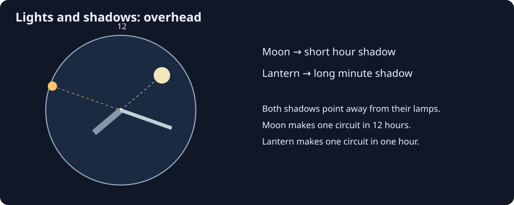
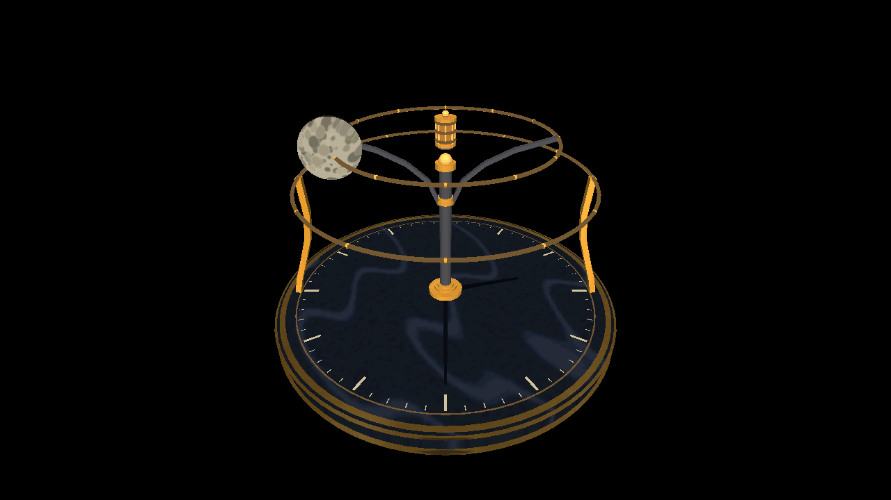

# Moon Lantern

Status: standalone implementation open for PC feedback. Chromecast testing, bundling and deployment are deferred until the current batch is ready.

## Experience

A dark twelve-mark dial supports a central post. A luminous model moon on a high orbit indicates the local hour through its short shadow; a smaller lantern on a wider, lower orbit makes the longer minute shadow. Both shadows point away from their corresponding lights. The moon shows the astronomical phase for the date. Keep the clock legible through a slow camera journey and offer a still-camera setting and Show framerate.

## Clock geometry and lunar phase

Use a conventional clockwise dial with twelve at the far side. Hour phase is `(hour % 12 + minute/60 + second/3600)/12`; minute phase is `(minute + second/60)/60`. Place each lamp diametrically opposite its shadow and move it smoothly along its own ring. The post and shadow geometry must make that relationship visually obvious; if actual dynamic shadows are unavailable, construct matching shadow-shaped geometry on the dial using existing level features and document the approximation. Test alignment and shadow crossings across both hour and day rollover.

Calculate lunar phase from the existing `WALL_DAY`, `WALL_HOUR`, `WALL_MINUTE`, `WALL_SECOND` and `WALL_UTC_OFFSET` mailboxes; convert local time to UTC before evaluating a documented lunar-phase approximation. Validate new, full and quarter moons against known UTC dates, account for rollover and offsets, and document the approximation's accuracy and limits. Do not confuse the Tide Harbour function called `moon_phase` with a lunar phase: it represents nighttime progress, not the Moon's illumination. The rendered crescent must change with date, including waxing and waning.

## Implementation and PC verification

Inspect the existing rendering and clock authoring facilities, model the dial, post, moon and lantern to match the visual target, and register the ordinary level settings type. Use smooth camera motion and existing capabilities; engine modifications require separate explicit permission. Verify phase at reference dates, hour/minute direction, shadows opposite their lights, a shadow crossing, noon and midnight, moving/still camera and Show framerate in the actual PC engine. Compare PC captures against the mockup, record discrepancies and open the real standalone at local time for Will's feedback. Do not update the pack manifest or deploy during this batch.

### PC implementation and review

The level has a textured stone case, layered brass trim, supported tubular orbit rails, a crater-textured phase moon, a framed lantern, a slow camera drift, and a level settings object with camera and framerate options. The two dark shapes on the dial are modeled shadows, rotated opposite their respective moving objects; they are not dynamically cast light. Lunar illumination uses a low-order longitude approximation and 32 discrete phase meshes; it is not a precise ephemeris or a latitude-dependent depiction of lunar orientation.

The PC engine was checked at the January 2000 new, first-quarter and full moons and at a 2026 local time, including actor positions, shadow angles and the calculated lunar phase; the quarter-phase capture also shows the expected half-lit moon. The geometry-size check passed, as did the Python phase and clock tests. The PC image still differs substantially from the visual target: the metal and glass are less realistic, illumination and contact shadows are absent, the case and lantern are simpler, and the dial has no physical moonlight or lantern glow. The standalone is open for visual feedback; explicit in-engine checks of clock rollovers, the still-camera option and framerate toggle remain to be completed.
