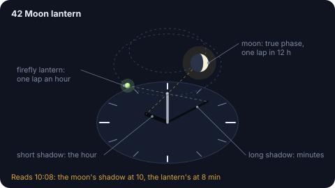
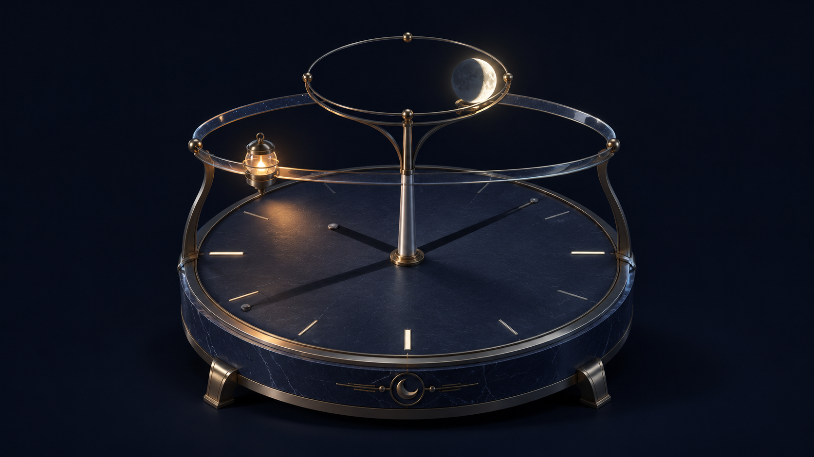

# Moon Lantern

Status: plan and standalone implementation in progress. Chromecast testing, bundling and deployment are deferred until the current batch is ready.

## Experience

A dark twelve-mark dial supports a central post. A luminous model moon on a high orbit indicates the local hour through its short shadow; a smaller lantern on a wider, lower orbit makes the longer minute shadow. Both shadows point away from their corresponding lights. The moon shows the astronomical phase for the date. Keep the clock legible through a slow camera journey and offer a still-camera setting and Show framerate.

## Clock geometry and lunar phase

Use a conventional clockwise dial with twelve at the far side. Hour phase is `(hour % 12 + minute/60 + second/3600)/12`; minute phase is `(minute + second/60)/60`. Place each lamp diametrically opposite its shadow and move it smoothly along its own ring. The post and shadow geometry must make that relationship visually obvious; if actual dynamic shadows are unavailable, construct matching shadow-shaped geometry on the dial using existing level features and document the approximation. Test alignment and shadow crossings across both hour and day rollover.

Calculate lunar phase from the existing `WALL_DAY`, `WALL_HOUR`, `WALL_MINUTE`, `WALL_SECOND` and `WALL_UTC_OFFSET` mailboxes; convert local time to UTC before evaluating a documented lunar-phase approximation. Validate new, full and quarter moons against known UTC dates, account for rollover and offsets, and document the approximation's accuracy and limits. Do not confuse the Tide Harbour function called `moon_phase` with a lunar phase: it represents nighttime progress, not the Moon's illumination. The rendered crescent must change with date, including waxing and waning.

## Implementation and PC verification

Inspect the existing rendering and clock authoring facilities, model the dial, post, moon and lantern to match the visual target, and register the ordinary level settings type. Use smooth camera motion and existing capabilities; engine modifications require separate explicit permission. Verify phase at reference dates, hour/minute direction, shadows opposite their lights, a shadow crossing, noon and midnight, moving/still camera and Show framerate in the actual PC engine. Compare PC captures against the mockup, record discrepancies and open the real standalone at local time for Will's feedback. Do not update the pack manifest or deploy during this batch.
