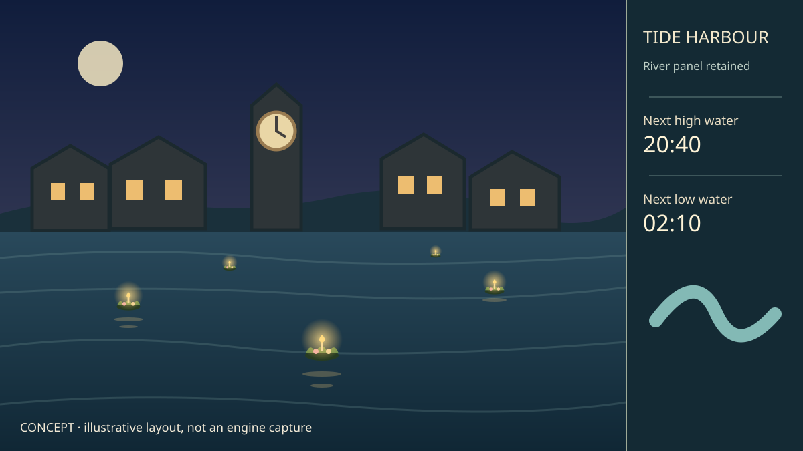
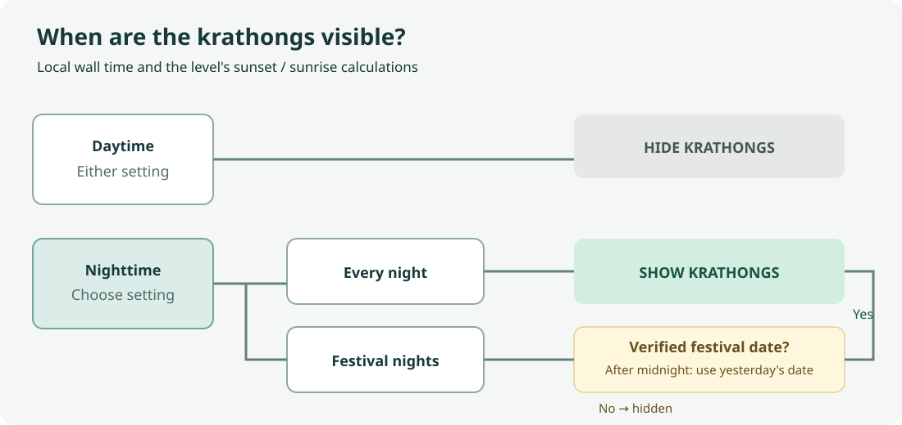
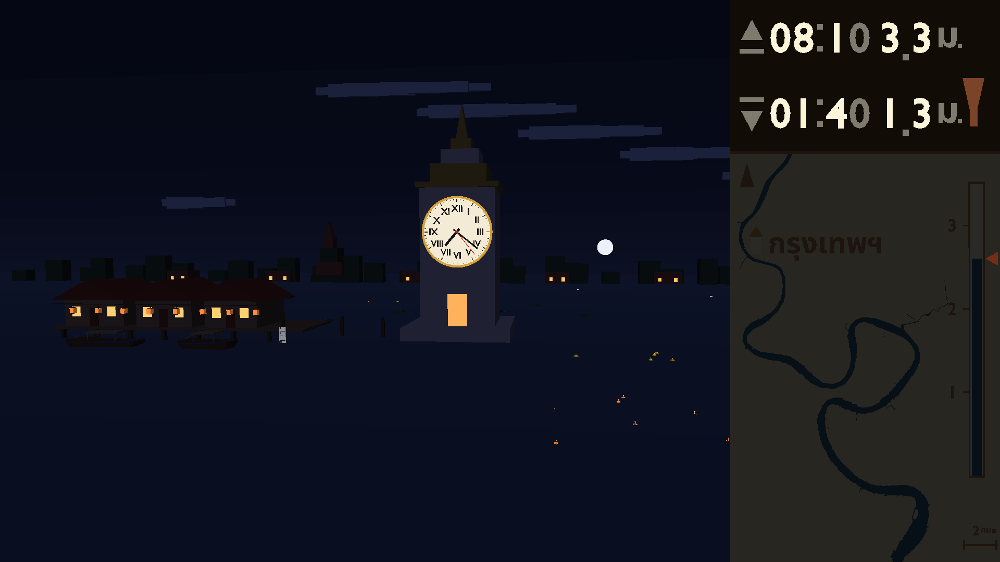

# Tide Harbour: Loy Krathong on the river

**Status: implemented with nighttime device review outstanding, 2026-11-24.** The standalone level and Clocks APK contain 100 float actors, festival/every-night settings and a count slider from 0 to 100 (default 30). A real zForth VM test covers launches, accumulation to 100 and count-zero behavior. Cast1 shows [both new controls](../diagnostics/tide-krathong-cast1-controls-100-final-2026-11-24/input-frame-004.png) in J‑924da3f37ca1. A forced-daytime stress profile is recorded below; the ordinary nighttime build still needs visual and performance verification. Preserve the current uncommitted Tide Harbour panel work and coordinate with the active Clocks bundle update.

**100-float cast1 stress result:** J‑a7bc0ca0fa35 completed a 120-second profile at **26.26 FPS**, p50 33.37 ms, p95 50.05 ms, below the original 30 FPS target. This was a test-only build that forced the effect on in daytime, forced the count to 100, and accelerated launches; the profile also includes the initial chooser and transition. [Summary and capture](../diagnostics/tide-krathong-cast1-profile-100-2026-11-24/summary.json). It measures that stress scene, not the normal build's nighttime performance; accelerated launching made the floats cluster, so the capture is not representative of normal spacing. The level has 233 actors (206 posed), exceeding the original 150-actor budget; the device measurement supersedes the budget as evidence of current cost. The normal 100-cap build was restored to cast1 after the test. A VM run independently confirmed that the normal 1.2-second launch spacing can accumulate all 100 with the 180-second journey.

**PC refinement after device build:** the floats were far too large and appeared from the far side. Four in five launch near the pier and the float model is now about 39–44 cm across. The earlier ×4 model scale was a visibility choice, not a measured triangle requirement. The level-design guide and FAQ recommend scaling the entire scene when small triangles require it; this particular mesh does not presently need that: inspection of all 27,200 exported, 16.16-quantized float triangles found minimum area 0.00011768 square units, none below the FAQ's conservative 0.00008 cutoff and none zero. The revised standalone is running on PC at simulated 20:00; it has not yet been included in the installed APK or profiled on device.

The normal 100-cap APK is `clocks-100.apk`, SHA-256 `73856948b7bfc782efec7b7f50846d181a6d4e02fe4e3f7db0cee4969aa5c152`. Pixel check J‑74069f51651b completed. Cast1 install J‑ce764894d38f verified the APK bytes, but launcher verification failed `launcher-home-occluded`; direct Tide Harbour and settings check J‑924da3f37ca1 succeeded. Cast1's screensaver inventory J‑5f8af3a17fa7 showed WF Clocks selected with its clock choice set to **Random**; this does not guarantee Tide Harbour tonight.

The prior eight-float APK (SHA-256 `0b7527f966af7ae3dd24d77d29fc6e41d5d6592a7eb50afe922f1e3646388d4a`) was installed and checked on Pixel J‑20703dfc01fa and cast1 J‑f7e2a94766e0. Cast1 launched Tide Harbour and opened its settings in J‑25d8ab75457e; the [daytime scene](../diagnostics/tide-krathong-cast1-2026-11-24/input-frame-001.png) and [settings](../diagnostics/tide-krathong-cast1-2026-11-24/input-frame-002.png) were captured. It predates the 100-float change. Since the device run was before sunset, nighttime floats and performance remain unverified on device. The cast2 readd attempt J‑856b3722ec89 failed because the device was not found on the network.

An actual desktop engine [capture at 20:00](../diagnostics/tide-krathong-enlarged-2026-11-24/20261124T200000.png) shows two launched floats. Their initial real-scale geometry was only a few pixels wide, so the model was enlarged fourfold for readability; the resulting stylized size needs visual review. Candle flicker was subsequently added and has not yet been visually reviewed. This image is from an existing desktop engine build and is not device acceptance.

## Occasion and dates

[Thailand's government confirms](https://thailand.go.th/issue-focus-detail/celebrate-loy-krathong-across-thailand-on-24-november-under-the-full-moon?hl=en) that Loy Krathong is on **24 November 2026**, the full moon of the twelfth Thai lunar month. People float small decorated vessels with candles and flowers. Traditionally these are krathongs made from banana stalk and leaves; make the scene recognizable as this Bangkok river tradition, with luminous candlelight and flower decorations.

Loy Krathong recurs annually, but its Gregorian date moves with the Thai lunar calendar. Northern Yi Peng overlaps the same full moon; it is not evidence for an additional annual Bangkok floating date. Local festival programs may include surrounding days, but dates vary by place and year. Research did not establish another fixed, recurring Bangkok night for the same river-floating practice; do not invent one. The **Every night** setting covers the user's desired additional nights without representing them as festival dates. Sources: [Thailand government](https://thailand.go.th/issue-focus-detail/celebrate-loy-krathong-across-thailand-on-24-november-under-the-full-moon?hl=en), [Thammasat anthropology museum](https://museum.socanth.tu.ac.th/en/general-en/loy_kratong_festival-en/), [Tourism Authority of Thailand festival program](https://tourismthailand.my/TAT_KL_E-News_Nov_2024.pdf).

Implement an explicit, maintainable list of verified annual Thai-calendar festival dates, starting with 2026-11-24. Research a trustworthy Thai calendar source and populate a documented practical range of future years; record sources and coverage. Thai calendar intercalation means a simple November full-moon approximation is not a reliable substitute. Make the range and behavior outside it explicit; never silently claim an approximated date is verified. Keep the date list independent of rendering so future confirmed occasions can be added. Test the 2026 date and multiple independently sourced years, plus adjacent days and coverage boundaries.

**Calendar work in progress:** `wflevels/tide_harbour/krathong_calendar.py` lists the confirmed 2026-11-24 date and forecasts for 2027-11-13, 2028-11-01 and 2029-11-20. These future dates are forecasts, not official event announcements: [Pai Thailand](https://www.pai-thailand.com/festivals) labels them as such, and [Festival Codex](https://www.festivalcodex.com/festival/loy-krathong/) also lists them. Other sources disagree, including for [2027 and 2028](https://www.umetravel.com/loy-krathong-festival/loy-krathong-in-bangkok.html), so recheck the dates against Thai calendar publications and announcements as available. Outside the listed dates festival mode returns false; Every night remains available. The director uses this date list; broader date and device verification remains open.

## Photographic references

Real krathongs are small floating arrangements with folded banana leaves, flowers and candles. These photographs are references for their construction, variety and appearance on the water; they are not screenshots of Tide Harbour.

Handmade krathong, showing the leaf construction and flowers. Photograph by [Rugops, via Wikimedia Commons](https://commons.wikimedia.org/wiki/File:A_hand-made_Loi_Krathong.jpg), [CC BY-SA 3.0](https://creativecommons.org/licenses/by-sa/3.0/); unchanged.

Krathong vendor in Sukhothai, showing variety in the arrangements. Photograph by [Dan Lundberg, via Wikimedia Commons](https://commons.wikimedia.org/wiki/File:1992_-129-10_Sukhothai_Loi_Krathong.jpg), [CC BY-SA 2.0](https://creativecommons.org/licenses/by-sa/2.0/); unchanged.

Candlelit krathongs on the Ping River at night, a reference for scale and light on water. Photograph by [John Shedrick, via Wikimedia Commons](https://commons.wikimedia.org/wiki/File:Thai_people_setting_their_candle-lit_krathongs_in_the_Ping_river_at_night_during_Loy_Krathong_2015-69.jpg), [CC BY 2.0](https://creativecommons.org/licenses/by/2.0/); unchanged.

## Scene and settings

[Open the editable Blender krathong](2026-11-24-tide-harbour-loy-krathong/krathong.blend). This reference model contains a banana-stalk platform, folded leaves, flowers, candle and incense. It is a concept for review, not an in-engine asset. [Blender source script](2026-11-24-tide-harbour-loy-krathong/make_krathong.py).

Existing-model search: [Sketchfab's Loy Krathong listing](https://sketchfab.com/tags/loikrathong) advertises a downloadable model, but its specific license and file were not accessible for verification. A [CGTrader model](https://www.cgtrader.com/3d-models/various/various-models/loy-krathong-festival) offers Blender and OBJ files for purchase. Neither was imported into this model.

This is an illustrative composition, not a screenshot of the level. The individual floats, candle glow, water reflections and side panel are visual targets; their final appearance and density need review in the actual engine.

- Add distinct floating krathongs on the existing river: leaf-green low baskets, colorful flowers and small warm candle flames, with a few restrained reflections. They should read from the actual camera on TV, rather than appearing as identical dots. Match the existing stylized harbor and avoid obscuring the tower or tide panel. Their number is controlled by the level setting below.
- Drift downstream, bob and tilt with the local water surface, and flicker gently. Use bounded, staggered motion with no visible synchronized reset or midnight jump. Keep the floats on the water and inside the visible river; check the camera's complete drift and the panel on and off. Use existing level actors, geometry, material and scripting facilities; avoid full-screen translucent veils.
- **Launch over time:** introduce the krathongs individually at a believable riverside launch point, then let each drift downstream and eventually leave the view. Stagger launch times so the river gradually fills; do not make the whole group appear simultaneously when the level starts or the effect becomes eligible. Reuse actors only after they have left the view, with no visible teleport. Vary launch timing, paths and appearance within the established actor and performance budget. The setting's count is the maximum number afloat at once, not a target to show immediately. A launch point may be suggested by an existing pier or bank; people or a launch animation are not required unless separately designed.
- A reference scheduler and lifecycle tests exist in `wflevels/tide_harbour/krathong_launch.py` and `tests/test_tide_harbour_krathong_launch.py`. The director has a separate implementation; verify its full lifecycle against the reference in the VM and engine, including long runs and count changes.
- Add a live Tide Harbour setting **River krathongs**, with **Festival nights** (default) and **Every night**. Festival nights displays the effect on the listed festival evening and continues after midnight into the following morning, using the preceding local date for that portion of the night. Every night displays it on every night, including festival nights. Neither setting shows the effect during daytime. Define night using the level's existing local sunset/sunrise calculation, including transitions and time jumps; make the rule consistent in the Python model and generated director. Other settings, including Boats and birds, must not hide it.
- Add a separate live **Krathong count** level setting. Default to a modest group; allow zero to turn the floats off, and choose a practical upper bound after checking actor budget, visual density and Chromecast performance. An increase allows additional launches over time, up to the new maximum; a decrease stops launches and lets excess floats leave naturally, while zero hides them immediately. The count does not override the date and night rules. Vary the floats rather than showing duplicates; document the chosen range and default after measurement. Expose the setting on both TV and phone.
- Use the device's local wall date and time, as Tide Harbour already does; document that the festival calendar represents Bangkok and a device set to a different local date will follow that device's date. Ensure runtime setting changes take effect immediately. Add the field through the established TideHarbourSettings schema and generated phone capabilities asset; preserve existing field meanings and saved values, and verify actual TV and phone settings paths.

## Implementation and verification

On 24 November 2026 the rebuilt Clocks APK was installed and profiled on cast1 during the real festival night (coordinator job J‑1b133957e0b3). The bundled Tide Harbour level matched the rebuilt standalone. The 150-second run averaged 46.6 FPS, including initial menu navigation; it does not establish the float count. A separate earlier forced-daytime test at 100 floats averaged approximately 26.3 FPS. The full maximum-count nighttime test and settings-path checks remain open.

**Nighttime 100-float profile on cast1, 26 November 2026 (J‑f98fe5c023f4):** the representative case, with no test build. The Clocks Release APK was built by `task build-clocks-apk` from `2026-new-level` at `42533e702`, SHA‑256 `4ab6bddd8404430d28e2bf29568b10453c92919587f1ae8ab4264275ecd1511b`. The rebuild regenerated the Tide Harbour and Minute Machine level outputs, because the committed ones predate `edd06146b`'s hidden *Maximum surface height* setting. The run lasted 440&nbsp;s and started at 20:43 Bangkok time, when the sun is far below the horizon (night is solar altitude below 0). Normal 1.2&nbsp;s launch spacing and the 180&nbsp;s journey applied. The input script chose Tide Harbour, the second clock, in the chooser and opened the settings form with a held OK. It recorded the prior values, *Festival nights* and 30 ([before](../diagnostics/tide-krathong-night-100-cast1-2026-11-26/input-frame-002-mode-before.png)), then set *Every night* and 100 ([set](../diagnostics/tide-krathong-night-100-cast1-2026-11-26/input-frame-004-count-set.png)) and applied them at 60&nbsp;s. At 390&nbsp;s it put the prior values back ([restored](../diagnostics/tide-krathong-night-100-cast1-2026-11-26/input-frame-008-restored.png); the final screenshot shows the form closed and the river empty).

| Window (script time) | Floats | FPS | p50 | p95 | Missed refresh |
|---|---|---|---|---|---|
| Whole run, 0–441&nbsp;s | chooser, settings, accumulation, restore | **33.51** | 33.37&nbsp;ms | 50.05&nbsp;ms | 60.5&nbsp;% |
| 0–60&nbsp;s | 30-cap Festival default: none tonight | 50.91 | 16.68&nbsp;ms | 33.37&nbsp;ms | 17.2&nbsp;% |
| 60–180&nbsp;s | accumulating, about 0→100 | 39.16 | 16.68&nbsp;ms | 50.05&nbsp;ms | 47.5&nbsp;% |
| **185–385&nbsp;s, steady** | **100** | **24.58** | 33.37&nbsp;ms | 50.05&nbsp;ms | 99.8&nbsp;% |

The steady window is flat: 24.58&nbsp;FPS for 185–300&nbsp;s and 24.59 for 300–385&nbsp;s, worst frame 66.73&nbsp;ms. During accumulation the 10&nbsp;s bins fall below 30&nbsp;FPS between 150 and 160&nbsp;s, when about 75–80 floats are afloat by the scheduler's arithmetic. **D7's 30&nbsp;FPS gate does not hold at 100 floats on cast1 at night.** The count of 100 rests on three pieces of evidence. The slider reads 100 with *Every night* set before Apply. By the reference scheduler, 100 launches complete 120&nbsp;s after Apply (at 180&nbsp;s), and the first float exits at 240&nbsp;s and is replaced at once. The frame rate falls steadily and then holds flat from 180&nbsp;s on. The [185&nbsp;s frame](../diagnostics/tide-krathong-night-100-cast1-2026-11-26/input-frame-006-river-185s.png) shows at least 65 lit floats inside the camera's view. The engine logs no float count, so no screenshot can show all 100, because some are outside the frame. Evidence, per-frame data and the window script are in [tide-krathong-night-100-cast1-2026-11-26](../diagnostics/tide-krathong-night-100-cast1-2026-11-26/windows.txt).

1. Inspect the current uncommitted level, its actor map, generated director, settings schema, packaged artifacts and ongoing bundle work before changing anything. Record a baseline capture and actor/mesh counts. Determine the exact build and settings-schema regeneration steps, and avoid overwriting concurrent work.
2. Source and implement the verified calendar and night predicate. Exercise 24 November 2026 at daylight, sunset, late evening, after midnight and sunrise; test the preceding and following nights, year rollover, direct launch, resume and wall-clock jumps. Check representative past and future dates against independent published Thai-calendar references. Verify Every night on an ordinary night and both modes in daytime. Exercise zero, the default, the maximum and live count changes, including when the date or daytime rules hide the floats.
3. Model and animate the floats using existing tools and features. Validate the real generated zForth director against the Python model, with live setting changes, all camera modes, panel states, water/tide extremes and a continuous midnight run. Record a continuous sequence from an initially empty river through multiple staggered launches, downstream departures and actor reuse; also check count increases, decreases and zero, night eligibility changes, time jumps and resume. Confirm the maximum is respected after any natural departures required by a count decrease. Capture a PC still and short motion recording at a simulated festival evening and an ordinary evening in each setting. Check candle visibility, river contact, clipping, readability and cost.
4. Rebuild the standalone and settings capabilities asset, run relevant Tide Harbour model, director, geometry and settings tests, and verify existing options and phone asset. Record source/artifact hashes, screenshots and results. Check the practical date-range fallback and any format or saved-settings implications.
5. Integrate the verified standalone into the current Clocks bundle in coordination with the batch work. Rebuild and freeze the APK, verify the bundled level and settings asset match the tested outputs, and test via the shared Chromecast coordinator. On available devices check festival and ordinary nights, both settings through hold-A and the phone path where available, animation, readability, and day/night performance at the maximum count. Record build hashes, job evidence and outstanding device checks. Use the clock override or another supported test mechanism for simulated dates; separately confirm real local time displays the festival on 24 November 2026.
6. Update this plan and the Tide Harbour plan with actual dates, visual evidence, device results and remaining gaps. If delivery tonight is feasible, build and install the verified Clocks release using the authorized coordinator workflow; distinguish installation from successful screensaver and settings verification. Preserve the no-veil decision and current side-panel numeral work.

Engine code changes require a separate concrete proposal and Will's explicit permission. This plan authorizes level, asset, settings and tooling work only where those do not require engine changes; if the existing settings path requires engine code changes, stop that portion and request permission while continuing independent work.
