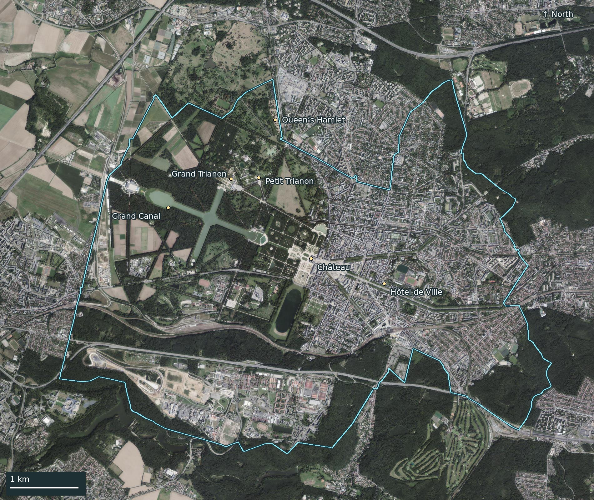
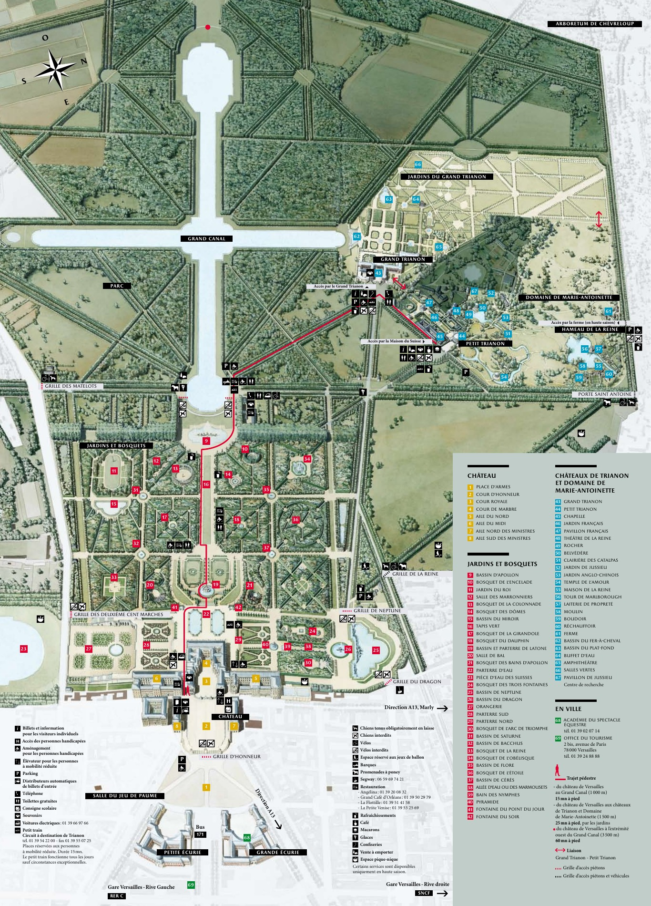
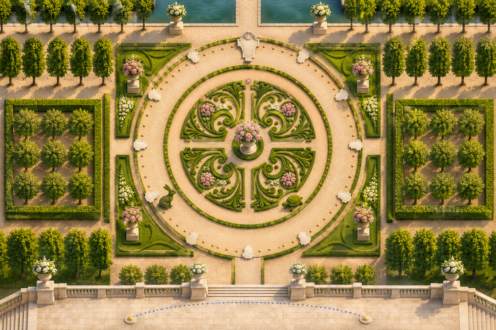
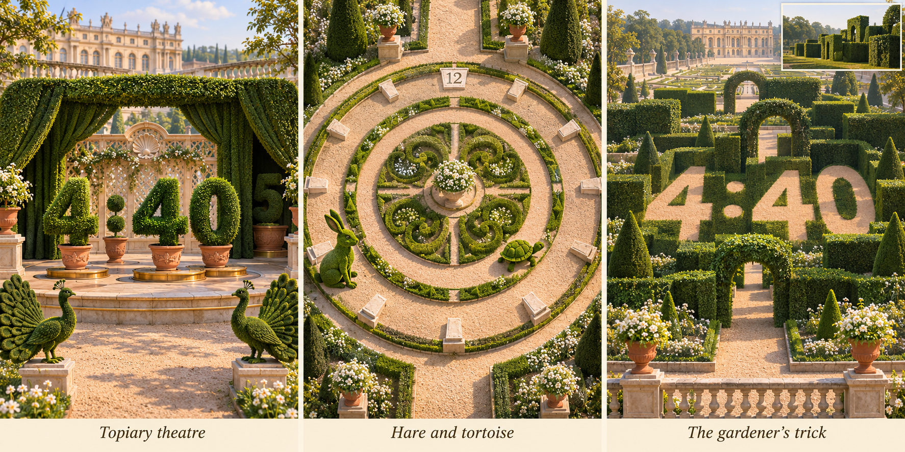

# Versailles topiary clock — The Hare and the Tortoise

**Screensaver level proposal · 24 November 2026**

From a limestone terrace, watch a hare hop between brass studs on a gravel path. Inside its orbit a tortoise carries the hour around a second path. At 4:40 the hare sits at eight o’clock and the tortoise is two thirds of the way from four to five. At noon they meet on the same sightline, one behind the other. Their different speeds tell both the time and the fable.

## All of Versailles from above

The turquoise outline follows the municipal boundary. Find the château at the meeting point of the town’s avenues, then follow the gardens west to the cross-shaped Grand Canal. The Trianon palaces and Queen’s Hamlet lie north of that axis. North is up and the scale bar measures one kilometre. Aerial imagery © IGN, Géoplateforme, orthophoto layer. [IGN imagery service](https://data.geopf.fr/wms-r/wms?SERVICE=WMS&REQUEST=GetCapabilities) · [Versailles municipal outline](https://geo.api.gouv.fr/communes/78646?format=geojson&geometry=contour)

## Palace, gardens, park and Trianon

The palace’s illustrated plan gives the paths and groves names. Its compass is rotated relative to the aerial above. Use the château, the cross of the Grand Canal and the Trianon grounds to move between the two maps. Estate plan © Château de Versailles, 2011. [Open the full-resolution official PDF](https://www.chateauversailles.fr/sites/default/files/domaine_2011.pdf)

## Detail of the proposed clock garden

The blue dotted line marks the camera’s travel along the terrace. The center of that line is the Still viewpoint. Looking toward the canal always puts twelve at the far edge and three on the right. The image sets the planting, materials and sightlines. Place the sixty studs and twelve stones by angle in the model so each marks an exact division.

| Map feature | Proposed blockout | Purpose in the shot |
| --- | --- | --- |
| Outer gravel track | Radius 10 m, sixty flush brass studs at 6° intervals | The hare lands with its feet over the current minute. Give every fifth stud a pale stone surround. |
| Inner gravel track | Radius 7 m, concentric with the first | The tortoise’s shell center marks the fractional hour. Carve hour numerals into the twelve outer stones so both tracks share one scale. |
| Embroidered beds and central urn | Four low boxwood scrolls around a shallow bowl of flowers | Leave the far track visible above the center planting even when the tortoise passes twelve. |
| Terrace and groves | Start the camera roughly 17 m from center and 13 m above the beds. Place tall hedges beside the dial. | The rail, urns and avenues give the moving view depth. Keep the near path visible over the balustrade. |
| Canal axis | One gravel avenue continues beyond the noon stone to a strip of water | The noon sightline gives the dial a fixed orientation throughout the promenade. |

The clock garden is an invented parterre. Use Versailles’ long axial views, clipped groves and contrasts of gravel and water as references. [Official estate map](https://bienvenue.chateauversailles.fr/en/overview/welcome-to-versailles) · [Versailles gardens plan (PDF)](https://www.chateauversailles-spectacles.fr/app/uploads/2026/04/PLAN-DE-VISITE-GEM-2026-EN.pdf)

## What moves

| Local time | Hare on the outer track | Tortoise on the inner track |
| --- | --- | --- |
| Most of each minute | Sits facing clockwise at its stud. Upright ears and a small tail identify it in silhouette. | Walks continuously clockwise. Model a domed shell with broad clipped panels, a projecting head and four short legs. |
| Final 0.8 seconds | Crouches, then covers one stud interval in a low arc. Lands on the new minute exactly at the boundary. | Keeps walking. Its body advances at half a degree per minute. |
| First second after landing | Ears settle in succession while its feet stay planted. | Continues along its own radius. |
| 11:59 into 12:00 | Hops across the wrap to the noon stone. | Arrives on the same radial line. The gap between the paths keeps both animals visible. |

Sample device-local hour, minute and fractional second together on every frame. Measure clockwise from twelve. The hare’s resting angle is six degrees times the minute. During its hop add up to six degrees before wrapping. The tortoise’s angle is thirty degrees times the hour modulo twelve, plus half a degree times the minute and one degree per 120 seconds. Derive lift, ear motion and footfalls from those same phases. Entering the level midway through a hop or waking after a clock correction should immediately show the corresponding pose.

## Camera and legibility

**Promenade**, the proposed default, travels about 3 m to either side of the terrace midpoint over a two-minute out-and-back cycle. Ease through the turnarounds and keep the camera aimed at the bed center. **Still** uses the elevated midpoint with the same lens. In both views, frame the entire outer track with a little gravel beyond the nearest stud. Check 12:00 and 6:30 first, when perspective brings the two animals closest together on screen.

Paint the hare a brighter yellow-green and the tortoise a cooler deep green. The ears and shell should also be distinguishable in grayscale. Give the garden soft afternoon light and enough ambient fill to see the feet against the pale gravel. Keep the brass studs broad enough to survive downsampling to a TV frame.

## Three ways to tell time with topiary

The middle panel is the proposed first build. The theatre on the left is an alternative if immediate numeral recognition matters most. Its revealing transition is 4:49 to 4:50, when two hedge pots exchange places with the next pair. The gardener’s trick on the right rewards a longer camera walk. Prototype that one with plain blocks first and check whether sunlight through several ordinary-looking hedges can resolve into digits from a single terrace mark.

## Build and review

1. **Prove the read.** Block out the two tracks, twelve stones, sixty studs and animal silhouettes in Blender. Render a terrace view at 4:40 and another at 12:00. Check that a viewer can identify the minute to one stud from both ends of the camera route.
2. **Cook a standalone level.** Start from the baseline room, player, camera, camshot and target setup. Batch static beds and paving by garden section. Give the torso meshes floor-level pivots, the ears base hinges, and the director references to the exported actors. Drive positions and headings directly from the clock. Check the first textured PC frame for face winding, atlas orientation and lighting before detailing the groves. [Level-building guide](../level-building.md) · [Actor types](../2026-05-03-oas-actor-types.md) · [Baseline](../../wflevels/baseline/README.md) · [Troubleshooting FAQ](../level-design-troubleshooting.md)
3. **Exercise time and framing on PC.** Record 4:39:58 through 4:40:02, noon, midnight and a backward clock jump. At 4:42 verify that the hare is two studs beyond eight. Sample the full camera path for hedge, urn and rail intersections, including the near plane. Switch between Still and Promenade while both animals occupy the far side. Compare actual captures with the overhead layout and center concept panel.
4. **Review the running clock.** Open the standalone PC level for visual review. Once the clock batch is ready, integrate the chooser and Dream settings, then check readability from the sofa, minute-hop frame pacing and resumed local time on the shared TV devices. [3D clocks batch workflow](../howto/combine-levels-chooser-and-screensaver-launch.md#3d-clocks-batch-workflow)
