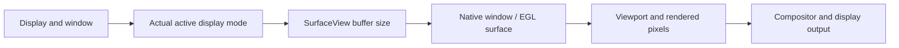

# Android rendering at 4K when available

Status: plan for review; World Foundry implementation and measurements pending. Existing Homeboard 4K experiments establish the device and Android surface groundwork. Target the World Foundry Android apps, including the combined 3D Clocks and Aquarium activities and their screensaver previews and Dreams. Keep other Android apps in the inventory and establish which share this rendering path before deciding their changes.

## Goal

When an Android device is actually outputting to a 4K-capable display, render the 3D scene at the available 4K resolution if the app can do so reliably and at an acceptable frame rate. Preserve the appropriate native surface resolution on 1080p devices and phone/tablet windows. Do not force the user's display mode, change system settings, or claim 4K merely because a television reports 4K support. Keep screen orientation, aspect ratio, UI sizing, touch, lifecycle and screensavers working.

Each arrow needs measurement: an active 4K display mode alone does not prove that the renderer produced 4K pixels. Android notes that a TV can run its application UI at 1080p while outputting 4K; a SurfaceView can use larger buffers. [Android Display.Mode](https://developer.android.com/reference/android/view/Display.Mode) and [SurfaceHolder](https://developer.android.com/reference/android/view/SurfaceHolder) describe the relevant APIs. Android also documents that [DisplayCompat](https://developer.android.com/reference/androidx/core/view/DisplayCompat) can report more reliable physical display dimensions on some TVs. Confirm the behavior on our actual devices rather than treating any one API as proof of the full path.

## Known starting point

- On 25 November, the coordinator reported cast1 (`chromecast-test-01`, Chromecast HD) at 1080p59.94, with a 1080p maximum. Cast2 (`chromecast-test-02`) reported an LG display at 4K60, with a 4K maximum. These are display observations, not yet application surface or rendering measurements; attached displays and modes can change.
- `android/screensaver/src/main/java/org/worldfoundry/screensaver/TankPlayer.java` owns the shared SurfaceView and layout. Its `surfaceChanged` callback currently does nothing; inspect the complete construction and lifecycle before choosing a sizing point.
- `android/screensaver/src/main/cpp/dream_host.cc` reads the native window size and reports surface changes. The renderer's Android EGL path in `wfsource/source/gfx/gl/android_window.cc` queries the actual EGL surface and updates the live surface size; the renderer already has resize/projection handling. Establish which path each Android app uses and verify the actual viewport rather than assuming a change is needed there.
- `TideSpikeActivity` has a separate opt-in low-resolution test path. Audit this and other standalone hosts individually; do not accidentally turn a deliberate test configuration into a production policy.
- Current touch handling maps view coordinates into surface pixels in `android/screensaver/src/main/cpp/touch_bridge.h` and `dream_host.cc`. Verify that mapping at differing view and buffer sizes.

## Reuse the Homeboard work

Read the [Android 4K HOWTO](../../../homeboard-tv/docs/how-to/android-4k.md) before implementation; its four-resolution model, surface sizing, orientation, lifecycle, resource cost and verification guidance apply here.

Do not repeat the device-capability investigation. The sibling project's [4K status report](../../../homeboard-tv/docs/investigations/2026-11-24-4k-status.md) and [dashboard verification record](../../../homeboard-tv/docs/testing/2026-11-25-native-4k-dashboard.md) already establish that cast2's LG is 4K and that a 3840×2160 hardware Canvas surface can be allocated while the ordinary UI is 1920×1080. Its separate actual-dashboard proof reports a 3840×2160 hardware surface and hierarchy; cast1 passed a 1920×1080 control. These establish the Android/device path, not that World Foundry's EGL renderer is already rendering at 4K.

Use the existing [tester and patterns](../../../homeboard-tv/launcher/tester/shared/com/gathin/tvhome/Native4kViewProbeActivity.java), [mode and rotation selection](../../../homeboard-tv/launcher/tester/shared/com/gathin/tvhome/ResolutionModeChooser.java), and their tests and recorded evidence as references. The tester APK is already installed on both Chromecasts. Reuse its black/white one-, two- and four-pixel patterns and physical-panel acceptance rather than inventing another tester. Native one-pixel panel detail remains unverified, and Homeboard's dashboard performance has not passed; neither conclusion should be assumed for this OpenGL workload.

The Homeboard tester can request a preferred mode to test modes; this plan's normal production behavior should follow the active mode without changing the user's display mode. The HOWTO identifies SurfaceView as suitable for a renderer that already draws its own scene: start with our existing SurfaceView/EGL path. Its VirtualDisplay/Presentation and SurfaceControlViewHost approaches solve native Android View hierarchy embedding and are not needed just to enlarge the engine render buffer. If separately rendered Android Views or dialogs need native 4K, assess their layout, density, focus and accessibility using that guide rather than scaling global resources. Reuse the findings, then measure that renderer and its lifecycle directly.

## Implementation plan

1. **Measure the World Foundry baseline.** Reuse the established Homeboard device and panel findings above; do not rerun its capability survey. Freeze an existing World Foundry APK and record its source revision and SHA-256. Through the coordinator, record cast1 and cast2 model, active display mode and supported modes, actual view/layout dimensions, SurfaceView buffer, native window, EGL surface and viewport dimensions, app and Dream/preview paths, refresh rate, frame times, memory and thermals. Capture screenshots and, where necessary, a visible fine-detail test pattern. Confirm which values are actually observable before relying on them. Include a phone at its ordinary window size. Record device/display identity, APK hash, configuration and evidence for every run.
2. **Choose the smallest host-side change supported by the measurements.** In the shared Android host, query the active display and the current window; only request a full-size buffer for an eligible fullscreen TV surface whose active output and device support it. Preserve the current aspect ratio, orientation and the chosen refresh rate. Evaluate `SurfaceHolder.setFixedSize` on its owning UI thread and return to `setSizeFromLayout` when the conditions no longer apply. Do not blindly force 3840×2160 on a 1080p output, phone, partial window or portrait surface. Distinguish a display's supported modes from its active mode; do not request a mode switch as part of this change. If the measurements reveal that Android's display APIs misreport a device, investigate `DisplayCompat` and justify any dependency or fallback.
3. **Handle transitions and cleanup.** Re-evaluate after surface recreation, display changes, window resizing, orientation, resume and Dream/preview entry and exit. Avoid resize loops and stale fixed buffers; handle allocation or EGL failure by falling back to the existing working surface size and logging the requested and actual dimensions. Verify the lifecycle does not leak or repeatedly recreate the engine.
4. **Engine permission gate.** Android app host work is in scope for a later implementation, but any change to World Foundry engine code requires Will's explicit permission before editing. If baseline evidence shows that engine resize, projection, UI or input changes are necessary, document the affected files and exact proposal and obtain permission first. Continue independent host and measurement work in the meantime.
5. **Measure cost and select a practical policy.** Compare matched 1080p and 4K runs on cast2 using representative heavy Aquarium scenes and multiple 3D Clocks, including the globe and bamboo pond. Record frame-time distributions, sustained FPS, thermal behavior and memory, as well as the final native/EGL/viewport dimensions. A single 3840×2160 four-byte buffer costs about 31.6 MiB; account for multiple graphics and compositor buffers, which process PSS may not capture. Run long enough to expose thermal throttling. Agree a performance threshold from the baseline; if 4K is too costly or fails allocation, document the measured result and fall back to a lower resolution rather than shipping an unusable default. Do not introduce a user-facing setting unless the measurements justify it.

## Verification and acceptance

- On cast2 with an active 4K mode, demonstrate a 3840×2160 rendering buffer and matching EGL surface and viewport, with capture evidence that distinguishes native detail from 1080p upscaling. If screenshot capture itself is downscaled, use a separately validated capture method or an on-screen diagnostic and describe its limits. Record performance and actual output mode alongside the evidence.
- On cast1, demonstrate correct 1080p operation without a 4K request. Verify an active 1080p mode on a 4K-capable display also follows the actual output, not just the EDID maximum. Test a phone/tablet layout without forcing TV-sized buffers.
- Exercise Activity, Dream and preview entry, background/resume, display disconnect or mode change when safely available, rotation where supported, settings, input and touch alignment. Check text and chooser readability, framing and aspect ratio, no black or stale surface, and fallback after a failed or unsupported size.
- Build and freeze the final APKs; compare packaged level bundles and binaries with the intended build. Use coordinator-owned sessions and save logs, receipts, screenshots, hashes and results. Do not describe 4K as verified for an unavailable path or device. Report any launch or launcher-tile failures separately.

## Baseline result, 25 November

Cast2 job J‑34d279376fe0 completed with the frozen Clocks APK SHA-256 `25a26ac64c4e74cc1f10b6adca501373d854ce60e1a3da7fc7ed7c128e804054`. The coordinator reported the attached LG at 4K60, but the engine logged a **1920×1080 surface and viewport**. The captured screen was the chooser; this does not establish level-specific performance, physical pixel detail or Dream behavior. [Evidence](../diagnostics/android-4k-baseline-2026-11-25/cast2/) includes the renderer log; raw receipts and captures remain local pending privacy review. The earlier cast1 control J‑81a7e64bab0d logged a 1920×1080 viewport on its 1080p output; its evidence is currently local under `build/clocks-deploy-2026-11-25/cast1-check/`. No 4K implementation exists yet, so 4K acceptance and comparative performance tests remain open.

## Initial implementation checks

A shared Android host change requests a physical-size buffer for a fullscreen TV on an active 4K display. Clocks APK SHA-256 `d8b5706d45255e57b1cc0a7d6490415a3cff7e197ec3144895c3bb5b81807ac3` reported a 3840×2160 surface and viewport on cast2 (J‑210e55160d6c); the same APK reported 1920×1080 on cast1 (J‑4d0773eeaf62). Scripted job J‑81d435917453 reached the Bamboo Tipper and Pond scene on cast2 at 3840×2160; [capture and logs](../diagnostics/android-4k-baseline-2026-11-25/cast2-bamboo/) are retained. The coordinator's screenshot is 1920×1080 and does not prove physical 4K detail. Sustained performance, display-mode changes, allocation failure and phone behavior remain unverified. The Dream check J‑db2c98aa0297 was still waiting for the Android idle trigger when this note was written; inspect its final receipt before claiming a result.

## Open questions for baseline evidence

- Baseline answered: the Clocks chooser reports a 1920×1080 renderer surface and viewport while cast2 outputs 4K; confirm each level and host path after implementation.
- Do all app, preview and Dream paths receive the same actual buffer size and behave correctly on resize?
- Can the device sustain native 4K at useful frame rates, and does compositor output preserve that detail?
- Is a host-only change sufficient, or are explicitly authorized engine changes needed?
