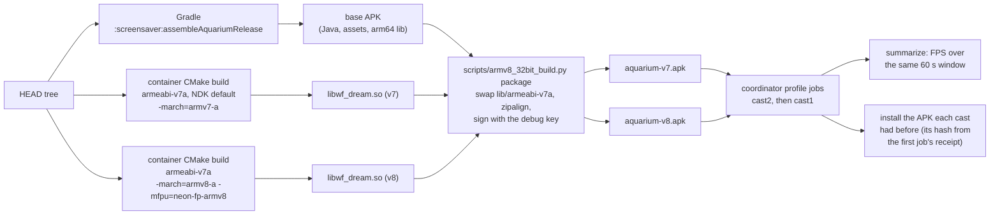
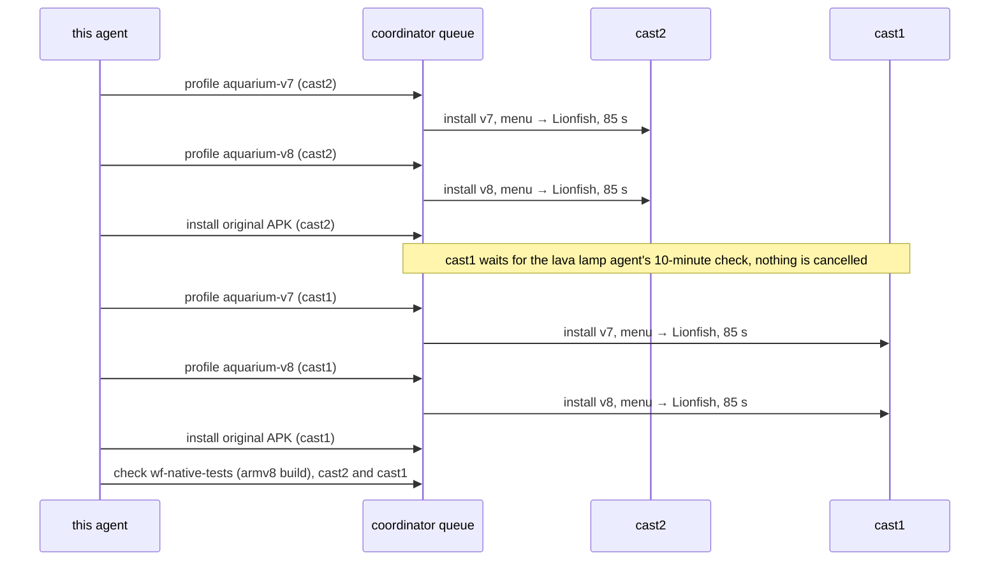

# An ARMv8 32-bit build for the Chromecasts: measure, then decide

**Status: measured 2026‑11‑27 on cast1 and cast2; a decision for Will.** Recommendation: **keep** the shipped ARMv7 build (see [Recommendation](#recommendation)). Nothing here changes the shipped build.

TODO item: **Measure an ARMv8 32-bit build for the Chromecasts** (T4). It comes from Q2 of the [Forth math words plan](2026-11-26-forth-math-words.md) and its hardware matrix, and it uses the [device native test route](2026-11-26-device-native-test-route.md).

No visible surface: this is a build flag measurement. It has no UI, no rendered page and no on-screen output of its own, so the plan has no mockups.

## The question

Both Chromecasts have ARMv8 cores: cast1 (Chromecast HD, "boreal") has 4 × Cortex‑A35 and cast2 (Chromecast 4K, "sabrina") has 4 × Cortex‑A55. Both run a 32-bit-only Android userspace, so they install our `armeabi-v7a` library. The NDK builds that ABI for ARMv7‑A with VFPv3‑D16 and NEON (`-march=armv7-a -mthumb`, `__ARM_FP 0xc`), so three things the cores have never reach our code:

- **`vrint*`** (ARMv8 FP): `floor`, `ceil`, `trunc`, `round` and `nearbyint` are calls into bionic's `libm` instead of one instruction.
- **`vfma`** (VFPv4): there is no fused multiply-add, so `std::fma` is bionic's software `fmaf` (the cause of the math plan's D8) and the compiler never contracts `a*b + c`.
- **`vsqrt`** is there in both builds (VFPv3 has it); it is listed so the codegen diff shows it unchanged.

The candidate flags are `-march=armv8-a -mfpu=neon-fp-armv8 -mfloat-abi=softfp`. NDK r26's clang accepts them for `armeabi-v7a` (`--target=armv7-none-linux-androideabi21`), and they turn on `__ARM_ARCH 8`, `__ARM_FP 0xe`, `__ARM_FEATURE_FMA`, `__ARM_FEATURE_DIRECTED_ROUNDING`, `__ARM_FEATURE_NUMERIC_MAXMIN`, `__ARM_FEATURE_IDIV` and `__ARM_FEATURE_CRC32` (probe in Verification 2). `softfp` is the Android `armeabi-v7a` calling convention, so the library still links against the same bionic and libc++.

The cost: a library built this way uses instructions an ARMv7 core does not have, so it dies with `SIGILL` on a true ARMv7 device (Cortex‑A5, A7, A8, A9, A15, A17). Android picks the library by ABI name only, and `armeabi-v7a` covers both.

## What we measure

1. The CPU features each cast reports to a 32-bit process (`/proc/cpuinfo`, through the native test route).
2. The codegen difference: the Forth math words of `engine/stubs/forth_math.hpp` and a Jolt solver file, disassembled both ways, and the instruction histogram of the whole engine library both ways.
3. Frame rate: one Aquarium tank, built both ways, profiled for a 60 s steady window on cast2 and on cast1, back to back.
4. The Forth words still agree bit for bit with the PC on the ARMv8 build (`fma` through hardware `vfma` must stay exact), and what each word costs in the VM both ways.
5. Which devices we know of would stop working.

## Design

**One library differs; everything else is the same APK.** The base is the Aquarium release APK built by Gradle from HEAD (`:screensaver:assembleAquariumRelease`, assets and Java as they ship). Both variants replace its `lib/armeabi-v7a/libwf_dream.so` with one built in the `linux-test` container from the same tree. The two builds differ only in `-march`/`-mfpu`, so the baseline variant is also our own build, not Gradle's. That keeps compiler paths and every other flag identical between the two. `arm64-v8a` is untouched, and the casts never load it.



**The build** (`scripts/armv8_32bit_build.py build --variant v7|v8`) reproduces AGP's CMake call for the screensaver Release (`android/screensaver/.cxx/Release/*/armeabi-v7a/metadata_generation_command.txt`): the NDK toolchain file, `ANDROID_ABI=armeabi-v7a`, `ANDROID_PLATFORM=android-21`, `CMAKE_BUILD_TYPE=Release`, the dream project hook, target `wf_dream`. The v8 variant adds the flags to `CMAKE_C_FLAGS`, `CMAKE_CXX_FLAGS` and `CMAKE_SHARED_LINKER_FLAGS`; the link flags matter because the Release build is thin LTO, where code generation happens at link time. Each variant has its own build directory under `build-docker/armv8-32bit/<variant>`.

**The one part both variants share prebuilt** is the Rust attribute validator (`libwf_attr_edit.a`, `scripts/build-runtime-property-core.py`). The `linux-test` image has no `armv7-linux-androideabi` Rust standard library, so a `cargo` shim inside the build container copies in the archive AGP built on the host for the shipped APK, and records its SHA‑256. The C flags do not reach Rust code, so the shipped APK and both variants link the same archive.

**Device runs** use the coordinator's `profile` workflow, not `variant-benchmark`: the Aquarium app has no coordinator scene list, and `variant-benchmark` takes no input script, so it could not leave the menu. Each run installs one variant (`reinstall`), opens the Lionfish tank from the menu with a scripted D-pad sequence, and records 85 s. The steady window is 20 s to 80 s after measurement start, computed from the per-frame present times (`run-1/presents-ns.json`). Lionfish is chosen because it sits on the 60/30 FPS boundary on cast1 (47.9 FPS, CPU 15 ms a frame in the [deformer normals profile](2026-11-01-deformer-face-normals.md)), where a CPU change shows in FPS. A tank already at 60 FPS, or one far over budget, hides it behind vsync. Afterwards, an `install` job puts back the APK the cast had, taken from the first job's `before_sha256`.



cast1's settings are not touched: no `configure`, no stay-on change, no screensaver selection. The Pixel and the tablet are not used.

**The Forth words on the ARMv8 build** use the native test route with one new option, `scripts/device_native_tests.py build|run --arm32 armv8`: the same suite with the ARMv8 flags on `armeabi-v7a`, frozen as `wf-native-tests-armv8-<sha16>.apk`, with results collected under `build/device-native-tests/<device>-armv8/`. `tests/forth_math_agreement.py --target pc --target chromecast-test-02-armv8` then compares it with no change to that script. The suite's `cpuinfo` test prints the compile-time macros, which proves that the run used the ARMv8 build, and `/proc/cpuinfo`, which is measurement 1.

**Rejected:** a Gradle property that adds the flags to the screensaver module's CMake arguments. AGP keeps one `.cxx/Release` tree per module that every flavor shares, and other agents build clocks and the lava lamp from it all day, so a variant built there would race them and could leave the shipped configuration dirty. **Also rejected:** swapping libraries into the APK the casts already have (2026‑11‑25 for cast2). Its Java predates today's display-resolution and surface-height changes, which HEAD's native code calls.

## Decision options (for Will)

| Option | What it means | Cost |
|---|---|---|
| **Keep** | Ship `armeabi-v7a` as today (ARMv7, VFPv3‑D16, NEON) | Whatever the measurement shows is left on the table |
| **Switch** | Build `armeabi-v7a` with `-march=armv8-a -mfpu=neon-fp-armv8` | Every true ARMv7 device gets `SIGILL` at start |
| **Split at run time** | Ship two 32-bit libraries in one APK (`libwf_dream.so` built for ARMv7, `libwf_dream_v8.so` for ARMv8) and load one by `getauxval(AT_HWCAP)`/`AT_HWCAP2` (`HWCAP_VFPv4`, `HWCAP2_CRC32`...) before `System.loadLibrary` | about 3.5 MB more APK per pack, one loader decision in Java or a tiny native stub |
| **Middle step** | `-march=armv7ve -mfpu=neon-vfpv4` | Gets `vfma` and integer divide but not `vrint`; still drops Cortex‑A8 and A9 |

The Play Store cannot split by CPU feature inside one ABI, so a "split" has to happen at run time.

## Phases

1. Plan (this file) and the TODO stamp.
2. `scripts/armv8_32bit_build.py`: `probe`, `build`, `package`, `summarize`; `--arm32 armv8` in `scripts/device_native_tests.py`, with a unit test of the flag in `tests/test_device_native_tests.py`.
3. Codegen probe; both builds; package; stage.
4. cast2 runs, cast1 runs (queued behind the lava lamp agent), restores.
5. Native test route on both casts with the ARMv8 build; agreement and VM cost.
6. Record results and the recommendation; delete my build output (`build-docker/armv8-32bit/`, the two variant libraries); keep the frozen APKs' hashes in the evidence.

## Verification

Run 2026‑11‑27 from HEAD `c2f281f8c`. Device runs between 23:21Z and 23:40Z on 2026‑11‑26 (06:21 to 06:40 in Bangkok on 2026‑11‑27).

1. Both casts report ARMv8 cores and the ARMv8 32-bit features (`vfpv4`, `lpae`, `idiva`, `crc32`...) to a 32-bit process:

    ```bash
    python3 scripts/device_native_tests.py run --arm32 armv8 --device chromecast-test-02
    python3 scripts/device_native_tests.py run --arm32 armv8 --device chromecast-test-01
    grep -E 'Features|CPU part|CPU architecture|__ARM' build/device-native-tests/chromecast-test-0?-armv8/cpuinfo.txt
    ```

    ```
    chromecast-test-02 (J‑bcb89da6852c), sort | uniq -c:
          1 arm __ARM_ARCH=8 neon __ARM_FP=0xe fma directed-rounding
          4 CPU architecture: 8
          4 CPU part	: 0xd05
          4 Features	: half thumb fastmult vfp edsp neon vfpv3 tls vfpv4 idiva idivt lpae evtstrm aes pmull sha1 sha2 crc32
          1 ro.soc.model=AMLS905D3
    chromecast-test-01 (J‑b53875281657):
          1 arm __ARM_ARCH=8 neon __ARM_FP=0xe fma directed-rounding
          4 CPU part	: 0xd04
          4 Features	: half thumb fastmult vfp edsp neon vfpv3 tls vfpv4 idiva idivt lpae evtstrm aes pmull sha1 sha2 crc32
          1 ro.soc.model=AMLS805X2
    ```

    **PASS.** Cortex‑A55 (`0xd05`) and Cortex‑A35 (`0xd04`), both `CPU architecture: 8`, both with exactly the feature list the brief names. The first line is the suite's own compile-time report: that run used the ARMv8 build (`__ARM_ARCH=8`, `__ARM_FP=0xe`, FMA, directed rounding). The 32-bit kernel interface has no `fphp`/`asimd` names (those are AArch64 hwcaps); `vfpv4` and `neon` are their 32-bit names, and ARMv8 FP (`vrint`) has no hwcap bit of its own in 32-bit `/proc/cpuinfo`, so the CPU part is what proves it.

2. The codegen differs where expected: the Forth rounding words become `vrintm`/`vrintp`/`vrintz`/`vrinta`/`vrintr` (or `vrintx`), `fma` becomes `vfma.f32`, `sqrt` stays `vsqrt`, and the libm imports for those words disappear from the engine library:

    ```bash
    python3 scripts/armv8_32bit_build.py probe
    ```

    ```
    == Forth words (engine/stubs/forth_math.hpp, -O3), per function: instructions of interest
    wf_probe_ceil        v7  27 ins {}
                         v8  23 ins {'vrintp': 1}
    wf_probe_floor       v7  27 ins {}
                         v8  23 ins {'vrintm': 1}
    wf_probe_fma         v7  83 ins {}
                         v8  42 ins {'vfma': 1}
    wf_probe_fraction    v7  10 ins {}
                         v8   5 ins {'vrintm': 1}
    wf_probe_round       v7  27 ins {}
                         v8  23 ins {'vrinta': 1}
    wf_probe_roundeven   v7  27 ins {}
                         v8  23 ins {'vrintr': 1}
    wf_probe_sinrev      v7  29 ins {}
                         v8  24 ins {'vrintm': 1}
    wf_probe_sqrt        v7  21 ins {'vsqrt': 1}
                         v8  17 ins {'vsqrt': 1}
    wf_probe_trunc       v7  27 ins {}
                         v8  23 ins {'vrintz': 1}

    == Jolt ContactConstraintManager.cpp (-O2, Jolt's flags), whole object
    v7:  21883 instructions; {'vmla': 1588, 'vmls': 337, 'vsqrt': 68}
    v8:  21699 instructions; {'vfma': 1594, 'vfms': 31, 'vfnma': 10, 'vmaxnm': 10, 'vmla': 179, 'vmls': 119, 'vsqrt': 68}
    ```

    **PASS.** Every rounding word drops its `bl` to libm for one `vrint` (`floor` → `vrintm`, `ceil` → `vrintp`, `trunc` → `vrintz`, `round` → `vrinta`, `roundeven` (`nearbyint`) → `vrintr`); `fma` goes from 83 instructions (D8's exact software path) to 42 with one `vfma.f32`; `sqrt` is `vsqrt` both ways. In Jolt's contact solver the compiler turns almost every non-fused `vmla`/`vmls` (multiply, round, add, round) into fused `vfma`/`vfms` (one rounding): 1588 `vmla` become 1594 `vfma`. That is `-ffp-contract=on`, clang's default, now that the target has FMA: the ARMv8 build's physics and deformer results are not bit-identical with today's `armeabi-v7a` build (the `arm64-v8a` build already fuses the same way). Disassembly: `build/armv8-32bit/probe-*.s`.

3. Both libraries build from the same tree, the v8 compile lines carry the flags after the NDK's `-march=armv7-a`, and the instruction histograms differ as in step 2:

    ```bash
    python3 scripts/armv8_32bit_build.py build --variant v7
    python3 scripts/armv8_32bit_build.py build --variant v8
    python3 scripts/armv8_32bit_build.py histogram
    ```

    ```
    build-v7.json: bytes_stripped 3535696, sha256_stripped e484f7977e5380c6…
      jolt_compile_arch: --target=armv7-none-linux-androideabi21 -march=armv7-a -mthumb -flto=thin
    build-v8.json: bytes_stripped 3517632, sha256_stripped 02c7f832bf3d3468…
      jolt_compile_arch: --target=armv7-none-linux-androideabi21 -march=armv7-a -mthumb -march=armv8-a -mfpu=neon-fp-armv8 -mfloat-abi=softfp -flto=thin
    both: rust_archive android/screensaver/.cxx/Release/5en6e4s5/armeabi-v7a/runtime-properties/libwf_attr_edit.a, sha256 2d36614cecc8d905…

    v7: 868,165 instructions
        of interest: {'sdiv': 1, 'vmla': 13445, 'vmls': 2719, 'vrinta': 1, 'vrintn': 3, 'vrintp': 1, 'vrintx': 2, 'vrintz': 5, 'vsqrt': 540}
        libm imports: ceil@LIBC ceilf@LIBC floor@LIBC floorf@LIBC lround@LIBC lroundf@LIBC nearbyint@LIBC nearbyintf@LIBC roundf@LIBC trunc@LIBC truncf@LIBC
    v8: 861,779 instructions
        of interest: {'sdiv': 26, 'udiv': 156, 'vcvta': 7, 'vfma': 10644, 'vfms': 597, 'vfnma': 88, 'vfnms': 26, 'vmaxnm': 150, 'vminnm': 59, 'vmla': 3909, 'vmls': 1228, 'vrinta': 10, 'vrintm': 21, 'vrintn': 4, 'vrintp': 3, 'vrintr': 3, 'vrintx': 2, 'vrintz': 8, 'vsqrt': 540}
        libm imports: lround@LIBC lroundf@LIBC
    imports the v8 library no longer needs: ceil@LIBC ceilf@LIBC floor@LIBC floorf@LIBC nearbyint@LIBC nearbyintf@LIBC roundf@LIBC trunc@LIBC truncf@LIBC
    ```

    **PASS.** The v7 library is 176 bytes from Gradle's own `armeabi-v7a` library (3,535,696 against 3,535,872; build paths), so the container build reproduces the shipped one. The stripped library has no Thumb mapping symbols, so the histogram decodes the whole text as Thumb-2 with the ARMv8 decoder for both variants; inline literal pools then decode as noise, which is why the v7 column shows a dozen `vrint`/`sdiv` it cannot contain. Above that noise, the v8 library has 11,355 fused `vfma`/`vfms`/`vfnma`/`vfnms` where the v7 one has about 11,000 more non-fused `vmla`/`vmls`, 182 hardware divides (instead of `__aeabi_idiv` calls, which are linked in statically and so do not show as imports), `vmaxnm`/`vminnm`, and no longer imports nine rounding functions from bionic. It is 18 KB smaller.

4. The two APKs differ from the base and from each other only in `lib/armeabi-v7a/libwf_dream.so` and the signature files:

    ```bash
    python3 scripts/armv8_32bit_build.py package --base android/screensaver/build/outputs/apk/aquarium/release/screensaver-aquarium-release.apk
    ```

    ```
    (base: the Gradle output, frozen as build/coordinator-artifacts/armv8-32bit/aquarium-base.apk, sha256 c86308a90a21ff9b…)
    v7: build/coordinator-artifacts/armv8-32bit/aquarium-v7.apk sha256 660733a35bc276d9b0fb9b5fcc2a69cacd45dc6558e7af11ccb3e6ad061f348a
        differs from the base in: META-INF/ANDROIDD.RSA META-INF/ANDROIDD.SF META-INF/MANIFEST.MF lib/armeabi-v7a/libwf_dream.so; missing: META-INF/CERT.RSA META-INF/CERT.SF
    v8: build/coordinator-artifacts/armv8-32bit/aquarium-v8.apk sha256 d4f2d20406958bfc8aa6f859ef9e60a73aaf150d01feb9e001e87a28dfd6cee2
        differs from the base in: META-INF/ANDROIDD.RSA META-INF/ANDROIDD.SF META-INF/MANIFEST.MF lib/armeabi-v7a/libwf_dream.so; missing: META-INF/CERT.RSA META-INF/CERT.SF
    apksigner --print-certs (base, v8, the 2026-11-25 Aquarium): Signer #1 certificate SHA-256 digest: 79f65b248ea21bbb… (all three)
    ```

    **PASS.** Only the library and the v1 signature file names differ (apksigner names them after the key alias); the signing certificate is the same as the installed Aquarium's, so both variants install over it and it installs back.

5. cast2: v7 and v8 FPS over the same 60 s Lionfish window, back to back:

    ```bash
    python3 scripts/armv8_32bit_build.py summarize build/armv8-32bit/evidence/chromecast-test-02-*
    ```

    ```
    chromecast-test-02 J-6836ee7a4d3d v7: window 20-80 s: 30.01 FPS, p50 33.33 ms, p95 33.33 ms, missed 99.33 %, 1800 frames; whole run 33.25 FPS
    chromecast-test-02 J-f1e221024920 v8: window 20-80 s: 30.03 FPS, p50 33.33 ms, p95 33.33 ms, missed 99.56 %, 1801 frames; whole run 33.36 FPS
    ```

    **PASS as a measurement, no difference.** Both runs show the Lionfish tank (captures `input-frame-002.png`/`-003.png`). cast2 draws at native 4K: `wf.log` reports `surface=3840x2160` (the TV runs 4K60, and the Maximum surface height setting is 0, none). At that size the frame never fits in one 16.7 ms refresh, so every frame takes two refreshes in both builds: the GPU's fill rate decides cast2's frame rate here, and the CPU build cannot show.

6. cast1: the same, back to back, queued behind the lava lamp agent's check.

    ```
    chromecast-test-01 J-071dc9d121c8 v7: window 20-80 s: 47.06 FPS, p50 16.68 ms, p95 33.37 ms, missed 26.74 %, 2824 frames; whole run 48.35 FPS
    chromecast-test-01 J-764f87e20652 v8: window 20-80 s: 47.24 FPS, p50 16.68 ms, p95 33.37 ms, missed 26.19 %, 2834 frames; whole run 48.46 FPS
    ```

    **PASS as a measurement, no difference outside noise.** cast1 draws 1920 × 1080 and sits on the 60/30 boundary, as chosen: about a quarter of frames take two refreshes. The ARMv8 build gives +0.18 FPS (+0.4 %) and 0.55 points fewer missed refreshes, one run each. The deformer-normals study measured the same tank's run-to-run spread on cast1 as 47.6 to 48.1 FPS, so this is inside the noise. Started 06:27 and 06:30 (Bangkok), consecutive in the queue. cast1's settings were not touched: no `configure`, `screensaver-select` or stay-on change.

7. Each cast's Aquarium is restored: its installed hash after the restore equals the `before_sha256` of my first job on it.

    ```
    cast2: first job J-6836ee7a4d3d before_sha256 92d9eb0bec6cf680be37286052245614b870c661293663f6d370157c5af89099
           restore J-ed04f45be50d: ('org.worldfoundry.game.aquarium', 'd4f2d2040695', '92d9eb0bec6cf680be37286052245614b870c661293663f6d370157c5af89099', 'verified')
    cast1: first job J-071dc9d121c8 before_sha256 92d9eb0bec6cf680be37286052245614b870c661293663f6d370157c5af89099
           restore J-6b8192df66e4 (install, then launcher verification): job-get installation 92d9eb0bec6cf680be37286052245614b870c661293663f6d370157c5af89099.apk, phase verifying-launcher
    ```

    **cast2: PASS** (the installed hash is back to `92d9eb0b…`). **cast1: install PASS, launcher verification still running** when this was written: the coordinator installed `92d9eb0b…` and then started its launcher-tile verification, which can take more than 10 minutes on cast1. Both casts had the same Aquarium (`92d9eb0b…`, 2026‑11‑25) before the runs.

8. The Forth words on the ARMv8 build agree with the PC bit for bit in groups A and B (`fma` included) and within one ulp in group C and trig, on both casts; the VM cost table both ways:

    ```bash
    scripts/in-linux-container.sh python3 tests/forth_math_agreement.py --target pc --target chromecast-test-02-armv8 --target chromecast-test-01-armv8
    ```

    Correction to the step: the script starts its own container for the `pc` target, so it runs on the host (`python3 tests/forth_math_agreement.py ...`); inside `in-linux-container.sh` it stops at `FileNotFoundError: 'docker'`. Run with the ARMv7 results beside it:

    ```
    $ python3 tests/forth_math_agreement.py --target pc --target chromecast-test-02-armv8 --target chromecast-test-01-armv8 --target chromecast-test-02 --target chromecast-test-01
    chromecast-test-02-armv8: … collected from …/chromecast-test-02-armv8/J-bcb89da6852c/wf.log
    chromecast-test-01-armv8: … collected from …/chromecast-test-01-armv8/J-b53875281657/wf.log
    chromecast-test-02: … collected from …/chromecast-test-02/J-5ac5e2120bb0/wf.log
    chromecast-test-01: … collected from …/chromecast-test-01/J-079d506f0848/wf.log
    74990 results per target; reference pc
    (36 rows, every one "0 differ, max 0 ulp" in all four columns; fma, floor, round, roundeven shown:)
    floor        A/B       0 differ, max 0 ulp    0 differ, max 0 ulp    0 differ, max 0 ulp    0 differ, max 0 ulp
    fma          A/B       0 differ, max 0 ulp    0 differ, max 0 ulp    0 differ, max 0 ulp    0 differ, max 0 ulp
    round        A/B       0 differ, max 0 ulp    0 differ, max 0 ulp    0 differ, max 0 ulp    0 differ, max 0 ulp
    roundeven    A/B       0 differ, max 0 ulp    0 differ, max 0 ulp    0 differ, max 0 ulp    0 differ, max 0 ulp
    PASS
    ```

    VM cost (`python3 tests/forth_math_vm_cost.py --device D`), ns per call, best of 31; each pair back to back on the same device:

    | Word | cast2 v7 (J‑5ac5e2120bb0) | cast2 v8 (J‑bcb89da6852c) | cast1 v7 (J‑079d506f0848) | cast1 v8 (J‑b53875281657) |
    |---|---|---|---|---|
    | loop step | 742.7 | 741.8 | 1088.5 | 1069.9 |
    | nop-sys | 122.9 | 120.0 | 162.0 | 165.3 |
    | sqrt | 186.6 | 175.1 | 235.8 | 261.7 |
    | floor | 165.4 | 151.3 | 244.9 | 236.0 |
    | fma | 265.1 | 233.7 | 381.4 | 372.3 |
    | exp | 193.8 | 191.1 | 303.6 | 314.8 |
    | atan2-rev | 296.1 | 300.0 | 471.6 | 459.7 |
    | pow | 362.2 | 340.0 | 559.2 | 545.6 |

    **PASS.** All 36 words give the PC's bits on both casts in both builds, `fma` included: on the ARMv8 build it is one `vfma.f32`, correctly rounded, and the `fmaf-probe` test shows the library-call spelling `fmaf(a, a, -1e-24)` now also returns the right `3f801000` (the compiler emits `vfma` for it instead of calling bionic). The VM still dominates: on cast2 `floor` and `fma` get 14 and 31 ns cheaper per call against a 742 ns loop step; on cast1 the differences (−9 to +26 ns) are inside run-to-run noise.

9. The shipped build is unchanged: no diff in `android/*/build.gradle.kts`, `CMakeLists.txt` or the NDK flags.

    ```
    $ git status --short android/ CMakeLists.txt cmake/
    (no output)
    ```

    **PASS.** The only tracked changes are this plan, `scripts/armv8_32bit_build.py`, the `--arm32` option in `scripts/device_native_tests.py` and its test.

## Results

| | cast1 (Chromecast HD, A35, 1080p) | cast2 (Chromecast 4K, A55, native 4K) |
|---|---|---|
| Lionfish FPS, ARMv7 build (60 s window) | 47.06 | 30.01 |
| Lionfish FPS, ARMv8 build (60 s window) | 47.24 (+0.4 %, inside noise) | 30.03 (GPU-bound at 4K: no CPU signal) |
| Forth words vs PC (36 words, 74,990 results) | bit-identical both ways | bit-identical both ways |
| Forth VM cost, `floor` / `fma` per call | 245 → 236 / 381 → 372 ns (noise) | 165 → 151 / 265 → 234 ns |

**Codegen:** the ARMv8 build replaces nine bionic rounding calls with `vrint*`, turns about 11,000 multiply-adds into fused `vfma` (changing physics and deformer bits by the extra rounding they skip), uses hardware divide and `vmaxnm`/`vminnm`, and is 18 KB smaller. None of it shows in the frame rate of a representative CPU-sensitive tank on cast1.

**Devices that would break.** Of the devices we own and the coordinator knows: **none**. cast1 and cast2 are ARMv8; the Pixel 8 Pro (`arm64-v8a` only) and the Lenovo Tab P11 Pro (`arm64-v8a` first) load the `arm64-v8a` library and never see this one; the Nest Hub Max runs no APKs. Outside our devices, the build would `SIGILL` on every Android 5+ device with a 32-bit ARMv7 core that can otherwise run the engine. The engine includes `<GLES3/gl3.h>` on Android (`wfsource/source/gfx/renderer.hp`), so GLES 2-only boxes (Mali‑400/450: Amlogic S805/S812, Allwinner H3, Rockchip RK3229, MediaTek MT8127, the second-generation Fire TV Stick) cannot run it today anyway. That leaves ARMv7 cores with a GLES 3 GPU, for example Qualcomm Krait (Snapdragon 600/800/801: Nexus 5, Nexus 7 (2013), Galaxy S4/S5, the 2014 Fire TV box) and Cortex‑A15/A17 (Exynos 5, 32-bit Tegra K1, Rockchip RK3288 boxes). These examples come from public spec sheets, not from devices we have tested, and none is a target today.

## Recommendation

**Keep the shipped ARMv7 build.** The ARMv8 32-bit build changes the code as expected, but in the scene most likely to show a CPU change (Lionfish on cast1, on the 60/30 boundary) it is +0.4 % FPS, inside run-to-run noise. On cast2 the GPU at native 4K decides the frame rate. The Forth words were already exact on ARMv7 (D8) and stay exact on ARMv8. Against that small gain the switch costs every true ARMv7 device and changes physics and deformer results (fused multiply-add) relative to today's 32-bit build.

If a future Chromecast scene is shown to be CPU-bound and needs headroom, prefer the **run-time split** (two 32-bit libraries, chosen by `AT_HWCAP` at load) over a switch. Measure that scene with CPU time, not FPS alone: the Dream host has no `--frame-profile`, so this study could only use presented frames. `simpleperf` runs of both APKs (the coordinator's `simpleperf` workflow) are the next step if Will wants a CPU number. The frozen APKs and hashes are in `build/coordinator-artifacts/armv8-32bit/`.
