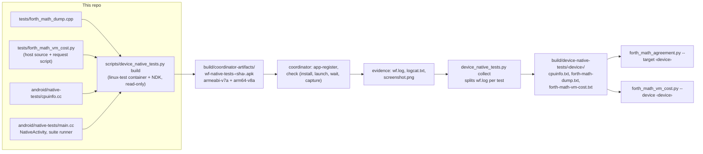
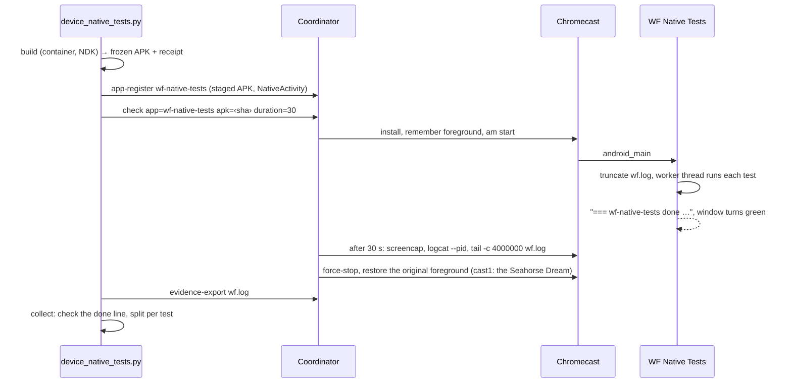
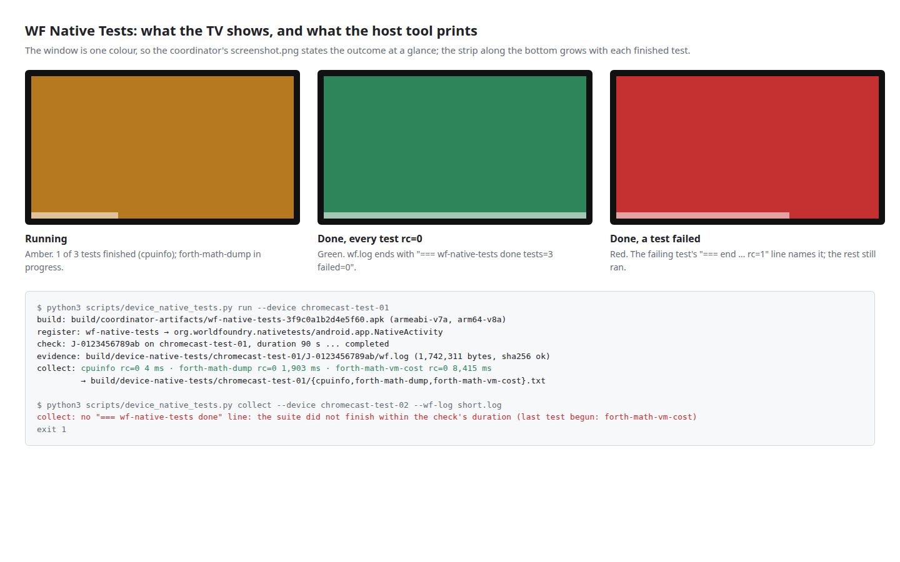

# A route to run native test code on the Android devices

**Status: built and verified 2026‑11‑26 on cast1 and cast2** (verification below). The Pixel and the tablet are not run: the Pixel waits for Will's go-ahead.

TODO item: **A route to run native test code on the Android devices** (T4). It unblocks verification 4 and 5 of the [Forth math words plan](2026-11-26-forth-math-words.md), that plan's CPU row for cast2, and the ARMv8 32-bit measurement item.

## The problem

The chromecast coordinator (`~/chromecast-coordinator`, its own repository) drives devices only through reviewed workflows: install, launch, check, profile, record, capture and so on. None of them runs a native binary or a shell command, and none reads `/proc/cpuinfo`. Our device-side questions (do the Forth math words give the same bits on bionic's `libm` as on glibc; what a word costs in the VM on a Cortex‑A35; what the CPU reports) all need native code to run on the device and its output to come back.

## What the coordinator already gives us

Read from `scripts/wf_device/plugins/android/` in the coordinator:

- **`app-register`** registers any staged APK and its activity under an app id we choose (MCP tool and `task app-register` in its CLI). No coordinator change is needed to add an app.
- **`check`** installs the staged APK when asked, launches the registered activity, waits `duration` seconds, then `capture()` saves `screenshot.png`, `logcat.txt` (the app's own process only), `meminfo.txt`, `thermal.txt` and **`wf.log`**: the last 4,000,000 bytes of `/sdcard/Android/data/<package>/files/wf.log` (`operations.py:1464`, `measurements.py:6`). It then restores the original foreground app.
- Evidence comes back with `evidence-export` (MCP) or `task chromecast:evidence` (CLI), verified by SHA‑256.

So a file the app writes in its own external files directory, under the name `wf.log`, already comes back as verified evidence of an ordinary `check`.

## Options

| | Route | Coordinator change | Capability added | Cost |
|---|---|---|---|---|
| **a** | New coordinator workflow that pushes and runs a native binary or a bounded command | New workflow in a separate project, with MCP/CLI/GUI parity, a release and a deployment through Will's administrator terminal | A generic "run this binary" is a large capability, even when bounded | Days, and Will's time for the deploy |
| **b1** | A self-test mode inside the WF game APK | None | None | Engine edits, a 10‑minute Gradle build of about 1 GB, and a launch extra that `check` cannot pass |
| **b2** | **A small dedicated test APK** that runs a fixed suite compiled into it and writes the results to its `wf.log` | **None** | **None**: the APK can do only what its own compiled code does, inside the app sandbox | One NativeActivity APK, no Java, built in the container in under a minute |

**Chosen: b2.** It is the narrowest possible capability (a named test artifact built from this repo), it needs nothing from the coordinator that is not already reviewed and deployed, and every step is an ordinary install and check, which have standing authorization on the dedicated Chromecasts. Rejected: **a**, because it needs a coordinator release and deployment that only Will can authorise, for a broader capability than we need; **b1**, because it costs a full engine build per change and couples test code to the shipping app.

The one thing b2 cannot do that a would: end the job the moment the suite finishes. `check` waits its whole `duration`. The suite writes a `done` line; a run without it is a failure, so the wait is a deadline, never the success signal. A registered `wf.log` checkpoint in the coordinator's `applications.json` could end the job on that line; that is a possible follow-up in the coordinator project, not needed here.

## Design



**The APK.** Package `org.worldfoundry.nativetests`, label "WF Native Tests", coordinator app id `wf-native-tests`. A `NativeActivity` with `hasCode="false"`: no Java, no Gradle. `android_main` truncates `<externalDataPath>/wf.log`, starts the suite on a worker thread (so the main thread keeps answering the system and never trips an ANR), and keeps the activity in the foreground until it is stopped, because `capture()` needs the process alive. The window shows the suite's state as a full-screen colour (see the mockup). Both ABIs are built: `armeabi-v7a` is what both Chromecasts run; `arm64-v8a` is there for the Pixel and the tablet when Will approves them.

**The suite.** Each test is an existing `main()` program compiled into the library under its own name with `-Dmain=…`; stdout and stdin are redirected per test with `freopen`, so the test source is the same file the PC and WebAssembly targets build. Version 1:

| Test | Source | Input | What it prints |
|---|---|---|---|
| `cpuinfo` | `android/native-tests/cpuinfo.cc` (new) | none | `/proc/cpuinfo` verbatim (as a 32-bit process sees it), `uname`, `AT_HWCAP`/`AT_HWCAP2` and `AT_PLATFORM` from `getauxval`, `ro.soc.*`, `ro.hardware`, `ro.product.cpu.abi`, and each core's `cpuinfo_max_freq` where readable |
| `forth-math-dump` | `tests/forth_math_dump.cpp` (unchanged) | none | 74,990 lines, the same format the PC and WebAssembly targets print |
| `forth-math-vm-cost` | the `HOST` program in `tests/forth_math_vm_cost.py` plus the engine's zForth VM | the request script that `forth_math_vm_cost.py` now generates (it used to type it line by line) | `DEF` and `TIME` lines, which `forth_math_vm_cost.py` turns into the same table as on the PC |
| `fmaf-probe` (suite version 2) | `android/native-tests/fmaf_probe.cc` (new) | none | what bionic's `fmaf` returns for the case the agreement run caught, whether `fesetround` works in this process, and the same algorithm written out (see Findings) |

**The framing in `wf.log`.** Plain lines, so the file reads on its own and splits mechanically:

```
=== wf-native-tests 1 start abi=armeabi-v7a
=== begin cpuinfo
…
=== end cpuinfo rc=0 ms=4
=== begin forth-math-dump
…
=== wf-native-tests done tests=3 failed=0
```

None of the words `capture()` treats as a runtime failure (`Fatal signal`, `ASSERTION FAILED`, …) can appear, and the file carries no `=== wf_game android_main` boundary, so the coordinator's log scan leaves it alone.



**The host tool**, `scripts/device_native_tests.py`:

- `build`: compiles in the `linux-test` container with the SDK mounted read-only (`WF_CONTAINER_MOUNTS`, a new optional variable in `scripts/in-linux-container.sh`), packages with `aapt`, aligns and signs, and writes `build/coordinator-artifacts/wf-native-tests-<sha16>.apk` and a receipt naming every source's hash.
- `collect --device D --wf-log FILE`: requires the `start` and `done` lines and `rc=0` for every test, then writes one file per test under `build/device-native-tests/D/`.
- `run --device D`: `build` (or `--apk`), then the coordinator CLI (`scripts/chromecast.py task app-register`, `task check` with `duration` 30, `task evidence`), then `collect`. The same steps work through the MCP tools. The suite takes about 4.5 s on cast1 and 3 s on cast2, so 30 s is a generous deadline. If the check fails with `target-left-foreground`, `run` tries once more (see Findings).

`forth_math_agreement.py --target <device>` and `forth_math_vm_cost.py --device <device>` read the collected files. A device with no collected run still reports NOT RUN, and says which command produces it. The Pixel stays NOT RUN until Will approves it.

**Cleanup.** The APK stays installed on the Chromecasts between runs (a few hundred KB, launched only by a `check`); `uninstall-package` removes it when Will wants it gone. Each `check` restores the foreground it found, so cast1 goes back to the Seahorse Dream; nothing touches stay-on.

## Findings

- **bionic's `fmaf` on `armeabi-v7a` is not correctly rounded in a halfway case.** The first agreement run on both Chromecasts gave `fma 1.000244140625 1.000244140625 -1e-24` as `0x3f801001`; glibc, WebAssembly and the exact oracle give `0x3f801000`. Our `armeabi-v7a` code is VFPv3, so `std::fma(float…)` is a call to bionic's software `fmaf` (`/apex/com.android.runtime/lib/bionic/libm.so`, as `fmaf-probe` reports). That routine is FreeBSD msun's `s_fmaf.c`: it adds in double, and when the double sum sits exactly halfway between two floats it adds again rounding toward zero and nudges the low word up when the two sums are equal. `fmaf-probe` on both devices: `fesetround(FE_TOWARDZERO)` works (`fegetround()` reads 3, and `1 + -1e-30` rounds to `3fefffffffffffff`), and the same algorithm written out with volatile operands returns the correct `0x3f801000`; only the library's compiled `fmaf` returns `0x3f801001`. So the library's two additions do not see the rounding-mode change; the likely reason is that bionic is compiled without `-frounding-math` and the compiler merged the two identical additions, which would need the device's `libm.so` disassembled to confirm. This is a real FAIL of the math plan's verification 5 for `fma` on both Chromecasts, not a test artefact. How to fix it is Will's decision. The options:
    1. **Compute the float `fma` exactly without `fmaf` where there is no hardware FMA** (`__arm__` without `__ARM_FEATURE_FMA`): the product of two floats is exact in double; add `c` with an error-free two-sum and round the double sum to odd before the one conversion to float. That is exact arithmetic, not an approximation, about ten extra operations on `armeabi-v7a` only, and independent of rounding modes. **Recommended.**
    2. **The ARMv8 32-bit build** (its own TODO item): `-mfpu=neon-fp-armv8` makes `std::fma(float…)` one `vfma.f32`, correctly rounded in hardware. It fixes this as a side effect but drops true ARMv7 devices, and is decided on its frame-rate merits.
    3. **Accept it**: document `fma` as exact except one ulp in exact-halfway cases on `armeabi-v7a`, and relax verification 5 for `fma` there.
- **A check launched over a running dream can lose the foreground to Home.** cast1's first run (`J‑cef38c6016d1`) started with a dream showing (original foreground `org.worldfoundry.game.clocks/android.service.dreams.DreamActivity`); 5 s after `am start` the Home screen was resumed and our task was not visible, so `check` failed with `target-left-foreground`. ApplicationExitInfo (`app-diagnostics`, `J‑f1e2cd3203f4`) shows no crash, only the cleanup's force-stop. The next run, started from Home, passed. `run` therefore retries once on that error; the first attempt has already woken the device.

## Mockups

The visible surfaces are the TV screen during a run (captured in `screenshot.png`) and the host tool's terminal report.

[](2026-11-26-device-native-test-route/states.html)

## Phases

1. `scripts/in-linux-container.sh`: optional `WF_CONTAINER_MOUNTS`.
2. `android/native-tests/`: manifest, `main.cc`, `cpuinfo.cc`, banner; `scripts/device_native_tests.py build` and `collect`, with a unit test of `collect` on good and broken logs.
3. `forth_math_vm_cost.py`: generate the request script once and parse replies in one place, for the PC and devices alike; `--device`.
4. `forth_math_agreement.py`: device targets read collected results.
5. Run on cast1 and cast2; fill in the math plan's machine table and its verification 4 and 5.

## Verification

1. The APK builds in the container, is signed, and holds both ABIs:

    ```bash
    python3 scripts/device_native_tests.py build
    ```

    ```
    $ python3 scripts/device_native_tests.py build
    build: build/coordinator-artifacts/wf-native-tests-9d09694e74bb43bc.apk (armeabi-v7a, arm64-v8a), sha256 9d09694e74bb43bc5fca103bbcf0198183305ddb93093f25063e136a4d037911
    $ unzip -l build/coordinator-artifacts/wf-native-tests-9d09694e74bb43bc.apk | grep lib/
       844468  1980-01-01 00:00   lib/armeabi-v7a/libwfnativetests.so
      1272000  1980-01-01 00:00   lib/arm64-v8a/libwfnativetests.so
    ```

    **PASS.** `apksigner verify` runs inside the build and passed. A second build gave the same SHA‑256 bit for bit.

2. `collect` accepts a complete log and refuses a truncated one, one with a failed test and one with no `done` line:

    ```bash
    python3 -m pytest tests/test_device_native_tests.py -q
    ```

    ```
    $ scripts/in-linux-container.sh python3 -m pytest tests/test_device_native_tests.py -q -p no:cacheprovider
    .........                                                                [100%]
    9 passed in 1.93s
    ```

    **PASS.** Also covered: a mismatched `done` count, two runs in one log, stray text, and `run` refusing `phone-pixel-8-pro`.

3. The PC path of the VM cost script still gives its table after the refactor:

    ```bash
    scripts/in-linux-container.sh python3 tests/forth_math_vm_cost.py --repeats 7
    ```

    ```
    pc: 10000 calls per run, best of 7, VM compiled -O2; loop overhead 301.6 ns per iteration
    word                          ns per call  vs nop-sys
    nop-sys (trivial syscall)            62.1       1.00x
    sqrt                                 45.4       0.73x
    atan2-rev                            92.1       1.48x
    floor                                18.0       0.29x
    exp                                  37.8       0.61x
    pow                                  77.8       1.25x
    fma                                  52.7       0.85x
    ```

    **PASS** (the table comes out; `tests/verify_forth_math.py`, which shares the refactored `bootstrap()`, still gives 155 checks PASS). The numbers are noisy on this shared machine (load average 3.5 to 6.5): each word is its loop minus the bare loop, about 300 ns minus 300 ns, so a busy core moves them by tens of nanoseconds, and one `--repeats 7` run during a build even came out negative. The PC method is unchanged from the math plan; the Chromecasts, idle during a check, give steadier numbers.

4. On cast1 and cast2, a `check` of `wf-native-tests` completes, its `wf.log` carries the `done` line with `failed=0`, and cast1 is back on the Seahorse Dream afterwards:

    ```bash
    python3 scripts/device_native_tests.py run --device chromecast-test-01
    python3 scripts/device_native_tests.py run --device chromecast-test-02
    ```

    ```
    J-1fa92c283b27: accepted {"device": "chromecast-test-02", "app": "wf-native-tests", "apk": "9d09694e74bb43bc5fca103bbcf0198183305ddb93093f25063e136a4d037911.apk", "reinstall": true, "duration": 30.0, "workflow": "check"}
    J-1fa92c283b27: completed {"error": null, "health": "ready"}
    J-1fa92c283b27: completed; verified 17 artifacts -> /home/will/WorldFoundry-wbniv/build/device-native-tests/chromecast-test-02/J-1fa92c283b27
    evidence: build/device-native-tests/chromecast-test-02/J-1fa92c283b27/wf.log (1,613,460 bytes)
    collect: cpuinfo rc=0 1 ms · forth-math-dump rc=0 149 ms · forth-math-vm-cost rc=0 2,509 ms · fmaf-probe rc=0 0 ms
    rc=0
    J-35fecef59c35: accepted {"device": "chromecast-test-01", "app": "wf-native-tests", "apk": "9d09694e74bb43bc5fca103bbcf0198183305ddb93093f25063e136a4d037911.apk", "reinstall": true, "duration": 30.0, "workflow": "check"}
    J-35fecef59c35: completed {"error": null, "health": "ready"}
    J-35fecef59c35: completed; verified 16 artifacts -> /home/will/WorldFoundry-wbniv/build/device-native-tests/chromecast-test-01/J-35fecef59c35
    evidence: build/device-native-tests/chromecast-test-01/J-35fecef59c35/wf.log (1,613,608 bytes)
    collect: cpuinfo rc=0 1 ms · forth-math-dump rc=0 208 ms · forth-math-vm-cost rc=0 4,159 ms · fmaf-probe rc=0 0 ms
    rc=0
    ```

    **PASS** on both, with one correction to the step's wording: cast1's selected dream is the Clocks dream (`org.worldfoundry.game.clocks/org.worldfoundry.screensaver.ClocksDreamService`, as every job receipt reports it), not the Seahorse one, and these jobs left it unchanged. Each job restored the foreground it found (its journal's foreground entry `restored=1`); nothing touched stay-on. The earlier failure of cast1's first run (`J‑cef38c6016d1`, launched over the dream) is under Findings. `screenshot.png` of the cast2 run is the green full-screen state of the mockup.

5. The math plan's verification 4 (cast1) and 5 (cast1, cast2) run from the collected results, recorded in that plan.

    **Done:** recorded in [the math plan](2026-11-26-forth-math-words.md#verification). Verification 4 on cast1: PASS. Verification 5 on cast1 and cast2: **FAIL for `fma` alone** (one halfway case, one ulp, bionic's `fmaf`; see Findings); all other 35 words are bit-identical with the PC.
