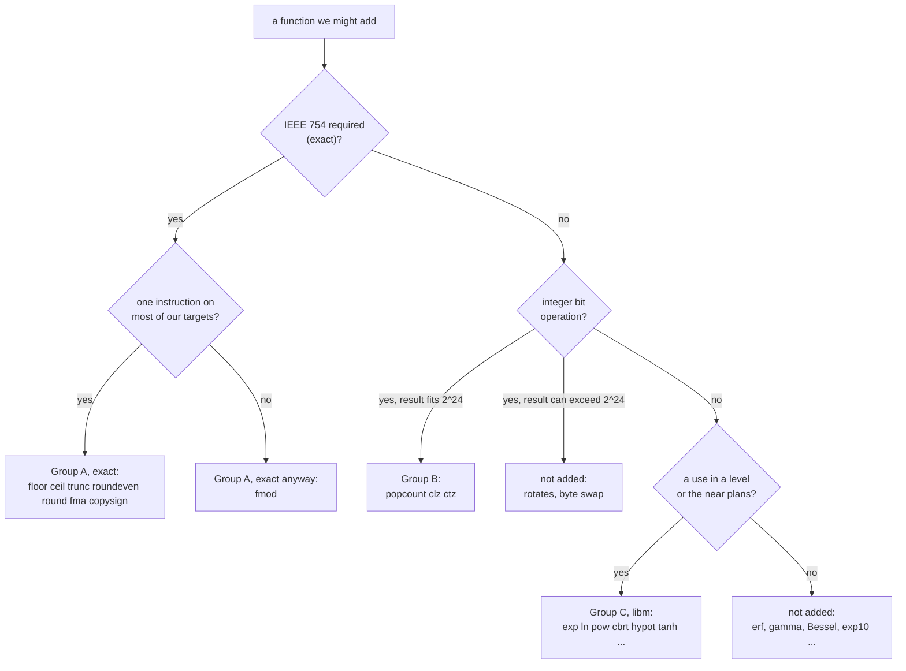
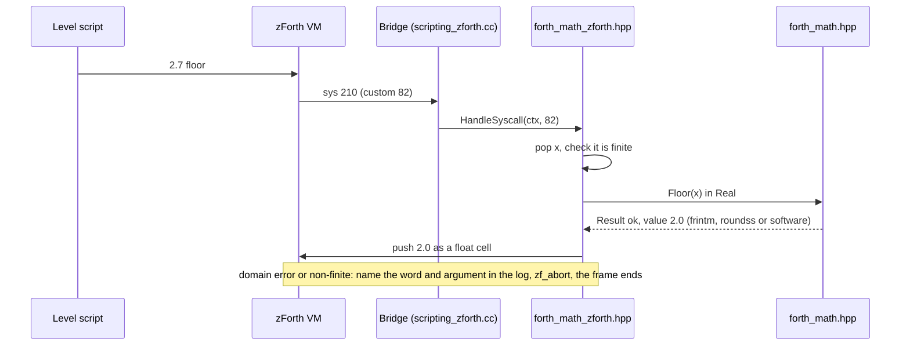
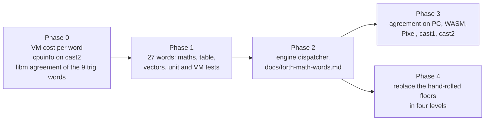

# Forth math words, part 2: exponentials, logarithms, rounding and the hardware

**Status: plan for review, 2026‑11‑26.** Nothing is built. This plan follows the [trig words plan](2026-11-21-forth-trig-words.md): the same table, the same `libm` policy, the same loud refusals and the same three test layers. It grew out of the [lava lamp plan](2026-11-26-lava-lamp.md), which needs `exp`, `expm1`, `cbrt` and `floor`. Will's direction (2026‑11‑26):

> "we could add exp to the engine … we already added trig functions … exp, ln, log, etc would be natural next steps … consider other functions to add? what are the functions getting added?"

> "i want math words to have their own plan AND i want to consider which other mathematical functions should be added while we're there (mostly things that map to hardware-level opcodes these days ;-) ) … identify which functions are directly hardware-supported"

**The answer in one paragraph.** 27 new words, in three groups:

- **Exact (8):** `floor` `ceil` `trunc` `round` `roundeven` `fma` `copysign` `fmod`.
- **Integer bits (3):** `popcount` `clz` `ctz`.
- **`libm` (16):** `exp` `expm1` `exp2` `pow` `ln` `log1p` `log2` `log10` `cbrt` `hypot` `sinh` `cosh` `tanh` `asinh` `acosh` `atanh`.

The hardware matrix below marks which compile to a single instruction on each machine we run on. Three findings shape the plan:

- **Hardware support buys exactness and agreement, not speed.** IEEE 754 requires the operations CPUs implement in hardware to be exact, so they give the same bits everywhere. A Forth word's cost is the interpreter's dispatch either way.
- **Our builds ask for less than our chips can do.** Both Chromecasts have ARMv8 cores but run a 32-bit build targeted at ARMv7, so `floor` and `fma` are software there today.
- **Five level scripts hand-roll `floor`** with a loop that runs once per whole unit of its argument.

## What exists

- **Words (9).** `sin-rev` `cos-rev` `tan-rev` `asin-rev` `acos-rev` `atan-rev` `atan2-rev` `sincos-rev` `sqrt`: custom syscalls 73–81, in [`forth_math_zforth.hpp`](../../engine/stubs/forth_math_zforth.hpp). The reference is [`docs/forth-math-words.md`](../forth-math-words.md).
- **zForth primitives.** `+ - * / % & | ^ << >>` and comparisons. The bitwise ones cast to an integer first (`zforth.c:779`). `negate`, `abs`, `min`, `max` and `mod` are Forth definitions in the bridge's prelude (`scripting_zforth.cc:1588`).
- **Cells are 32-bit floats** (`engine/stubs/zfconf.h:24`). Integers are exact only up to 2²⁴ = 16,777,216. The maths runs in `Real`, which is `double` on desktops and Android and `float` on an ESP32 (`forth_math.hpp:21`); the result is rounded into the float cell.
- **Hand-rolled floors** (the house rule says real maths, never hand-rolled). [`minute_machine/forth.py:63`](../../wflevels/minute_machine/forth.py), [`tide_spike/spike.py:218`](../../wflevels/tide_spike/spike.py), [`cuckoo_village/forth.py`](../../wflevels/cuckoo_village/forth.py), [`anamorphic_shards/generate.py:128`](../../wflevels/anamorphic_shards/generate.py) and [`lava_lamp_digits/generate.py`](../../wflevels/lava_lamp_digits/generate.py) each define a `*-frac` that subtracts 1 until the value is below 1, then `*-floor` and sometimes `*-mod` on top. The loop runs once per whole unit of its argument, and the lava lamp copy is wrong for negative numbers.

## Where our code runs

| Machine | CPU | Instruction set our build targets | Source |
|---|---|---|---|
| This PC and the Linux container | Intel Core i7‑1185G7 (Tiger Lake): SSE4.1, FMA3, AVX2, AVX‑512, POPCNT, LZCNT, BMI1 | **x86‑64 baseline (SSE2)**: CMake passes no `-march` | `lscpu`; `CMakeLists.txt` |
| Chromecast HD (cast1, "boreal") | Amlogic S805X2, 4 × Cortex‑A35 (ARMv8‑A) | **`armeabi-v7a`**: ARMv7, VFPv3‑D16 + NEON. The device reports only 32-bit ABIs | [CNX Software](https://www.cnx-software.com/2022/09/23/chromecast-with-google-tv-hd-amlogic-s805x2-cpu-av1-video/); coordinator device list; [NDK Neon guide](https://developer.android.com/ndk/guides/cpu-arm-neon) |
| Chromecast 4K (cast2, "sabrina") | Amlogic S905X3-class, Cortex‑A55 (ARMv8.2‑A) per CNX; Phase 0 reads `/proc/cpuinfo` to confirm | **`armeabi-v7a`**, as above | CNX (same article); coordinator |
| Pixel 8 Pro, Lenovo Tab P11 Pro | ARMv8 and ARMv9 cores | **`arm64-v8a`**: ARMv8.0 | coordinator; `android/*/build.gradle.kts` |
| iOS (Metal build) | Apple A-series | **arm64**: ARMv8 | |
| Browser (`wf_game`, `wf-edit`) | any | **WebAssembly** (Emscripten) | `Taskfile.yml` |
| ESP32 (prospective; trig plan D9) | Xtensa with a single-precision FPU | not chosen | [Espressif](https://developer.espressif.com/blog/2025/10/cores_with_fpu/) |

## Which functions the hardware does

Legend:

- **✓** one instruction at the baseline our build targets.
- **2** or **3**: that many instructions.
- **◐** the chip has the instruction but our baseline does not let the compiler use it. On the PC, glibc's run-time dispatch (IFUNC) reaches it through a function call: `objdump -T` on this PC's glibc 2.43 shows `floorf`, `ceilf`, `truncf`, `rintf` and `fmaf` as IFUNC symbols, and `roundf` is not.
- **✗** a software routine.

| Word | x86‑64 PC (as built) | AArch64: Pixel, tablet, iOS | Chromecasts (`armeabi-v7a`, as built) | Chromecasts if built for ARMv8 32-bit | WebAssembly |
|---|---|---|---|---|---|
| `sqrt` *(exists)* | ✓ `sqrtss` | ✓ `fsqrt` | ✓ `vsqrt` | ✓ | ✓ `f32.sqrt` |
| `min` `max` *(exist, Forth)* | ✓ `minss` `maxss` | ✓ `fminnm` `fmaxnm` | ✓ `vmin` `vmax` (NEON) | ✓ | ✓ `f32.min` `f32.max` |
| `abs` `negate` *(exist, Forth)* | ✓ a mask | ✓ `fabs` `fneg` | ✓ `vabs` `vneg` | ✓ | ✓ `f32.abs` `f32.neg` |
| **`copysign`** | 3 (masks) | 2 (`bit` with a mask) | 2 | 2 | ✓ `f32.copysign` |
| **`floor` `ceil` `trunc`** | ◐ `roundss` (SSE4.1) via IFUNC | ✓ `frintm` `frintp` `frintz` | ✗ software | ✓ `vrintm` `vrintp` `vrintz` | ✓ `f32.floor` `ceil` `trunc` |
| **`roundeven`** (ties to even) | ◐ `roundss` via `rintf` IFUNC | ✓ `frintn` | ✗ | ✓ `vrintn` | ✓ `f32.nearest` |
| **`round`** (ties away from zero) | ✗ a short sequence; `roundf` has no hardware path | ✓ `frinta` | ✗ | ✓ `vrinta` | ✗ a sequence |
| **`fma`** (a·b + c, one rounding) | ◐ `vfmadd` (FMA3) via IFUNC | ✓ `fmadd` | ✗ software: correct, slow | ✓ `vfma` (VFPv4) | ✗ software; only relaxed SIMD has it |
| **`fmod`** | ✗ | ✗ | ✗ | ✗ | ✗ |
| **`popcount`** | ◐ `popcnt` (x86‑64‑v2); a sequence at baseline | 3 (`cnt` + `addv`, NEON) | 2–3 (`vcnt` + `vpaddl`) | 2–3 | ✓ `i32.popcnt` |
| **`clz`** | ◐ `lzcnt` (v3); 2 at baseline (`bsr`) | ✓ `clz` | ✓ `clz` | ✓ | ✓ `i32.clz` |
| **`ctz`** | ◐ `tzcnt` (v3); 2 at baseline (`bsf`) | 2 (`rbit` + `clz`) | 2 (`rbit` + `clz`) | 2 | ✓ `i32.ctz` |
| **`exp` … `atanh`**, and the trig words | ✗ `libm` (glibc picks FMA-tuned versions of `expf`, `logf`, `exp2f` and `sinf`: IFUNC, still software) | ✗ `libm` (bionic) | ✗ | ✗ | ✗ `libm` (Emscripten) |

Sources: [Arm A64 and A32 ISA](https://developer.arm.com/documentation/ddi0602/latest), [WebAssembly 3.0 instructions](https://webassembly.github.io/spec/core/syntax/instructions.html), [x86‑64 microarchitecture levels](https://en.opensuse.org/X86-64_microarchitecture_levels) (v2 adds SSE4.1 and POPCNT; v3 adds FMA, LZCNT and BMI1), and LLVM's [ARM rounding test](https://llvm.googlesource.com/llvm/+/master/test/CodeGen/ARM/arm32-rounding.ll) (with `+fp-armv8`, floor, ceil and trunc become `vrintm`, `vrintp` and `vrintz`). On GPUs, `exp2`, `log2`, reciprocal square root, `sin` and `cos` *are* hardware: approximate special-function units (PTX `ex2.approx`, `lg2.approx`). That is why shading languages treat them as cheap, but it doesn't help a CPU-side Forth.

**ESP32, unconfirmed.** Espressif documents a single-precision FPU. A QEMU commit and the forum confirm `madd.s` and hardware divide and square-root steps. Rounding, `abs` and `neg` opcodes appear in Xtensa material we could not verify ([QEMU commit](https://git.cs.tu-dortmund.de/SYS-OSS/FRET-qemu/commit/f8c613701637ebfbf75570153715af3ac7aeca9d), [forum](https://esp32.com/viewtopic.php?p=35764)). Fill this column in from the Xtensa ISA manual when a chip is chosen.

### Why it matters: exact versus recommended

IEEE 754 **requires** square root, fused multiply-add, remainder, minimum, maximum, rounding to integer, and the sign operations (`abs`, `negate`, `copySign`), and requires them to be exact ([Wikipedia, IEEE 754 required operations](https://en.wikipedia.org/wiki/IEEE_754#Required_operations)). Those are precisely what CPUs build into silicon. Any conforming machine, instruction or library gives **the same bits**: `floor` on the PC, the Pixel, the Chromecast and in the browser agree exactly, whether the answer comes from `frintm` or from bionic's software.

`exp`, `log`, `pow`, `hypot`, the trig and hyperbolic functions are only **recommended** (clause 9) ([Wikipedia, recommended operations](https://en.wikipedia.org/wiki/IEEE_754#Recommended_operations)). glibc, bionic, Emscripten and Apple are not all correctly rounded, so a result may differ in its last bit between machines. The trig plan therefore checks "within one float ulp". Because `Real` is `double` and the cell is `float`, those differences should almost never survive the rounding into the cell. Phase 0 checks that claim on every target rather than assuming it.

**Speed** hardly matters inside Forth. Every word costs a VM dispatch, a syscall switch and a table lookup. A one-instruction `floor` and a 20-instruction `exp` should cost about the same per call, and Phase 0 measures this. Where the hardware matters for speed is the engine's C++ (Jolt, the deformers), which is Q2's subject, not this plan's.



## The words

All 27 follow the trig words' rules (D3 below):

- computed in `Real` with `libm`, then rounded into the float cell;
- a non-finite argument, or a non-finite result, is **refused**: the word and the argument go to the log and the script's frame aborts, never papered over;
- a domain error refuses the same way.

Custom syscalls **82–108** (sys 210–236), straight after the trig set. 0–55 and 72 are taken, and 82 onward is free.

| # | Word | Stack effect | Refuses | Uses |
|---|---|---|---|---|
| | **A · Exact** | | | |
| 82 | `floor` | `( x -- ⌊x⌋ )` | non-finite | replaces the five hand-rolled loops; digits of the time |
| 83 | `ceil` | `( x -- ⌈x⌉ )` | non-finite | counts that round up |
| 84 | `trunc` | `( x -- r )` toward zero | non-finite | the integer part of a signed value |
| 85 | `round` | `( x -- r )` ties away from zero | non-finite | the school rule; C `round` |
| 86 | `roundeven` | `( x -- r )` ties to even | non-finite | the hardware's own rounding: no bias over many values (C23 name; WebAssembly calls it `nearest`) |
| 87 | `fma` | `( a b c -- a·b+c )` one rounding | a non-finite result | polynomials and `lerp` without the second rounding |
| 88 | `copysign` | `( x y -- \|x\| with y's sign )` | non-finite | signs without branches |
| 89 | `fmod` | `( x y -- r )` x − n·y, n truncated, takes x's sign | y = 0 | wrapping angles, phases and time; the existing `mod` is an integer `%` |
| | **B · Integer bits** (argument an integer, 0 ≤ n ≤ 2²⁴) | | | |
| 90 | `popcount` | `( n -- bits set )` | a non-integer or out of range | neighbour masks in tile maps, flag counts |
| 91 | `clz` | `( n -- leading zeros in 32 bits )`, `clz 0` = 32 | as above | integer log2: `31 swap clz -` |
| 92 | `ctz` | `( n -- trailing zeros )`, `ctz 0` = 32 | as above | the lowest set flag |
| | **C · libm** | | | |
| 93 | `exp` | `( x -- eˣ )` | non-finite result | the lava lamp's hot layer; growth, decay |
| 94 | `expm1` | `( x -- eˣ − 1 )` | non-finite result | `1 − e^(−k·dt)` for tiny k·dt keeps its digits |
| 95 | `exp2` | `( x -- 2ˣ )` | non-finite result | octaves, doubling |
| 96 | `pow` | `( x y -- xʸ )` | x < 0 with non-integer y; 0 with y < 0 | easing curves, falloff |
| 97 | `ln` | `( x -- ln x )` | x ≤ 0 | inverse of `exp`; half-lives |
| 98 | `log1p` | `( x -- ln(1+x) )` | x ≤ −1 | inverse of `expm1` |
| 99 | `log2` | `( x -- r )` | x ≤ 0 | octaves, mip levels |
| 100 | `log10` | `( x -- r )` | x ≤ 0 | decibels, decades |
| 101 | `cbrt` | `( x -- ∛x )` | non-finite | radius from volume: merging wax keeps its volume |
| 102 | `hypot` | `( x y -- √(x²+y²) )` | non-finite | distances without overflow |
| 103 | `sinh` | `( x -- r )` | non-finite result | catenaries (cables, chains) |
| 104 | `cosh` | `( x -- r )` | non-finite result | as above |
| 105 | `tanh` | `( x -- r )` | non-finite | a soft limit for speeds and easing, −1 to 1 |
| 106 | `asinh` | `( x -- r )` | non-finite | inverse |
| 107 | `acosh` | `( x -- r )` | x < 1 | inverse |
| 108 | `atanh` | `( x -- r )` | \|x\| ≥ 1 | inverse |

**Names (D5).** Cells are reals, so we drop ANS Forth's `F` prefix, as `sqrt` already does: `FEXP`, `FLN`, `FEXPM1` and `FLNP1` become `exp`, `ln`, `expm1` and `log1p`. ANS `FLOG` is base 10. "log" means natural log to some readers and base 10 to others, so we spell it `log10` and define **no `log`**. `F**` becomes `pow`. Like the trig words, these take and return reals; the integer-bit words take reals that must be whole numbers.

**Considered and not added:**

| Candidate | Why not |
|---|---|
| Reciprocal and reciprocal-square-root *estimates* (`rcpss`, `rsqrtss`, `frecpe`, `frsqrte`) | Hardware, but approximations of 8 to 14 bits. The house rule is real maths, never approximations. Exact `1/x` and `1/√x` are two words already: `1 swap /` and `sqrt 1 swap /` |
| `rotl`, `rotr`, byte swap, 32-bit hashes | Hardware everywhere, but a float cell holds integers exactly only to 2²⁴. A 32-bit rotate's result would silently lose bits. Revisit if cells change (the trig plan's D9) |
| `fmin`, `fmax`, `fabs` | `min`, `max` and `abs` exist. NaNs cannot reach Forth (they are refused at the boundary), so IEEE's NaN rules for min and max never apply |
| `isnan`, `isinf`, `isfinite`, `signbit` | For the same reason, every value in Forth is finite |
| `ldexp`, `frexp`, `scalbn`, `logb`, `nextafter` | IEEE-required and cheap, but no use in sight |
| `remainder` (IEEE, quotient ties to even) | `fmod` covers wrapping; the IEEE variant is rarely what a script wants |
| `exp10`, `rootn`, `pown`, `compound`, `sinpi` and the other clause 9 extras | `pow` and the revolution-based trig words cover them |
| `erf`, `tgamma`, `lgamma`, Bessel functions | No use |
| `clamp`, `lerp`, `smoothstep`, `sign` | Short Forth definitions a level writes itself; no syscall needed (`lerp` can use `fma`) |
| The x87 transcendentals (`fsin`, `f2xm1`, `fyl2x`) | Historically "hardware", but slow, with known argument-reduction errors, and unused by 64-bit code |

## How a word runs



## Decisions

| # | Question | Recommendation | Alternatives |
|---|---|---|---|
| D1 | A plan of its own | **Yes** (Will, 2026‑11‑26). The lava lamp plan points here | Keep it inside the lava lamp plan |
| D2 | Which words | **The 27 above**: everything with a use or an IEEE guarantee, nothing speculative | The lava lamp's four (`exp`, `expm1`, `cbrt`, `floor`); groups A and C only (no bit words) |
| D3 | Implementation | **The trig plan's D3 option B**: plain `libm` (`std::floor`, `std::fma`, `std::exp` …) in `Real`, so the compiler emits the instruction wherever the baseline allows and glibc dispatches on the PC; no hand-written instructions, no promise at special points beyond IEEE's | Intrinsics per architecture (faster nowhere that matters, because the VM dominates); our own polynomials (forbidden) |
| D4 | Compile baselines | **Unchanged in this plan.** Group A is exact everywhere, so raising the baseline would change speed, never results. Q2 asks whether to measure an ARMv8 32-bit Chromecast build separately | Raise them here: x86‑64‑v3 on the PC (excludes pre-2013 CPUs), `-march=armv8-a -mfpu=neon-fp-armv8` for 32-bit Android (every 32-bit device we own is ARMv8; true ARMv7 phones would stop working) |
| D5 | Names | **No `F` prefix; `ln`, `log10` and no `log`; `roundeven` and `round`; `fmod` beside the existing integer `mod`** | ANS names with `F` (out of step with `sqrt` and `sin-rev`) |
| D6 | Integer-bit domain | **Whole numbers 0 to 2²⁴, refused otherwise.** That is the range a float cell holds exactly, and `clz` and `ctz` count in 32 bits (`clz 0` = `ctz 0` = 32, as in C++20 and WebAssembly) | Count in 24 bits (unusual); accept any real and truncate (hides mistakes) |
| D7 | The hand-rolled floors | **Replace all five in this plan's last phase** with `floor` and `fmod`, each level's reference test unchanged. The lava lamp copy goes away with the lava lamp plan anyway | Leave them (they work for their ranges, but break the house rule and loop per unit) |

### Questions for Will

| # | Question | My recommendation |
|---|---|---|
| Q1 | Add group B (`popcount`, `clz`, `ctz`) now, with no level needing them yet? | **Yes**: three table rows, and the hardware does them in one instruction almost everywhere |
| Q2 | Open a separate TODO to measure the Chromecasts on an ARMv8 32-bit build (`vrint`, `vfma`, and whatever else the compiler finds in Jolt and the deformers)? | **Yes**, as a T4 measurement: it could be free frame rate on our slowest device, but it drops true ARMv7 devices |
| Q3 | Run the agreement check (verification 5) on the devices too, not only in the container? | **Yes**: it is the only evidence that the PC's reference results are what the Chromecast computes |

## Phases



- **Phase 0, measure.**
  - Time 10,000 calls of `sqrt`, `atan2-rev` and a dummy syscall in the VM on the PC and on cast1 (`profile-begin` / `profile-end`) to test "the VM dominates".
  - Read cast2's `/proc/cpuinfo` (Features, CPU part) to confirm its core.
  - Run the existing nine words' vector file on every target, as the baseline for Phase 3.
- **Phase 1, the words.**
  - `forth_math.hpp`: the maths and its `Result`.
  - `forth_math_zforth.hpp`: the table and dispatch, extending `kLastCustom` to 108.
  - The prelude line in `scripting_zforth.cc`.
  - `tests/gen_forth_math_vectors.py`: special values, each domain edge and random arguments against a `long double` reference.
  - `tests/forth_math_test.cpp` in both precisions.
  - `tests/test_forth_math_vm.py`: every word through the real VM, stacks left empty, refusals that abort and leave the VM usable.
- **Phase 2, engine and docs.**
  - `tests/verify_forth_math_engine.py` through the engine's own dispatcher.
  - `docs/forth-math-words.md` gains the 27 rows, the names rule and the hardware matrix, and `tests/test_forth_math_docs.py` keeps it equal to the table.
- **Phase 3, agreement.** A new `tests/forth_math_agreement.py` runs the vectors on the PC (glibc), in WebAssembly (Emscripten, under Node), on the Pixel (bionic, arm64) and on cast1 and cast2 (bionic, `armeabi-v7a`). It reports, per word, whether group A is bit-identical everywhere (it must be) and the worst ulp spread for groups C and trig.
- **Phase 4, the hand-rolled floors.**
  - Replace the `*-frac` / `*-floor` / `*-mod` definitions in Minute Machine, Tide spike, Cuckoo Village and Anamorphic Shards with `floor` and `fmod`.
  - Rebuild each level, and check each against its reference.

No visible surface: these are engine words and a reference document, so this plan has no mockups.

## Verification

1. The unit test passes in both precisions. Every new word is within one float ulp of a `long double` reference on 100,000 random arguments; groups A and B are exact; every domain edge refuses:

    ```bash
    task test-forth-math
    ```

2. The bridge registers exactly the 36 words (9 + 27) with the stack effects in the table, and the reference document lists the same:

    ```bash
    python3 tests/verify_forth_math.py
    scripts/in-linux-container.sh python3 -m pytest tests/test_forth_math_docs.py tests/test_forth_math_vm.py -q
    ```

3. Every word works through the engine's own dispatcher, and a refusal names the word in the engine log and leaves the engine running:

    ```bash
    scripts/in-linux-container.sh scripts/build-wf-game-container.sh --dev
    WF_CONTAINER_ENV="WF_GAME=/build/wf-game-dev/src/engine/wf_game" scripts/in-linux-container.sh bash -c 'timeout 400 xvfb-run -a -s "-screen 0 1280x720x24" python3 tests/verify_forth_math_engine.py'
    ```

4. The VM cost per word is recorded for the PC and cast1, for `floor`, `exp` and a dummy syscall (Phase 0's measurement, repeated on the finished words).

5. Agreement across machines. Group A and group B are bit-identical on the PC, WebAssembly, the Pixel, cast1 and cast2; groups C and trig are within one float ulp, with the spread recorded per word:

    ```bash
    python3 tests/forth_math_agreement.py --target pc --target wasm --target phone-pixel-8-pro --target chromecast-test-01 --target chromecast-test-02
    ```

6. The four levels whose hand-rolled floors were replaced still match their references:

    ```bash
    python3 tests/verify_minute_machine_forth.py
    scripts/in-linux-container.sh python3 -m pytest tests -q -k "cuckoo or anamorphic or tide"
    ```

7. Nothing else moved: the existing Forth tests still pass:

    ```bash
    task test-forth-source
    ```
