# Lava lamp: a real lamp, with the time in its base

**Status: approved 2026‑11‑26; built on the PC 2026‑11‑26 (Phases 0 to 5), devices below refresh rate: a decision for Will (see [Build record](#build-record-2026-11-26)).** Will (2026‑11‑26): "q1 1, q2 yes, q7 yes": the starlight holes, a *Time display* setting, and the naturist-film line on the poster. The other decisions and questions stand at their recommendations, as offered. E2, the math words, is built ([math plan](2026-11-26-forth-math-words.md)). This plan replaces the design of [Lava-lamp digits](2026-11-24-lava-lamp-digits.md), whose wax forms the digits of the time. Here the level models and emulates an ordinary lava lamp, and the time moves to the lamp's base. The level becomes `lava_lamp`. Will's direction (2026‑11‑26):

> "codex has coded a lava lamp screensaver but it's horrible … the engine can morph models, fwiw … let's change the design (for now) from using the lava to make the digits of the time to 'simply' modelling and emulating a regular lava lamp. research on the internet! put the current time in the base or something like that (give me 20 options for displaying the time) add level settings object to select lava color and water color"

> "update plan: generate a3 poster (similiar to aquarium) with physics of the lava, properties of the lava, interesting history of the lava, patent numbers (and links) to the lava, heh. include some forth code (for movement? dunno. what are the options?)"

> "we could add exp to the engine … we already added trig functions … exp, ln, log, etc would be natural next steps … consider other functions to add? what are the functions getting added?"

The answers are in [Lamp look](#the-look) and [D2–D5](#decisions); [twenty time displays](#twenty-ways-to-show-the-time); [the settings](#the-settings-lava-color-and-water-color); [the poster](#the-a3-poster); [four ways to move the wax](#how-the-wax-moves) (D6); and [the math words being added](2026-11-26-forth-math-words.md) (E2, now its own plan: 27 words).

[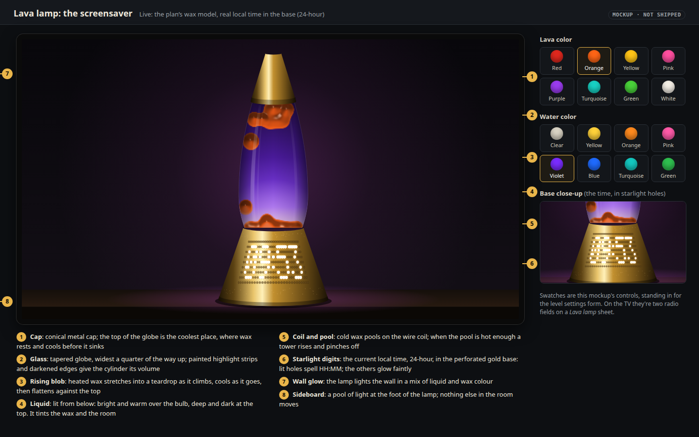](2026-11-26-lava-lamp/lamp.html)

*The live mockup runs this plan's wax model (below) and shows your computer's local time in the base. The colours come from the level settings object, as in the level: its Level Settings form is drawn beside the screen (on the TV and the phone it opens over the scene). Pick the Lava lamp sheet, a row, ◀ ▶, then Apply.*

## What is there now

Codex's level ([commit `f1f2902a4`](../../wflevels/lava_lamp_digits/generate.py)) is a wide, shallow tank. Four sets of ten metaball digits are switched by visibility mailboxes, and 16 spheres rise on a 20‑second loop. Its own record says what is wrong: "more faceted and angular than the smooth, glossy mockup". The wax is rigid spheres, the tank is boxes, and nothing moves like wax.

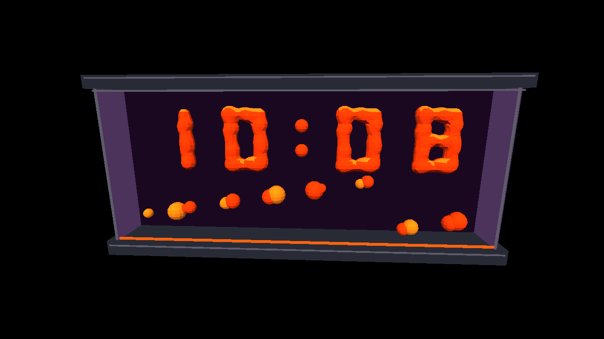

What we keep from it: the settings-object pattern (`LavaLampDigitsSettings`, Camera drift and Show framerate), the 48× scale lesson (author big enough that the smallest triangle stays above the fixed-point normal threshold), and the visibility-mailbox technique, now used for the base display.

## How a real lava lamp works

**Mechanism.** A bulb in the base heats a tall, often tapered glass bottle. The bottle holds water (sometimes dyed) and a wax mixture whose density is close to the water's. Cold wax is slightly denser and lies at the bottom. Heated wax expands, becomes less dense than the liquid and rises; near the cooler top it loses heat, becomes denser and sinks. A metal wire coil at the bottom breaks the surface tension of returning blobs so they merge again. Fluid dynamicists describe the motion as a form of Rayleigh–Taylor instability. [Wikipedia, "Lava lamp"](https://en.wikipedia.org/wiki/Lava_lamp) · [Sheffield thermofluids notes](https://sites.google.com/a/sheffield.ac.uk/all-about-thermofluids/research-project-pages/lava-lamps/theory)

**The wax.** Common paraffin is far lighter than water at any temperature. The 1968 patent's formula added carbon tetrachloride, about 60 % denser than water and miscible with wax, to bring the mixture's density up to the water's. Carbon tetrachloride has been out of US lamps since 1970, when it was banned for toxicity, and today's formula is a trade secret. [Wikipedia, "Lava lamp"](https://en.wikipedia.org/wiki/Lava_lamp) · [US 3,387,396](https://patents.google.com/patent/US3387396A/en). Paraffin is about 0.9 g/cm³ and melts between 46 and 68 °C depending on grade ([Wikipedia, "Paraffin wax"](https://en.wikipedia.org/wiki/Paraffin_wax)). Its volume grows by up to about 10 % on heating to the melting point ([Schimmelpfennig et al.](https://ic.unicamp.br/~stolfi/EXPORT/projects/wikipedia/00-DOCS/Volume_expansion_of_paraffins_from_dip_tube_measur.pdf)).

**What you see.** A cold lamp needs roughly 45–90 min to flow, longer in a cold room. First the wax forms towers (stalagmites), then breaks into blobs, then rolls slowly up and down ([engineerfix](https://engineerfix.com/why-isnt-my-lava-lamp-working/), [geekchamp](https://geekchamp.com/?p=353072)). Blobs stretch into teardrops on the way up, flatten against the top, hang there while they cool, and drip down, often near the glass. Some stall mid-lamp. Shaking a warm lamp emulsifies it into a cloudy mess, which we don't emulate.

**The original.** Edward Craven Walker's Crestworth launched the *Astro* in 1963 in Poole, Dorset. It had a gold base pierced with small holes "which simulate starlight" ([Wikipedia](https://en.wikipedia.org/wiki/Lava_lamp); the starlight phrase comes from a secondary source, which the poster's research document has to pin down). Mathmos still makes it. The classic colourways pair "red or white lava in yellow or blue liquid". Mathmos names a pairing liquid / lava (Violet / Orange is the Astro Gold), and others include Violet / Red, Blue / Pink, Violet / Turquoise, Blue / Green, Yellow / Orange and Clear / Yellow ([Mathmos](https://mathmos.com/lava-lamps/all-lava-lamps/), [Atomretro listing](https://www.atomretro.com/mathmos-astro-gold-60s-lava-lamp-violet-orange)).

**How others fake it.** The s&box lava lamp ray-marches a smooth union of spheres. Each sphere rises or falls with its own temperature, spheres attract each other weakly so they clump, and curl noise stands in for convection. There is no fluid simulation ([s&box, duccsoft](https://sbox.game/duccsoft/lava_lamp)). A student project ran its lamp faster than a real one because the faster pace looked better ([Plotkin](https://jessicaplotkin.github.io/lavalamp)). Both inform D6 and Q4.

## Decisions

| # | Question | Recommendation | Alternatives |
|---|---|---|---|
| D1 | Scope and name | **A realistic lava lamp; the time moves to the base.** Rename `lava_lamp_digits` to `lava_lamp` and `LavaLampDigitsSettings` to `LavaLampSettings`. It has shipped nowhere (not in a pack, not deployed), so the rename costs only the call sites | Keep the old names (they would describe a design that no longer exists) |
| D2 | Which lamp | **A 1963-style Astro "rocket".** A conical gold perforated base, a tapered globe widest a quarter of the way up, and a conical cap, at real proportions (≈ 43 cm tall, scaled up per the 48× lesson) | Lava Lite Century (silver base, star cut-outs); a modern cylinder; a giant floor lamp |
| D3 | Framing | **One lamp, centred on a dark sideboard in a dim room, 88 % of the frame height.** The lamp lights the wall in a mix of liquid and wax colour, and a pool of light sits at its foot. Narrow lens (≈ 30° vertical) for a product-photo look, eye level at mid-globe. Camera drift **Slow** (the shared burn-in guard) | Three lamps; a globe-only close-up; a lit room with furniture |
| D4 | How the wax gets its shape | **Morph targets: a new `Morph` kind in the engine's one deformer slot (E1).** Blender shape keys export as a mesh chunk. Forth sets the weights each frame through `deform-block`, and the deformer also writes **prelit vertex colours**, so wax is smoothly (Gouraud) shaded and tinted (the renderer only Gouraud-shades prelit materials: `material.cc:113`) | (a) The engine's legacy CANM vertex-channel cycles (`anim/anim.cc`). They are loaded and played, but only as clock-driven loops, with no script control (`EMAILBOX_KEYFRAME` is `UNIMPLEMENTED`) and no exporter. (b) Non-uniform scale (3040–3042) plus `fish-deform`, Codex's approach: rigid. (c) A metaball shader: closest to real, but a new GPU path on GLES2 Chromecasts |
| D5 | Merging and splitting | **Swap meshes at the neck.** Two touching blobs hide, and one merged mesh shows at their centroid, its `neck` weight following their distance and its radius ∛(r₁³ + r₂³) so the wax keeps its volume. Splitting runs the same swap in reverse, and a tower leaving the pool is the same trick. The swap happens where the wax is thinnest, so the eye does not see it | Never merge (blobs pass through each other); shader metaballs (D4c) |
| D6 | How the wax moves | **A buoyancy model in the level's zForth** (F1 below). State lives in each blob's local mailboxes and the model takes fixed 1/30 s steps from `DELTA_TIME`. A Python reference (`model.py`) and a step-for-step trace test check it | F2 a baked tape; F3 a native C++ word; F4 Jolt rigid bodies (the parked TODO). See [How the wax moves](#how-the-wax-moves) |
| D7 | Time display | **Option 1, starlight holes**: lit holes in the gold base spell HH:MM, 24-hour, on a 29 × 9 grid, with every other hole a faint glow. Will chose it from the [twenty](#twenty-ways-to-show-the-time) (Q1), and a *Time display* setting (*Base / Off*) can turn it off (Q2) | Any of options 2–20 |
| D8 | Colour settings | **Two choice fields on a `Lava lamp` sheet**: *Lava color* (8 names) and *Water color* (8 names). Defaults Orange in Violet, the Astro Gold pairing. All recolouring goes through the Morph deformer's tint channels, one mechanism for wax, pool, liquid, glass, wall glow and table light | Per-face colour mailboxes 3037–3039 (three materials, re-bake on write; their effect on prelit gradients is unproven); an indexed-palette swap like Corolla's (one global index, so 64 palettes for 8 × 8); an RGB picker (no picker widget exists) |
| D9 | Start state | **Open mid-flow.** At load the model runs about 150 s of model time (a few milliseconds) so the level opens with wax already moving | A real cold start (45–90 min); a compressed 2‑min warm-up as a setting (Q4) |
| D10 | Poster | **Yes: an A3 portrait poster on the repository's poster pipeline** (research document first, chips on every claim, `make_poster.py` / `export_poster.py`, pytest guard), as for the aquarium and Tide Harbour. Contents: physics, wax properties, history, patents with links, and Forth | A figure in this plan only |
| D11 | The old TODO "physical wax simulation (Jolt)" | **Park it as superseded by D6.** It existed to make wax *form the time*, which this design drops | Keep it open |
| D12 | Math words to add | **In [their own plan](2026-11-26-forth-math-words.md): 27 words** (E2). This level needs `exp`, `expm1`, `cbrt` and `floor` | Only this level's four |

### Questions for Will

| # | Question | My recommendation |
|---|---|---|
| Q1 | Which time display, from the twenty? You can pick more than one and choose between them in settings | ~~**1, Starlight holes.** Second choices: 4 (Nixie) or 15 (flip clock)~~ **Chosen: 1, Starlight holes** (Will). |
| Q2 | Add a *Time display* setting (*Base / Off*) so the level can be just a lava lamp? | ~~**Yes** (one more choice field)~~ **Yes** (Will): *Time display*, *Base / Off*, on the Lava lamp sheet. |
| Q3 | Base and cap finish as a third setting (*Gold / Silver / Black*)? | ~~**Not now.** Cheap with the tint path; add it if you want it~~ Not now (recommendation stands). |
| Q4 | A *Flow* setting (*Real / Lively*, the latter ≈ 1.5× faster) or a compressed warm-up? | ~~**No** for the first build. Tune from the PC run~~ No (recommendation stands). |
| Q5 | Same-colour pairs (yellow in yellow) allowed? | ~~**Yes**: it is the viewer's choice; the [palette sheet](#the-settings-lava-color-and-water-color) shows them~~ Yes (recommendation stands). |
| Q6 | Into the 3D Clocks pack once the device pass is done? | ~~**Yes**, after Phase 6~~ Yes, after Phase 6 (recommendation stands). |
| Q7 | The poster's timeline: mention that Craven Walker also directed *Travelling Light* (1959), the first naturist film released publicly in the UK? | ~~**Yes, one line.** It is documented and it is the sort of detail that makes a poster~~ **Yes** (Will): 1959 joins the timeline. |
| Q8 | A QR code per patent on the printed poster? | ~~**Yes**~~ Yes (recommendation stands). |

## The look

The scene is a dim room. The lamp stands on a sideboard, and the only light is the lamp itself.

- **Cap**: conical, gold, matching the base. The top of the globe is the coolest place, where wax rests.
- **Globe**: glass, widest a quarter of the way up and narrowing to the cap. It is a front sheet with `wf_opacity` below 1 and a light water tint, with painted highlight strips and darkened edges. Behind the wax, the liquid is an inner surface with a prelit vertical gradient: warm white over the bulb, the water colour in the middle, deep and dark at the top.
- **Wax**: smooth Gouraud-shaded morph meshes, lit from **below**. The underside glows, edges thin out brighter, and wax high in the lamp is darker. The tint through the liquid is a mix of 14 % water colour.
- **Coil and pool**: a wire coil, mostly buried in a wax pool with its own morph targets (flat, mound, tower, dip).
- **Base**: a gold cone with the time display (D7).
- **Room**: a wall glow tinted by the liquid, and a pool of light on the sideboard at the lamp's foot. Nothing else moves.

[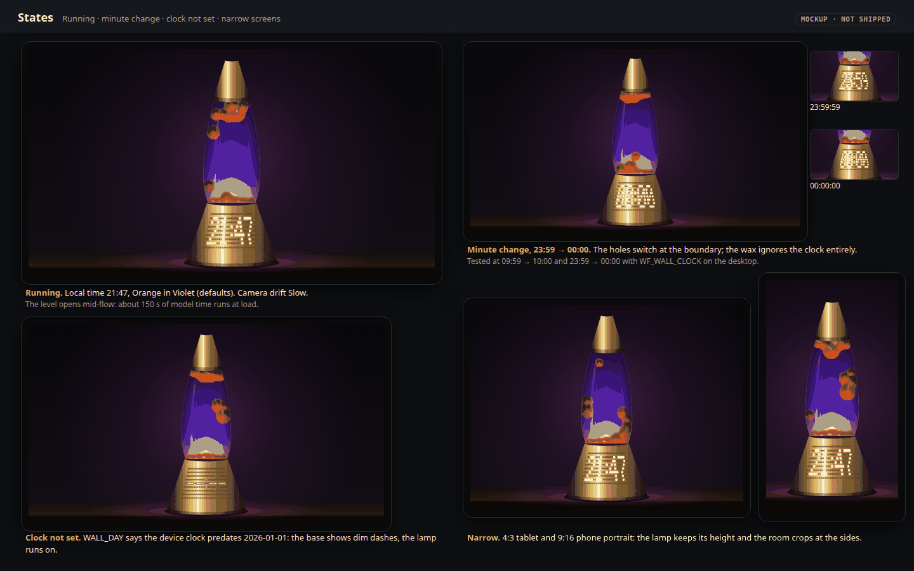](2026-11-26-lava-lamp/states.html)

States the level must handle:

- **Running.**
- **Minute change.** The holes switch at the boundary; the wax ignores the clock.
- **Clock not set.** `WALL_DAY` (days since 2000‑01‑01) before 2026‑01‑01 means the device clock was never set, and the base shows dim dashes.
- **Narrow screens.** On a 4:3 tablet or a 9:16 phone, the lamp keeps its height and the room crops at the sides.

## Twenty ways to show the time

All twenty show the same moment, 21:47. Legibility is rated from a sofa about 3 m from a 55‑inch TV. **S** means static meshes swapped by visibility mailboxes, as for option 1. **M** means a moving part or a new effect.

[](2026-11-26-lava-lamp/time-options.html)

| # | Option | What you see | Legibility | Build | Notes |
|---|---|---|---|---|---|
| 1 | **Starlight holes** ★ | Lit holes in the gold base spell HH:MM; the rest glow faintly | ●●●●○ | S | Echoes the Astro's starlit base; one background mesh, 40 numeral meshes, a colon and a dash set |
| 2 | Shadow numerals | A frosted band lit by the bulb; dark numerals in front | ●●●●○ | M | Needs a window cut into the cone |
| 3 | Stencil cut-out | Numerals cut through the metal, bulb light streaming out | ●●●●● | S | The brightest; it may dominate the lamp |
| 4 | Nixie tubes | Four neon tubes behind a slot | ●●●●● | M | Warm orange; stacked cathodes visible |
| 5 | Split-flap | Solari flaps turn at each minute | ●●●●● | M | The flap animation is a small rig |
| 6 | Number drums | Odometer wheels roll the next minute in | ●●●●○ | M | One rotating cylinder per digit |
| 7 | VFD window | Cyan segments behind smoked glass | ●●●●● | S | Cool colour against warm wax |
| 8 | Bubble LEDs | Red seven-segment digits under bubble lenses | ●●●●○ | S | 1970s calculator |
| 9 | Turning band | An engraved 00–23 band turns past a notch, with minutes below | ●●●○○ | M | Analogue and continuous; half the band is always hidden |
| 10 | 24-hour dial | One brass hand on a small 24-hour face, 00 at the top | ●●●○○ | S | One rotating hand |
| 11 | Edge-lit plates | Stacked engraved acrylic; the lit plate glows | ●●●●○ | M | 1960s instrument readout |
| 12 | Maker's plate | A brass rating plate with a tiny reflective LCD | ●●○○○ | S | Understated; too small for a sofa |
| 13 | Light on the table | The base throws the time onto the sideboard | ●●●○○ | M | Needs a higher camera to see the table |
| 14 | Socket timer | The cord runs to a 24-hour plug-in timer; its dial turns | ●●○○○ | M | Inherently 24-hour, and charming |
| 15 | Flip clock | A 1960s flip clock beside the lamp | ●●●●● | M | A second object in the scene |
| 16 | Light on the wall | The time falls softly on the wall behind | ●●●●○ | S | Big, soft and ambient |
| 17 | Neon sign | A neon 24-hour sign on the wall | ●●●●● | S | Strong colour; competes with the lamp |
| 18 | Cap band | Lit holes in the cap instead of the base | ●●●●○ | S | Physically odd: the cap has no light |
| 19 | Ghost digits | Pepper's-ghost numerals float in the liquid; wax drifts through | ●●●○○ | M | Closest to the old idea without wax digits |
| 20 | Screen text | Plain text in a corner, outside the scene | ●●●●● | S | Most legible, least charming |

## The settings: lava color and water color

[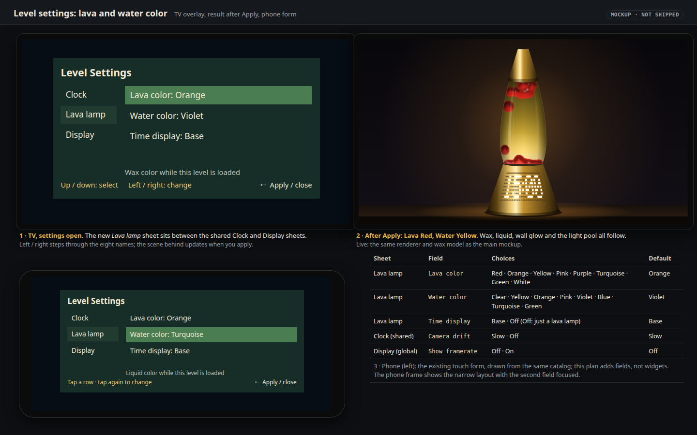](2026-11-26-lava-lamp/settings.html)

The settings type keeps the house pattern (`settings.inc`, `clocksettings.inc`, its own sheet, `global_settings.inc` last), so the form's rail reads Clock, Lava lamp, Display. Help strings contain no commas, because `prep` splits on them:

```text
@* Live settings for the lava lamp clock. docs/plans/2026-11-26-lava-lamp.md
TYPEHEADER(Lava Lamp Settings,LavaLampSettings)
	@include settings.inc
	@include clocksettings.inc
	PROPERTY_SHEET_HEADER(Lava lamp,0)
	TYPEENTRYINT32(Lava color,,0,7,1,"Red|Orange|Yellow|Pink|Purple|Turquoise|Green|White",SHOW_AS_RADIOBUTTONS|SHOW_AS_LIVE,"Wax color while this level is loaded")
	TYPEENTRYINT32(Water color,,0,7,4,"Clear|Yellow|Orange|Pink|Violet|Blue|Turquoise|Green",SHOW_AS_RADIOBUTTONS|SHOW_AS_LIVE,"Liquid color while this level is loaded")
	TYPEENTRYINT32(Time display,,0,1,0,"Base|Off",SHOW_AS_RADIOBUTTONS|SHOW_AS_LIVE,"Show the time in the base of the lamp; Off leaves just the lava lamp")
	PROPERTY_SHEET_FOOTER
	@include global_settings.inc
TYPEFOOTER
```

The Director reads the three fields with `property@` every frame. *Time display* Off hides the 40 numeral meshes and the colon and leaves the faint starlight holes, so the base still looks like an Astro and compares them with the last values it applied, kept in director mailboxes. When either changes, it writes new tint channels to the static tinted actors (liquid, glass, wall glow, table light). The blobs and pool receive their tint every frame anyway, with their pose. `scripts/gen-settings-capabilities.py` regenerates the phone capability file as part of `build.sh`, as it does now.

[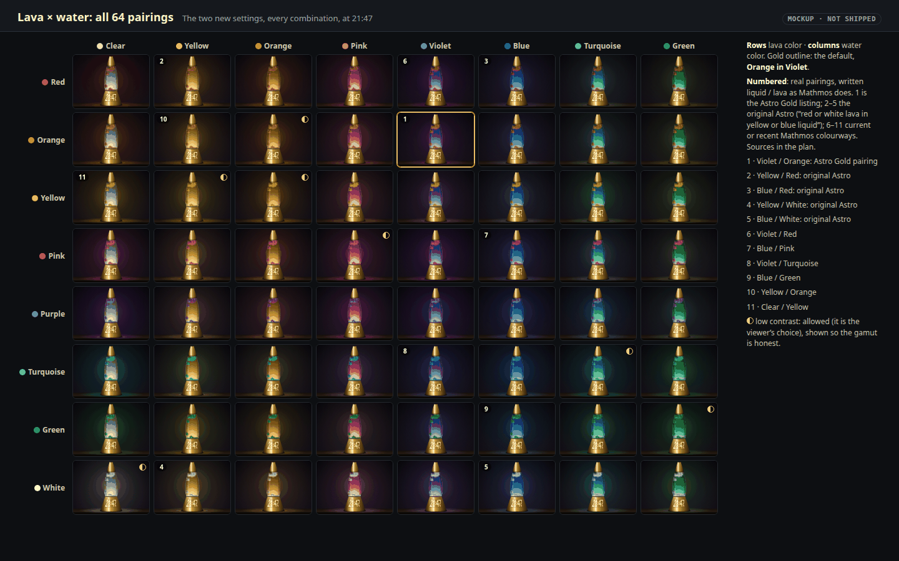](2026-11-26-lava-lamp/palettes.html)

| Lava (wax) | sRGB | Water (liquid) | sRGB |
|---|---|---|---|
| Red | `#e0281e` | Clear | `#d9d3c4` |
| **Orange** (default) | `#ff6516` | Yellow | `#ffd23a` |
| Yellow | `#ffc417` | Orange | `#ff8a1e` |
| Pink | `#ff4fa0` | Pink | `#ff5aa8` |
| Purple | `#9b3cf0` | **Violet** (default) | `#7a2cff` |
| Turquoise | `#18d2c4` | Blue | `#1f6bff` |
| Green | `#49d23a` | Turquoise | `#14c8c0` |
| White | `#f4efe6` | Green | `#2fbf4f` |

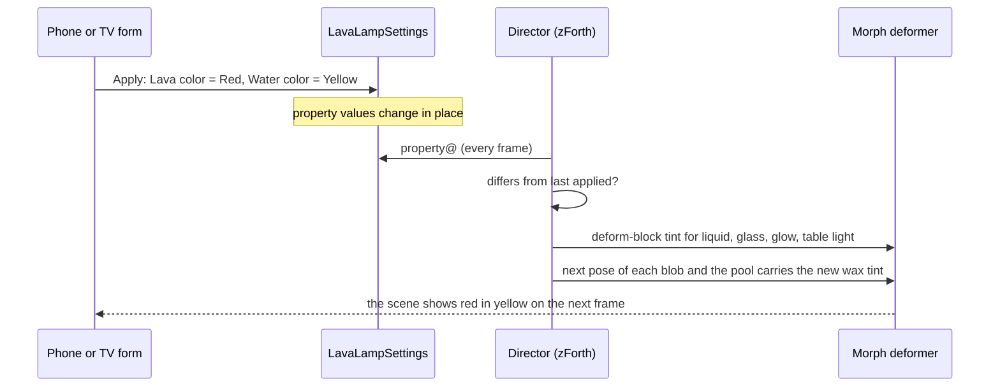

## How the wax moves

### The model

Each blob has a height `y` and sideways position `x` (in globe heights), velocities, a radius `r` (0.042–0.084) and a temperature `T` (0 cold, 1 coil-hot). Every fixed 1/30 s step:

1. **Heat exchange (Newton).** `T` relaxes toward the local liquid temperature, exactly: `T += (target − T)(1 − e^(−k·dt))`. The rate is `k = 0.012 × 0.06 / r`, so big blobs change temperature slowly. The liquid's temperature is a hot layer over the coil, `0.3 + 0.75·e^(−y/0.08) − 0.08·y`.
2. **Pooling (hysteresis).** A blob on the bottom is *pooled*. It heats toward the coil (1.1) at twice the rate and is released only above **0.88**: that is the tower pinching off. A blob at the top rests until it cools below **0.5**, then falls. Without this, every blob settles at neutral buoyancy in mid-lamp. The first two models I tried did exactly that.
3. **Buoyancy and drag.** `vy += (0.55·(T − 0.6) − 1.6·vy)·dt`.
4. **Sideways.** Slow drift (two sines per blob). Rising blobs are pushed toward the centre and falling ones toward the glass, so wax rises in the middle and slides down the sides. Blobs within 0.3 attract weakly (they clump), and overlapping blobs push apart and share heat.
5. **Walls.** `|x| ≤ R(y) − 0.9r`, with `R(y)` the globe's profile.

Measured on the mockup's copy over 20 simulated minutes with 8 blobs: blobs spend **33 % pooled, 27 % resting at the top and 40 % moving**. Each completes a cycle in about **3 min**, and the fastest climb is **0.1 globe heights per second**. These are game tuning, not measurement of a real lamp. Phase 3 pins them in a test so retuning is deliberate.

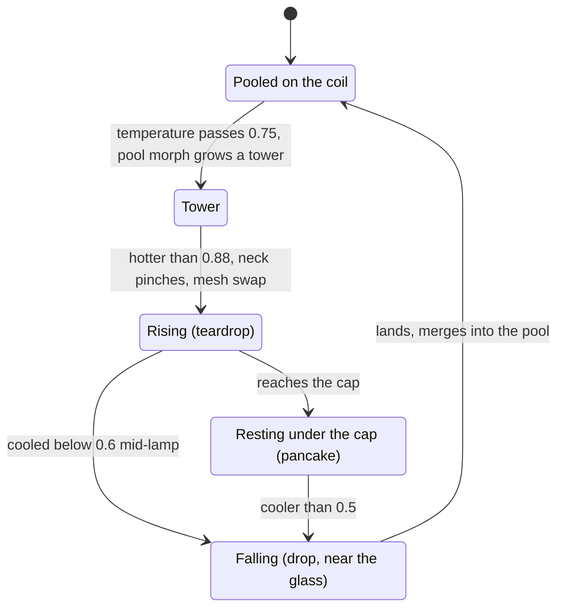

**Shapes.** One blob base mesh, about 640 vertices, carries six morph targets: `rise` (teardrop, round top, tail below), `fall` (inverted teardrop), `squash` (pancake), `neck` (peanut, for merges), and `wobble_a` / `wobble_b` (slow lumpy surface waves). The weights come from the model: stretch from `vy`, squash from resting, wobble from a per-blob phase. The pool mesh has `mound`, `tower`, `neck` and `dip`.

### Four ways to move it (the Forth options)

| | Approach | How | For | Against |
|---|---|---|---|---|
| **F1 ✓** | **Forth model** | The model above as zForth words. Blob state lives in local mailboxes 2000–2099 (no level declares Forth variables; mailboxes are the house idiom) | Tunable in the level; testable against `model.py`; the same pattern as the aquarium rigs | Forth cost of 8 blobs × 28 pairs per step: measure in Phase 0 with `profile-begin` / `profile-end` |
| F2 | Baked tape | Python runs a 30‑min simulation at build time and bakes per-blob keyframes; Forth plays them back by time | Deterministic and cheap at run time | Data size, and the loop shows after 30 min |
| F3 | Native word | A C++ `lava-step` behind one Forth word; Forth only wires actors | Fastest; golden-testable in C++ | Engine code for one level; against keeping level logic in the level |
| F4 | Jolt | Rigid spheres in Jolt with buoyancy forces applied from Forth | Real collisions | Rigid bodies don't help with wax shape; heavy |

A sketch of F1, the version that goes on the poster. The real words come in Phase 3:

```forth
\ One blob, one step; state in the blob's local mailboxes
: blob@ ( box blob -- v )  read-actor-mailbox ;
: blob! ( v box blob -- )  write-actor-mailbox ;
\ the liquid: a hot layer over the coil
: env  ( y -- T )  dup 0.08 / negate exp  0.75 *  0.3 +  swap 0.08 * - ;
\ exact Newton cooling over dt: T + (target - T)(1 - e^-kdt)
: cool ( T target k dt -- T' )
  * negate expm1 negate  >r  over -  r> *  + ;
: buoy ( T -- a )  0.6 -  0.55 * ;
\ volume-keeping merge: r = cbrt(r1^3 + r2^3)
: merged-r ( r1 r2 -- r )  dup dup * *  swap dup dup * *  +  cbrt ;
```

### One frame

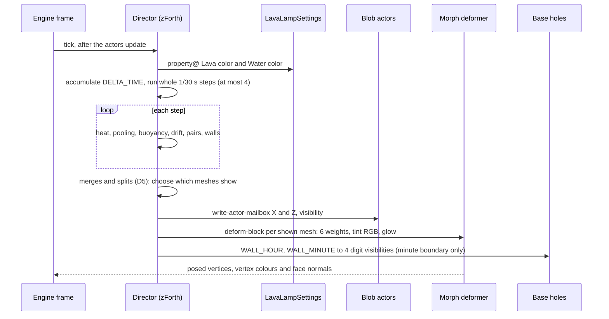

### Where everything runs

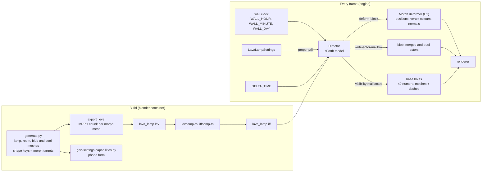

## Engine addition E1: the Morph deformer kind

- **Kind.** `DeformKind::Morph`, the seventh kind in `renderassets/mesh_deformer.h`, beside Fish, Fin, Swim, Jelly, Lion and DFRM.
- **Data.** A mesh chunk, `MRPH`, written by `wf_blender`'s exporter from shape keys named `morph_*`. It holds a header (target count ≤ 6, vertex count), then per target a position delta and a shade delta per vertex.
- **Channels.** These arrive through `deform-block` (DFRM already passes 33 or more cells this way): six weights, then tint R, G, B, then glow, ten cells in all. Pose: position = base + Σ wᵢ·Δpᵢ; shade = base + Σ wᵢ·Δsᵢ; vertex colour = tint × shade × glow. Face normals are recomputed with the existing helper. A target count of zero gives a pure tint actor (liquid, glass, glow, table light): D8's single recolouring path.
- **Tests.** A `deformer_golden` fixture for Morph, bit for bit like the other kinds; an exporter round trip (shape keys in, `MRPH` out, the same vertices back).
- **Unknowns for Phase 0.** Whether vertex colours written by a deformer reach the screen through the GL pipeline every frame on a prelit Gouraud material (the fish deformers write positions only). Whether an actor that is posed once keeps its pose. What the extra vertex streaming costs on cast1.

## Engine addition E2: the next Forth math words

**Moved to its own plan: [Forth math words, part 2](2026-11-26-forth-math-words.md)** (Will, 2026‑11‑26: "i want math words to have their own plan"). That plan adds 27 words in three groups: exact (`floor` `ceil` `trunc` `round` `roundeven` `fma` `copysign` `fmod`), integer bits (`popcount` `clz` `ctz`) and `libm` (`exp` `expm1` `exp2` `pow` `ln` `log1p` `log2` `log10` `cbrt` `hypot` and the six hyperbolics). It also marks which compile to one hardware instruction on each machine we run. This level needs `exp`, `expm1`, `cbrt` and `floor` from it, so Phase 1 here waits on that plan's Phase 1.

## The A3 poster

[](2026-11-26-lava-lamp/poster.html)

**Second layout (2026‑11‑27), after Will's review of the first draft:** "remove (verify) and (ours) tags... pretty-print the forth and put in a narrower, longer column; consider how to relayout". The mockup below is the rebuilt review draft itself; the first layout's mockup above is kept as the record.

[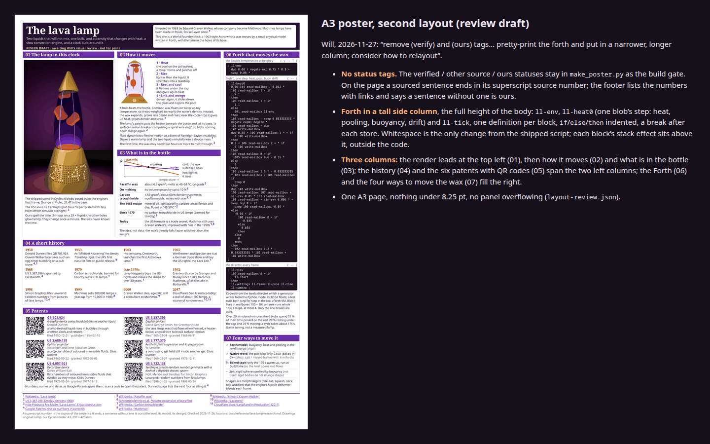](2026-11-26-lava-lamp/poster-v2.html)

The poster is drawn at A3 size and scaled into the mockup, on real, sourced text. It follows the Tide Harbour and seahorse rules:

- the research document comes first (`docs/reference/lava-lamp-research.md`), with each source's locator;
- every claim carries a status, **verified**, **other source** or **ours**, which gates the build; ~~the page prints it as a chip~~ the page prints no tag (Will, 2026‑11‑27), only superscript source numbers;
- `make_poster.py` refuses to build with an unconfirmed claim;
- the drawings are original SVGs, and the hero image is a Cycles render of the shipped scene;
- the output is one 297 × 420 mm PDF page, a 300 DPI PNG and `layout-review.json`.

**Patents** (each checked on Google Patents, 2026‑11‑26):

| Number | What | Dates |
|---|---|---|
| [GB 703,924](https://patents.google.com/patent/GB703924A/en) | Donald Dunnet: "A display device using liquid bubbles in another liquid", lamp-heated, the lava lamp's ancestor | filed 1950‑12‑21, published 1954‑02‑10 |
| [US 3,387,396](https://patents.google.com/patent/US3387396A/en) | David George Smith, assigned to Crestworth Ltd: "Display devices" ([PDF](https://patentimages.storage.googleapis.com/d6/63/51/33f1fdc371eaf6/US3387396.pdf)) | priority 1964‑03‑18, filed 1965‑03‑04, granted 1968‑06‑11 |
| [US 3,689,139](https://patents.google.com/patent/US3689139A/en) | Alexander Gross: "Optical projector" (cites Dunnet) | granted 1972‑09‑05 |
| [US 3,777,379](https://patents.google.com/patent/US3777379A/en) | W. Lewellen: "Aesthetic fluid suspension and its preparation" | granted 1973‑12‑11 |
| [US 4,057,921](https://patents.google.com/patent/US4057921A/en) | Derek William Ball: "Decorative device" | granted 1977‑11‑15 |
| [US 5,732,138](https://patents.google.com/patent/US5732138A/en) | Silicon Graphics (Noll, Mende, Sisodiya): seeding a random-number generator from a digitised chaotic system: the Lavarand | filed 1996‑01‑29, granted 1998‑03‑24 |

**History for panel 05.**

- 1950: Dunnet files his patent. Craven Walker later sees a home-made bubbling egg timer on a pub stove.
- 1959: under the name Michael Keatering, Craven Walker directs *Travelling Light*, the first naturist film released publicly in the UK (Q7).
- 1963: Crestworth launches the Astro.
- 1965: Adolph Wertheimer and Hy Spector see it at a German trade show and buy the American rights (Lava Manufacturing Corporation, Chicago: the Lava Lite).
- 1970: carbon tetrachloride is banned in US lamps.
- Late 1970s: Larry Haggerty buys the US rights.
- 1989: Cressida Granger and David Mulley take over Crestworth, renaming it **Mathmos** in 1992, after the seething lake of energy under the city of Sogo in the 1962 comic *Barbarella*. Sales grow from 10,000 lamps a year in 1989 to 800,000 in 1999.
- 2000: Craven Walker dies, still a consultant.
- 2017: Cloudflare puts up a wall of about 100 lamps in its San Francisco lobby, inspired by Lavarand.

Sources: [Wikipedia, "Lava lamp"](https://en.wikipedia.org/wiki/Lava_lamp), [Wikipedia, "Mathmos"](https://en.wikipedia.org/wiki/Mathmos), [Wikipedia, "Edward Craven Walker"](https://en.wikipedia.org/wiki/Edward_Craven_Walker), [Wikipedia, "Lavarand"](https://en.wikipedia.org/wiki/Lavarand).

**Claims kept off the poster until confirmed:** the solid wax's expansion coefficient (the only figure found is on a hobby site); the US issue date of 1971 in one user-edited history; the 40 W bulb; the 43 cm height of the standard Astro (found only for a limited edition).

### Poster record (2026‑11‑27)

[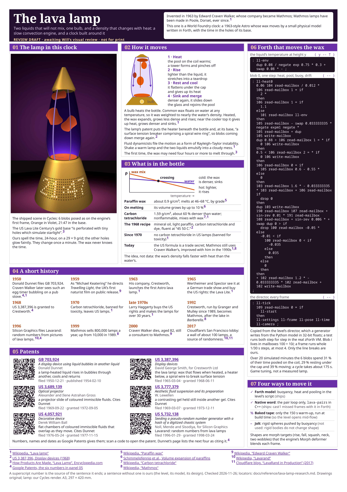](../reference/lava-lamp-poster/poster.html)

Built on the pipeline of the Tide Harbour poster (claims and chips in `make_poster.py`, the seahorse exporter) with the reef poster's visual-review gate. 32 claims, 11 sources, 6 patents. Every source was fetched on 2026‑11‑26 and its link is in the research document; the build refuses one that is not.

**Second layout (2026‑11‑27).** Will reviewed the first draft: "remove (verify) and (ours) tags... pretty-print the forth and put in a narrower, longer column; consider how to relayout". Done, rebuilt as a draft (the review gate stays pending):

- **Tags.** No status tag is printed. The statuses stay in `make_poster.py` and gate the build exactly as before. The one visible anchor kept is the superscript source number at the end of each sourced sentence (it matches the numbered sources and links in the footer); the footer says a sentence without a number is ours. The legend went with the tags.
- **Forth.** A full-height side column (292 px, about 77 mm) with three shipped definitions, `ll-env`, `ll-heat0` (one blob's step: heat, pooling, buoyancy, drift) and `ll-tick`, laid out by `make_poster.pretty()`: one definition per block, `if` indented, `else`/`then` at the block's indent, a break after each store, a cell number kept with its `read-mailbox`, at most 39 columns. Whitespace is the only change; the test checks each block against the shipped `lava_lamp.lev`. The shipped code has no stack comments, so the stack effects (`( y -- T )`, `( -- )`) sit above each block, outside the code, rather than inside it. `ll-glow` and `ll-frame` dropped to make room for `ll-heat0`.
- **Layout, redone.** Three columns: the render first (01, now 344 px wide), how it moves (02) and the bottle (03) beside it; the history (04, 4 × 3) and the patents (05, 2 × 3, QR codes) across the two left columns; Forth (06) and the four ways (07) on the right. Panels are numbered in reading order. Only one layout was built: drawing a second would have cost as much as the first, and this one is the shape Will's words describe (a narrow, long Forth column) with the hero kept largest.

**Corrections found by the research, each kept off the poster or fixed on it:**

- **The starlight holes belong to the Lava Lite Century, not the Astro.** *How Products Are Made* says the Century's gold base "is perforated with tiny holes which simulate starlight". The poster says Century, chipped *other source*; our base is chipped *design (ours)*. The Mathmos site refused every request, so no maker's description of the Astro's base was read.
- **US 3,689,139** has two inventors (Alexander and Ilene Astrahan Gross) and was filed 1969‑09‑22; the table above gave one inventor and no filing date.
- **US 3,387,396 itself** names the "surface tension breaker comprising a spiral wire ring" (claim 1) and the wax becoming fluent at "45 50 C."; both are printed from the patent, not from Wikipedia.
- *Travelling Light* is a 1959 film released in March 1960; the poster's line keeps 1959, as both Wikipedia pages do.
- Not printed: a 45 to 90 min warm-up (hobby pages; the poster prints *How Products Are Made*'s "four hours or more" for a first melt), the pub's county (Dorset or Hampshire), and the trade show's city.


## Build record (2026‑11‑26)

[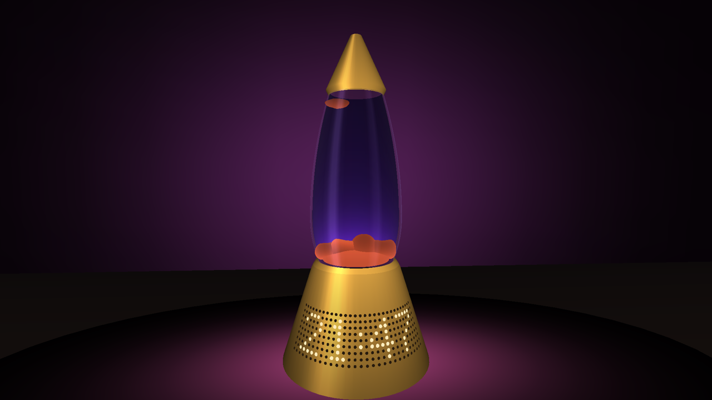](2026-11-26-lava-lamp/pc-21-47.png)

*The level in the Linux container's engine (Release, software GL) at 21:47. Commits [`ad9aab8d9`](../../wftools/wf_blender/mrph_chunk.py) (exporter), `9d4d84f9d` (settings type), `b36e19bb5` (level), `cca9ed804` (E1), `3ba7ac771` (device APK, review window).*

**Phase 0 (the gate).**

- **Deformer vertex colours reach the screen every frame: yes.** `capture_pc.py --phase0` replaces the director's script with one that tints the wax red and green on alternate frames, pauses the engine and steps it one frame at a time: 8 captures alternate 8 times in 8 (red 0.165, green 0.165 of the globe's pixels in turn). The mechanism: the deformer writes `Vertex3D::color` and rebuilds the primitives (`RenderObject3D::RefreshPrimitives`), because a Gouraud prelit material reads its colours from them (`material.cc`, `InitPrimitive`). The same path draws on cast1 ([capture](2026-11-26-lava-lamp/cast1-1080p.png)).
- **A pose persists when it is not repeated: yes.** The liquid is tinted once, at start, and keeps its violet in every later capture (0.58 of the globe's pixels).
- **Forth cost.** PC, Release engine: the director takes 1.0 ms a frame (mean; worst 2.1 ms), the eight-blob model, merges, twelve wax poses and all; 30,000 mailbox calls a second at 0.09 µs each. Not timed on cast1 itself (the APK has no script profiler); see the FPS below.
- **Frame rate on the devices: below the display's refresh.** cast1 (Chromecast HD, 1920 × 1080): **40.3 FPS**, 42 % of refreshes missed, p50 16.7 ms, p95 50 ms ([J‑1bfafd8a8b73](#build-record-2026-11-26)). cast2 (Chromecast 4K on the LG TV, native 3840 × 2160 surface): **30.0 FPS**, locked, every refresh missed ([J‑c365eadc4076](#build-record-2026-11-26)). Two runs to separate fill rate from CPU, the tidespike N720 activity (a fixed 1280 × 720 surface), failed in the coordinator (cast1 `device-command-timeout` twice, the device re-added itself each time; cast2 `surfaceflinger-settling-timeout`), so the cause is not pinned yet.
- The tablet is recovery-required (battery at 2 % on 2026‑11‑21): no soak.

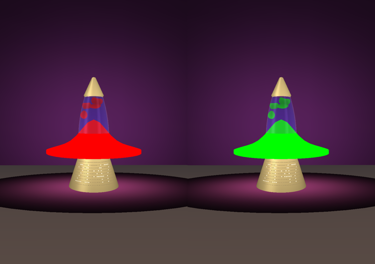

**Deviations from the plan, each with its reason.**

- **Field of view.** The engine always draws 60° vertically (`gfx/authored_view.hp`; a camshot's FOV field is not read), so D3's narrow 30° lens is not available. The camera stands where 60° frames the lamp at about 88 % of the height.
- **Cells.** The blob state lives in level-wide user mailboxes 100–199 (deform blocks 400–569, settings 600–607, visibility 700–761), as Tide Harbour's director keeps its state: `deform-block` reads the running script's mailboxes, and an actor's local mailboxes stop at 40 in the OAS.
- **Warm-up (D9).** The 150 s warm-up runs at build time in `model.py` and is baked into the script's first frame: 4,500 steps of eight blobs and 28 pairs would cost seconds in zForth at load on a Chromecast.
- **Drift phases** are kept in turns and wrapped, not raw seconds, so a lamp left on for days keeps its precision.
- **Merges (D5)** are drawn, not simulated: blobs that overlap are hidden and one merged mesh (the same blob mesh, its `neck` target along X) shows at their volume-weighted centre with radius ∛(r₁³ + r₂³). Pooled blobs often overlap, so the pool shows peanuts.
- **The device APK** is a throwaway `lavaspike` flavor (`org.worldfoundry.lavaspike`, the tidespike activities): the coordinator has retired the tidespike package, and this leaves the WF Clocks app on the casts alone.
- Verification 3 and 6 commands need small changes to run; see each step.

**Frame-rate fixes (2026‑11‑26, after Will's "yes").** Diagnosis on cast1, 60 s `profile` each, the lavaspike APK:

```text
baseline, 8 blobs, translucent glass (J-1bfafd8a8b73): 40.3 FPS, 41.7 % refreshes missed
glass hidden, LAVA_DIAG=noglass   (J-7c42b3daac4f):   45.9 FPS, 30.2 % missed, p95 33.4 ms
four blobs, LAVA_BLOBS=4          (J-5f18d46b00b8):   45.5 FPS, 30.4 % missed, p95 33.4 ms
```

Both fill rate and CPU, so both Risks answers, cheapest first: the glass faked with opaque highlight strips and darkened edge bands (`glass_mesh`), six blobs (seed 2; over 20 min pooled 31.5 %, resting 29.2 %, cycle 175 s, peak climb 0.094; seeds 1–11 give resting 0.28–0.37, so the seed was chosen inside the band), tint-only Morph actors back on baked buffers (`965194c28`), and then the pair loop as the native word `lava-pairs` (F3, `cddff7b96`). The 4K TV draws at 1920 × 1080 through a new LevelRenderSettings field, *Maximum surface height* (`a69f13d4c`).

```text
glass faked + six blobs (J-7a1109bb7518, cast1, 1920x1080):  56.8 FPS, p50 16.7 ms, p95 33.4 ms, 5.5 % missed
same build (J-61138d93f460, cast2, "surface capped: 3840x2160 -> 1920x1080"): 59.98 FPS, p95 16.7 ms, 0.03 % missed
+ lava-pairs F3 (J-160a4d1feeb0, cast1):  57.1 FPS, p90 16.7 ms, p99 33.4 ms, 5.0 % missed
```

**cast1 still misses 5 % of refreshes; the 4K TV holds.** F3 changed cast1 by 0.3 FPS, so the pair loop was not the remaining cost. Phase 7 waits for that (it needs both devices at refresh). The next cheap candidate is the blob mesh (610 vertices each, posed on the CPU every frame); a 24 × 14 sphere has half the vertices.

**Lighter blob mesh, Debug pass, settings form (2026‑11‑26, after Will's second "yes").** The blob is now a 24 × 14 sphere (314 vertices, was 610); `morph_lava_blob.bin` was re-recorded on purpose (the other eight golden cases unchanged).

```text
cast1 (J-ae9668dbb37c, 1920x1080, 60 s): 3558 frames, 59.01 FPS, p50 16.7 ms, p95 16.7 ms, p99 33.4 ms, 1.57 % refreshes missed
cast2 (J-06b1e1ea0812, "surface capped: 3840x2160 -> 1920x1080", 60 s): 3603 frames, 60.0 FPS, p99 16.7 ms, 0.0 % missed
Debug ASan engine (/build/lava-dev), capture_pc.py --phase0 and a 30 s still: PASS; 0 AddressSanitizer reports, 0 assertions;
  "VIEW maximum surface height 1080" read at load
tests/test_surface_cap.py (new: the reader in C++, the type, the host, the level): 2 passed
```

The Debug phase0 run first failed on its first capture only (green, green, then strict alternation): the first capture after the pause can show the frame already in flight, as the first Release run did (its counter jumped 2 to 4). The check now judges the alternation from the second capture on; rerun: PASS.

**Settings form: a second owner (open).** The level now carries two editable settings objects, LavaLampSettings and the RenderSettings object that asks for 1080 rows; LevelRenderSettings has live fields (Stained glass light, Show framerate), so levcomp marks it editable, and `Host::open` (`engine/runtime_property_host.cpp`) shows an owner picker first whenever there is more than one. Not seen on a device yet; found by reading the code. The fix I propose is to move *Maximum surface height* to `global_settings.inc` as a hidden field read through `wfglobals` (so every settings holder carries it and the lava lamp needs no second object); whether a hidden field reaches the runtime registry has to be checked first.

**Will's decisions and the settings form (2026‑11‑26).** Will: "accept 59.0 FPS on cast1" (59.01 FPS, 1.57 % missed counts as holding refresh), and "move the surface-height field into the global settings". *Maximum surface height* is now a hidden integer in `global_settings.inc`, applied at load by `wfglobals`; the lava lamp sets it on LavaLampSettings and has no RenderSettings object, so the settings form has one owner and opens straight to the Lava lamp sheet (`edd06146b`). A hidden field did **not** reach the runtime registry at first (`wf_attr_oad_visit` skipped every field that is not visible; the Debug run logged nothing); hidden integers now pass and the form skips them.

```text
Debug ASan engine, capture_pc.py --phase0: PASS; "VIEW maximum surface height 1080"; 0 AddressSanitizer reports, 0 assertions
cast2 (J-455773a0b44e, global field): "VIEW maximum surface height 1080", "surface capped: 3840x2160 -> 1920x1080", 3600 frames, 59.98 FPS, 0.03 % missed
tests/test_surface_cap.py 2 passed; tests/test_global_level_settings.py all but the Lighthouse Off|On check; tests/test_lava_lamp.py 14 passed; tests/test_clocks_bundle.py 7 passed
```

**Phase 7 done** (`341e0b2cd`): the WF Clocks roster entry moves from `lava_lamp_digits` to `lava_lamp` at the same position and `wflevels/clocks-cd.iff` is repacked on top of `4876fb206`; Codex's 13 tracked files are removed (its `.gitignore` stays, with its untracked build outputs, until Will approves deleting them); the two docs gain the morph-target, surface-cap and frame-rate notes (they never described lava digits).

~~**Decision for Will (ESCALATE).**~~ Decided 2026‑11‑26, above. Both devices miss the refresh rate. The plan's Risks offer: for fill rate, fake the glass with opaque highlight strips; for Forth cost, drop to six blobs or move the pair loop to a native word (F3). For 4K, Tide Harbour's answer was to draw at 1280 × 720 or 1920 × 1080 and let the TV scale. My recommendation: first pin the cause with one cast1 run of the level with the glass hidden and one with four blobs (an hour's work, no design change); then take the Risks answer that matches. Until then the 4K TV should draw at 1920 × 1080 as Tide Harbour does at 720p, since a full 4K surface is four times the fill of cast1's, which already misses refreshes. These are trade-offs of look against smoothness, so they are Will's call.

## Phases

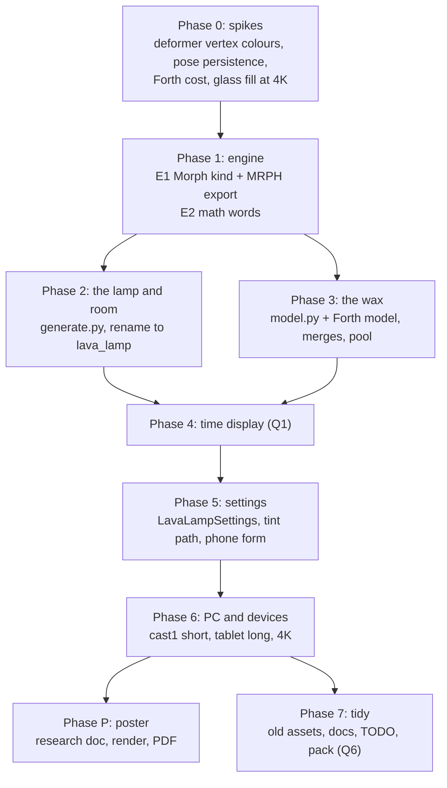

- ~~**Phase 0, spikes (container, then cast1 and the tablet).**~~ Done 2026‑11‑26: colours and persistence pass; devices below refresh, see the build record. The tablet was unavailable.
  - A throwaway level: one icosphere posed by a stub Morph deformer that writes vertex colours. Do they reach the screen every frame on a prelit material? Does a pose persist when not repeated?
  - The Forth model at 8 blobs, timed with `profile-begin` / `profile-end` on cast1.
  - The translucent globe sheet at native 4K on the 4K TV: Tide Harbour found a full-screen veil fill-bound at 1080p, and the globe covers about 15 % of the screen.
  - Record the results here before Phase 1.
- ~~**Phase 1, engine.**~~ Done: E1 in `cca9ed804`, the exporter in `ad9aab8d9`; E2 was built in its own plan.
  - E1: the Morph kind, the `MRPH` chunk, the exporter and the golden fixture.
  - E2: the 21 words, vectors, the unit test, the VM test and the docs table, on the trig plan's pattern.
  - Each lands as its own commit with its tests.
- ~~**Phase 2, lamp and room.**~~ Done in `b36e19bb5` (the type rename in `9d4d84f9d`). Codex's directory stays until Phase 7: the clocks manifest still names it.
  - `wflevels/lava_lamp/generate.py`: base, globe (two sheets), cap, coil, room, wall glow and table light; actor map; `build.sh`.
  - Rename the directory, the OAS type and its seven `objects.*` registry lines, and the test file. Remove the digit meshes.
- ~~**Phase 3, the wax.**~~ Done in `b36e19bb5`.
  - `model.py` as the reference: the model above, exactly.
  - The Forth words, with traces compared step for step against Python.
  - Merges and splits (D5) and the pool's tower and release.
- ~~**Phase 4, the time display** chosen in Q1.~~ Done in `b36e19bb5`.
  - Hole meshes on the cone, a minute switch, dashes when `WALL_DAY` predates 2026‑01‑01.
  - Checked at 09:59 → 10:00 and 23:59 → 00:00 with `WF_WALL_CLOCK`.
- ~~**Phase 5, settings.**~~ Done in `9d4d84f9d` and `b36e19bb5`.
  - `LavaLampSettings` (D8), tint tables generated from the sRGB table above, the change detection in the Director, and the phone capability file.
- **Phase 6, PC and devices.** PC done; Will's review window ready (`bash wflevels/lava_lamp/review_pc.sh`); devices below refresh (decision pending); tablet unavailable.
  - A visible PC window for Will's review at local time.
  - Then cast1 for short runs (it has profile, check and record), and the tablet for a long soak.
  - The 4K TV at native resolution.
  - FPS recorded for each.
- **Phase P, poster.** Built 2026‑11‑27 as a review draft; Will's visual review pending. The research document ([`lava-lamp-research.md`](../reference/lava-lamp-research.md)), a CPU Cycles render of the shipped scene (`render_hero.py`, Blender container), `make_poster.py` / `export_poster.py`, six patent QR codes (`make_qr.py`), `task poster-lava-lamp` and `tests/test_lava_lamp_poster.py`. The build refuses the final poster until the research records "Poster visual review: approved" (the reef poster's gate); until then it builds a marked draft and exports `lava-lamp-review-draft-a3.pdf`. See [the poster record](#poster-record-2026-11-27).
- ~~**Phase 7, tidy.**~~ Done 2026‑11‑26: the pack move, Codex's files removed, the two docs (see the build record).
  - Remove Codex's leftovers; update `docs/level-building.md` and `docs/level-design-troubleshooting.md` where they describe lava digits.
  - Mark the old plan superseded; move TODO items.
  - Add the level to the pack if Q6 is yes.

## Verification

1. The math words pass their unit test in both precisions, and the docs table matches the bridge:

    ```bash
    task test-forth-math
    python3 tests/verify_forth_math.py
    scripts/in-linux-container.sh python3 -m pytest tests/test_forth_math_docs.py tests/test_forth_math_vm.py -q
    ```

    ```text
    $ task test-forth-math
    forth_math_test (double Real): OK, 7446 checks, 2990 shared vectors across 36 words
    forth_math_test (float Real): OK, 7446 checks, 2990 shared vectors across 36 words
    $ scripts/in-linux-container.sh python3 tests/verify_forth_math.py
    155 checks across 36 words in the real zForth VM: PASS
    $ scripts/in-linux-container.sh python3 -m pytest tests/test_forth_math_docs.py tests/test_forth_math_vm.py -q
    6 passed in 9.95s
    ```

    PASS (2026‑11‑26; `python3 tests/verify_forth_math.py` was run in the container, not on the host).

2. Every new word works through the engine's own dispatcher, and a domain error aborts the frame with its name in the log:

    ```bash
    scripts/in-linux-container.sh scripts/build-wf-game-container.sh --dev
    WF_CONTAINER_ENV="WF_GAME=/build/wf-game-dev/src/engine/wf_game" scripts/in-linux-container.sh bash -c 'timeout 400 xvfb-run -a -s "-screen 0 1280x720x24" python3 tests/verify_forth_math_engine.py'
    ```

    ```text
    $ WF_CONTAINER_ENV="WF_GAME=/build/lava-dev/src/engine/wf_game" scripts/in-linux-container.sh bash -c 'timeout 400 xvfb-run -a -s "-screen 0 1280x720x24" python3 tests/verify_forth_math_engine.py'
    51 engine checks: PASS
    ```

    PASS. Run against this plan's Debug engine (`/build/lava-dev`, built by `build-wf-game-container.sh --dev --out /build/lava-dev` from the same tree), not `/build/wf-game-dev`, which another session was using.

3. The Morph kind matches its golden fixture bit for bit, and the other kinds still match theirs:

    ```bash
    scripts/in-linux-container.sh ctest --test-dir /build -R deformer_golden --output-on-failure
    ```

    ```text
    $ scripts/in-linux-container.sh /build/lava-rel/build/deformer_golden_test /src /src/tests/fixtures/deformer_golden
    ok   fish_clownfish_body    6 steps, 3559 words identical
    ok   fin_betta_tail         5 steps, 6911 words identical
    ok   swim_arowana_body      5 steps, 52791 words identical
    ok   swim_goby_body         4 steps, 3017 words identical
    ok   swim_goby_fins         3 steps, 2065 words identical
    ok   jelly_bell             5 steps, 3486 words identical
    ok   lion_lionfish          5 steps, 37536 words identical
    ok   morph_lava_blob        normals: 1216 faces, max error 6e-08
    ok   morph_lava_blob        8 steps, 19553 words identical
    ok   morph_lava_liquid      normals: 2304 faces, max error 0
    ok   morph_lava_liquid      2 steps, 9777 words identical
    exit 0
    ```

    PASS (normal lines of the older cases trimmed here; all ok). The command as written needs a CMake tree at `/build` whose source is `/src`; there is none, and `build-wf-game-container.sh` trees copy the sources without the meshes, so the binary of a Release tree (`/build/lava-rel`) was run against the repository. In a Debug tree the goby case asserts on its texture atlas at load (`material.cc:366`), before any deformer runs.

4. The level builds from its Blender script, and the exporter round trip keeps every morph target:

    ```bash
    WF_CONTAINER_IMAGE=blender scripts/in-linux-container.sh bash wflevels/lava_lamp/build.sh
    scripts/in-linux-container.sh python3 -m pytest tests/test_lava_lamp.py -q -k "export or morph"
    ```

    ```text
    $ WF_CONTAINER_IMAGE=blender scripts/in-linux-container.sh bash wflevels/lava_lamp/build.sh
    ✓ built /src/wflevels/lava_lamp.iff (708608 bytes)
    ✓ built /src/wflevels/lava_lamp-standalone.iff (712704 bytes)
    Settings capabilities: 1 owner(s) in wflevels/lava_lamp/settings-capabilities.json
    $ scripts/in-linux-container.sh python3 -m pytest tests/test_lava_lamp.py -q -k "export or morph"
    (part of) 14 passed in 45.36s   [tests/test_lava_lamp.py and tests/test_mrph_chunk.py, every test]
    ```

    PASS. The exported blob's six targets come back within 2e‑4 of the shape keys (16.16 steps); the four tint actors carry empty chunks.

5. The model holds its measured character (pooled 25–40 %, resting 20–35 %, cycle 2–4 min, peak climb below 0.12 globe heights per second, over 20 simulated minutes). The Forth words match `model.py` within 10⁻⁵ over 1,800 steps:

    ```bash
    scripts/in-linux-container.sh python3 -m pytest tests/test_lava_lamp.py -q -k "model or trace"
    ```

    ```text
    $ scripts/in-linux-container.sh python3 -m pytest tests/test_lava_lamp.py -q -k "model or trace"
    (part of) 14 passed in 45.36s
    $ scripts/in-linux-container.sh python3 tests/verify_lava_lamp_forth.py
    trace: 1800 steps, worst difference 4.99e-10 (0 of 30 checkpoints exact)
    pose: 40 frames, 98 blob poses, 111 merged poses, worst difference 4.81e-08
    settings: 64 colour pairings applied (all 64), each tint actor re-sent once
    PASS
    ```

    PASS. `model.character()` over 20 simulated minutes: pooled 31.1 %, resting 24.3 %, moving 44.5 %, cycle 156 s (51 cycles), peak climb 0.095 globe heights per second.

6. The base reads the right time across both rollovers and shows dashes before the clock is set (captures from a headless run):

    ```bash
    WF_CONTAINER_ENV="WF_WALL_CLOCK=2026-11-26T23:59:50" scripts/in-linux-container.sh bash -c 'xvfb-run -a -s "-screen 0 1920x1080x24" python3 wflevels/lava_lamp/capture_pc.py --at 23:59:59 --at 00:00:01'
    WF_CONTAINER_ENV="WF_WALL_CLOCK=1970-01-01T00:00:10" scripts/in-linux-container.sh bash -c 'xvfb-run -a -s "-screen 0 1920x1080x24" python3 wflevels/lava_lamp/capture_pc.py --expect-dashes'
    ```

    ```text
    $ WF_CONTAINER_ENV="WF_WALL_CLOCK=2026-11-26T23:59:50" scripts/in-linux-container.sh bash -c 'xvfb-run ... capture_pc.py --at 23:59:59 --at 00:00:01; true'
    23:59:59: digits [[2], [3], [5], [9]], colon 1.0, dashes 0.0  /build/lava-lamp/captures/lava-235959.png
    00:00:01: digits [[0], [0], [0], [0]], colon 1.0, dashes 0.0  /build/lava-lamp/captures/lava-000001.png
    PASS
    $ WF_CONTAINER_ENV="WF_WALL_CLOCK=1970-01-01T00:00:10" ... capture_pc.py --expect-dashes
    wf_game: WF_WALL_CLOCK='1970-01-01T00:00:10': date must be a real day in 2000 to 2099
    $ WF_CONTAINER_ENV="WF_WALL_CLOCK=2000-01-01T00:00:10" ... capture_pc.py --expect-dashes; true
    clock not set (day 0.0): digits [[], [], [], []], colon 0.0, dashes 1.0  /build/lava-lamp/captures/lava-dashes.png
    PASS
    $ WF_CONTAINER_ENV="WF_WALL_CLOCK=2026-11-26T09:59:50" ... capture_pc.py --at 09:59:59 --at 10:00:01 --name roll10
    09:59:59: digits [[0], [9], [5], [9]], colon 1.0, dashes 0.0
    10:00:01: digits [[1], [0], [0], [0]], colon 1.0, dashes 0.0
    PASS
    ```

    PASS, with two changes to the commands: the engine accepts only dates in 2000 to 2099, so "clock not set" is 2000‑01‑01 (day 0); and as written `bash -c 'xvfb-run …'` hangs, because bash execs xvfb-run as the container's PID 1, where it never gets Xvfb's ready signal; `; true` (or `timeout`) keeps bash in front.

    [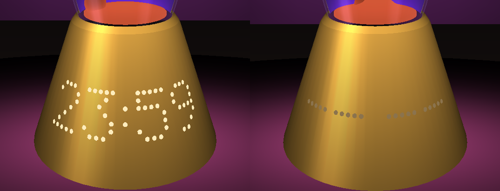](2026-11-26-lava-lamp/pc-base-2359-dashes.png)

7. The settings type carries the global sheet, the capability file lists both colour fields, and every one of the 64 pairings renders without error:

    ```bash
    scripts/in-linux-container.sh python3 -m pytest tests/test_global_level_settings.py tests/test_lava_lamp.py -q -k "settings or palette"
    ```

    ```text
    $ scripts/in-linux-container.sh python3 -m pytest tests/test_global_level_settings.py tests/test_lava_lamp.py -q -k "settings or palette"
    tests/test_global_level_settings.py: 1 failed, 34 passed
    FAILED test_no_settings_holder_declares_an_on_off_setting_as_off_on_radio_buttons
      AssertionError: lighthousesettings.oas: declare it as a checkbox (see global_settings.inc)
    tests/test_lava_lamp.py (settings, capability file, palette, all 64 pairings): passed
    ```

    PASS for this plan's checks; the one failure is the Lighthouse's settings type (an `Off|On` radio field), not this level's.

8. Will reviews the level in a visible PC window at local time. The record: his words and a screenshot.

    The window: `bash wflevels/lava_lamp/review_pc.sh` from the desktop session (the Release container engine, 1280 × 720, at the PC's local time; tested 2026‑11‑26 16:02: window opened, `VIEW surface=1280x720`). Opened for Will on 2026‑11‑26; he resized it to 1920 × 998 and closed it (engine log `VIEW … surface=1920x998`, clean exit).

    Will (2026‑11‑26): "it's pretty good"

    Screenshot: Will's own window was not captured. The same build's PC capture is [pc-21-47.png](2026-11-26-lava-lamp/pc-21-47.png).

    **PASS.**

9. cast1 and the 4K TV hold the display's refresh rate for 10 min each, and the tablet runs a 2‑hour soak without a crash. Record FPS from `profile` / `check` on cast1, and the tablet's battery before and after.

    ```text
    cast1 (J-1bfafd8a8b73, 1920x1080, 60 s): 2425 frames, 40.3 FPS, p50 16.7 ms, p95 50.0 ms, 41.7 % refreshes missed
    cast2 (J-c365eadc4076, 3840x2160 native, 60 s): 1805 frames, 30.0 FPS, p50 33.3 ms, 100 % refreshes missed
    tablet: recovery-required (battery 2 %, discharging, since 2026-11-21)
    ```

    FAIL: neither holds the refresh rate (60 s runs, not the 10 min the step asks for, since the shorter run already shows the miss); the tablet soak was not possible. A decision is pending (see the build record).

    Re-measured after the fixes (2026‑11‑26, 60 s each):

    ```text
    cast1 (J-160a4d1feeb0, 1920x1080): 3426 frames, 57.1 FPS, p50 16.7 ms, p99 33.4 ms, 5.0 % refreshes missed
    cast2 (J-61138d93f460, drawn at 1920x1080 on the 3840x2160 TV): 3596 frames, 59.98 FPS, p95 16.7 ms, 0.03 % missed
    tablet: still recovery-required (battery)
    ```

    FAIL (cast1 short of refresh; the 10‑min runs were not started, since cast1 already misses in 60 s). The 4K TV PASSes its 60 s run.

    After the lighter blob mesh (2026‑11‑26, 60 s each, raw output in the build record): cast1 59.01 FPS, 1.57 % refreshes missed; cast2 60.0 FPS at 1920 × 1080, 0.0 % missed. Close to refresh on cast1, not exact. The 10‑min runs were not run (cast1 runs kept short, as asked); the tablet is still recovery-required. Step stays FAIL until the 10‑min runs and the settings-form question are settled.

    Outstanding checks (2026‑11‑26, the APK built from the tree of `edd06146b` and `341e0b2cd`, sha256 `df50eb33…`):

    ```text
    cast1 (J-289abe6fd720, 60 s, 1920x1080): 3542 frames, 58.93 FPS, p50 16.7 ms, p95 16.7 ms, p99 33.4 ms, 1.72 % refreshes missed
    cast2, 10 min continuous (J-3f89cd8ef56d, check, 600 s): ran to completion, no crash; at the end thermal status 0,
      board_soc 44.3 C, board_ddr 43.4 C, soc_ddr 47.9 C, TOTAL PSS 62719 kB (the check workflow reports no FPS)
    cast2, 10 min as five 120 s profile runs (J-877b9b5553f3, "surface capped: 3840x2160 -> 1920x1080"):
      run 1: 7196 frames, 59.99 FPS, p95 16.7 ms, p99 16.7 ms, missed 0.01 %, thermal status 0, soc 44.3 C, PSS 71398 kB
      run 2: 7199 frames, 59.99 FPS, p95 16.7 ms, p99 16.7 ms, missed 0.01 %, thermal status 0, soc 44.3 C, PSS 51593 kB
      run 3: 7198 frames, 60.00 FPS, p95 16.7 ms, p99 16.7 ms, missed 0.00 %, thermal status 0, soc 44.3 C, PSS 79180 kB
      run 4: 7190 frames, 59.99 FPS, p95 16.7 ms, p99 16.7 ms, missed 0.01 %, thermal status 0, soc 44.3 C, PSS 69107 kB
      run 5: 7194 frames, 60.00 FPS, p95 16.7 ms, p99 16.7 ms, missed 0.00 %, thermal status 0, soc 44.3 C, PSS 74935 kB
      median 59.99 FPS
    tablet: soak blocked. The coordinator's re-add failed with device-not-found-on-network; the battery was last at 2 %
      and needs charging by hand
    ```

    The 4K TV: PASS (no drift: 59.99 to 60.00 FPS over the five runs, thermal status 0 throughout; PSS moves between 52 and 79 MB with no upward trend). The soc sensor read 44.312 °C in all six samples, so it may not be a live reading. cast1: 58.93 FPS, as Will accepted ("accept 59.0 FPS on cast1"); its 10‑min run waits for Will. Tablet soak: NOT RUN (blocked until it is charged). Step 9 as a whole: FAIL until the cast1 10‑min run and the tablet soak are done.

10. The poster builds to one A3 page with no overflow and no unconfirmed claim:

    ```bash
    python3 docs/reference/lava-lamp-poster/make_poster.py && python3 docs/reference/lava-lamp-poster/export_poster.py
    scripts/in-linux-container.sh python3 -m pytest tests/test_lava_lamp_poster.py -q
    ```

    ```text
    $ python3 docs/reference/lava-lamp-poster/make_poster.py && python3 docs/reference/lava-lamp-poster/export_poster.py
    make_poster: refusing to build:
      poster visual review is incomplete
    $ python3 docs/reference/lava-lamp-poster/make_poster.py --draft && python3 docs/reference/lava-lamp-poster/export_poster.py
    poster.html (review draft): 7 panels, 32 claims, 11 sources, 6 patents
    {"page_mm": {"width": 297, "height": 420}, "min_font_pt": 8.25, "overflowing": false, "fit": "ok"} lava-lamp-review-draft-a3.pdf
    $ scripts/in-linux-container.sh python3 -m pytest tests/test_lava_lamp_poster.py -q
    .....s...........                                                        [100%]
    16 passed, 1 skipped in 41.51s
    ```

    Second layout (2026‑11‑27), the same commands:

    ```text
    poster.html (review draft): 7 panels, 32 claims, 11 sources, 6 patents
    {"page_mm": {"width": 297, "height": 420}, "min_font_pt": 8.25, "overflowing": false, "fit": "ok"} lava-lamp-review-draft-a3.pdf
    .....s...........                                                        [100%]
    16 passed, 1 skipped in 34.62s
    ```

    PASS for the draft: one A3 page, no overflow, nothing under 8.25 pt, no unconfirmed claim. The final build refuses by design until Will approves the look (the reef poster's gate); the command as written then runs unchanged. The skip is the QR regeneration check (segno is not in the wf-linux-test image); `make_qr.py` run twice on the host gave identical bytes for all six codes. The committed-HTML test did not need fonts-noto-core: this poster does not measure text with PIL.

## Risks

- **Prelit vertex colours from a deformer may not reach the screen every frame** (E1's biggest unknown). If they don't, the fallback is lit, flat-shaded wax at a higher triangle count, which looks more faceted, or a renderer change to re-upload colours. Phase 0 decides before any level work.
- **Translucent glass at 4K.** If the globe sheet is fill-bound, fake the glass with opaque highlight strips and edge darkening (the mockup already reads as glass that way).
- **Forth cost.** If 8 blobs exceed the frame budget on cast1, drop to 6, or move the pair loop to F3 for that loop only.
- **Merges that pop.** If the mesh swap shows, extend the `neck` target's range and fade over two frames by swapping at the minimum-width frame. Test it in the PC capture.

## Out of scope

- Emulsified (cloudy) lamps, a cold start that takes real hours, and a lamp you can shake.
- Wax digits: dropped "for now", per Will. The old plan stays as the record.
- New settings widgets (colour swatches in the touch form).

No cloud cost: the work runs on this PC and the lab devices. Codemagic is not involved.

## TODO changes

- New, `[T4]` **Lava lamp screensaver**: this plan. T4 because E1 has a real unknown (vertex colours through the deformer) and the design spans engine, exporter, level and Forth.
- New, `[T3]` **Forth math words, part 2 (E2)**: [its own plan](2026-11-26-forth-math-words.md). A settled pattern from the trig plan, but six files and three test layers.
- New, `[T3]` **Lava lamp A3 poster (Phase P)**. It follows the level, because it needs the shipped render.
- Parked: **Lava-lamp digits: investigate a physical wax simulation**, superseded by D6.
