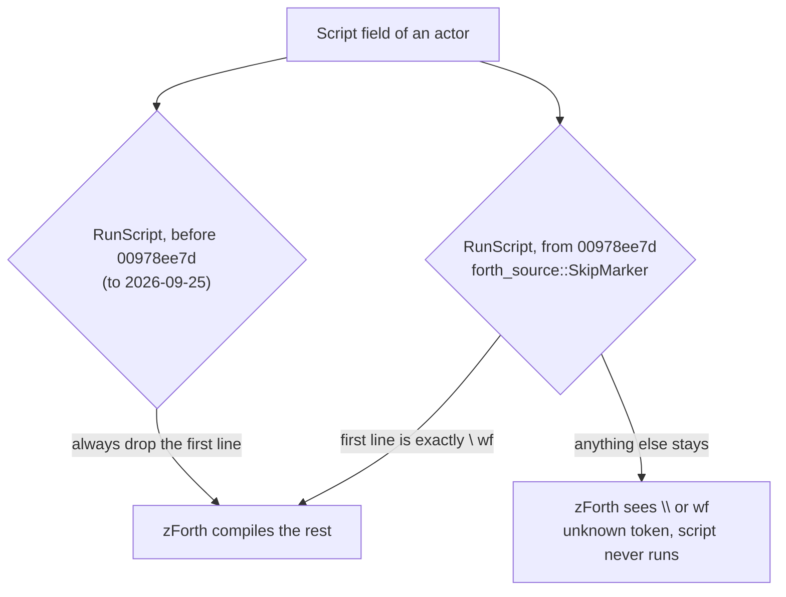
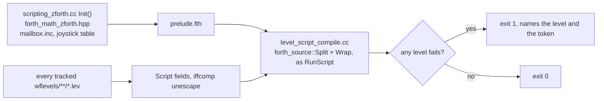
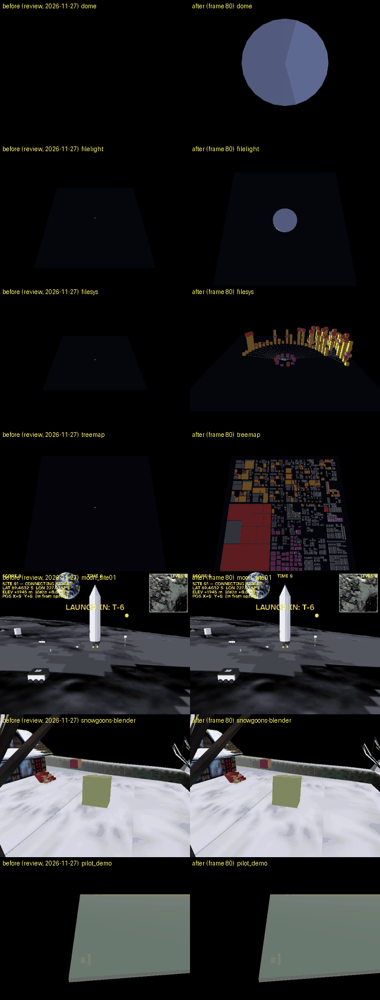
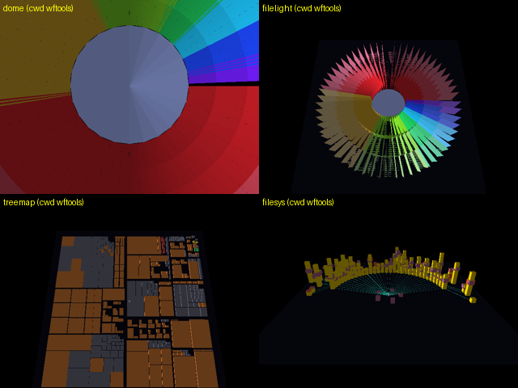

# Unreachable levels: scripts that compile, sources that build

TODO: "Unreachable levels: make them build and their scripts compile again" (T4). Follows the
review [docs/diagnostics/2026‑11‑27‑unreachable-levels](../diagnostics/2026-11-27-unreachable-levels/README.md)
and the 2026‑11‑22 recompile noted in [global level settings](2026-11-22-global-level-settings.md).

Will, 2026‑11‑27: "so fix" `dome`, `filelight`, `filesys`, `treemap`; "also fix" `moon_site01`,
`pilot_demo`, `snowgoons-blender`; the filesystem levels "might also have backwards normals now";
"why?" they broke. Keep or delete is still undecided for the rest, so no level gains the global
settings here: every rebuild passes `--no-default-settings`.

No visible surface of its own: the change restores levels that already have one, so there are no
mockups; before and after captures are in the verification section.

## Why they broke



Two generator bugs wrote malformed opener lines, and the old loader hid them by dropping line one
whatever it held. `00978ee7d` (2026‑09‑25, "Add condo walkthrough controls and shared Forth
comment support") made the drop conditional, so a script that starts with code keeps its first line:

```diff
-    // Skip leading whitespace, then the `\ wf` sigil line.
-    while (*src == ' ' || *src == '\t' || *src == '\r' || *src == '\n') ++src;
-    while (*src && *src != '\n') ++src;
-    if (*src == '\n') ++src;
+        const auto parts = forth_source::Split(src);
```

| Level | Opener written | Where it came from |
|---|---|---|
| `filesys`, `filelight`, `treemap`, `dome` | `\\ wf` | `r'\\ wf'` (a raw string: two backslashes) in each generator since it was written: `94633af84`, `b2f18cf64`, `86e790e4b`, `7622e66ce` (2026‑06‑12 and 13) |
| `snowgoons-blender` | ` wf` (Director), `\n wf` (Player) | the Blender round trip of `c782aa534` (2026‑05‑22) dropped the backslash |
| `moon_site01`, `pilot_demo` | ` wf` | both import the `snowgoons-blender.lev` scaffold (`c23af2686`, 2026‑05‑30, and `blender_create_pilot_demo.py`) |

Restoring the unconditional drop is not an option: five current levels (`aquarium_arowana`,
`aquarium_sea_stars`, `dutch_cuckoo_village`, `hour_tree`, `seahorse_grid`) put code on line one
and fail under it (`check_level_scripts.py --legacy-opener` shows both sides).

A third fault surfaced once `filesys` compiled: its towers still did not draw. FSN's table words
`node-kind`/`node-x`/`node-y` (custom 24 to 26, `e49f37201`, 2026‑06‑13 03:41) were shadowed by
`read-actor-mailbox` (custom 24, `484b035fa`, the same day at 22:23, "custom 3-23 are already
claimed") and `random`/`seed-random` (25 and 26, `ef45ca330`, 2026‑10‑19). The dispatch tests
those ids first, so `node-kind` popped two cells: `zforth error 3` (stack underrun).

## Design

Fix the sources, keep the loader strict, and add a fast guard.

- **Generators and sources.** `r'\ wf'` in the four filesystem generators; the opener of each
  tracked `.lev` (the four, `snowgoons-blender`, `moon_site01`) corrected to what the fixed
  generator writes; `pilot_demo` regenerated by its own Blender step from the fixed scaffold.
- **Engine.** FSN's six table accessors move to unused custom ids 57 to 62 (syscalls 185 to 190).
  Level scripts call the words by name, so no level is rebuilt for this.
- **Rebuild without upgrading.** `build_level_binary.sh` passes `WF_LEVCOMP_ARGS` to levcomp; the
  repair uses `--no-default-settings`, so the only change in each `.lvl` is the opener.
- **Guard.** `tests/check_level_scripts.py` (`task test-level-scripts`) compiles every Script field
  of every tracked `.lev` on the engine's own dictionary, read from `scripting_zforth.cc`, and
  fails naming the level. It also fails when two engine words share a syscall id.

Rejected: a tolerant loader that also strips `\\ wf` and ` wf`. It fixes the committed outputs
without rebuilds, but hides the next malformed opener, and the shipped levels never needed it.
Rejected: a guard that runs `wf_game` per level. Faithful, but minutes long and GL-bound; the
compile check takes seconds and the engine run is done once here as evidence.



## The textile failure of 2026‑11‑22

`aquarium_idle` and the four `style_*` levels build today in this tree, in-tree and in a
dereferenced copy. From tracked files alone they stop at textile with `couldn't find mesh`:

- the `style_*` levels' meshes, source atlas and `textile.flags` are untracked relative symlinks
  into the reef tanks, made by `scripts/build-style-*-scene.py`. Fix: commit the links (160) and a
  `.gitignore` for the build outputs, so `task build-level -- style_*` works from a clean clone;
- `aquarium_idle`'s meshes are gitignored on purpose (its `.gitignore`): `task aquarium-idle-level`
  is the build, with Blender first.

The exact 11‑22 environment is not recorded (its transcript keeps no commands), and a pure clean
checkout would also have failed `seahorse_grid`, which passed then. The symlink hypothesis is
refuted: no link changed since 2026‑11‑09 and `aquarium_idle` has none.

## Verification

1. `task test-level-scripts` passes with only the listed known-broken sources.

    Before the opener fixes (abridged):

    ```
    FAIL  wflevels/dome/dome.lev: 1/2 compiled          actor 9 (defs): unknown token '\\'
    FAIL  wflevels/filelight/filelight.lev: 1/2 compiled
    FAIL  wflevels/filesys/filesys.lev: 1/2 compiled
    FAIL  wflevels/moon_site01/moon_site01.lev: 10/11 compiled   actor 2 (call): unknown token 'wf'
    FAIL  wflevels/snowgoons-blender/snowgoons-blender.lev: 0/2 compiled
    FAIL  wflevels/treemap/treemap.lev: 1/2 compiled
    ```

    After:

    ```
    known wflevels/main_game/main_game.lev: 0/1158 compiled; known broken: decompiled (cff9dc34b): its Script fields hold undecoded bytes, not the scripts
    known wflevels/marble-madness/mm_fromscratch.lev: 0/2 compiled; known broken: blender_mm_fromscratch.py writes the opener as r'\\ wf' (two backslashes)
    known wflevels/marble-madness/mm_intermediate.lev: 0/2 compiled; known broken: blender_mm_intermediate.py writes the opener as r'\\ wf' (two backslashes)
    known wflevels/marble-madness/mm_practice_rom.lev: 0/2 compiled; known broken: blender_mm_practice_rom.py writes the opener as r'\\ wf' (two backslashes)
    67 levels, 1571 scripts: 407 compiled, 0 PILOT, 1164 failed; 0 levels FAIL; 4 known broken
    ```

    With `--lev wflevels/pilot_demo/pilot_demo.lev`: `ok wflevels/pilot_demo/pilot_demo.lev: 1/1 compiled, 1 PILOT skipped`. PASS

2. Under `--legacy-opener` the seven compile, showing what `00978ee7d` changed.

    ```
    FAIL  wflevels/aquarium_arowana/aquarium_arowana.lev: 0/2 compiled      actor 4 (defs): unknown token 'fish-off'
    FAIL  wflevels/aquarium_sea_stars/aquarium_sea_stars.lev: 1/2 compiled  actor 9 (defs): unknown token 'st-init'
    FAIL  wflevels/dutch_cuckoo_village/dutch_cuckoo_village.lev: 0/1 compiled
    FAIL  wflevels/hour_tree/hour_tree.lev: 0/1 compiled
    FAIL  wflevels/seahorse_grid/seahorse_grid.lev: 2/26 compiled
    67 levels (legacy opener), 1571 scripts: 1542 compiled, 0 PILOT, 29 failed in 5 levels
    ```

    The seven compile under the old rule and five current levels fail under it. PASS

3. The guard fails on the engine before the syscall fix, naming 152, 153 and 154.

    ```
    check_level_scripts: engine words share a syscall id (scripting_zforth.cc): 152 = node-kind read-actor-mailbox; 153 = node-x random; 154 = node-y seed-random
    before-fix exit=1
    prelude ok 328 lines
    after-fix exit=0
    ```

    PASS

4. Each of the seven rebuilds with `--no-default-settings`; decompiled, only the opener differs.

    ```
    dome: iff 51200 -> 51200; holder-added=0                 decompile-hunks: 6473c6473
    filelight: iff 53248 -> 53248; holder-added=0            decompile-hunks: 6473c6473
    filesys: iff 55296 -> 55296; holder-added=1 (it already had one)   decompile-hunks: 6473c6473
    treemap: iff 47104 -> 47104; holder-added=0              decompile-hunks: 6473c6473
    moon_site01: iff 2985984 -> 2985984; holder-added=0      decompile-hunks: 1115c1115
    snowgoons-blender: iff 163840 -> 163840; holder-added=0  decompile-hunks: 5566c5566 23111,23112c23111
    pilot_demo: iff 22528 -> 22528; holder-added=0           decompile-hunks: 1115c1115 4438c4438 … (object order and names)
    ```

    PASS for six; `pilot_demo` also reorders and renames objects, because its regenerated `.lev`
    comes from today's generator and scaffold.

5. `wf_game` runs each of the seven headless: no `unknown token`, no `zforth error`.

    Today's Debug + ASan dev engine with the syscall fix, built incrementally in a private copy of
    `build-docker/wf-game-dev`, under Xvfb: `--frame-step-smoke=90 --cycles=1 -rate20 --no-fps`,
    the large VRAM switches, capture at frame 80. `zforth_errors` counts the two
    `INDEXOF_CAMSHOT = 1921 (expect 1921)` information lines each run prints.

    ```
    dome rc=0 zforth_errors=2 unknown=
    filelight rc=0 zforth_errors=2 unknown=
    filesys rc=0 zforth_errors=2 unknown=
    treemap rc=0 zforth_errors=2 unknown=
    moon_site01 rc=0 zforth_errors=2 unknown=
    snowgoons-blender rc=0 zforth_errors=2 unknown=
    pilot_demo rc=0 zforth_errors=2 unknown=
          1 FSN: emitted '.' — 400 nodes (70 towers)
         14 zforth: INDEXOF_CAMSHOT = 1921 (expect 1921)
    ```

    On the same engine without the syscall fix, `filesys` logged `zforth error 3 calling _wfs1`
    and drew only the floor. PASS

    [](2026-11-27-level-scripts-and-rebuilds/before-after.png)

    Run from the repository root, `dome` and `filelight` scan `/src`, whose file count exhausts
    `fl_scan`'s 200,000-stat budget: `FL: scanned '.' — 1 segments`, so only the centre cap draws
    (one early run, with fewer files under `build-docker/`, drew the bands). From `/src/wftools`
    the scan finds 26 segments, `treemap` lays out 401 cells and FSN emits 392 nodes:

    [](2026-11-27-level-scripts-and-rebuilds/fs-levels-wftools.png)

6. Mesh winding of the filesystem levels matches the migrated convention.

    `scripts/audit_face_hand.py`'s `inspect_model` over every tracked mesh: every closed shell in
    `filesys`, `filelight`, `treemap` and `dome` (boxes, tower, file and connector templates, rings,
    disk, sphere, room, floor) has positive signed volume, as Qbert's verified `cube.iff` does. The
    dome's band and cap templates are open sheets wound inward (24 of 24 faces, area normal down
    towards the centre), which is what the 2026‑09‑21 dome fix made them so they show from inside
    with culling on. The frame-80 capture shows the cap and bands from the centre with the default
    `WF_CULL` on, matching the cap of the 2026‑09‑21 `dome-after-cull1.png`. No inverted normals. PASS

7. The four `style_*` levels build from tracked files alone.

    ```
    copied: wflevels/aquarium_thai_reef_anime wflevels/style_flat_anime wflevels/style_geom_anime
    == clean style_flat_anime rc=0
    copied: wflevels/aquarium_thai_reef wflevels/style_flat_realistic wflevels/style_geom_realistic
    == clean style_flat_realistic rc=0
    == clean style_geom_anime rc=0
    == clean style_geom_realistic rc=0
    ```

    PASS. The outputs differ from the committed ones (`style_geom_anime.iff` 1,508,539 bytes, same
    size; `style_geom_realistic.iff` 2,114,422 bytes, 4,855,808 against 4,853,760) because the
    linked reef meshes changed in `b8d50042e`; not committed. `aquarium_idle` regenerated by
    Blender also differs (new schema fields in its `.lev`); its working files were restored.
