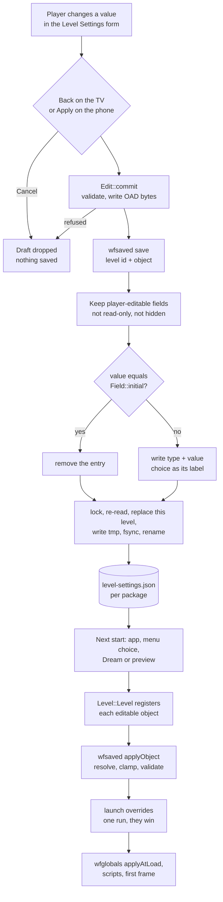
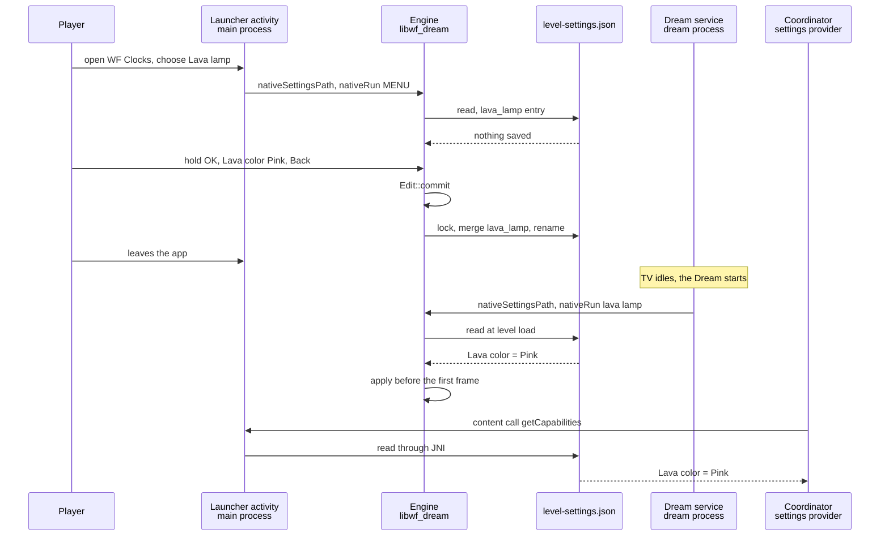
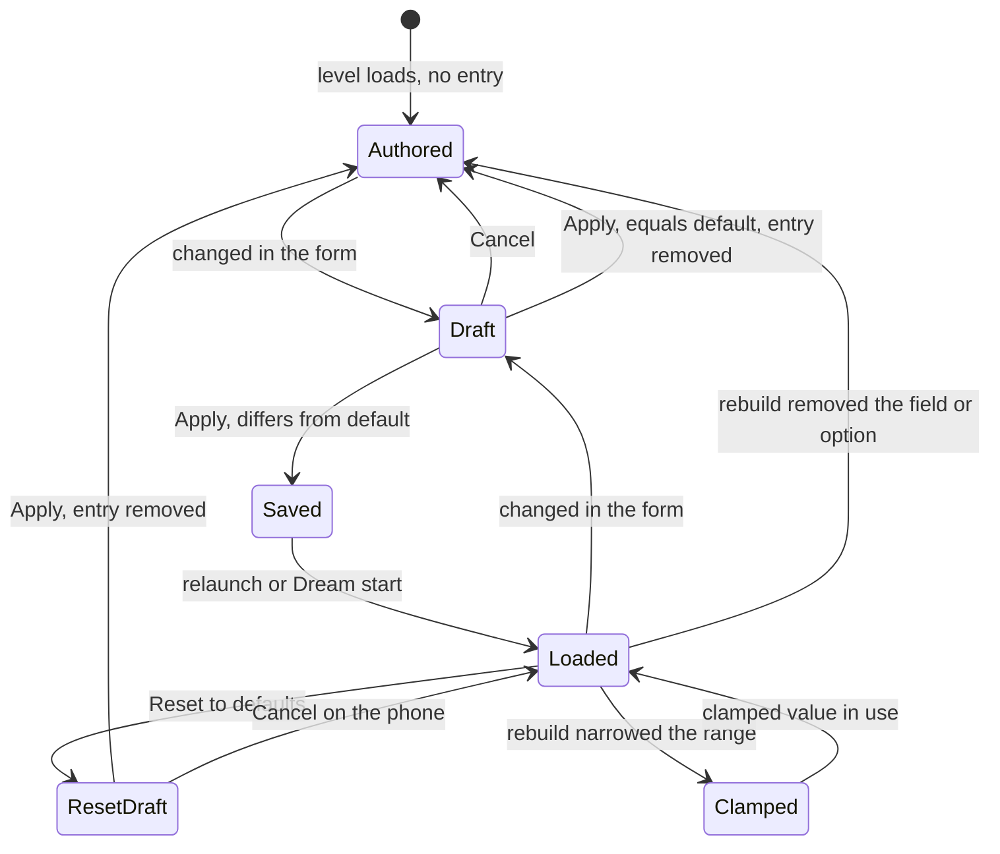
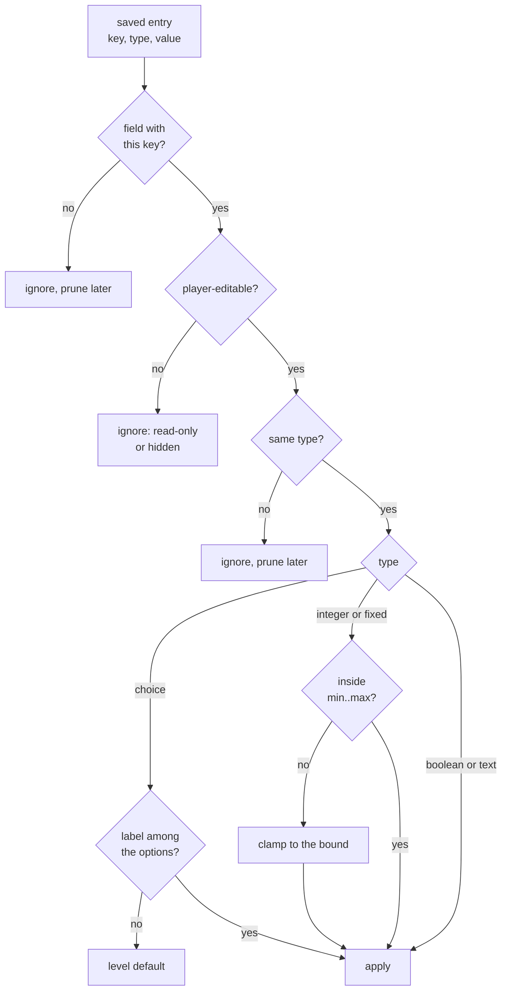
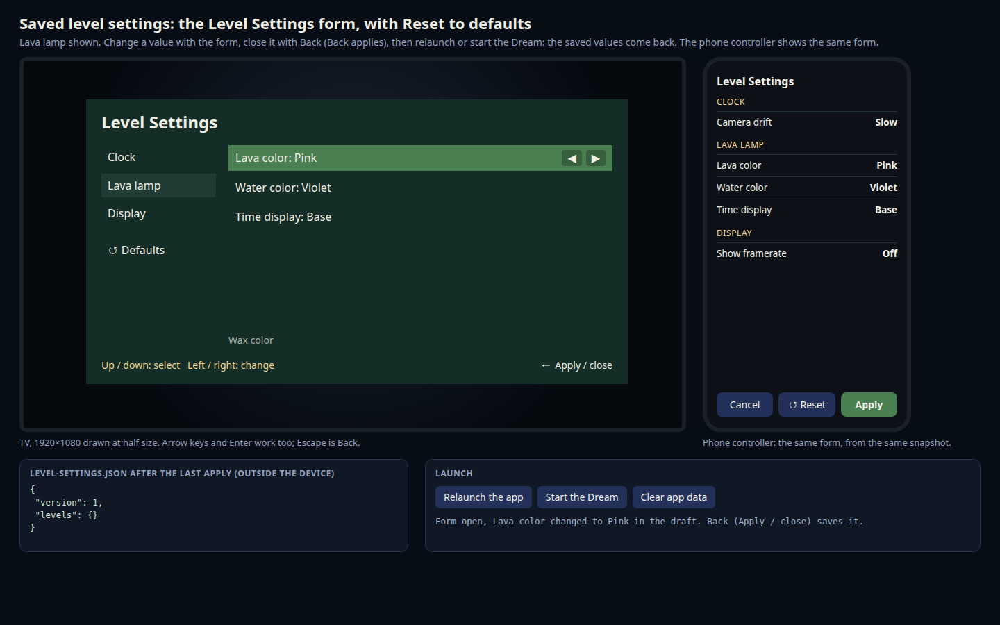
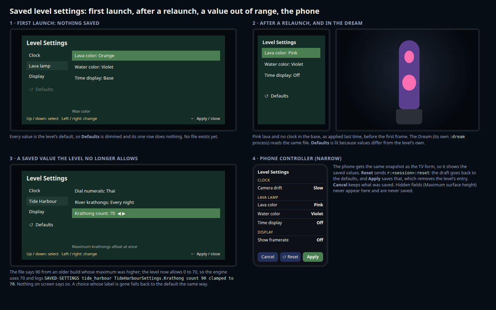

# Persist level settings across launches

**Status:** draft for Will's review, 2026‑11‑27. Nothing is implemented. TODO item: "Persist level settings across launches" (`[T4]`, re-ranked from T3 because it crosses the engine, every host and the level format, and the design was open).

## Context

A level's settings object (Discus Palette, the lava lamp's Lava color, Water color and Time display, Tide Harbour's krathongs, the Lighthouse's Water motion, Show framerate on every level) is edited in the runtime **Level Settings** form, on the TV with the remote or on the phone controller. Today a choice lasts only while that level stays loaded. Relaunching the app, or the Dream starting, brings back the level's authored defaults. The [Discus palette plan](2026-11-23-discus-palette-selector.md) accepted "lasts only while loaded" as a first step. Will wants chosen settings saved and applied on every start, for both the playable level and its Dream screensaver.

What the code does today:

- **Apply commits to memory only.** `wfprops::Host::apply` (`engine/runtime_property_host.cpp`) calls `form.edit.commit()`, which writes the draft into the registry object's values and through `Object::apply` into the actor's OAD bytes (`engine/runtime_properties.cpp`, `Edit::commit`). Nothing is written to disk.
- **Launch overrides exist and are keyed the right way.** `wfprops::LaunchOverrides` (`engine/runtime_properties.hpp`) holds `schema + field key -> value` and applies it to every matching object each time a level registry loads, before scripts run (`wfsource/source/game/level.cc`, the two `launchOverrides()` calls). Desktop feeds it from `--property=Schema.Key=Value` (`main.cc`); Android from `TankPlayer.nativeLaunchOverride` (`dream_host.cc`).
- **One level already saves Dream choices, in Java.** `LevelSettings.java` keeps Sea Stars' choices in SharedPreferences (`sea-stars`), written by the shell-only `TankSettingsProvider` (the coordinator), and `LevelLaunch.startChosen` pushes them as launch overrides when the Dream or a `LEVEL` launch starts Sea Stars. A choice made in the in-engine form never reaches it, and no other level is covered. The other capability assets (`tide-harbour-settings.json`, `anamorphic-shards-settings.json`) are generated but not read by any store.
- **The app and the Dream are different processes.** The clocks manifest runs `ClocksDreamService` in `:dream` and the preview in `:preview`; the launcher activity and the settings provider run in the main process. All of them run the same engine library (`libwf_dream`, `dream_host.cc`), and in menu mode the engine, not Java, chooses which level loads.
- **`Field::initial` is the authored value.** The OAD adapter reads each field's value from the level data into `Field::initial` before any override is applied (`engine/runtime_oad_adapter.cpp:147`), so the engine already knows each field's level default.
- **Hidden fields reach the registry.** Since `edd06146b`, a hidden (`show 6`) field such as `Maximum surface height` passes into the runtime registry and the form skips it. `Edit::set` still accepts a hidden field id, so a phone could send `r:<session>:set:<id>:…` for one.
- **Several help strings promise the old behaviour**: "Wax color while this level is loaded" (`lavalampsettings.oas`), "Petal color while this level is loaded" (`corollagaugesettings.oas`).

## Approach

One small store, owned by the engine, written on Apply and read when each settings object is registered at level load. Every host (Android app, Android Dream, desktop, WASM) gets the behaviour from the same engine code; the hosts only say where the file lives.

**Rejected: SharedPreferences as the store, with the engine calling up to Java on Apply.** It needs a JNI upcall from the render thread, SharedPreferences is not safe across the `:dream` and main processes (each caches its own copy), and desktop and WASM need a C++ store anyway, so there would be two implementations to keep in step.

### The store

`engine/saved_settings.{hpp,cpp}`, namespace `wfsaved`, no engine dependencies beyond `runtime_properties.hpp`, so it builds in the host unit tests the way `launch_overrides_test.cpp` does.

One JSON document per package:

```json
{
  "version": 1,
  "levels": {
    "lava_lamp": {
      "LavaLampSettings": {
        "Lava color":   {"type": "choice", "value": "Pink"},
        "Time display": {"type": "choice", "value": "Off"}
      }
    },
    "tide_harbour": {
      "TideHarbourSettings": {
        "Krathong count": {"type": "integer", "value": "40"}
      }
    }
  }
}
```

- **Key: package, level id, schema, field key.** The package is the file (one file per package). The level id is a stable string the exporter writes (below). The schema is the settings type name (`LavaLampSettings`). The field key is the OAS field name (`Lava color`), the same key launch overrides and `LevelSettingField` already use. No field id, offset or index is ever stored, so a rebuild that adds, removes or reorders fields cannot move a value onto the wrong field.
- **The record carries the type.** `type` is `choice`, `integer`, `boolean`, `fixed` or `text`, derived from the field descriptor (an `Int32` with a choice string is a `choice`; with an empty choice string and the checkbox display, a `boolean`). A saved entry whose type no longer matches the field is ignored.
- **A choice is saved by its label, not its index.** `"Pink"`, not `"3"`. If a rebuild reorders the Discus palette or inserts a lava colour, the saved choice still finds its option. A label that is gone falls back to the level's default.
- **Only values that differ from the level's default are saved.** On Apply, a field whose committed value equals `Field::initial` has its entry removed. So a level with nothing changed has no entry, and when an author later changes a default, everyone who never touched that field gets the new one.
- **Only player-editable fields.** A field is saved, and a saved entry is applied, only if it is stored, not read-only, not hidden (`show 6`), and not a sheet header, group, button or label (kinds 5, 6, 7, 9, 10). `Maximum surface height` therefore can never be written from the form, and a hand-edited entry for it is ignored with a log line.

### Where the file lives

| Platform | Location | Shared by |
|---|---|---|
| Android | `Context.getFilesDir()/level-settings.json` (app-private, per package, survives updates, removed by Clear data and uninstall) | the launcher activity and settings provider (main process), the Dream (`:dream`), the preview (`:preview`) |
| Linux / desktop `wf_game` | `$XDG_CONFIG_HOME/worldfoundry/<package>/level-settings.json`, `~/.config/…` when unset; `<package>` from `--package=NAME`, default `desktop` | every run as that user |
| WASM | `localStorage["wf.level-settings.<package>"]`, the same JSON text; synchronous, so it is read before the first frame without an async filesystem sync | that browser profile and origin |
| iOS / macOS | `Application Support/level-settings.json` in the app container | the app |

The Android host passes the path once through a new `TankPlayer.nativeSettingsPath(String)` before `nativeRun`; `native_app_entry.cc` (the NativeActivity APK) takes it from `ANativeActivity::internalDataPath`. Desktop adds `--saved-settings=off|reset|PATH`: `off` neither reads nor writes (every test harness and review render passes it), `reset` deletes the file at start, a path uses that file.

**Writes are atomic and merge per level.** A save takes an exclusive `flock` on `level-settings.lock` beside the file, re-reads the file, replaces only the current level's entry, writes `level-settings.json.tmp`, `fsync`s it and renames it over the file. The lock works across the main, `:dream` and `:preview` processes; the re-read means an Apply in the app cannot erase a value the coordinator saved for another level a moment earlier. A file that does not parse is renamed to `level-settings.json.bad` (kept for diagnosis) and treated as empty. A file with a `version` newer than the build knows is read where it can be and never overwritten.

### The level id

The store needs a level id that is the same in the app, the Dream, the menu bundle and a standalone desktop run, and that a rename of the menu label does not change. The engine knows only a TOC index. Following the "resolve at export, not at runtime" rule, **levcomp writes it into the level**: a new `Level Id` field appended to `LevelObj`, an `XDATA_COPY` string like the existing `Editable Object Labels` (`wfsource/source/oas/levelobj.oas`). Its value is the level's catalogue id, the `<id>` of `<id>-standalone.iff` (`tide_harbour`, `lava_lamp`, `aquarium_sea_stars`), passed to levcomp by the level's build and defaulting to the `.lev` file's stem. A test checks that every manifest id (`wflevels/*-menu.manifest`) equals the `Level Id` inside its `-standalone.iff`.

A level built before this change has a shorter `LevelObj` record; the engine treats the field as absent, as the memory rule for appended `LevelObj` fields says, and turns saving off for that level with one line, `SAVED-SETTINGS off: level has no Level Id (rebuild it)`. Nothing else changes for it.

### When values are saved

On every successful commit in `Host::apply`: after `form.edit.commit()` returns true, before the consumer's `committed` callback, the host calls `wfsaved::store().save(levelId, committedObject)`. That covers Back on the TV (Back applies), Apply on the phone, and action commits such as `regenerate`. A failed validation or a refused `beforeCommit` saves nothing. Cancel saves nothing. A failed write is logged (`SAVED-SETTINGS write failed: <errno text>`) and the in-memory change still stands for this run; it never aborts the level.

### When values are loaded

In `Level::Level`, at the point each editable object is registered (`level.cc`, just before `launchOverrides().applyObject(model)`): `wfsaved::store().applyObject(levelId, model)`. That is before the first frame, before any script runs, and before `wfglobals::applyAtLoad`, so Show framerate and the level's own controllers start with the saved values. Because it is in the engine's level constructor, it covers the launcher activity, a menu choice, a `LEVEL` launch, the Dream and the preview the same way, with no per-host code.

The order is **authored value, then saved value, then launch overrides**. A launch override is a one-run instruction (the coordinator, a test, `--property`), so it wins, and it is never saved unless the player then applies it from the form.

The store reads the file once per level load, not once per process, so a value saved in the app is seen by a Dream that starts later in a long-lived `:dream` process.

### Validation and range clamping

Each saved entry is resolved against the live field descriptor, never trusted:

| Saved entry | Result | Log |
|---|---|---|
| field key not in this level's object | ignored; pruned on the next save of this level | `… no such field` |
| type differs from the field's type | ignored, pruned | `… type changed (integer -> choice)` |
| field is read-only or hidden | ignored, pruned | `… not player-editable` |
| choice label not among the options | level default | `… no option "Teal"` |
| integer or fixed outside the current range | **clamped** to the nearest bound and applied | `… Krathong count 90 clamped to 70` |
| integer not a number, text longer than `maxLength` | ignored | `… invalid value` |

The applied value then goes through `wfprops::validate` and `Object::apply` like any launch override, so a value the actor's own apply refuses leaves the authored value. Nothing is shown on screen; the log line is the record (Q4).

### Reset to defaults

The form gains one visible thing: a **Defaults** entry at the bottom of the sheet rail, marked with a ↺ glyph. Its pane holds a single row, **Reset to defaults**. OK on it puts every player-editable field of the open object back to its `Field::initial` in the draft; the other sheets show the default values at once. Back (which applies) then commits that draft, and since every value equals its default, the save removes the level's entry from the file. The entry and its row are dimmed when the draft already equals the defaults. There is no confirmation step: the reset changes only the draft until Back.

The phone controller gets a **Reset** button between Cancel and Apply. It sends a new verb, `r:<session>:reset`, handled by `Form::command` like `apply`; the snapshot gains `"resettable": true|false` so the page can dim it. Cancel on the phone abandons the draft, so a mistaken reset is undone by Cancel.

Clearing everything at once is outside the form: Android Clear data, the coordinator's `resetLevelSettings` provider method (below), `--saved-settings=reset` on desktop.

### What the phone controller sees

- The form snapshot is built from the registry, which already holds the saved values after load, so the phone shows the saved values with no change to `controller.html` beyond the Reset button.
- No field is marked as "saved" or "changed" (the rule on status words; a glyph is possible, Q2).
- Hidden fields stay out of the phone form as today. `Edit::set` is tightened to refuse a hidden field id, closing the gap where a phone command could set one.
- **The coordinator's settings provider** (`TankSettingsProvider`, `ClocksSettingsProvider`, shell-only) reads and writes the same store through JNI (`LevelSettingsStore.native…` in `libwf_dream`), validated first by `LevelSettingField` against the level's capabilities asset. `getCapabilities` then reports the same values the form shows. `LevelSettings` stops being Sea Stars-only: it serves every level whose package carries a `*-settings.json` asset. A new `resetLevelSettings` method clears the file.

### Hidden fields

`Maximum surface height` (and any later hidden global) is excluded on save and on load by the player-editable rule above. It stays a pure authoring value, applied at load from the level data by `wfglobals`. Tests prove that a draft containing it does not write it, a file containing it does not apply it, and `r:<session>:set:<hidden id>:2160` is refused.

### Migration

1. **No engine store exists yet**, so first launch after the update starts with an empty file: everyone sees the level defaults, exactly as today.
2. **Sea Stars' SharedPreferences** (`sea-stars`) are imported once into the store under `aquarium_sea_stars / SeaStarsSettings`, converting choice values from their option ids to labels through the capabilities asset, then cleared, with a marker so the import never runs twice. `LevelLaunch.startChosen` stops pushing them as launch overrides; otherwise a stale Java value would override a newer choice made in the form.
3. **Help strings** that say "while this level is loaded" are reworded in the same change (lava lamp Lava color and Water color, Corolla gauge Palette), and the capability assets regenerated.
4. **Levels without `Level Id`** keep working with saving off until rebuilt; every level in the bundles is rebuilt by the change anyway.
5. **File format** carries `"version": 1`. A later format reads version 1; a version 1 build never overwrites a newer file.
6. **The planted tank** keeps its own `PlantedConfig` path for now (its bridge sets launch overrides per tank, which win over the store). Folding it in is a follow-up (Q7).

## Diagrams

### Flow: from Apply to the next start



### Sequence: the app saves, the Dream starts later in its own process



### State: one field's value over its life



### Flow: resolving one saved entry at load



## Mockups

The form gains one visible element, the **Defaults** rail entry with its **Reset to defaults** row, and the phone controller gains a **Reset** button. Both mockups use a replica of the real Level Settings form (the layout of `docs/plans/2026-11-22-global-level-settings/cast1-form-show-framerate-off.png`), with the lava lamp's real fields and help strings. The TV and the phone open the same form.

[](2026-11-27-persist-level-settings/form-reset.html)

Interactive: arrow keys and Enter drive the TV form, Escape is Back (which applies), and the buttons below the device relaunch the app, start the Dream, or clear app data. The JSON panel shows what the file holds after each Apply. Annotations sit outside the device frames.

[](2026-11-27-persist-level-settings/states.html)

States: nothing saved (Defaults dimmed); after a relaunch and in the Dream (saved values in use before the first frame); a saved Krathong count of 90 clamped to the new maximum of 70 (no on-screen notice, a log line); the phone controller at phone width with Cancel, Reset and Apply.

## Decisions

Recommendations for Will to accept or change.

- **D1. One store, in the engine.** `wfsaved` in C++, used by every host; Android's Java code reaches it through JNI. Rejected: SharedPreferences with a JNI upcall on Apply (multi-process unsafe, two implementations).
- **D2. Per-package file in app-private storage.** Android `getFilesDir()/level-settings.json`; desktop `$XDG_CONFIG_HOME/worldfoundry/<package>/`; WASM `localStorage`; iOS/macOS Application Support. JSON, version 1.
- **D3. Key by level id, schema and field key; record type and value; choices by label.** Never by field id, offset or option index.
- **D4. Level id written at export.** A `Level Id` `XDATA_COPY` field appended to `LevelObj`, filled by levcomp with the catalogue id; older levels run with saving off.
- **D5. Save on every successful commit, only player-editable fields that differ from `Field::initial`.** Equal values remove the entry.
- **D6. Load at object registration in `Level::Level`.** Before the first frame and before scripts, for the app, the menu, the Dream and the preview alike. Order: authored, saved, launch overrides.
- **D7. Validate against the live field; clamp numbers, drop the rest.** Log every adjustment with a `SAVED-SETTINGS` line; never abort.
- **D8. Hidden and read-only fields are never saved or applied;** `Edit::set` refuses hidden fields.
- **D9. Reset to defaults resets the draft only;** Back or Apply saves it, which removes the level's entry. On the TV it is a ↺ Defaults rail entry; on the phone a Reset button and the `r:<session>:reset` verb.
- **D10. Atomic, locked, per-level merge writes.** `flock` on a lock file, re-read, replace one level, tmp + `fsync` + rename; a corrupt file is kept as `.bad`.
- **D11. One source of truth on Android.** The coordinator's settings providers and `LevelLaunch` use the engine store; the Sea Stars SharedPreferences are migrated once and retired.
- **D12. Tests and benchmarks run without saved settings.** Desktop harnesses pass `--saved-settings=off`; device benchmark jobs call `resetLevelSettings` first or pass a `SAVED_SETTINGS=off` launch extra, so a value someone chose on cast1 cannot skew a measurement.

## Open questions for Will

- **Q1. Where does Reset live on the TV?** Recommended: the ↺ **Defaults** entry at the bottom of the sheet rail, shown in the mockups. The alternative is a second footer action next to "Apply / close", which needs its own button on a remote that has none to spare.
- **Q2. Should the form mark fields that differ from the level's default?** For example a small dot glyph beside the value. Recommended: not now; the Defaults entry being lit already says something differs.
- **Q3. Separate choices per package?** The same level in WF Aquarium and WF Clocks would keep separate choices, because each package has its own file, as the task describes. The app and its Dream always share. Recommended: yes, per package.
- **Q4. Out-of-range numbers: clamp, with a log line only?** Recommended: clamp (Tide Harbour's 90 becomes 70), with no on-screen notice. The alternative is to drop the value and use the default.
- **Q5. Global settings such as Show framerate: per level or once per package?** As designed they are saved per level like every other field, so turning the framerate on in the lava lamp leaves Tide Harbour off. A package-wide choice would need its own keying. Recommended: per level, the same as the form presents them.
- **Q6. Desktop `wf_game` saves by default?** Recommended: yes for interactive runs, with every test, review render and container harness passing `--saved-settings=off`. The native editor (`wf-edit`) never uses the store: it edits the authored level.
- **Q7. Planted tank:** fold its `PlantedConfig` choices into this store in a follow-up, or leave them on their own path? Recommended: a follow-up item once this lands.

## Implementation phases (after review)

1. **Store and unit tests.** `engine/saved_settings.{hpp,cpp}`, `tests/saved_settings_test.cpp`; no engine wiring yet.
2. **Level id.** `LevelObj` `Level Id` field, levcomp writes it, the engine reads it with the shorter-record rule; the manifest-match test.
3. **Engine wiring.** Load at registration, save in `Host::apply`, `Edit::set` refuses hidden fields, the form's Defaults entry and `reset` verb, snapshot `resettable`; desktop `--saved-settings` and `--package`; host tests.
4. **Android.** `nativeSettingsPath` from `TankPlayer` and `native_app_entry.cc`; JNI store access for the providers; generic `LevelSettings`; Sea Stars migration; `controller.html` Reset button; `resetLevelSettings`; JVM tests.
5. **WASM and iOS paths,** help-string rewording, capability assets regenerated, every level and bundle rebuilt.
6. **Device verification** (below).

## Verification

Builds and tests run in the containers (`scripts/in-linux-container.sh`), never on the host.

1. Store unit tests: `tests/saved_settings_test.cpp` covers round trip; keying by level, schema and field key; a choice saved by label surviving an option reorder and an inserted option; a removed field and a changed type ignored and pruned on the next save; Krathong count 90 clamped to 70; a hidden field and a read-only field neither saved nor applied; a value equal to `Field::initial` removing its entry; a corrupt file kept as `.bad`; a newer `version` never overwritten; two processes saving different levels under the lock with neither value lost.
2. Host tests: `tests/runtime_property_host_test.cpp` and `runtime_property_host_phone.cc`: Apply writes the store; Cancel and a refused commit write nothing; `r:<session>:reset` restores the defaults in the draft and a following Apply removes the entry; `resettable` in the snapshot; `r:<session>:set:<hidden id>:2160` refused.
3. Level id: levcomp writes `Level Id`; a Python test checks every id in `wflevels/*-menu.manifest` equals the `Level Id` in its `-standalone.iff`; an old level without it loads with `SAVED-SETTINGS off` and no other change.
4. Engine test (linux-test container, `wf_game` headless under `xvfb-run`): seed a file for `lava_lamp` with Lava color Pink, Time display Off and a hand-edited `Maximum surface height` of 2160; run the lava lamp level; the log shows Pink and Off applied before the first frame, the hidden entry refused, and `VIEW maximum surface height 1080` unchanged; a frame shows pink wax. Repeat for `tide_harbour` with Krathong count 90 and see `clamped to 70`. Run once more with `--saved-settings=off` and see the defaults.
5. JVM tests: generic `LevelSettings` over a fake store; the Sea Stars migration (option ids to labels, runs once); `LevelLaunch` no longer pushes saved values as launch overrides.
6. Device, cast2 through the coordinator (reserve, then restore the device): install the WF Clocks APK; open the lava lamp from the menu; set Lava color Pink with the remote; Back; force-stop; relaunch: Pink. Start the Dream with the saved clock set to the lava lamp: Pink. Reset to defaults, Back, relaunch: Orange. `getCapabilities` reports the same values at each step. Repeat one Tide Harbour change with the phone controller.
7. Device, the tablet when charged: the same relaunch and Dream check, with the touch form.
8. Device, cast1: one short relaunch check only, then reset its saved settings so later benchmarks start clean. The Pixel is not used without asking Will.

## Cost

No infrastructure; no AWS or other paid resources. Device time on cast2 and the tablet through the coordinator.
