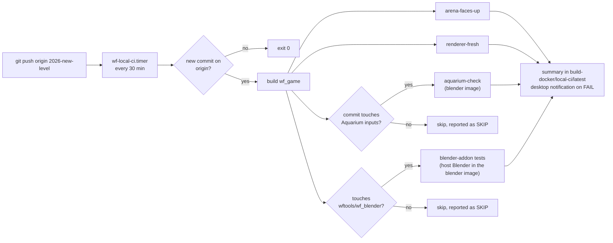
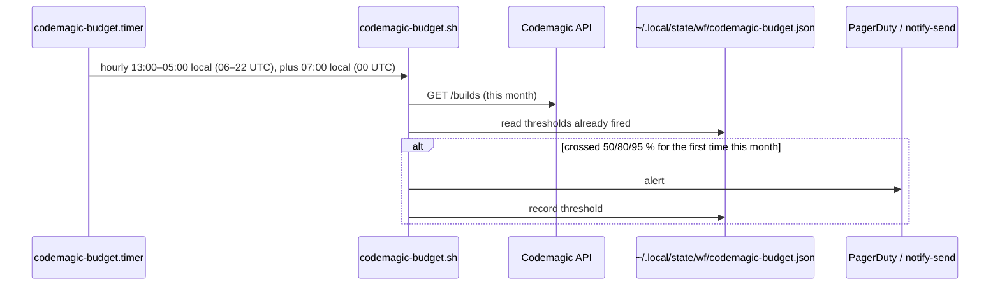
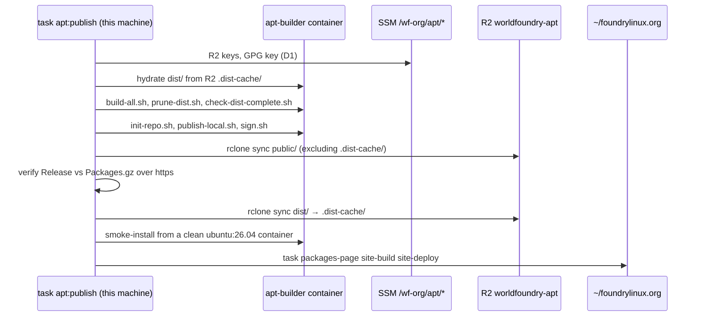

# Retire the remaining GitHub Actions workflows

**Status:** approved (Will, 2026‑11‑27: "d1-d5: ok"); D1–D5 taken as recommended. Phases 1–3 done (`57d753965`, `cc22ca5a0`, worldfoundry.org `a2a7170`); Phase 4 (delete the unused GitHub secrets) waits on Will's "yes, delete".
**TODO:** `[T4] Retire the remaining GitHub Actions workflows: local replacements first`.
**Repos:** this one (`wbniv/WorldFoundry`, branch `2026-new-level`) and `~/worldfoundry.org`.

## Why

Will, 2026‑11‑27: "no more github actions". GitHub also refuses to start any job on this account ("recent account payments have failed or your spending limit needs to be increased"), so every workflow below is already dead. Today that means:

- the Blender add-on tests go red on every push and test nothing;
- committed Aquarium outputs are no longer checked on push;
- Codemagic usage is no longer watched by the hourly cron;
- apt.worldfoundry.org cannot be published at all, because the signed publish exists only as a workflow.

Done already: worldfoundry.org deploys from this machine (`task publish` → `task deploy`, `deploy.yml` deleted, `0572fc7`), and the engine-side `notify-worldfoundry-org.yml` is no longer in this repo.

## What is left

| Repo | Workflow | Trigger | Job | Local replacement | Exists today? |
|---|---|---|---|---|---|
| engine | `blender-addon-tests.yml` | push, PR | wf_blender export tests across a Blender matrix | a step in `scripts/local-ci.sh` | local CI exists, step does not |
| engine | `level-outputs.yml` | push touching Aquarium inputs | rebuild the eight tanks and both bundles, fail on any diff | a step in `scripts/local-ci.sh` calling `task aquarium-check` | `task aquarium-check` exists |
| engine | `codemagic-budget.yml` | cron, hourly 06–22 UTC + 00 UTC | sum Mac minutes, PagerDuty at 50/80/95 % | a systemd user timer running `scripts/codemagic-budget.sh` | script exists and keeps `.budget-state.json` locally |
| site | `apt-publish.yml` | `apt-v*` tag | build, sign, `rclone sync` to R2, verify, smoke-install | `task apt:publish` chaining the same `apt/scripts/*.sh` in the builder container | every step is already a script; no task chains them with signing and upload |
| site | `notify-foundrylinux.yml` | called by apt-publish | `repository_dispatch` so foundrylinux.org rebuilds its packages page | last step of `task apt:publish`: `task packages-page site-build site-deploy` in `~/foundrylinux.org` | those tasks exist |
| site | `dispatch-token-health.yml` | cron, weekly | warn before the dispatch PAT expires | none needed: with no dispatch there is no PAT | n/a |

## Mechanism

### Push-time checks move into local CI



The path filters copy the workflows' `paths:` lists, so a commit that touches nothing relevant costs nothing extra. Both new steps run in the existing containers (`WF_CONTAINER_IMAGE=blender`), never on the host.

### Codemagic budget becomes a timer



The state file moves out of the repo root (today's untracked `.budget-state.json`) into `~/.local/state/`, so it no longer shows as an untracked file in the work tree.

### apt publish becomes one local task



It runs the same scripts in the same order as the workflow, so the published repo is the same. The `apt:bump` task stops pushing a tag that nothing listens to, and calls `task apt:publish` instead.

## Decisions for Will

- **D1. Where the apt secrets live.** Today the R2 keys and the GPG private key are GitHub secrets, backed up to `r2://worldfoundry-secrets/`, with a local cache in `/tmp/worldfoundry-bootstrap.env`. Recommended: SSM `SecureString` under `/wf-org/apt/*`, read with the site's own `wf-org-terraform` profile. That profile is **missing on this machine**. Found 2026‑11‑27: `/wf-org/` *is* in the same AWS account as every other profile here (3531…3271), in **us-west-2** (`/wf-org/cloudflare/{api_token,account_id,email_destination}`, 2026‑05‑17); `wf-terraform` only missed it because its default region is us-east-1. The IAM user `wf-org-terraform` exists with one active key (2026‑05‑16), but no copy of that key is on this machine, so the profile needs a new access key. **Resolved 2026‑11‑28** (Will: "you do"): a second key minted with `wf-terraform` and saved as the `wf-org-terraform` profile (us‑west‑2); the four apt secrets copied from the R2 backup into SSM `/wf-org/apt/*`. The apt secrets themselves (R2 keys, GPG key) are not in SSM yet: only in GitHub secrets (write-only) and the `r2://worldfoundry-secrets/` backup. Alternative: keep the R2 backup as the source and read it with a cached token, which keeps the secret outside SSM.
- **D2. The Blender matrix.** The workflow tested several Blender versions to widen the add-on's apt version pin. Recommended: local CI tests only the host's Blender (the one in the `blender` image), and a separate `task blender-matrix` runs the other versions on demand before the pin is widened.
- **D3. Alert channel for the Codemagic budget.** Recommended: keep PagerDuty, the existing channel, and add a desktop notification as well.
- **D4. foundrylinux.org's own workflows** (`site-deploy`, `foundry-apt-publish`, `foundry-iso-publish`, `foundry-setup-test`, `audit-apt-repos-snapshot`; the nightly `site-deploy` has failed twice this week). The repo belongs to the `foundry-linux` organisation. Is it in scope? Recommended: a separate plan in that repo, because it has its own apt and ISO pipelines.
- **D5. Delete or keep the workflow files.** Recommended: delete each one in the same commit that adds its local replacement, and keep the GitHub secrets until the first successful local run, then delete them with `gh secret delete`.

## Phases

1. **Local CI steps** (T3): add `aquarium-check` and `blender-addon` steps with path filters to `scripts/local-ci.sh`; delete `level-outputs.yml` and `blender-addon-tests.yml`; update `docs/level-building.md` ("Committed Aquarium outputs stay fresh") and the 2026‑05‑21 matrix plan's pointer.
2. **Codemagic timer** (T2): `scripts/install-codemagic-budget.sh` (unit + timer, `set -euo pipefail`, `-h`), state file moved; delete `codemagic-budget.yml`; update the `codemagic-budget.sh` header and the 2026‑05‑12 plan.
3. **apt publish** (T4, after D1): secrets into their new home, `task apt:publish`, `apt:bump` rewired; delete `apt-publish.yml`, `notify-foundrylinux.yml`, `dispatch-token-health.yml`; update the apt runbook, README line 59 and `docs/ARCHITECTURE.md`.
4. **Secrets cleanup** (T1): after one green local run of each, delete the now-unused GitHub secrets and record which were removed.

## Mockups

None: there is no new user interface. The new steps print through the existing local CI summary and the existing scripts' output.

## Cost

Nothing new on AWS: a few SSM `SecureString` parameters are free in the standard tier. GitHub billing goes to zero for these repos. Local cost is CPU on this PC: `aquarium-check` takes a few minutes, and only on commits that touch its inputs.

## Verification

1. `bash scripts/local-ci.sh --no-notify <commit touching wflevels/aquarium_reef/>` shows an `aquarium-check` row with PASS, and on a commit touching neither path both new rows read SKIP.

    Run with `--only` (added for this: the engine build needs 20 GB free and the disk had 8–10 GB; `WF_CI_MIN_FREE_GB=5` for the same reason). A commit touching neither path:
    ```
    $ WF_CI_MIN_FREE_GB=5 scripts/local-ci.sh --no-notify --only aquarium-check,blender-addon 02cedef1f
    WF local CI   PASS
    commit        02cedef1f645  todo: triage the chooser plan's captured deferrals
    step                 result                 seconds
    build                SKIP (not selected)    0
    arena-faces-up       SKIP (not selected)    0
    renderer-fresh       SKIP (not selected)    0
    aquarium-check       SKIP (not touched)     0
    blender-addon        SKIP (not touched)     0
    ```
    An Aquarium-input commit, `351be3175`: the step ran and **failed for a real reason**: `level outputs STALE: 38 of 2419 tracked files do not rebuild identically from 351be31757e6`, every tank and both bundles. Cause: `1cdea7cb2` changed the `snowgoons-blender` scaffold every tank imports and nothing regenerated them (GitHub's check was not running). Fixed by `task aquarium-regenerate`, `d2320285d`, then:
    ```
    $ WF_CI_MIN_FREE_GB=5 scripts/local-ci.sh --no-notify --only aquarium-check,blender-addon HEAD
    commit        d2320285db9f  Aquarium tanks and bundles: rebuilt after 1cdea7cb2's scaffold script fix
    aquarium-check       PASS                   309
    blender-addon        SKIP (not touched)     0
    level outputs fresh: all 2423 tracked files rebuild identically from d2320285db9f
    ```
    **PASS.**
2. `bash scripts/local-ci.sh --no-notify <commit touching wftools/wf_blender/>` shows a `blender-addon` row with PASS.

    The step builds the wheel (maturin 1.11.5 in the Blender image) and runs the test against Blender 5.0.1. On `1cdea7cb2` it **fails for a real reason**: `Export output differs from golden at byte 1072` (276,421 against 266,019 bytes; the other two tests pass). On the last commit GitHub passed, in the same container:
    ```
    $ WF_CI_ALL_STEPS=1 WF_CI_MIN_FREE_GB=5 scripts/local-ci.sh --no-notify --only blender-addon d6f6b7d70
    local-ci: blender-addon: PASS (28 s)
    WF local CI   PASS
    ============================== 3 passed in 3.26s ===============================
    ```
    Bisected: `8cdd071dc`, `30e0526e9`, `583111c1b`, `41c48094a` PASS; `750a8db4a` and every later add-on commit FAIL. `750a8db4a` regenerated `qbert_practice.blend` without refreshing the golden; refreshing it with a review of later differences is a separate TODO item. **PASS** for the step (it runs, and it catches a real regression); the add-on test itself reads FAIL until the golden is refreshed.
3. `systemctl --user list-timers codemagic-budget.timer` lists the timer, and `systemctl --user start codemagic-budget.service; journalctl --user -u codemagic-budget -n 5` prints this month's Mac minutes.

    ```
    $ systemctl --user list-timers codemagic-budget.timer --no-pager
    NEXT                         LEFT LAST PASSED UNIT                   ACTIVATES
    Fri 2026-11-27 21:01:51 +07 41min -         - codemagic-budget.timer codemagic-budget.service

    1 timers listed.
    $ systemctl --user start codemagic-budget.service; journalctl --user -u codemagic-budget -n 8 --no-pager -o cat
    month=2026-11 used=298 pct=59%  (budget=500 min)
    already fired this month: ["50"]
    threshold 50%: already fired this month
    threshold 80%: not reached
    threshold 95%: not reached
    state written to /home/will/.local/state/wf/codemagic-budget.json: {"month":"2026-11","fired":["50"],"used_minutes":298,"pct":59}
    Finished codemagic-budget.service - WorldFoundry Codemagic Mac-minute budget check (PagerDuty + desktop alert at 50/80/95 %).
    ```

    The fired list `["50"]` came from the old repo-root state file, which the installer copied. The PagerDuty key was read from SSM: no "not readable" line. Threshold dry run, `STATE_FILE=$(mktemp) BUDGET_MINUTES=1 DRY_RUN=1 scripts/codemagic-budget-run.sh`, crossed 80 % and 95 % with "would alert" and posted nothing. The desktop notification was not fired for real: that would page as well. **PASS.**
4. `cd ~/worldfoundry.org && task apt:publish -- --dry-run` builds and signs with no upload; then a real `task apt:publish` ends with the Release/Packages.gz check and the smoke install passing, and [apt.worldfoundry.org/dists/stable/Release](https://apt.worldfoundry.org/dists/stable/Release) shows the new date.

    ```
    $ bash apt/scripts/publish.sh --dry-run      # second attempt, after the rootless --user fix
    2026-11-28T03:51:22Z apt-publish: dry run: stopping before signing and upload; output in /home/will/worldfoundry.org/apt/public/
    rc=0
    $ bash apt/scripts/publish.sh
    2026-11-28T03:52:15Z apt-publish: checking the live Release matches the live Packages.gz
    2026-11-28T03:52:16Z apt-publish: consistent (attempt 1)
    2026-11-28T03:52:16Z apt-publish: persisting dist/ to R2:worldfoundry-apt/.dist-cache/
    2026-11-28T03:52:18Z apt-publish: smoke-installing worldfoundry-blender-editor-exporter in a clean ubuntu:26.04
    ii  worldfoundry-blender-editor-exporter 0.2.1+git3fa94cbe-2foundry2 amd64        World Foundry Level Editor add-on for Blender
    2026-11-28T03:56:48Z apt-publish: rebuilding foundrylinux.org packages page (/home/will/foundrylinux.org)
    $ head -5 https://apt.worldfoundry.org/dists/stable/Release
    Date: Sat, 28 Nov 2026 03:52:00 UTC
    ```

    Completeness gate: "15 local .debs, 15 live packages". Two deviations from the step as written: the dry run stops *before* signing (signing needs the private key, and a dry run should touch no secret beyond R2 read); and the first dry run failed at `mkdir /work/apt/.aptly: permission denied`, because under rootless Docker `--user 1000:1000` maps to a subordinate UID, fixed in `in-docker.sh` (`a2a7170`). The image is `Dockerfile.github`: the lab registry is unreachable from home. **PASS.**
5. `ls .github/workflows ~/worldfoundry.org/.github/workflows` lists nothing.

    ```
    ls: cannot access '.github/workflows': No such file or directory
    ls: cannot access '/home/will/worldfoundry.org/.github/workflows': No such file or directory
    ```

    **PASS.**
6. `gh secret list -R wbniv/worldfoundry.org` and `gh secret list -R wbniv/WorldFoundry` list nothing that is still unused.
