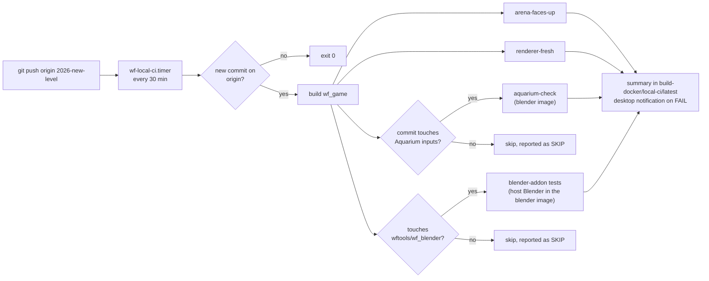
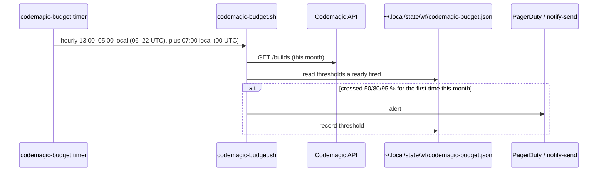
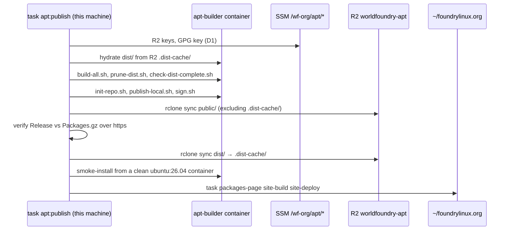

# Retire the remaining GitHub Actions workflows

**Status:** approved (Will, 2026‑11‑27: "d1-d5: ok"); D1–D5 taken as recommended. Phases 1–2 in progress.
**TODO:** `[T4] Retire the remaining GitHub Actions workflows: local replacements first`.
**Repos:** this one (`wbniv/WorldFoundry`, branch `2026-new-level`) and `~/worldfoundry.org`.

## Why

Will, 2026‑11‑27: "no more github actions". GitHub also refuses to start any job on this account ("recent account payments have failed or your spending limit needs to be increased"), so every workflow below is already dead. Today that means:

- the Blender add-on tests go red on every push and test nothing;
- committed Aquarium outputs are no longer checked on push;
- Codemagic usage is no longer watched by the hourly cron;
- apt.worldfoundry.org cannot be published at all, because the signed publish exists only as a workflow.

Done already: worldfoundry.org deploys from this machine (`task publish` → `task deploy`, `deploy.yml` deleted, `0572fc7`), and the engine-side `notify-worldfoundry-org.yml` is no longer in this repo.

## What is left

| Repo | Workflow | Trigger | Job | Local replacement | Exists today? |
|---|---|---|---|---|---|
| engine | `blender-addon-tests.yml` | push, PR | wf_blender export tests across a Blender matrix | a step in `scripts/local-ci.sh` | local CI exists, step does not |
| engine | `level-outputs.yml` | push touching Aquarium inputs | rebuild the eight tanks and both bundles, fail on any diff | a step in `scripts/local-ci.sh` calling `task aquarium-check` | `task aquarium-check` exists |
| engine | `codemagic-budget.yml` | cron, hourly 06–22 UTC + 00 UTC | sum Mac minutes, PagerDuty at 50/80/95 % | a systemd user timer running `scripts/codemagic-budget.sh` | script exists and keeps `.budget-state.json` locally |
| site | `apt-publish.yml` | `apt-v*` tag | build, sign, `rclone sync` to R2, verify, smoke-install | `task apt:publish` chaining the same `apt/scripts/*.sh` in the builder container | every step is already a script; no task chains them with signing and upload |
| site | `notify-foundrylinux.yml` | called by apt-publish | `repository_dispatch` so foundrylinux.org rebuilds its packages page | last step of `task apt:publish`: `task packages-page site-build site-deploy` in `~/foundrylinux.org` | those tasks exist |
| site | `dispatch-token-health.yml` | cron, weekly | warn before the dispatch PAT expires | none needed: with no dispatch there is no PAT | n/a |

## Mechanism

### Push-time checks move into local CI

The path filters copy the workflows' `paths:` lists, so a commit that touches nothing relevant costs nothing extra. Both new steps run in the existing containers (`WF_CONTAINER_IMAGE=blender`), never on the host.

### Codemagic budget becomes a timer

The state file moves out of the repo root (today's untracked `.budget-state.json`) into `~/.local/state/`, so it no longer shows as an untracked file in the work tree.

### apt publish becomes one local task

It runs the same scripts in the same order as the workflow, so the published repo is the same. The `apt:bump` task stops pushing a tag that nothing listens to, and calls `task apt:publish` instead.

## Decisions for Will

- **D1. Where the apt secrets live.** Today the R2 keys and the GPG private key are GitHub secrets, backed up to `r2://worldfoundry-secrets/`, with a local cache in `/tmp/worldfoundry-bootstrap.env`. Recommended: SSM `SecureString` under `/wf-org/apt/*`, read with the site's own `wf-org-terraform` profile. That profile is **missing on this machine** (only `wf-terraform` exists, and `/wf-org/` is not in its account), so recreating it is the one manual step. Alternative: keep the R2 backup as the source and read it with a cached token, which keeps the secret outside SSM.
- **D2. The Blender matrix.** The workflow tested several Blender versions to widen the add-on's apt version pin. Recommended: local CI tests only the host's Blender (the one in the `blender` image), and a separate `task blender-matrix` runs the other versions on demand before the pin is widened.
- **D3. Alert channel for the Codemagic budget.** Recommended: keep PagerDuty, the existing channel, and add a desktop notification as well.
- **D4. foundrylinux.org's own workflows** (`site-deploy`, `foundry-apt-publish`, `foundry-iso-publish`, `foundry-setup-test`, `audit-apt-repos-snapshot`; the nightly `site-deploy` has failed twice this week). The repo belongs to the `foundry-linux` organisation. Is it in scope? Recommended: a separate plan in that repo, because it has its own apt and ISO pipelines.
- **D5. Delete or keep the workflow files.** Recommended: delete each one in the same commit that adds its local replacement, and keep the GitHub secrets until the first successful local run, then delete them with `gh secret delete`.

## Phases

1. **Local CI steps** (T3): add `aquarium-check` and `blender-addon` steps with path filters to `scripts/local-ci.sh`; delete `level-outputs.yml` and `blender-addon-tests.yml`; update `docs/level-building.md` ("Committed Aquarium outputs stay fresh") and the 2026‑05‑21 matrix plan's pointer.
2. **Codemagic timer** (T2): `scripts/install-codemagic-budget.sh` (unit + timer, `set -euo pipefail`, `-h`), state file moved; delete `codemagic-budget.yml`; update the `codemagic-budget.sh` header and the 2026‑05‑12 plan.
3. **apt publish** (T4, after D1): secrets into their new home, `task apt:publish`, `apt:bump` rewired; delete `apt-publish.yml`, `notify-foundrylinux.yml`, `dispatch-token-health.yml`; update the apt runbook, README line 59 and `docs/ARCHITECTURE.md`.
4. **Secrets cleanup** (T1): after one green local run of each, delete the now-unused GitHub secrets and record which were removed.

## Mockups

None: there is no new user interface. The new steps print through the existing local CI summary and the existing scripts' output.

## Cost

Nothing new on AWS: a few SSM `SecureString` parameters are free in the standard tier. GitHub billing goes to zero for these repos. Local cost is CPU on this PC: `aquarium-check` takes a few minutes, and only on commits that touch its inputs.

## Verification

1. `bash scripts/local-ci.sh --no-notify <commit touching wflevels/aquarium_reef/>` shows an `aquarium-check` row with PASS, and on a commit touching neither path both new rows read SKIP.
2. `bash scripts/local-ci.sh --no-notify <commit touching wftools/wf_blender/>` shows a `blender-addon` row with PASS.
3. `systemctl --user list-timers codemagic-budget.timer` lists the timer, and `systemctl --user start codemagic-budget.service; journalctl --user -u codemagic-budget -n 5` prints this month's Mac minutes.
4. `cd ~/worldfoundry.org && task apt:publish -- --dry-run` builds and signs with no upload; then a real `task apt:publish` ends with the Release/Packages.gz check and the smoke install passing, and [apt.worldfoundry.org/dists/stable/Release](https://apt.worldfoundry.org/dists/stable/Release) shows the new date.
5. `ls .github/workflows ~/worldfoundry.org/.github/workflows` lists nothing.
6. `gh secret list -R wbniv/worldfoundry.org` and `gh secret list -R wbniv/WorldFoundry` list nothing that is still unused.
