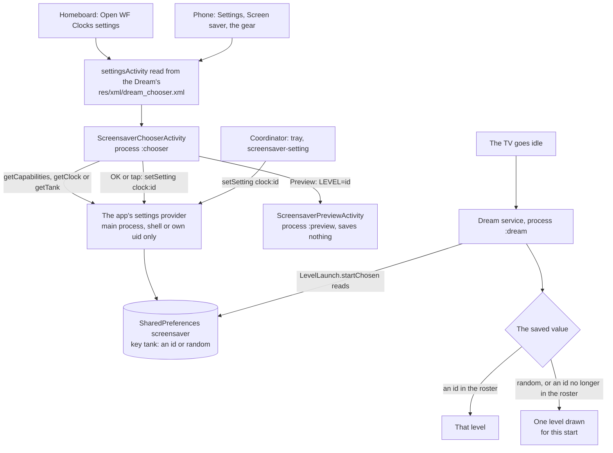
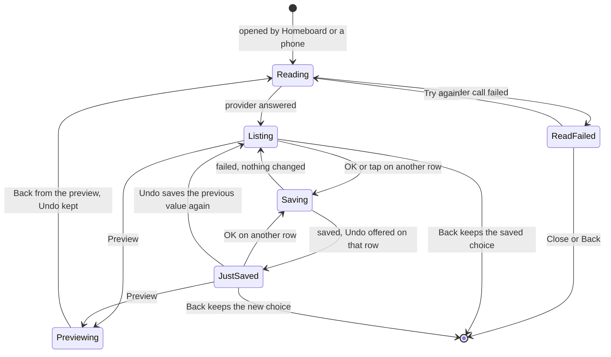
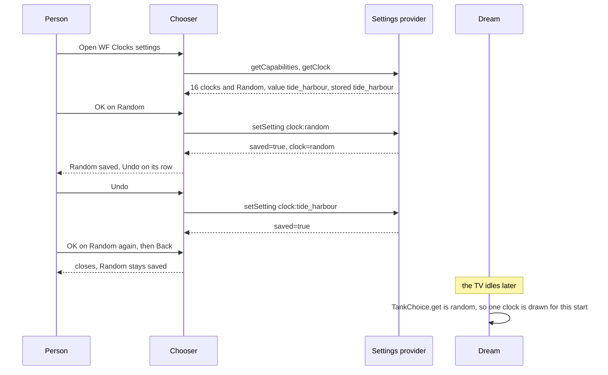
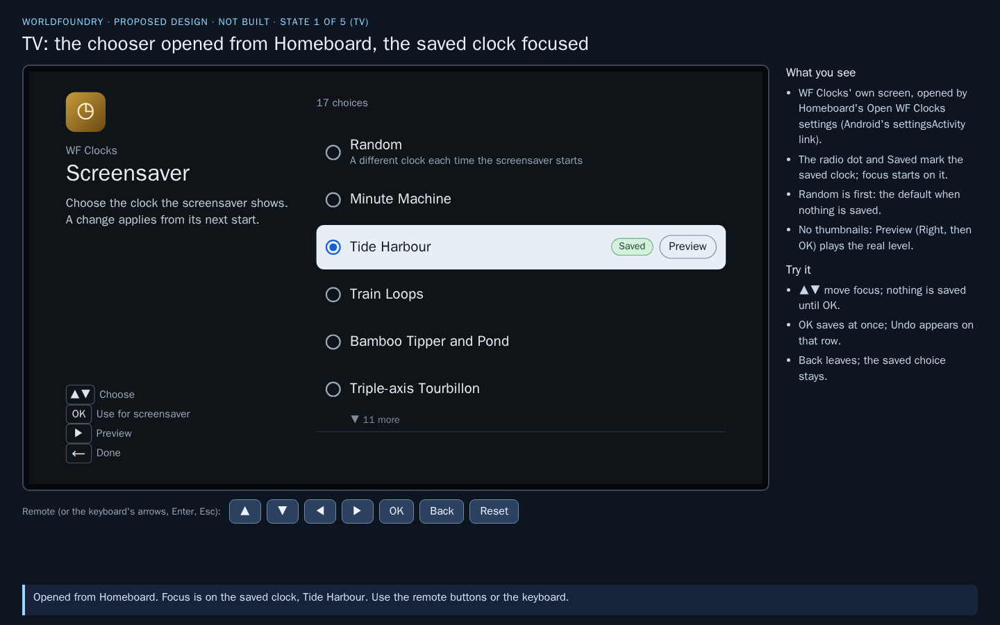
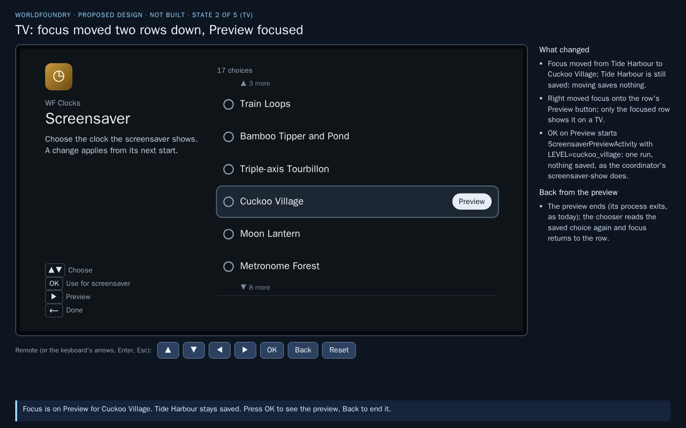
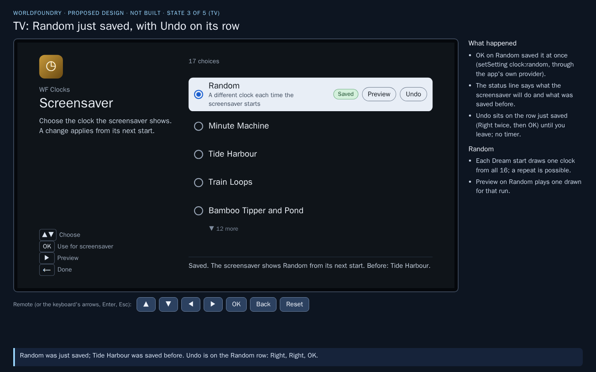
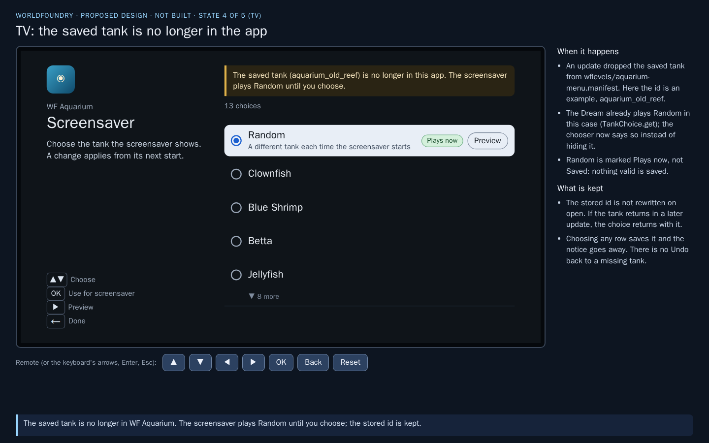
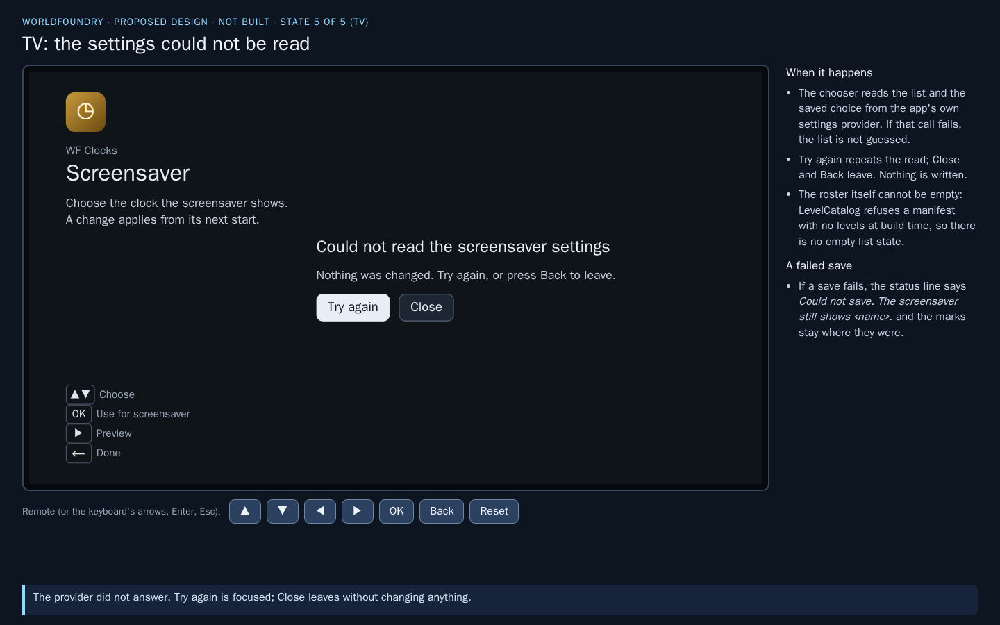
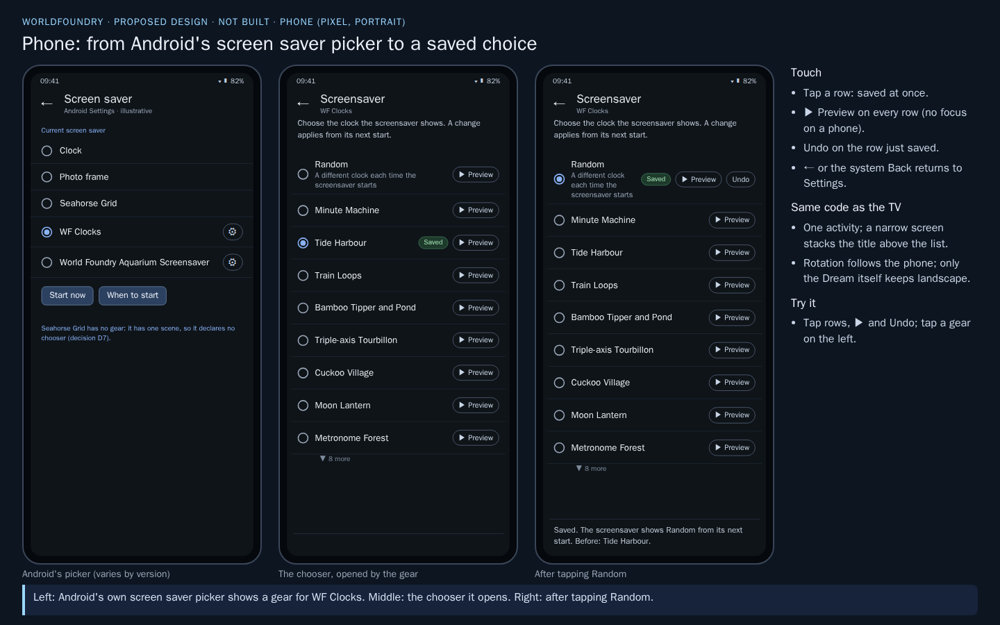
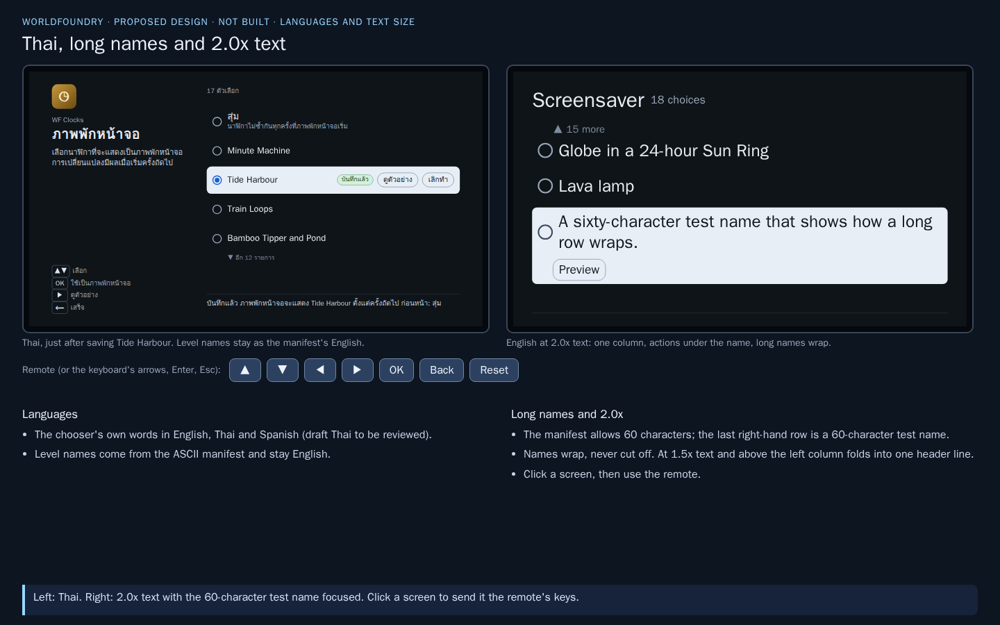

# Aquarium and Clocks: a "use for screensaver" chooser behind the Dream's settings link

**Status:** decided by Will, 2026‑11‑27 (D4 changed; see the note under Decisions); being built. Was: draft for Will's decisions. TODO item: "Aquarium and Clocks: 'use for screensaver' chooser behind the Dream's settings link" (`[T4]`). It follows Will's decision 1 of 2026‑11‑26 in Homeboard's [screensaver integration investigation](../../../homeboard-tv/docs/investigations/2026-11-26-screensaver-integration.md): each app offers the choice itself, reached through Android's `settingsActivity` link, and only the app writes the saved choice. **No engine change is needed** for the recommended design; the one option that would need one (D1, the engine's level menu) is marked.

## Context: what is true today

- **The Dream XML is empty and shared.** `android/screensaver/src/main/res/xml/dream.xml:2` is `<dream … />` with no attributes. All four flavours point their Dream's `android.service.dream` meta-data at it: `src/aquarium/AndroidManifest.xml:25`, `src/clocks/AndroidManifest.xml:28`, `src/seahorse/AndroidManifest.xml:25`, `src/planted/AndroidManifest.xml:25`. So no World Foundry Dream declares `settingsActivity`, and Homeboard shows no **Open ‹app› settings** button for them.
- **The saved choice is one preference.** `TankChoice` (`src/main/java/org/worldfoundry/screensaver/TankChoice.java`) keeps it in the app's `screensaver` SharedPreferences under key `tank`, for the Aquarium and for WF Clocks alike. The value is a roster id or `random`; nothing saved means `random`. `TankChoice.get` (line 35) returns `random` for an id the roster no longer holds (line 38), silently. The same file also holds `orientation` (`OrientationSettings.java:11`).
- **The roster is the manifest.** `LevelCatalog` reads `wflevels/aquarium-menu.manifest` (12 tanks) or `wflevels/clocks-menu.manifest` (16 clocks), copied into the APK as `levels.manifest`. Labels are the manifest's Dream labels, printable ASCII, 1 to 60 characters (`LevelCatalog.java`, `checkText`). A manifest with no levels is refused, so a shipped app always has at least one.
- **Only the shell-only providers write it.** `TankSettingsProvider` (`setSetting tank:<id>`, line 67) and `ClocksSettingsProvider` (`setSetting clock:<id>`, line 59) are the only callers of `TankChoice.set`. Both accept the device shell or the app's own uid (`caller != Process.SHELL_UID && caller != Process.myUid()`), and `getTank` / `getClock` read it back. `LaunchModeTest.java:105-118` is a source guard: `TankChoice.set` has one caller per pack, the provider, and `LauncherActivity` touches no preference.
- **Readers.** The Dream services (`AquariumDreamService`, `ClocksDreamService`) and `ScreensaverPreviewActivity` call `LevelLaunch.startChosen`, which resolves Random once per start (`LevelCatalog.choose`, line 180). The preview also takes a one-run `LEVEL` extra (an id or `random`) and saves nothing.
- **Processes.** The providers and the launcher activities run in the main process; each Dream runs in `:dream`, the preview in `:preview`. `TankPlayer.stop` (line 196) ends the process after every engine run, including the launcher's in the main process, because the renderer has process-lifetime globals.
- **The launcher menu never saves.** A plain launcher start shows the engine's level menu; choosing a tank there plays it for that run only (Will, 2026‑11‑21, [one Aquarium app](2026-11-21-one-aquarium-app.md)).
- **How Homeboard opens the link.** `SystemScreensaver.declaredSettings` reads `settingsActivity` from the Dream's XML; `ScreensaverRegistry.settingsComponent` (Homeboard `ScreensaverRegistry.java:172`) takes a `package/class` value whole, joins a bare class with the Dream's package, and joins a leading-`.` class with the **package name**, which here is `org.worldfoundry.game.clocks`, not the code package `org.worldfoundry.screensaver`. `MainActivity.openScreensaverAppSettings` (line 3326) starts it with a plain `startActivity`, no flags. Android's own reader builds `ComponentName(dreamPackage, value)` for a value without `/` and, since a 2023 security fix, ignores a component in another package (from AOSP `DreamService.getDreamMetadata`, not run here; Verification 8 checks it on the Pixel). So **the value must be the full class name, with no `/` and no leading `.`**, the same rule as `PREVIEW_ACTIVITY`.
- **Who can open it.** Homeboard on any TV (Cast1, Cast2); a phone's or tablet's own picker (Pixel: Settings, Display, Screen saver, the gear beside a screensaver). Google TV itself has no screensaver picker, so on the Chromecasts Homeboard is the only way in.
- **The coordinator** uses the providers' `getCapabilities` and `setSetting` (the tray, `task chromecast:screensaver-setting`), and its registry names `level_setting_id` (`tank`, `clock`) ([contract](../../../chromecast-coordinator/docs/settings-provider-contract.md)). Those must keep working unchanged.
- **Per-level settings** (Sea Stars, the lava lamp, Tide Harbour…) are edited in the engine's own Level Settings form while the level plays from the launcher menu; the [persist level settings plan](2026-11-27-persist-level-settings.md) (awaiting review) would save them for the app and its Dream. The [remediation plan](2026-11-21-screensaver-app-and-remediation.md) asks for a settings dialog per level, reachable "where the platform exposes Dream settings".

## Decisions for Will

Each has a recommendation; "if not" says what the other answer costs.

**Decided by Will, 2026‑11‑27:** "D1-D3,D5-D10: yes, ok. D4: no, don't show 'random' as choice in list." So
the chooser lists only the app's levels, with no Random row. Random stays where it already works: an app
nobody has chosen for keeps today's `random` (nothing saved means `random`), the coordinator's
`setSetting tank:random` / `clock:random` is unchanged, and D9's fallback for a missing saved level still
plays a random level. The list then marks no row as Saved and its status line says a random level plays
until a level is chosen; D9's notice says the same instead of marking a Random row "Plays now". Choosing a
level saves it, and there is no way back to Random from the chooser (Undo still restores the previous
saved value while on the screen, including `random`). D5's Preview takes a level id only.

| # | Question | Recommendation | What changes | If not |
|---|---|---|---|---|
| D1 | What is the chooser? | **A plain Android screen**: a list, in the app, with no engine | A new activity in each app; opens in well under a second, works with the remote and with touch, can show Thai | The engine's level menu: it plays a level when chosen, so saving instead needs a change to `shell-menu.fth` and the native host (**engine change, needs your permission**); no Saved mark, no Random row and no Undo without more engine work; ASCII text only; starting the engine takes seconds on Cast1 just to pick a name |
| D2 | What does a row show? | **The name and a Saved mark, no thumbnails; a Preview button plays the real level** | Rows are text; the focused row (TV) or every row (phone) has Preview | Thumbnails: one image per level (28 today), captured again whenever a scene changes, about 1 MB more per APK, and a stale picture misleads |
| D3 | When is the choice saved? | **At once, on OK or a tap. Undo sits on the row just saved until you leave. Back leaves and keeps what is saved** | One press saves; the status line says what the screensaver will show and what was saved before | A Save and Cancel pair: two more presses per change, and Back would throw a change away, which Android TV settings do not do |
| D4 | Random | **Offered, first in the list, the default. Each Dream start draws one level from all of them; a repeat is possible. Hidden when an app has only one level** | Same behaviour as today's `random`, now visible and choosable | Without Random, the default would have to become a fixed level; "Random from levels I pick" is possible later (out of scope) |
| D5 | Preview from the chooser? | **Yes**: Preview starts the app's existing `ScreensaverPreviewActivity` with `LEVEL=<id>` (or `random`), one run, nothing saved; Back returns to the same row | No new player code; the preview is the one Homeboard already uses | Names only; a person picks "Mirror and Haze" without seeing it |
| D6 | Per-level settings in the chooser? | **No, and no link out in this item.** Revisit when the persist plan is decided | The chooser stays a single list | A per-row Settings link would open the app on that level with its Level Settings form; today the form is reachable only from the launcher menu, so this needs a new launch mode and probably a native host call (**possibly an engine change**) |
| D7 | Seahorse Grid | **Declares no `settingsActivity`**: it has one scene, so there is nothing to choose; Homeboard keeps showing no Open settings button for it | Seahorse Grid and Planted Tank keep the empty `dream.xml` | A chooser with one fixed row is a dead end on a TV; it is only worth it if D8 is yes |
| D8 | Orientation in the chooser? | **Not now**; it stays a coordinator setting | Nothing | An Orientation row below the list on touch devices only (the TVs are always landscape); Seahorse Grid would then declare the chooser too, to reach its one setting |
| D9 | The saved level is no longer in the app | **Say so, play Random (as today), keep the stored id.** It is never rewritten except by a person's choice, so if the level comes back in a later update, the choice comes back | A notice above the list; Random marked "Plays now", not "Saved"; no Undo back to a missing level | Resetting it to `random` when the chooser opens: opening would write, and the choice is lost even if the level returns |
| D10 | Languages | **English, Thai and Spanish** for the chooser's own words (about 15 strings each). Level names stay the manifest's English | `values-th`, `values-es` resources; the Thai and Spanish are drafts for a native reader | All of Homeboard's 30 languages: 30 machine translations to keep; translated level names: a second name source beside the ASCII manifest, which the engine menu also reads |

Rejected outright, not offered: saving from the launcher's engine menu (it would reverse Will's 2026‑11‑21 rule that the menu never changes the saved choice); Android's deprecated `PreferenceActivity` or the AndroidX preference library (a dependency for one list, and no Preview or Undo).

## Approach

One activity in `src/main`, shared by the Aquarium and WF Clocks, declared only in their two flavour manifests. It is a client of the app's own settings provider: it reads and writes the saved choice **through the provider**, never through SharedPreferences.

### One chooser for every World Foundry screensaver bundle

Will, 2026‑11‑27: "you should be able to reuse the same menu chooser code for both aquarium and 3d
clocks. and for all wf screensaver bundles in the future, too". So the chooser is one piece of code with
no per-app branches, ids or strings, and a new bundle gets it with no new Java:

- **Everything per-app is data.** The list comes from the bundle's roster (`levels.manifest`, read by
  `LevelCatalog`); the provider is found from the Dream's existing
  `org.worldfoundry.screensaver.SETTINGS_AUTHORITY` meta-data; the level setting id the provider stores
  (`tank` for the Aquarium, `clock` for WF Clocks) is one declared value, or both providers also accept one
  shared key such as `level`. Whichever is chosen, the coordinator's existing `tank:<id>` and
  `clock:<id>` keep working unchanged.
- **Whether a bundle offers the chooser is data too.** A bundle whose roster has more than one level
  declares the chooser activity and points its Dream at `dream_chooser.xml`; a one-level bundle (Seahorse
  Grid, D7) keeps the empty `dream.xml`.
- **Adding it to a new bundle** is a few manifest lines, the Dream XML and the roster, written up as a
  how-to in `android/screensaver/README.md`.
- **A source guard test** fails if the chooser or its helpers name a particular bundle (`aquarium`,
  `clocks`, a hard-coded `tank` or `clock` id), and pure tests build the list and the save calls from a
  roster and a setting id they are given.

**Rejected: the chooser calling `TankChoice` directly.** It is shorter, but it must then run in the main process to share the provider's cached preferences; the main process is ended by `TankPlayer.stop` after every launcher run, and a second writer breaks the `LaunchModeTest` guard. In its own process it would hold a stale copy of the `screensaver` file and could overwrite an orientation the coordinator saved. Through the provider there is one writer, one validation and one list, the same one the coordinator's tray shows. The two are close; this one wins on keeping the writer single.

### Critical files

**As built (`820e29f6a`, `1323b23a4`, 2026‑11‑27):** the views are built in code, choosing the wide or stacked layout at run time, so there is no `layout/chooser.xml` or `layout-w720dp`; the list scrolls with faded edges instead of "▲ N more" lines; the shared calls live in `ChooserModel` and `LevelChoiceCalls` (now the only caller of `TankChoice.set`); both providers accept the shared `level` id beside `tank` and `clock`. Not yet built as an APK or run on a device.

New:

- `android/screensaver/src/main/java/org/worldfoundry/screensaver/ScreensaverChooserActivity.java`: the screen. Framework views only (no new dependency), `Theme.Material` dark, sizes in `dp` and `sp`. Reads on every `onResume` (so a coordinator change or a return from Preview shows), writes with `ContentResolver.call(<package>.settings, "setSetting", "<key>:<id>")`. Back calls `finish()`. A failed call shows the read-error screen or a "Could not save" status; nothing is guessed.
- `.../ChooserModel.java`: plain Java, no Android imports, like `LevelCatalog`: builds the rows from the capabilities' option list and the stored value (Saved, Plays now, the missing notice, Random hidden for one level), holds the one-step Undo, and says what each key does. Tested with `javac` alone.
- `src/main/res/xml/dream_chooser.xml`: `<dream android:settingsActivity="org.worldfoundry.screensaver.ScreensaverChooserActivity" />`. `dream.xml` stays empty for Seahorse Grid and Planted Tank (D7).
- `src/main/res/layout/chooser.xml` (narrow: title above the list) and `src/main/res/layout-w720dp/chooser.xml` (title column beside the list, both TVs at 960 × 540 dp); at text scale 1.5 and above the code folds the title column into one header line, as the mockup shows.
- Strings: `src/main/res/values{,-th,-es}/strings.xml` with the Aquarium's wording ("tank"); `src/clocks/res/values{,-th,-es}/strings.xml` override the noun phrases ("clock").
- `src/test/java/org/worldfoundry/screensaver/ChooserModelTest.java` and a `task test-screensaver-chooser` beside `test-aquarium-launch-mode`.

Changed:

- `src/aquarium/AndroidManifest.xml`, `src/clocks/AndroidManifest.xml`: the Dream's `android.service.dream` meta-data points at `@xml/dream_chooser`; add `<activity android:name=".ScreensaverChooserActivity" android:exported="true" android:process=":chooser" android:excludeFromRecents="true" android:taskAffinity="" android:label="@string/chooser_title" />`. Exported with no intent filter, because Homeboard and Android's Settings start it by component; it can only show a list and save a choice a person makes. `taskAffinity=""` keeps it out of the app's own task when Android's Settings starts it with a new task, so Back returns to Settings.
- `TankChoice.java`: a read-only `stored(Context)` returning the raw saved value (or null), before `get`'s missing-to-Random mapping.
- `TankSettingsProvider.java` (`getTank`) and `ClocksSettingsProvider.java` (`getClock`): also return `stored`. Additive; `getCapabilities` and `setSetting` are unchanged, so the coordinator sees no difference.
- `LaunchModeTest.java`: extend the guard: the chooser contains no `getSharedPreferences` and no `TankChoice.set`.
- `tests/test_screensaver_preview_metadata.py`: the Aquarium and Clocks Dreams use `@xml/dream_chooser`, its `settingsActivity` is the full class name with no `/` or leading `.`, the activity is declared and exported in those two manifests; Seahorse Grid and Planted Tank declare none.
- `android/screensaver/README.md`: a "Choosing the screensaver" section; correct "only this provider writes" to "only the provider writes; the chooser writes through it".

### How it behaves

**TV (remote).** Focus starts on the saved row (on Random when the saved level is missing). Up and Down move focus and save nothing. OK saves the focused row at once. Right moves onto the focused row's Preview button, and again onto Undo when that row was just saved; Left moves back. Back from a button returns to its row; Back from a row closes the chooser. Rows that do not fit scroll, with "▲ 3 more" and "▼ 9 more" lines. Overscan margins 48 dp at the sides and 27 dp top and bottom. Both Chromecasts resolve to 960 × 540 dp (1080p at density 2.0, 4K at 4.0), so one layout serves both; Verification 7 checks it on each.

**Phone (touch).** The same activity with the narrow layout: an app bar with Back, the explanation, then the list. Tap a row to save; every row has a Preview button, because there is no focus; Undo on the row just saved. Rotation follows the phone; only the Dream keeps landscape.

**Accessibility.** Each row is one radio item (`role` radio, checked when saved) whose spoken text is "Tide Harbour, saved, 3 of 17"; Preview and Undo say which level they act on; the status line is a polite live region, so TalkBack reads "Saved. The screensaver shows Tide Harbour from its next start." Focus is shown by a light background and dark text, not by colour alone. Text in `sp`, names wrap and are never cut off.

### Effects elsewhere

- **Coordinator:** none. `getCapabilities` and `setSetting` are unchanged; `getTank` / `getClock` gain a `stored` key it does not read. A change in the chooser shows in the tray's next read, and a tray change shows the next time the chooser opens or resumes.
- **Homeboard:** none in code. WF Clocks and the Aquarium gain an **Open ‹app› settings** button in its screensaver list; Seahorse Grid does not (D7). Verification 9 closes Homeboard's contract Verification 3.
- **Phones:** Android's screen saver picker shows a settings gear for the two apps.

## Mockups

All seven are live in the rendered plan; use the on-page remote, the keyboard (arrows, Enter, Esc) or taps. TV screens are drawn at 960 × 540 dp. Built by `make_mockups.py` in the bundle; PNGs captured and checked with Homeboard's `dev/plan-mockup-check.cjs`.

**1. TV, as opened.** WF Clocks opened from Homeboard: Random first, Tide Harbour saved and focused, key hints on the left.

**2. Focus moving.** Focus on Cuckoo Village's Preview button; Tide Harbour is still saved.

**3. Random and Undo.** Random just saved; the status line names what was saved before; Undo on the row.

**4. Missing level.** WF Aquarium after an update dropped the saved tank (example id): the notice, Random "Plays now".

**5. Read failure.** The provider did not answer: Try again or Close; nothing written. (There is no empty-list state: a manifest without levels does not build.)

**6. Phone.** Android's own picker with the new gear (illustrative), the chooser it opens, and the chooser after tapping Random.

**7. Thai, long names, 2.0x.** Thai chrome with English level names, just after a save; English at 2.0x text with a 60‑character test name (the manifest's limit).

## Out of scope

- Per-level settings in the chooser (D6) and Orientation (D8), unless Will says otherwise.
- Random from a chosen subset, and "no repeat twice in a row" (the Dream would have to remember its last draw).
- Thumbnails (D2), translated level names (D10).
- Seahorse Grid and Planted Tank (retiring) choosers (D7).
- Any change to the coordinator, its registry or Homeboard.
- Debugging switched off (Homeboard investigation, "Not decided here").

## Verification

Builds and device runs happen only after Will's decisions; device jobs go through the coordinator (`task chromecast:*`), with frozen APK copies.

1. Unit: `task test-screensaver-chooser` runs `ChooserModelTest`: rows for the real Clocks and Aquarium manifests (Random first, then the manifest order, Dream labels); Saved on the stored id; a stored id not in the roster gives the notice, Random as "Plays now" and no Undo to it; Random hidden for a one-level roster; Undo restores exactly the previous value once; OK on the saved row writes nothing.
2. Guards: `task test-aquarium-launch-mode` still passes with the extended guard (the chooser has no `getSharedPreferences` and no `TankChoice.set`; the provider stays the only writer).
3. Manifests: `task test-screensaver-preview-metadata` passes with the new cases: Aquarium and Clocks Dreams use `@xml/dream_chooser`, its `settingsActivity` is `org.worldfoundry.screensaver.ScreensaverChooserActivity` (no `/`, no leading `.`), the activity is exported in both manifests; Seahorse Grid and Planted Tank declare no `settingsActivity`; the registry cross-check still passes.
4. Builds: `task build-clocks-apk` and `task build-aquarium-screensaver-apk` succeed; `aapt2 dump xmltree --file res/xml/dream_chooser.xml <apk>` on each shows the full class name.
5. Cast1, WF Clocks, through a coordinator check recipe written with the code: start the chooser by component, capture it (focus on the saved row), Down twice, Right, OK (preview starts, `LevelLaunch` logs `cuckoo_village`), Back (focus back on Cuckoo Village), Left, OK (saved). `getCapabilities` through the coordinator then reports `clock` = `cuckoo_village`; `task chromecast:screensaver-select` WF Clocks and `task chromecast:screensaver-trigger`: the Dream's log names Cuckoo Village. Repeat with Random, then Undo, and confirm the provider reports the restored value after each.
6. Cast1, missing level: save `corolla_gauge`; install a throwaway WF Clocks built from a manifest without it (the `-PwfClocksManifest` route of `task build-clocks-two-entry-apk`); open the chooser: the notice and "Plays now" on Random; trigger the Dream: a clock is drawn; reinstall the shipped APK: Corolla Gauge is saved again with no notice.
7. Cast2 (4K) and Cast1 at 2.0x text: the same capture as step 5's first frame; the layout matches mockups 1 and 7 (no cut-off names, title column folded at 2.0x). Restore Cast1's text size afterwards.
8. Pixel (`DEVICE=phone-pixel-8-pro`): Settings, Display, Screen saver: the gear beside WF Clocks opens the chooser; tap Random; Preview plays; system Back returns to Settings; rotate the phone while the chooser is open (the list keeps the saved mark); `task chromecast:screensaver-show` plays the saved choice. A `uiautomator` dump in the same recipe shows each row's spoken text ("Tide Harbour, saved, 3 of 17").
9. Homeboard on Cast1 (closes Homeboard's [companion contract](../../../homeboard-tv/docs/plans/2026-11-26-screensaver-companion-contract.md) Verification 3): Homeboard's Screensaver list, WF Clocks, **Open WF Clocks settings** opens the chooser; choose a clock; Back returns to Homeboard with the WF Clocks entry focused; Homeboard's Preview of WF Clocks then plays the new choice. Seahorse Grid's entry shows no Open settings button. Record the result in that plan.
10. Coordinator unchanged: `task chromecast:screensaver-setting DEVICE=chromecast-test-01 SETTING_ID=clock VALUE=lighthouse` succeeds, and the chooser opened afterwards shows Lighthouse saved.
